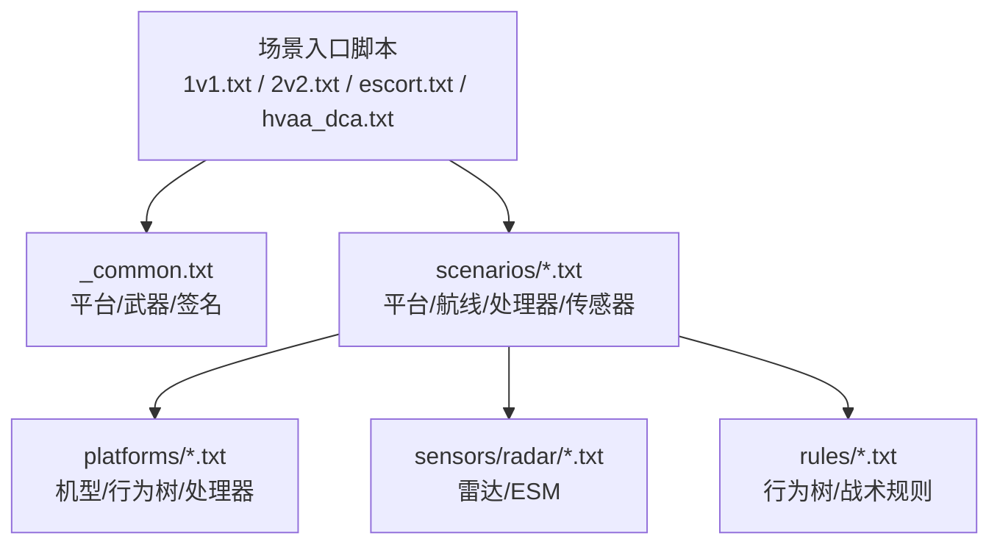
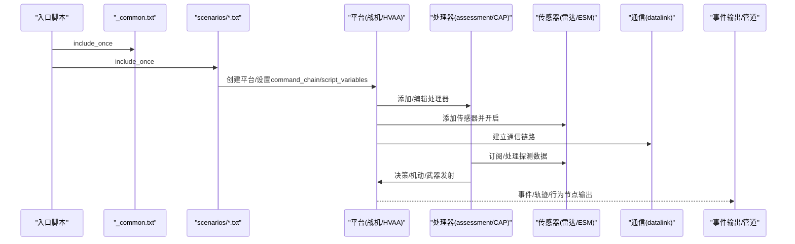
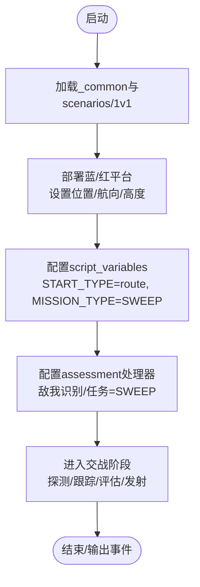
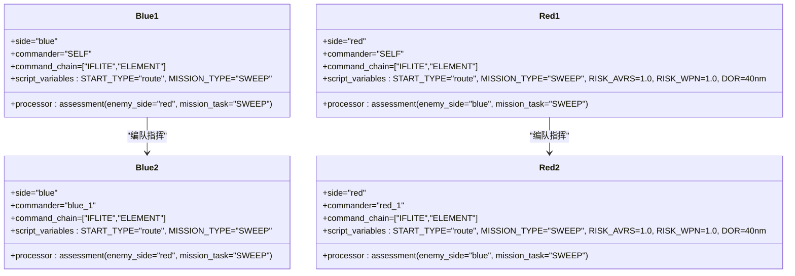
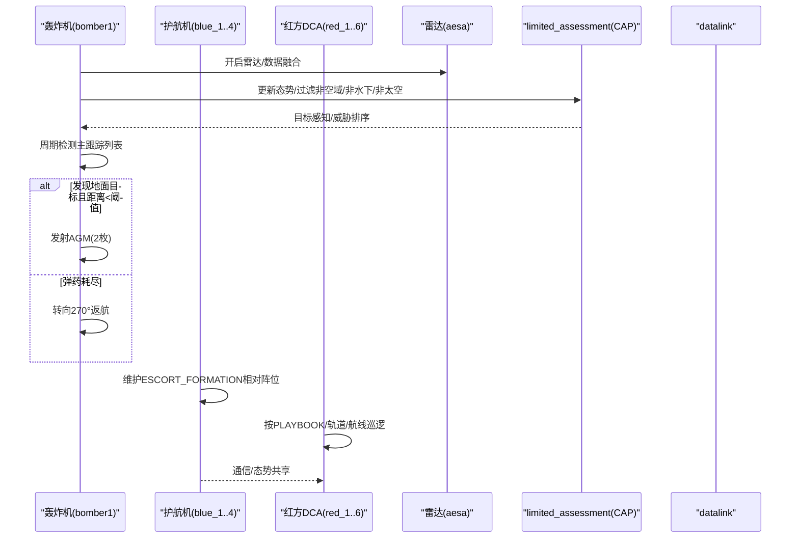
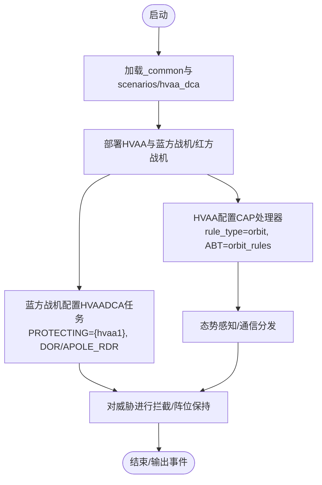
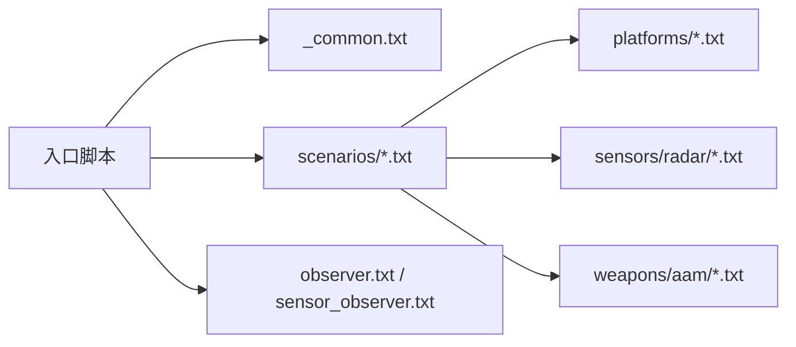

# 场景示例详解

<cite>
**本文引用的文件**   
- [air_to_air/README.md](file://demos/air_to_air/README.md)
- [air_to_air/_common.txt](file://demos/air_to_air/_common.txt)
- [air_to_air/1v1.txt](file://demos/air_to_air/1v1.txt)
- [air_to_air/2v2.txt](file://demos/air_to_air/2v2.txt)
- [air_to_air/escort.txt](file://demos/air_to_air/escort.txt)
- [air_to_air/hvaa_dca.txt](file://demos/air_to_air/hvaa_dca.txt)
- [air_to_air/scenarios/1v1.txt](file://demos/air_to_air/scenarios/1v1.txt)
- [air_to_air/scenarios/2v2.txt](file://demos/air_to_air/scenarios/2v2.txt)
- [air_to_air/scenarios/escort.txt](file://demos/air_to_air/scenarios/escort.txt)
- [air_to_air/scenarios/hvaa_dca.txt](file://demos/air_to_air/scenarios/hvaa_dca.txt)
- [air_to_air/platforms/lte_fighter.txt](file://demos/air_to_air/platforms/lte_fighter.txt)
- [air_to_air/platforms/hvaa.txt](file://demos/air_to_air/platforms/hvaa.txt)
- [air_to_air/platforms/escort.txt](file://demos/air_to_air/platforms/escort.txt)
- [air_to_air/platforms/dca.txt](file://demos/air_to_air/platforms/dca.txt)
- [air_to_air/sensors/radar/aesa.txt](file://demos/air_to_air/sensors/radar/aesa.txt)
- [air_to_air/observer.txt](file://demos/air_to_air/observer.txt)
- [air_to_air/sensor_observer.txt](file://demos/air_to_air/sensor_observer.txt)
</cite>

## 目录
1. [引言](#引言)
2. [项目结构](#项目结构)
3. [核心组件](#核心组件)
4. [架构总览](#架构总览)
5. [详细场景分析](#详细场景分析)
6. [依赖关系分析](#依赖关系分析)
7. [性能与可观测性](#性能与可观测性)
8. [参数调整与扩展开发指南](#参数调整与扩展开发指南)
9. [故障排查](#故障排查)
10. [结论](#结论)

## 引言
本文件聚焦 AFSIM 空对空对抗的典型场景示例，系统解读以下作战模式：
- 1v1 单对单对抗
- 2v2 编队对抗
- 护航（Escort）
- 高价值航空器（HVAA）防御（DCA）

文档从场景初始化、平台部署、任务分配与执行流程入手，结合源码级引用，给出参数调整与扩展开发的实用指导。

## 项目结构
air_to_air 演示集围绕“场景入口 + 公共配置 + 具体场景”组织：
- 顶层入口脚本：1v1.txt / 2v2.txt / escort.txt / hvaa_dca.txt
- 公共配置：_common.txt（平台类型、武器、签名等）
- 场景定义：scenarios/*.txt（平台、航线、处理器、传感器等）
- 平台/传感器/武器/规则等复用资源：platforms/, sensors/, weapons/, rules/

图表来源
- [air_to_air/1v1.txt:10-22](file://demos/air_to_air/1v1.txt#L10-L22)
- [air_to_air/_common.txt:13-27](file://demos/air_to_air/_common.txt#L13-L27)
- [air_to_air/scenarios/1v1.txt:10-15](file://demos/air_to_air/scenarios/1v1.txt#L10-L15)

章节来源
- [air_to_air/README.md:3-27](file://demos/air_to_air/README.md#L3-L27)
- [air_to_air/_common.txt:13-27](file://demos/air_to_air/_common.txt#L13-L27)

## 核心组件
- 场景入口脚本：负责选择 SCNRIO、包含公共配置与具体场景、设置日志与事件输出、随机种子、DIS 接口开关等。
- 公共配置 _common.txt：统一引入平台类型（Brawler/LTE_FIGHTER/HVAA）、短距红外导弹、基础雷达签名等。
- 场景定义 scenarios/*.txt：定义平台、command_chain、script_variables、处理器（assessment/CAP）、传感器、通信链路、武器、航线等。
- 观察者与数据输出：observer.txt 与 sensor_observer.txt 生成 Brawler 风格 log/iout 与传感器相关输出。

章节来源
- [air_to_air/1v1.txt:10-54](file://demos/air_to_air/1v1.txt#L10-L54)
- [air_to_air/_common.txt:13-27](file://demos/air_to_air/_common.txt#L13-L27)
- [air_to_air/observer.txt](file://demos/air_to_air/observer.txt)
- [air_to_air/sensor_observer.txt](file://demos/air_to_air/sensor_observer.txt)

## 架构总览
典型运行流程如下：
- 入口脚本加载公共配置与具体场景
- 场景内平台按 command_chain 形成指挥链（IFLITE/ELEMENT/BOMBER 等）
- 每个平台挂载处理器（如 WSF_SA_PROCESSOR assessment/CAP），驱动行为树与战术决策
- 平台通过通信链路（datalink）共享态势与指令
- 传感器探测目标，处理器融合跟踪并驱动武器发射
- 事件管道与事件输出记录关键交互

图表来源
- [air_to_air/1v1.txt:20-54](file://demos/air_to_air/1v1.txt#L20-L54)
- [air_to_air/scenarios/1v1.txt:22-59](file://demos/air_to_air/scenarios/1v1.txt#L22-L59)
- [air_to_air/scenarios/hvaa_dca.txt:46-112](file://demos/air_to_air/scenarios/hvaa_dca.txt#L46-L112)

## 详细场景分析

### 1v1 单对单对抗
- 场景入口：1v1.txt 将 SCNRIO 设为 1v1，包含 _common.txt 与 scenarios/1v1.txt，设置日志、事件管道与输出。
- 平台部署：蓝方 BLUE_FIGHTER 与红方 RED_FIGHTER，分别设置 heading、position、altitude，并通过 script_variables 指定 START_TYPE=route、MISSION_TYPE=SWEEP、ROUTE.Append("blue_route"/"red_route") 等。
- 任务分配：双方均使用 assessment 处理器，设置 enemy_side/enemy_type/friendly_type/flight_id/id_flag/mission_task=SWEEP。
- 执行流程：平台沿预设航线进入交战区，处理器根据态势进行探测、跟踪、威胁评估与武器发射。

图表来源
- [air_to_air/1v1.txt:10-54](file://demos/air_to_air/1v1.txt#L10-L54)
- [air_to_air/scenarios/1v1.txt:12-59](file://demos/air_to_air/scenarios/1v1.txt#L12-L59)

章节来源
- [air_to_air/1v1.txt:10-54](file://demos/air_to_air/1v1.txt#L10-L54)
- [air_to_air/scenarios/1v1.txt:10-96](file://demos/air_to_air/scenarios/1v1.txt#L10-L96)

### 2v2 编队对抗
- 场景入口：2v2.txt 将 SCNRIO 设为 2v2，结构与 1v1 类似。
- 平台部署：蓝方 blue_1/blue_2，红方 red_1/red_2；blue 侧两机 indestructible 便于观察；command_chain IFLITE/ELEMENT 体现编队指挥。
- 任务分配：双方均使用 assessment 处理器，设置 SWEEP 任务；红方额外设置 RISK_AVRS/RISK_WPN/DOR 等风险与交战距离参数。
- 执行流程：编队协同进入交战区，依据处理器决策进行编队机动、目标分配与武器发射。

图表来源
- [air_to_air/scenarios/2v2.txt:22-94](file://demos/air_to_air/scenarios/2v2.txt#L22-L94)
- [air_to_air/scenarios/2v2.txt:96-170](file://demos/air_to_air/scenarios/2v2.txt#L96-L170)

章节来源
- [air_to_air/2v2.txt:10-54](file://demos/air_to_air/2v2.txt#L10-L54)
- [air_to_air/scenarios/2v2.txt:10-170](file://demos/air_to_air/scenarios/2v2.txt#L10-L170)

### 护航（Escort）
- 场景入口：escort.txt 将 SCNRIO 设为 escort，并在 Windows 条件分支下启用（Linux 暂不支持）。
- 平台部署：
  - 蓝方：WSF_PLATFORM 轰炸机（bomber1）+ 4 架 ESCORT 护航机（blue_1~blue_4）
  - 红方：多架 DCA 拦截机（red_1~red_6）
- 关键配置：
  - bomber1 挂载雷达 aesa、WSF_TRACK_PROCESSOR、WSF_TASK_PROCESSOR、WSF_COMM_TRANSCEIVER，以及有限态势感知处理器 limited_assessment（WSF_SA_PROCESSOR），用于对地目标探测与武器投放。
  - 护航机通过 script_variables 设置 FORM_FLY_CHAIN、VECTOR_FORMATION、ESCORT_FORMATION、COMMIT_RNG 等，实现编队飞行与对保护实体（PE）的护航阵位控制。
  - 红方 DCA 机设置 home_base、PLAYBOOK、START_TYPE=orbit/route 等，执行巡逻/轨道任务。
- 执行流程：
  - 轰炸机沿航线飞行，周期性扫描主跟踪列表，发现地面目标且距离满足条件时发射 AGM；弹药耗尽后转向返航。
  - 护航机在保护实体周围保持相对偏移，并对潜在威胁进行“僵硬手臂”逻辑限制（避免误入己方扇区）。
  - 红方 DCA 机根据任务与航线对蓝方编队实施拦截。

图表来源
- [air_to_air/scenarios/escort.txt:37-176](file://demos/air_to_air/scenarios/escort.txt#L37-L176)
- [air_to_air/scenarios/escort.txt:178-327](file://demos/air_to_air/scenarios/escort.txt#L178-L327)
- [air_to_air/scenarios/escort.txt:339-521](file://demos/air_to_air/scenarios/escort.txt#L339-L521)

章节来源
- [air_to_air/escort.txt:14-64](file://demos/air_to_air/escort.txt#L14-L64)
- [air_to_air/scenarios/escort.txt:10-521](file://demos/air_to_air/scenarios/escort.txt#L10-L521)

### 高价值航空器（HVAA）防御（DCA）
- 场景入口：hvaa_dca.txt 将 SCNRIO 设为 hvaa_dca。
- 平台部署：
  - 蓝方：1 架 HVAA（hvaa1）+ 4 架 BLUE_FIGHTER 护航战斗机（blue_1~blue_4）
  - 红方：6 架 RED_FIGHTER（red_1~red_6）
- 关键配置：
  - HVAA 删除默认 assessment，新增 CAP 处理器（WSF_SA_PROCESSOR），设置 rule_type="orbit"，并绑定 advanced_behavior_tree orbit_rules，使其以轨道模式维持态势感知与指挥。
  - 蓝方战斗机 MISSION_TYPE="HVAADCA"，PROTECTING={"hvaa1"}，设置 DOR/APOLE_RDR 等参数，执行对 HVAA 的防空巡逻。
  - 红方战斗机设置 PLAYBOOK、PRE_PLAN、SHOT_DOC/FWD_PASS 等变量，执行进攻任务。
- 执行流程：
  - HVAA 作为空中指挥节点，持续感知空域并分发态势给友军。
  - 蓝方战斗机围绕 HVAA 保持阵位，对入侵威胁进行拦截。
  - 红方战斗机按剧本接近并尝试攻击 HVAA 或蓝方编队。

图表来源
- [air_to_air/scenarios/hvaa_dca.txt:25-114](file://demos/air_to_air/scenarios/hvaa_dca.txt#L25-L114)
- [air_to_air/scenarios/hvaa_dca.txt:116-264](file://demos/air_to_air/scenarios/hvaa_dca.txt#L116-L264)
- [air_to_air/scenarios/hvaa_dca.txt:266-451](file://demos/air_to_air/scenarios/hvaa_dca.txt#L266-L451)

章节来源
- [air_to_air/hvaa_dca.txt:14-58](file://demos/air_to_air/hvaa_dca.txt#L14-L58)
- [air_to_air/scenarios/hvaa_dca.txt:10-451](file://demos/air_to_air/scenarios/hvaa_dca.txt#L10-L451)

## 依赖关系分析
- 入口脚本依赖 _common.txt 与 scenarios/*.txt
- scenarios/*.txt 依赖 platforms/*.txt（机型/处理器/行为树）、sensors/radar/*.txt（雷达/ESM）、weapons/aam/*.txt（空空导弹）
- observer.txt 与 sensor_observer.txt 提供标准输出与传感器观测能力

图表来源
- [air_to_air/1v1.txt:20-54](file://demos/air_to_air/1v1.txt#L20-L54)
- [air_to_air/_common.txt:13-27](file://demos/air_to_air/_common.txt#L13-L27)

章节来源
- [air_to_air/1v1.txt:20-54](file://demos/air_to_air/1v1.txt#L20-L54)
- [air_to_air/_common.txt:13-27](file://demos/air_to_air/_common.txt#L13-L27)

## 性能与可观测性
- 事件管道与事件输出：各入口脚本均启用 event_pipe（AIRCOMBAT/TRACK_UPDATE/BEHAVIOR_TOOL）与 event_output（可选各类事件），便于回放与分析。
- 日志与 Brawler 风格输出：通过 observer.txt 与 sensor_observer.txt 生成 log/iout 文件，可通过脚本变量 log_print/iout_print 控制。
- DIS 接口：入口脚本中提供 dis_interface 注释段，可按需开启并抑制部分数据以减少回放文件大小。

章节来源
- [air_to_air/1v1.txt:67-97](file://demos/air_to_air/1v1.txt#L67-L97)
- [air_to_air/2v2.txt:67-97](file://demos/air_to_air/2v2.txt#L67-L97)
- [air_to_air/escort.txt:77-107](file://demos/air_to_air/escort.txt#L77-L107)
- [air_to_air/hvaa_dca.txt:71-101](file://demos/air_to_air/hvaa_dca.txt#L71-L101)

## 参数调整与扩展开发指南
- 切换场景：修改入口脚本中的 define_path_variable SCNRIO，选择 1v1/2v2/escort/hvaa_dca。
- 平台与编队：
  - 在 scenarios/*.txt 中添加/删除 platform，设置 side/commander/command_chain/script_variables。
  - 通过 edit processor assessment 或 add processor CAP 配置态势感知与行为树。
- 传感器与通信：
  - 在平台下 add sensor 与 add comm datalink，设置 internal_link 与 propagation_speed。
  - 在 HVAA 场景中可使用 datalink2 分离通信网络。
- 武器与弹药：
  - 通过 edit weapon fox3/fox2/fox1 quantity 调整载弹量；在护航场景中为轰炸机添加 agm 武器。
- 行为树与战术规则：
  - 在处理器中绑定 advanced_behavior_tree behavior_node（如 orbit_rules），或在 assessment 处理器中通过 script_variables 控制规则类型。
- 输出与调试：
  - 调整 event_pipe/event_output 启用/禁用事件类别；通过 observer.txt/sensor_observer.txt 控制 log/iout 输出。
  - 使用 random_seed 固定随机数以便复现实验。

章节来源
- [air_to_air/1v1.txt:10-54](file://demos/air_to_air/1v1.txt#L10-L54)
- [air_to_air/scenarios/hvaa_dca.txt:46-112](file://demos/air_to_air/scenarios/hvaa_dca.txt#L46-L112)
- [air_to_air/scenarios/escort.txt:56-176](file://demos/air_to_air/scenarios/escort.txt#L56-L176)

## 故障排查
- 护航场景在 Linux 上不可用：入口脚本中使用 conditional_section 与 feature_present os:windows 限定平台，需在 Windows 环境运行。
- 重复运行结果不一致：护航与 HVAA 场景明确提示不保证相同随机种子下的确定性输出，不适合回归测试。
- 传感器输出错误：入口脚本中 sensor_print 默认为 false，若开启可能引发错误，建议保持关闭。
- 事件文件过大：可在 dis_interface 中 suppress_comm_data/suppress_emissions_data/suppress_non_standard_data 减少回放体积。

章节来源
- [air_to_air/escort.txt:24-31](file://demos/air_to_air/escort.txt#L24-L31)
- [air_to_air/escort.txt:9-12](file://demos/air_to_air/escort.txt#L9-L12)
- [air_to_air/hvaa_dca.txt:9-12](file://demos/air_to_air/hvaa_dca.txt#L9-L12)
- [air_to_air/1v1.txt:26-43](file://demos/air_to_air/1v1.txt#L26-L43)
- [air_to_air/1v1.txt:58-65](file://demos/air_to_air/1v1.txt#L58-L65)

## 结论
AFSIM air_to_air 演示集通过统一的入口脚本与模块化场景定义，清晰展示了 1v1、2v2、护航与 HVAA 防御四类典型空对空对抗模式。借助处理器（assessment/CAP）、行为树（ABT）、传感器与通信链路，平台能够完成态势感知、任务规划、编队机动与武器发射。用户可通过调整入口脚本与场景定义快速扩展新场景，并结合事件管道与日志输出进行调试与分析。