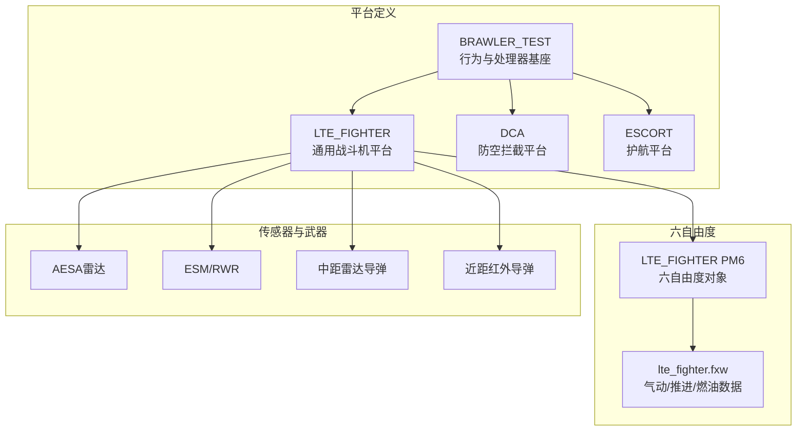
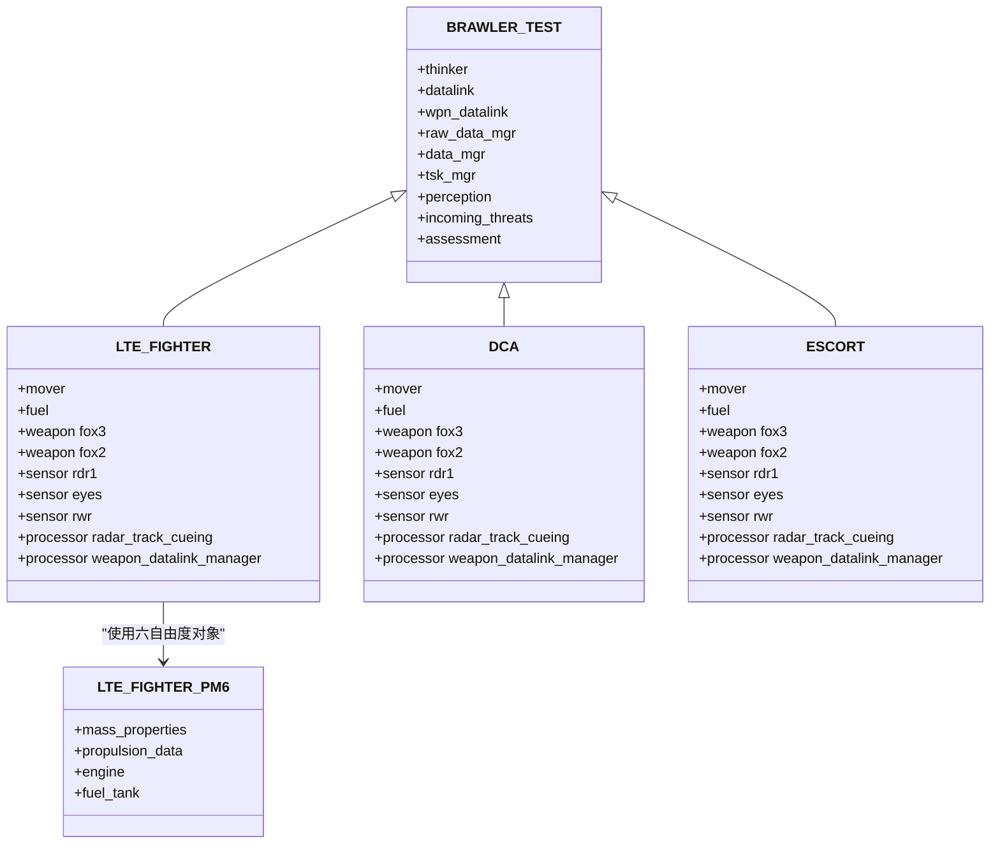
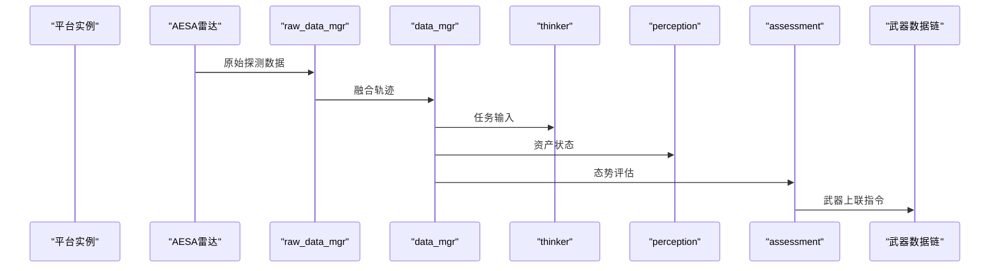
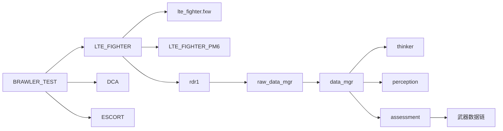

# 平台配置详解

<cite>
**本文引用的文件**   
- [demos/air_to_air/platforms/lte_fighter.txt](file://demos/air_to_air/platforms/lte_fighter.txt)
- [demos/air_to_air/platforms/dca.txt](file://demos/air_to_air/platforms/dca.txt)
- [demos/air_to_air/platforms/escort.txt](file://demos/air_to_air/platforms/escort.txt)
- [demos/air_to_air/platforms/lte_fighter_six_dof.txt](file://demos/air_to_air/platforms/lte_fighter_six_dof.txt)
- [demos/air_to_air/six_dof_types/aircraft/LTE_FIGHTER/LTE_FIGHTER.txt](file://demos/air_to_air/six_dof_types/aircraft/LTE_FIGHTER/LTE_FIGHTER.txt)
- [demos/air_to_air/platforms/brawler_test.txt](file://demos/air_to_air/platforms/brawler_test.txt)
- [demos/air_to_air/platforms/fxw/lte_fighter.fxw](file://demos/air_to_air/platforms/fxw/lte_fighter.fxw)
- [swdev/src/warlock/plugins/SixDOF_Data/source/SixDOF_DataSimInterface.cpp](file://swdev/src/warlock/plugins/SixDOF_Data/source/SixDOF_DataSimInterface.cpp)
</cite>

## 目录
1. [引言](#引言)
2. [项目结构](#项目结构)
3. [核心组件](#核心组件)
4. [架构总览](#架构总览)
5. [详细组件分析](#详细组件分析)
6. [依赖关系分析](#依赖关系分析)
7. [性能与调优](#性能与调优)
8. [故障排查指南](#故障排查指南)
9. [结论](#结论)
10. [附录：六自由度气动数据与参数说明](#附录六自由度气动数据与参数说明)

## 引言
本文件面向空中对抗场景中的战斗机平台配置，系统解析 LTE_FIGHTER、DCA、Escort 等型号的属性定义、运动模型、燃油系统、挂载配置，以及六自由度飞行模型的参数设置与气动数据。同时给出平台间通信关系、编队管理机制的说明，并提供平台参数调优与性能优化方法，以及自定义平台开发指导。

## 项目结构
围绕空中对抗平台的配置主要分布在以下位置：
- 平台类型与行为基座：brawler_test.txt
- 具体机型平台定义：lte_fighter.txt、dca.txt、escort.txt
- 六自由度飞行器对象定义：six_dof_types/aircraft/LTE_FIGHTER/LTE_FIGHTER.txt
- 气动与推进数据：platforms/fxw/lte_fighter.fxw
- 六自由度仿真接口（C++）：SixDOF_DataSimInterface.cpp

图表来源
- [demos/air_to_air/platforms/brawler_test.txt:58-88](file://demos/air_to_air/platforms/brawler_test.txt#L58-L88)
- [demos/air_to_air/platforms/lte_fighter.txt:34-123](file://demos/air_to_air/platforms/lte_fighter.txt#L34-L123)
- [demos/air_to_air/platforms/dca.txt:32-122](file://demos/air_to_air/platforms/dca.txt#L32-L122)
- [demos/air_to_air/platforms/escort.txt:32-123](file://demos/air_to_air/platforms/escort.txt#L32-L123)
- [demos/air_to_air/six_dof_types/aircraft/LTE_FIGHTER/LTE_FIGHTER.txt:12-42](file://demos/air_to_air/six_dof_types/aircraft/LTE_FIGHTER/LTE_FIGHTER.txt#L12-L42)
- [demos/air_to_air/platforms/fxw/lte_fighter.fxw:10-36](file://demos/air_to_air/platforms/fxw/lte_fighter.fxw#L10-L36)

章节来源
- [demos/air_to_air/platforms/brawler_test.txt:58-88](file://demos/air_to_air/platforms/brawler_test.txt#L58-L88)
- [demos/air_to_air/platforms/lte_fighter.txt:34-123](file://demos/air_to_air/platforms/lte_fighter.txt#L34-L123)
- [demos/air_to_air/platforms/dca.txt:32-122](file://demos/air_to_air/platforms/dca.txt#L32-L122)
- [demos/air_to_air/platforms/escort.txt:32-123](file://demos/air_to_air/platforms/escort.txt#L32-L123)
- [demos/air_to_air/six_dof_types/aircraft/LTE_FIGHTER/LTE_FIGHTER.txt:12-42](file://demos/air_to_air/six_dof_types/aircraft/LTE_FIGHTER/LTE_FIGHTER.txt#L12-L42)
- [demos/air_to_air/platforms/fxw/lte_fighter.fxw:10-36](file://demos/air_to_air/platforms/fxw/lte_fighter.fxw#L10-L36)

## 核心组件
- 平台类型与基座
  - BRAWLER_TEST：提供行为树、感知、威胁处理、任务管理、数据融合与通信链路等基础能力。
  - LTE_FIGHTER：在 BRAWLER_TEST 基础上扩展传感器、武器、燃油与运动模型，支持点质量与六自由度两种 mover。
  - DCA/ESCORT：基于 BRAWLER_TEST 的任务型平台，侧重防空与护航逻辑，挂载与传感器配置略有差异。

- 运动模型
  - WSF_BRAWLER_MOVER：用于高机动空战的行为驱动运动模型，结合 aero_file 提供气动与燃油耦合。
  - WSF_POINT_MASS_SIX_DOF_MOVER：六自由度点质量模型，vehicle_type 指向 LTE_FIGHTER_PM6，更新间隔可配置。

- 燃油系统
  - WSF_BRAWLER_FUEL：与 aero_file 联动，支持初始油量比例或绝对量设定。
  - 六自由度推进数据：包含发动机、油箱容量、最大流量/填充/转输速率等。

- 传感器与处理器
  - AESA 雷达、几何传感器、ESM/RWR。
  - 雷达跟踪提示处理器、武器数据链管理器、态势评估处理器等。

- 武器挂载
  - 中距雷达导弹（fox3）、近距红外导弹（fox2/fox1），可按平台类型调整数量。

章节来源
- [demos/air_to_air/platforms/brawler_test.txt:75-164](file://demos/air_to_air/platforms/brawler_test.txt#L75-L164)
- [demos/air_to_air/platforms/lte_fighter.txt:42-71](file://demos/air_to_air/platforms/lte_fighter.txt#L42-L71)
- [demos/air_to_air/platforms/lte_fighter.txt:266-269](file://demos/air_to_air/platforms/lte_fighter.txt#L266-L269)
- [demos/air_to_air/platforms/lte_fighter.txt:47-50](file://demos/air_to_air/platforms/lte_fighter.txt#L47-L50)
- [demos/air_to_air/six_dof_types/aircraft/LTE_FIGHTER/LTE_FIGHTER.txt:24-38](file://demos/air_to_air/six_dof_types/aircraft/LTE_FIGHTER/LTE_FIGHTER.txt#L24-L38)

## 架构总览
下图展示平台类型继承与关键子系统之间的关系：

图表来源
- [demos/air_to_air/platforms/brawler_test.txt:58-164](file://demos/air_to_air/platforms/brawler_test.txt#L58-L164)
- [demos/air_to_air/platforms/lte_fighter.txt:34-123](file://demos/air_to_air/platforms/lte_fighter.txt#L34-L123)
- [demos/air_to_air/platforms/dca.txt:32-122](file://demos/air_to_air/platforms/dca.txt#L32-L122)
- [demos/air_to_air/platforms/escort.txt:32-123](file://demos/air_to_air/platforms/escort.txt#L32-L123)
- [demos/air_to_air/six_dof_types/aircraft/LTE_FIGHTER/LTE_FIGHTER.txt:12-42](file://demos/air_to_air/six_dof_types/aircraft/LTE_FIGHTER/LTE_FIGHTER.txt#L12-L42)

## 详细组件分析

### LTE_FIGHTER 平台
- 属性与继承
  - 基于 BRAWLER_TEST，具备完整的行为树、感知、威胁处理、任务管理与通信链路。
  - 图标与侧别通过 platform_type 子类 BLUE_FIGHTER/RED_FIGHTER 区分。
- 运动模型
  - 默认使用 WSF_BRAWLER_MOVER，引用 aero_file platforms/fxw/lte_fighter.fxw，update_time_tolerance 为 0.01 s。
  - 可选 WSF_POINT_MASS_SIX_DOF_MOVER，vehicle_type 为 LTE_FIGHTER_PM6，update_interval 为 0.05 sec。
- 燃油系统
  - WSF_BRAWLER_FUEL 引用同一 aero_file，initial_quantity_ratio 为 1.0。
  - 六自由度推进数据包含主油箱容量、最大流量/填充/转输速率等。
- 传感器与处理器
  - AESA 雷达 rdr1，开启并连接 raw_data_mgr 与 data_mgr。
  - 几何传感器 eyes，FOV 覆盖全向，报告位置、速度、距离、方位、俯仰、IFF。
  - ESM/RWR rwr，忽略同侧目标，连接 raw_data_mgr 与 data_mgr。
  - 雷达跟踪提示处理器将源传感器设为“*”，引导至 rdr1 的 TWS 模式。
  - 武器数据链管理器将上链接入 rdr1。
- 武器挂载
  - fox3（中距雷达导弹）数量 6；fox2（近距红外导弹）数量 2；fox1 与 agm 数量为 0。
- 通信
  - 武器数据链 comm weapon_datalink 使用网络 weapons_subnet，内部链接 data_mgr。

章节来源
- [demos/air_to_air/platforms/lte_fighter.txt:34-123](file://demos/air_to_air/platforms/lte_fighter.txt#L34-L123)
- [demos/air_to_air/platforms/lte_fighter.txt:125-147](file://demos/air_to_air/platforms/lte_fighter.txt#L125-L147)
- [demos/air_to_air/platforms/lte_fighter.txt:260-348](file://demos/air_to_air/platforms/lte_fighter.txt#L260-L348)
- [demos/air_to_air/platforms/lte_fighter.txt:350-369](file://demos/air_to_air/platforms/lte_fighter.txt#L350-L369)

### DCA 平台（防空拦截）
- 属性与继承
  - 基于 BRAWLER_TEST，侧重防空拦截任务。
- 运动模型与燃油
  - 使用 WSF_BRAWLER_MOVER，aero_file 同上；燃油初始量为 20000 pounds。
- 传感器与处理器
  - 与 LTE_FIGHTER 类似，但几何传感器帧时间 2 sec，误差略大。
- 武器挂载
  - fox3 数量 4；fox2 数量 2；fox1 与 agm 数量为 0。
- 通信
  - 武器数据链与数据链网络与 LTE_FIGHTER 一致。

章节来源
- [demos/air_to_air/platforms/dca.txt:32-122](file://demos/air_to_air/platforms/dca.txt#L32-L122)

### ESCORT 平台（护航）
- 属性与继承
  - 基于 BRAWLER_TEST，标记 indestructible，强调护航角色。
- 运动模型与燃油
  - 使用 WSF_BRAWLER_MOVER，燃油初始比例为 1.0。
- 传感器与处理器
  - 几何传感器帧时间 0.025 sec，更频繁的报告以支持护航态势。
- 武器挂载
  - fox3 数量 4；fox2 数量 2；fox1 与 agm 数量为 0。
- 通信
  - 武器数据链与数据链网络与 LTE_FIGHTER 一致。

章节来源
- [demos/air_to_air/platforms/escort.txt:32-123](file://demos/air_to_air/platforms/escort.txt#L32-L123)

### 六自由度飞行器对象 LTE_FIGHTER_PM6
- 对象类型
  - point_mass_vehicle_type LTE_FIGHTER_PM6 BASE_TYPE。
- 质量与推进
  - 质量约 36110 lbs。
  - 发动机 Engine LTE_FIGHTER_Eng_PM6，燃料来自 MainFuelTank。
  - 主油箱最大容量 20718 lbs，当前满油，最大流量/填充/转输速率均为 10000 lbs/sec。
- 控制与气动
  - 引入 aero/aero_pm6.txt、controls/control_inputs_pm6.txt、controls/flight_controls_pm6.txt。

章节来源
- [demos/air_to_air/six_dof_types/aircraft/LTE_FIGHTER/LTE_FIGHTER.txt:12-42](file://demos/air_to_air/six_dof_types/aircraft/LTE_FIGHTER/LTE_FIGHTER.txt#L12-L42)

### 平台间通信与编队管理
- 通信链路
  - datalink：brawler_net，瞬时传播（propagation_speed 0 m/s），连接 data_mgr、tsk_mgr、thinker、perception、assessment。
  - wpn_datalink：weapons_subnet，瞬时传播，连接 data_mgr、raw_data_mgr，用于武器上联。
- 数据处理
  - raw_data_mgr：非主轨迹处理器，加权平均融合，定期清理与报告。
  - data_mgr：主轨迹处理器，输出融合轨迹，上报给 commander、peers、subordinates，并通过 wpn_datalink 上联武器。
- 行为与任务
  - thinker：行为树入口，mind_file 指定行为脚本。
  - perception：资产感知，威胁更新间隔与负载限制可配置。
  - assessment：态势评估，包含敌我识别、风险计算、武器支援等脚本。
  - tsk_mgr：任务处理器，接收 data_mgr 输出。

图表来源
- [demos/air_to_air/platforms/brawler_test.txt:80-132](file://demos/air_to_air/platforms/brawler_test.txt#L80-L132)
- [demos/air_to_air/platforms/brawler_test.txt:139-164](file://demos/air_to_air/platforms/brawler_test.txt#L139-L164)
- [demos/air_to_air/platforms/brawler_test.txt:166-280](file://demos/air_to_air/platforms/brawler_test.txt#L166-L280)

章节来源
- [demos/air_to_air/platforms/brawler_test.txt:80-132](file://demos/air_to_air/platforms/brawler_test.txt#L80-L132)
- [demos/air_to_air/platforms/brawler_test.txt:139-164](file://demos/air_to_air/platforms/brawler_test.txt#L139-L164)
- [demos/air_to_air/platforms/brawler_test.txt:166-280](file://demos/air_to_air/platforms/brawler_test.txt#L166-L280)

## 依赖关系分析
- 平台类型依赖
  - LTE_FIGHTER/DCA/ESCORT 均依赖 BRAWLER_TEST 提供的行为、感知、任务与通信能力。
- 运动模型依赖
  - WSF_BRAWLER_MOVER 依赖 aero_file（lte_fighter.fxw）。
  - WSF_POINT_MASS_SIX_DOF_MOVER 依赖 vehicle_type（LTE_FIGHTER_PM6），后者再依赖 aero_pm6.txt 与控制输入文件。
- 传感器与处理器依赖
  - 雷达 rdr1 与几何传感器 eyes 输出到 raw_data_mgr 与 data_mgr。
  - 雷达跟踪提示处理器将源传感器通配符“*”映射到 rdr1。
- 武器与数据链依赖
  - 武器数据链管理器将上链接入 rdr1，供武器选择与发射决策使用。

图表来源
- [demos/air_to_air/platforms/brawler_test.txt:58-164](file://demos/air_to_air/platforms/brawler_test.txt#L58-L164)
- [demos/air_to_air/platforms/lte_fighter.txt:34-123](file://demos/air_to_air/platforms/lte_fighter.txt#L34-L123)
- [demos/air_to_air/platforms/lte_fighter.txt:266-269](file://demos/air_to_air/platforms/lte_fighter.txt#L266-L269)
- [demos/air_to_air/six_dof_types/aircraft/LTE_FIGHTER/LTE_FIGHTER.txt:12-42](file://demos/air_to_air/six_dof_types/aircraft/LTE_FIGHTER/LTE_FIGHTER.txt#L12-L42)

章节来源
- [demos/air_to_air/platforms/brawler_test.txt:58-164](file://demos/air_to_air/platforms/brawler_test.txt#L58-L164)
- [demos/air_to_air/platforms/lte_fighter.txt:34-123](file://demos/air_to_air/platforms/lte_fighter.txt#L34-L123)
- [demos/air_to_air/platforms/lte_fighter.txt:266-269](file://demos/air_to_air/platforms/lte_fighter.txt#L266-L269)
- [demos/air_to_air/six_dof_types/aircraft/LTE_FIGHTER/LTE_FIGHTER.txt:12-42](file://demos/air_to_air/six_dof_types/aircraft/LTE_FIGHTER/LTE_FIGHTER.txt#L12-L42)

## 性能与调优
- 运动模型更新频率
  - WSF_BRAWLER_MOVER 的 update_time_tolerance 建议保持较小值（如 0.01 s）以提升响应精度。
  - WSF_POINT_MASS_SIX_DOF_MOVER 的 update_interval 可根据仿真步长与精度需求调整（示例为 0.05 sec）。
- 传感器报告频率
  - 几何传感器的 frame_time 影响态势更新速度与计算开销，护航场景可采用更高频（如 0.025 sec）。
- 数据融合与报告间隔
  - raw_data_mgr 与 data_mgr 的 purge_interval、report_interval 需平衡实时性与内存占用。
- 行为树与感知更新
  - thinker 的 consciousness_event_update_time 与 perception 的 threat_update_interval 影响决策延迟。
- 六自由度事件输出频率
  - 可通过 mover 的事件核心/运动/引擎/自动驾驶/控制输入/力矩数据频率进行细化（参考注释示例）。

章节来源
- [demos/air_to_air/platforms/lte_fighter.txt:42-45](file://demos/air_to_air/platforms/lte_fighter.txt#L42-L45)
- [demos/air_to_air/platforms/lte_fighter.txt:266-269](file://demos/air_to_air/platforms/lte_fighter.txt#L266-L269)
- [demos/air_to_air/platforms/escort.txt:76-93](file://demos/air_to_air/platforms/escort.txt#L76-L93)
- [demos/air_to_air/platforms/brawler_test.txt:75-164](file://demos/air_to_air/platforms/brawler_test.txt#L75-L164)
- [demos/air_to_air/six_dof_types/aircraft/LTE_FIGHTER/LTE_FIGHTER.txt:44-65](file://demos/air_to_air/six_dof_types/aircraft/LTE_FIGHTER/LTE_FIGHTER.txt#L44-L65)

## 故障排查指南
- 传感器无输出
  - 检查 sensor rdr1/eyes/rwr 是否 on，internal_link 是否正确连接到 raw_data_mgr 与 data_mgr。
  - 确认 radar_track_cueing 的 mSourceSensorNames 与 mCuedSensorName 配置正确。
- 武器无法上联
  - 检查 weapon_datalink_manager 的 mUplinkSensorNames 是否包含 rdr1。
  - 确认 comm weapon_datalink 的网络名称与 internal_link 配置。
- 燃油异常
  - 核对 fuel WSF_BRAWLER_FUEL 的 initial_quantity_ratio 或 initial_quantity 是否与预期一致。
  - 六自由度模式下检查 propulsion_data 的 engine 与 fuel_tank 参数。
- 六自由度仿真无事件
  - 检查 mover 的事件输出频率配置（event_core_data、event_kinematic_data 等）。
  - 确认 SixDOF_DataSimInterface 能正确读取 mover 的状态并生成事件。

章节来源
- [demos/air_to_air/platforms/lte_fighter.txt:73-123](file://demos/air_to_air/platforms/lte_fighter.txt#L73-L123)
- [demos/air_to_air/platforms/lte_fighter.txt:47-50](file://demos/air_to_air/platforms/lte_fighter.txt#L47-L50)
- [demos/air_to_air/six_dof_types/aircraft/LTE_FIGHTER/LTE_FIGHTER.txt:24-38](file://demos/air_to_air/six_dof_types/aircraft/LTE_FIGHTER/LTE_FIGHTER.txt#L24-L38)
- [swdev/src/warlock/plugins/SixDOF_Data/source/SixDOF_DataSimInterface.cpp:64-104](file://swdev/src/warlock/plugins/SixDOF_Data/source/SixDOF_DataSimInterface.cpp#L64-L104)

## 结论
通过对 LTE_FIGHTER、DCA、ESCORT 等平台配置的深入解析，可以看到 AFSIM 在空战场景中提供了高度模块化的平台定义方式：以 BRAWLER_TEST 为基座，叠加传感器、武器、燃油与运动模型，既支持高响应的行为驱动空战，也支持精细的六自由度仿真。平台间通过 datalink 与 wpn_datalink 实现态势共享与武器上联，配合数据融合与行为树，形成完整的编队与战术执行体系。在实际应用中，应依据任务需求合理配置传感器报告频率、数据融合策略与行为树更新间隔，并在六自由度模式下校准气动与推进数据以获得更真实的飞行特性。

## 附录：六自由度气动数据与参数说明
- 气动数据组织
  - 核心气动数据（aero_data）与非控制面数据分离，控制面气动由 aero_component 单独定义。
  - 几何参数可选择机翼基准（wing_chord_ft、wing_span_ft、wing_area_sqft）或参考面积（ref_area_sqft）。
  - 稳定性导数表按马赫数与迎角/侧滑角函数定义，聚焦基础非控制气动。
- 推进与燃油
  - 发动机推力表（TIDLE/TMIL/THRMX）与燃油流量表（FLOIDL/FLOMIL/FLOMAX）按马赫与高度维度定义。
  - 最大过载（GCAP/GCAP2）、极限速度（CASMAX）、加力开关（ABDT）等包线参数。
- 物理与外形
  - 物理模型（PHYS_MODEL SHOEBOX）、投影面积（PAREA）、体积（VAREA）、死重（DESWT）、导弹质量（MISS_MASS）等。
  - 内油箱容量（AC_FUEL_CAP）与舱门相关参数。
- 红外与雷达特征
  - IR 与 RF 签名表按波段、马赫、高度、方位/俯角网格化定义，便于多谱段特征建模。

章节来源
- [demos/air_to_air/platforms/fxw/lte_fighter.fxw:10-36](file://demos/air_to_air/platforms/fxw/lte_fighter.fxw#L10-L36)
- [demos/air_to_air/platforms/fxw/lte_fighter.fxw:146-361](file://demos/air_to_air/platforms/fxw/lte_fighter.fxw#L146-L361)
- [demos/air_to_air/platforms/fxw/lte_fighter.fxw:362-800](file://demos/air_to_air/platforms/fxw/lte_fighter.fxw#L362-L800)