# 战术行为规则

<cite>
**本文引用的文件**   
- [intercept_rules.txt](file://demos/air_to_air/rules/intercept_rules.txt)
- [orbit_rules.txt](file://demos/air_to_air/rules/orbit_rules.txt)
- [vectoring.txt](file://demos/air_to_air/rules/vectoring.txt)
- [route_rules.txt](file://demos/air_to_air/rules/route_rules.txt)
- [select_wpn.txt](file://demos/air_to_air/rules/select_wpn.txt)
- [shoot_it.txt](file://demos/air_to_air/rules/shoot_it.txt)
- [ftr_rules.txt](file://demos/air_to_air/rules/ftr_rules.txt)
- [README.md](file://demos/behavior_tree/README.md)
- [selector_with_memory.txt](file://demos/behavior_tree/selector_with_memory.txt)
- [run_tree.txt](file://demos/behavior_tree/run_tree.txt)
</cite>

## 目录
1. [引言](#引言)
2. [项目结构](#项目结构)
3. [核心组件](#核心组件)
4. [架构总览](#架构总览)
5. [详细组件分析](#详细组件分析)
6. [依赖关系分析](#依赖关系分析)
7. [性能与可维护性](#性能与可维护性)
8. [故障排查指南](#故障排查指南)
9. [结论](#结论)
10. [附录：复杂场景行为树设计与自定义战术开发](#附录复杂场景行为树设计与自定义战术开发)

## 引言
本文件聚焦空中对抗中的战术行为规则与决策逻辑，围绕拦截(intercept)、盘旋(orbit)、矢量(vectoring)等核心机动行为，以及航路规划(route_rules)、武器选择(select_wpn)和射击(shoot_it)的规则配置进行系统化解析。同时提供面向复杂战术场景的行为树设计思路与自定义战术开发指导，帮助读者在AFSIM中构建可扩展、可配置的空中对抗AI。

## 项目结构
与空中对抗战术相关的规则脚本集中在空对空示例的rules目录下，涵盖任务阶段控制、机动策略、武器选择与发射判定；行为树示例位于behavior_tree目录，展示如何组合条件、选择器、序列等节点实现复杂决策。

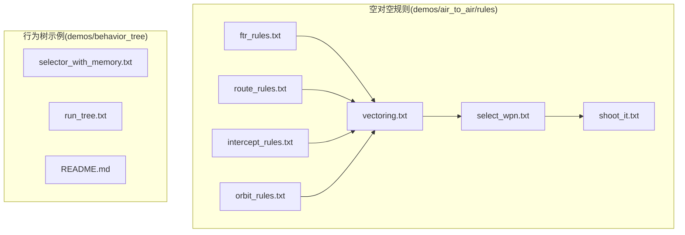

**图表来源** 
- [intercept_rules.txt:1-164](file://demos/air_to_air/rules/intercept_rules.txt#L1-L164)
- [orbit_rules.txt:1-231](file://demos/air_to_air/rules/orbit_rules.txt#L1-L231)
- [vectoring.txt:1-172](file://demos/air_to_air/rules/vectoring.txt#L1-L172)
- [route_rules.txt:1-311](file://demos/air_to_air/rules/route_rules.txt#L1-L311)
- [select_wpn.txt:1-337](file://demos/air_to_air/rules/select_wpn.txt#L1-L337)
- [shoot_it.txt:1-337](file://demos/air_to_air/rules/shoot_it.txt#L1-L337)
- [ftr_rules.txt:1-341](file://demos/air_to_air/rules/ftr_rules.txt#L1-L341)
- [selector_with_memory.txt](file://demos/behavior_tree/selector_with_memory.txt)
- [run_tree.txt](file://demos/behavior_tree/run_tree.txt)
- [README.md](file://demos/behavior_tree/README.md)

**章节来源**
- [intercept_rules.txt:1-164](file://demos/air_to_air/rules/intercept_rules.txt#L1-L164)
- [orbit_rules.txt:1-231](file://demos/air_to_air/rules/orbit_rules.txt#L1-L231)
- [vectoring.txt:1-172](file://demos/air_to_air/rules/vectoring.txt#L1-L172)
- [route_rules.txt:1-311](file://demos/air_to_air/rules/route_rules.txt#L1-L311)
- [select_wpn.txt:1-337](file://demos/air_to_air/rules/select_wpn.txt#L1-L337)
- [shoot_it.txt:1-337](file://demos/air_to_air/rules/shoot_it.txt#L1-L337)
- [ftr_rules.txt:1-341](file://demos/air_to_air/rules/ftr_rules.txt#L1-L341)

## 核心组件
- 拦截(intercept)：根据任务列表与目标轨迹计算航向，驱动编队飞向预计拦截点。
- 盘旋(orbit/CAP)：基于CAP区域或当前位置生成四点巡逻路径，按速度、过载与腿长循环飞行。
- 矢量(vectoring)：根据战术剧本与威胁态势计算期望航向、速度与过载，并在接近时决定进入合并(notch/merge)或其他战术阶段。
- 航路(route_rules)：沿WsfRoute对象逐点导航，支持编队飞行、单机矢量飞行与返航(egress)。
- 武器选择(select_wpn)：依据SHOT_DOC策略、射程与传感器支持，为每个目标分配首选武器与最大命中数。
- 射击(shoot_it)：综合WQT、SRM范围、贪婪限制、HOB角、 fratricide风险、RPEAK包络等条件决定是否开火。
- 战斗机规则(ftr_rules)：统一处理阶段切换（egress/pump/reaction等），协调编队成员相位变更。

**章节来源**
- [intercept_rules.txt:78-160](file://demos/air_to_air/rules/intercept_rules.txt#L78-L160)
- [orbit_rules.txt:80-227](file://demos/air_to_air/rules/orbit_rules.txt#L80-L227)
- [vectoring.txt:49-168](file://demos/air_to_air/rules/vectoring.txt#L49-L168)
- [route_rules.txt:94-307](file://demos/air_to_air/rules/route_rules.txt#L94-L307)
- [select_wpn.txt:84-333](file://demos/air_to_air/rules/select_wpn.txt#L84-L333)
- [shoot_it.txt:77-333](file://demos/air_to_air/rules/shoot_it.txt#L77-L333)
- [ftr_rules.txt:154-334](file://demos/air_to_air/rules/ftr_rules.txt#L154-L334)

## 架构总览
以下图展示了各行为节点之间的调用与数据流关系：ftr_rules作为阶段控制器，将平台状态与战术意图传递给vectoring；vectoring根据威胁与战术计划更新pr_heading/pr_speed/pr_altitude/pr_gees，并可能触发select_wpn与shoot_it；route_rules负责航路导航；intercept_rules与orbit_rules分别处理特定战术阶段。

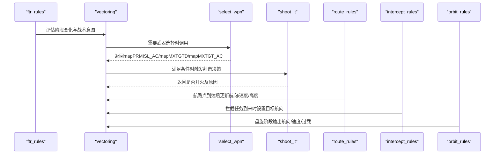

**图表来源** 
- [ftr_rules.txt:176-334](file://demos/air_to_air/rules/ftr_rules.txt#L176-L334)
- [vectoring.txt:64-168](file://demos/air_to_air/rules/vectoring.txt#L64-L168)
- [select_wpn.txt:103-333](file://demos/air_to_air/rules/select_wpn.txt#L103-L333)
- [shoot_it.txt:98-333](file://demos/air_to_air/rules/shoot_it.txt#L98-L333)
- [route_rules.txt:148-307](file://demos/air_to_air/rules/route_rules.txt#L148-L307)
- [intercept_rules.txt:101-160](file://demos/air_to_air/rules/intercept_rules.txt#L101-L160)
- [orbit_rules.txt:178-227](file://demos/air_to_air/rules/orbit_rules.txt#L178-L227)

## 详细组件分析

### 拦截(intercept)
- 目的：对已接收的INTERCEPT任务执行拦截，计算目标航向并驱动编队飞向拦截点。
- 关键逻辑：
  - 检查处理器类型与rule_type是否为“intercept”。
  - 遍历任务列表，找到有效目标轨迹，若目标失效则完成任务并取消。
  - 计算TrueBearingTo目标，设置pr_heading，并以COMMIT_SPD与COMMIT_ALT驱动编队飞行。
  - 支持燃油耗尽(bng_fuel)时的返航(egress)逻辑。
- 复杂度：线性遍历任务列表，O(N)，N为任务数量。

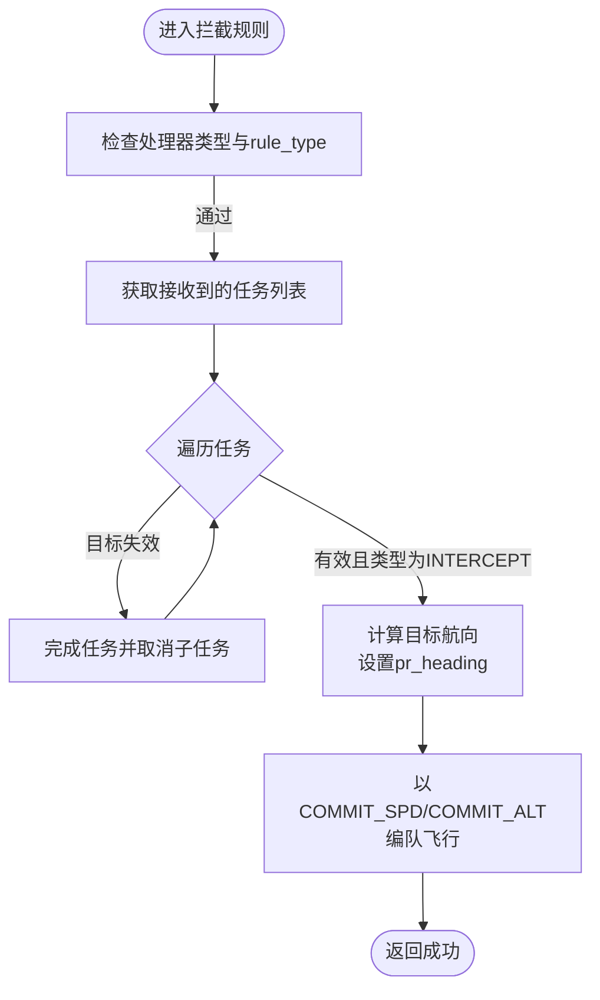

**图表来源** 
- [intercept_rules.txt:78-160](file://demos/air_to_air/rules/intercept_rules.txt#L78-L160)

**章节来源**
- [intercept_rules.txt:78-160](file://demos/air_to_air/rules/intercept_rules.txt#L78-L160)

### 盘旋(orbit/CAP)
- 目的：创建CAP巡逻区，按四点路径循环飞行，支持基于cap_zone的中心定位。
- 关键逻辑：
  - on_init/on_new_execute中根据cap_zone或当前位置生成CAP1-CAP4四点。
  - 使用orbit_leg_length、orbit_spd、orbit_gees参数控制腿长、速度与过载。
  - 当接近当前CAP点时递增索引，形成闭环巡逻。
  - 支持bng_fuel时的返航(egress)逻辑。
- 复杂度：每帧计算四个点的相对位置与距离，O(1)。

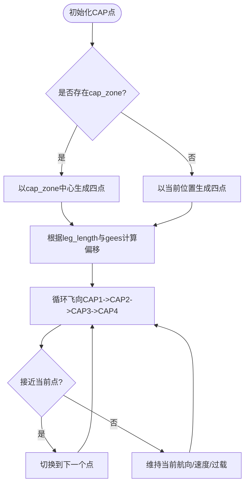

**图表来源** 
- [orbit_rules.txt:80-227](file://demos/air_to_air/rules/orbit_rules.txt#L80-L227)

**章节来源**
- [orbit_rules.txt:80-227](file://demos/air_to_air/rules/orbit_rules.txt#L80-L227)

### 矢量(vectoring)
- 目的：根据战术剧本(PLAYBOOK)、编队向量(VECTOR_FORMATION)与威胁态势计算期望航向、速度与过载，并在接近时决定进入notch/merge/pump/crank/sam_vctr等阶段。
- 关键逻辑：
  - 根据first_pass决定冲刺速度(COMMIT_SPD+SPRINT_SPD)或常规速度(COMMIT_SPD)。
  - 调用pr_vctr_hdg计算期望航向，设置COMMIT_ALT与可持续过载。
  - 根据rng_cls_hst、DOR、SAM威胁、needil/apole_tct等条件切换faz_desired。
  - 支持地面目标(SAM)与空域目标的差异化处理。
- 复杂度：主要取决于威胁评估与战术判断，通常为O(M)，M为感知实体数量。

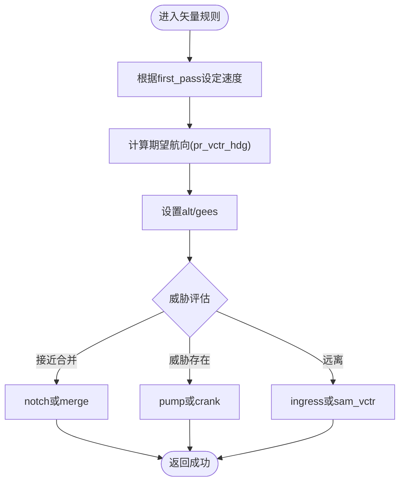

**图表来源** 
- [vectoring.txt:64-168](file://demos/air_to_air/rules/vectoring.txt#L64-L168)

**章节来源**
- [vectoring.txt:49-168](file://demos/air_to_air/rules/vectoring.txt#L49-L168)

### 航路(route_rules)
- 目的：沿WsfRoute对象逐点导航，支持编队飞行、单机矢量飞行与返航(egress)。
- 关键逻辑：
  - on_new_execute中查找最近的路由点索引rte_ind。
  - 到达路由点后递增索引，设置pr_heading/pr_speed/pr_altitude。
  - 支持escort编队飞行与最后一点后的返航逻辑。
  - 根据VECTOR_FORMATION[0]决定编队飞行或单机矢量飞行。
- 复杂度：每帧遍历ROUTE.Size()个点，O(N)。

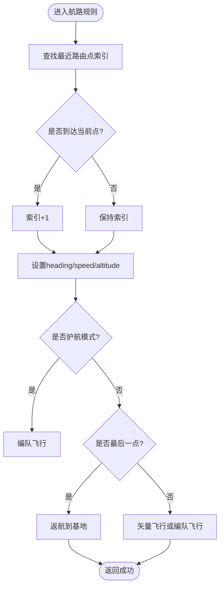

**图表来源** 
- [route_rules.txt:113-307](file://demos/air_to_air/rules/route_rules.txt#L113-L307)

**章节来源**
- [route_rules.txt:94-307](file://demos/air_to_air/rules/route_rules.txt#L94-L307)

### 武器选择(select_wpn)
- 目的：根据SHOT_DOC策略、传感器支持与武器库存，为每个目标分配首选武器(mapPRMISL_AC)与最大命中数(mapMXTGTD/mapMXTGT_AC)。
- 关键逻辑：
  - 默认选择fox3，若无则回退至fox2/fox1。
  - 针对地面目标(SAM)强制选择agm。
  - 根据SHOT_DOC值(-3至2)调整SRM/MRM使用与双发条件。
  - 考虑保护目标(PROTECTING)与威胁范围(DOR)增加双发概率。
- 复杂度：遍历感知敌方实体，O(K)，K为感知目标数量。

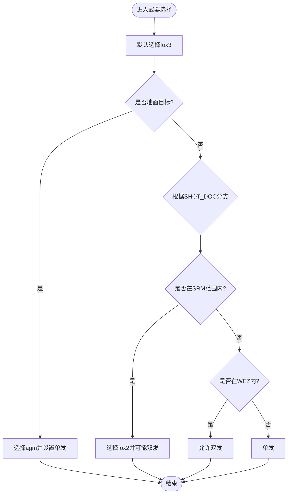

**图表来源** 
- [select_wpn.txt:103-333](file://demos/air_to_air/rules/select_wpn.txt#L103-L333)

**章节来源**
- [select_wpn.txt:84-333](file://demos/air_to_air/rules/select_wpn.txt#L84-L333)

### 射击(shoot_it)
- 目的：综合多种约束条件决定是否对目标开火，包括WQT、SRM范围、贪婪限制、HOB角、fratricide风险、RPEAK包络与俯仰辅助。
- 关键逻辑：
  - 初始化失败原因数组fails，清空mapPICKLE。
  - 跳过SAM目标，交由sam_shoot_it处理。
  - 检查WQT有效性（方位/俯仰/距离误差）。
  - 检查SRM范围、stiff_arm、greedy限制、HOB角、mxshot_rng。
  - 检查fratricide风险与RPEAK包络，必要时命令pitch_up。
  - 选择引导机(guider)并执行Fire()，记录t_last_pickle。
- 复杂度：遍历shoot_list，O(L)，L为待射击目标数量。

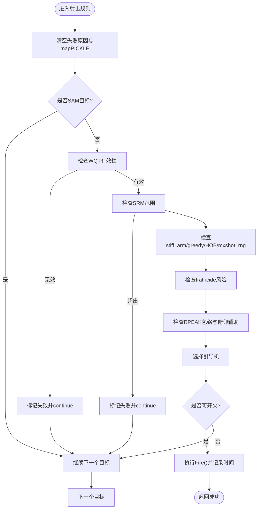

**图表来源** 
- [shoot_it.txt:98-333](file://demos/air_to_air/rules/shoot_it.txt#L98-L333)

**章节来源**
- [shoot_it.txt:77-333](file://demos/air_to_air/rules/shoot_it.txt#L77-L333)

### 战斗机规则(ftr_rules)
- 目的：统一处理阶段切换（egress/pump/reaction等），协调编队成员相位变更。
- 关键逻辑：
  - 根据bng_msl/bng_fuel/attack_success/react/sam_threatnd等条件设置faz_desired与reason。
  - 非领队成员通过aux data(dzr_change/dzr_phase)请求阶段变更，领队汇总并广播。
  - 领队更新所有成员faz/t_faz_switch/n_pump等状态。
- 复杂度：遍历编队成员，O(P)，P为成员数量。

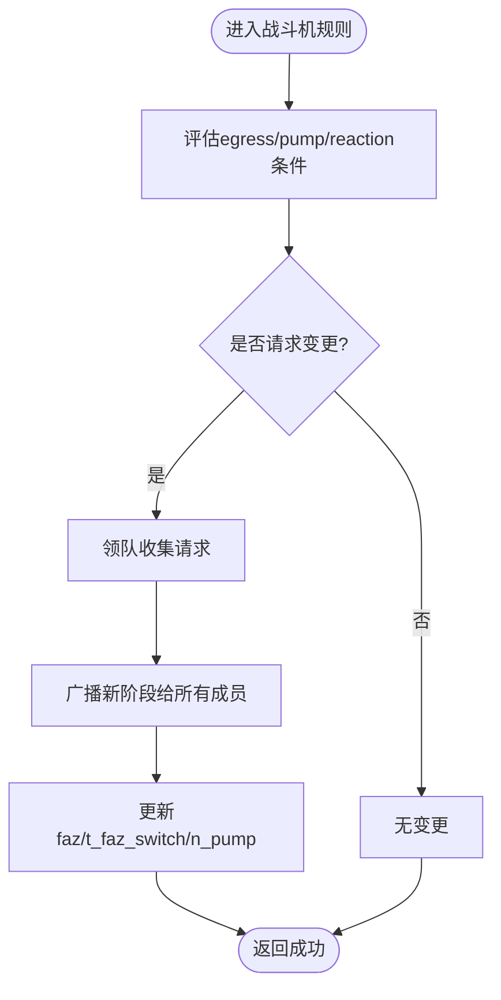

**图表来源** 
- [ftr_rules.txt:176-334](file://demos/air_to_air/rules/ftr_rules.txt#L176-L334)

**章节来源**
- [ftr_rules.txt:154-334](file://demos/air_to_air/rules/ftr_rules.txt#L154-L334)

## 依赖关系分析
- ftr_rules作为阶段控制器，影响vectoring的阶段切换。
- vectoring依赖select_wpn与shoot_it完成武器选择与发射决策。
- route_rules独立于战术阶段，但可与vectoring协同提供航路导航。
- intercept_rules与orbit_rules为特定战术阶段的专用行为，最终通过vectoring输出具体机动指令。

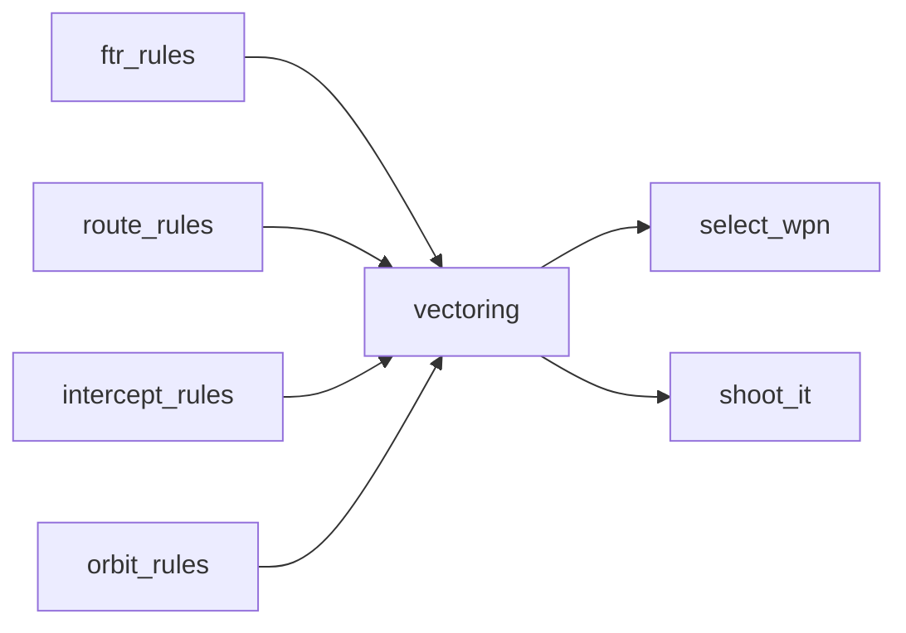

**图表来源** 
- [ftr_rules.txt:176-334](file://demos/air_to_air/rules/ftr_rules.txt#L176-L334)
- [vectoring.txt:64-168](file://demos/air_to_air/rules/vectoring.txt#L64-L168)
- [select_wpn.txt:103-333](file://demos/air_to_air/rules/select_wpn.txt#L103-L333)
- [shoot_it.txt:98-333](file://demos/air_to_air/rules/shoot_it.txt#L98-L333)
- [route_rules.txt:148-307](file://demos/air_to_air/rules/route_rules.txt#L148-L307)
- [intercept_rules.txt:101-160](file://demos/air_to_air/rules/intercept_rules.txt#L101-L160)
- [orbit_rules.txt:178-227](file://demos/air_to_air/rules/orbit_rules.txt#L178-L227)

**章节来源**
- [ftr_rules.txt:176-334](file://demos/air_to_air/rules/ftr_rules.txt#L176-L334)
- [vectoring.txt:64-168](file://demos/air_to_air/rules/vectoring.txt#L64-L168)
- [select_wpn.txt:103-333](file://demos/air_to_air/rules/select_wpn.txt#L103-L333)
- [shoot_it.txt:98-333](file://demos/air_to_air/rules/shoot_it.txt#L98-L333)
- [route_rules.txt:148-307](file://demos/air_to_air/rules/route_rules.txt#L148-L307)
- [intercept_rules.txt:101-160](file://demos/air_to_air/rules/intercept_rules.txt#L101-L160)
- [orbit_rules.txt:178-227](file://demos/air_to_air/rules/orbit_rules.txt#L178-L227)

## 性能与可维护性
- 性能：各规则脚本主要为线性遍历与简单几何计算，复杂度低；可通过减少感知实体数量与优化任务列表提升性能。
- 可维护性：规则脚本采用模块化设计，便于扩展新的战术阶段与武器选择策略；建议将常用逻辑封装为工具函数以减少重复代码。

## 故障排查指南
- 常见问题：
  - 未正确附加WSF_SA_PROCESSOR导致precondition失败。
  - rule_type不匹配导致行为不执行。
  - 武器库存不足或WQT数据无效导致无法开火。
  - 航路点不可达或CAP点不可达导致无限循环。
- 排查步骤：
  - 检查处理器类型与rule_type设置。
  - 打印iout/log日志确认阶段切换与失败原因。
  - 验证WQT数据与传感器跟踪质量。
  - 确保航路与CAP点可达性。

**章节来源**
- [intercept_rules.txt:78-96](file://demos/air_to_air/rules/intercept_rules.txt#L78-L96)
- [orbit_rules.txt:155-173](file://demos/air_to_air/rules/orbit_rules.txt#L155-L173)
- [vectoring.txt:49-61](file://demos/air_to_air/rules/vectoring.txt#L49-L61)
- [route_rules.txt:128-143](file://demos/air_to_air/rules/route_rules.txt#L128-L143)
- [select_wpn.txt:88-100](file://demos/air_to_air/rules/select_wpn.txt#L88-L100)
- [shoot_it.txt:81-95](file://demos/air_to_air/rules/shoot_it.txt#L81-L95)

## 结论
AFSIM的空对空战术规则通过模块化行为脚本实现了拦截、盘旋、矢量、航路导航、武器选择与射击决策的完整流程。ftr_rules作为阶段控制器协调各行为节点，vectoring作为核心机动输出单元整合威胁评估与战术计划。通过行为树示例，用户可进一步扩展复杂战术场景的决策逻辑，实现高度可定制的空中对抗AI。

## 附录：复杂场景行为树设计与自定义战术开发
- 行为树基础：
  - selector_with_memory：带记忆的选择器，用于在不同条件下选择不同子树并保留上次结果。
  - run_tree：运行行为树的入口，组合多个行为节点实现复杂决策。
- 设计建议：
  - 将战术阶段（如ingress/merge/egress）建模为行为树的不同分支。
  - 使用selector节点根据威胁态势与资源状态动态选择战术。
  - 结合blackboard共享状态，跨节点传递战术意图与执行结果。
- 开发步骤：
  - 定义行为树根节点与子节点（条件、装饰器、序列、选择器等）。
  - 编写条件节点评估威胁、资源与战术约束。
  - 组合节点实现战术流程，并通过调试日志验证行为。

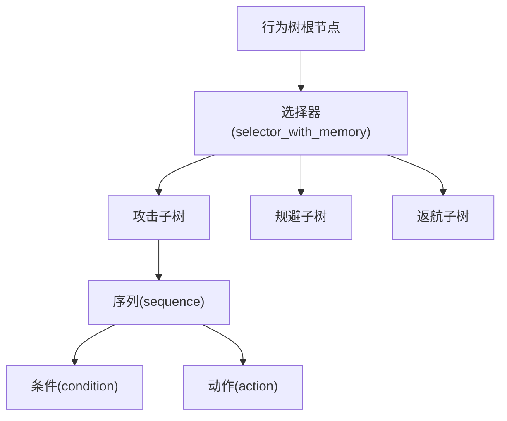

**图表来源** 
- [selector_with_memory.txt](file://demos/behavior_tree/selector_with_memory.txt)
- [run_tree.txt](file://demos/behavior_tree/run_tree.txt)
- [README.md](file://demos/behavior_tree/README.md)

**章节来源**
- [selector_with_memory.txt](file://demos/behavior_tree/selector_with_memory.txt)
- [run_tree.txt](file://demos/behavior_tree/run_tree.txt)
- [README.md](file://demos/behavior_tree/README.md)