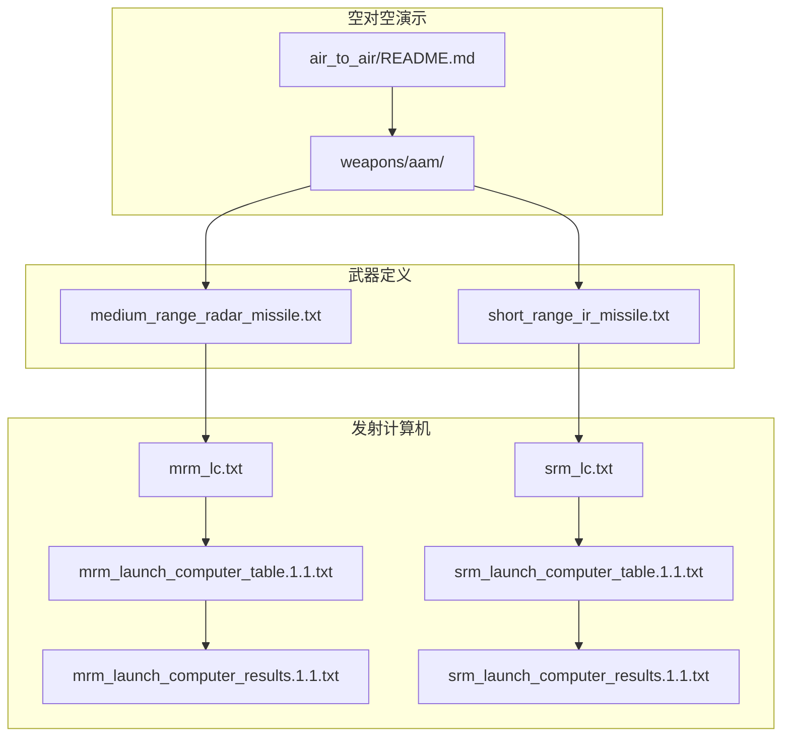
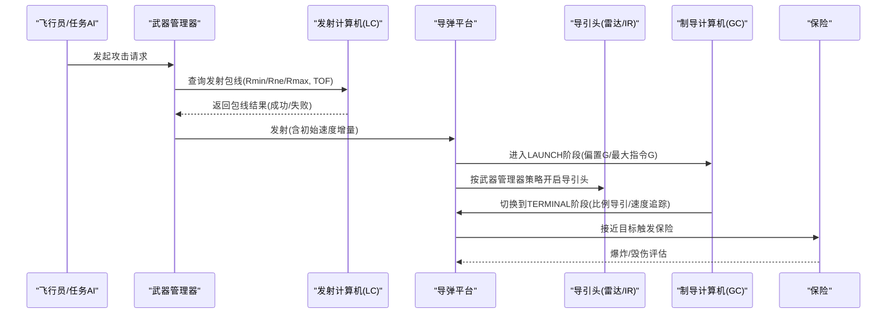
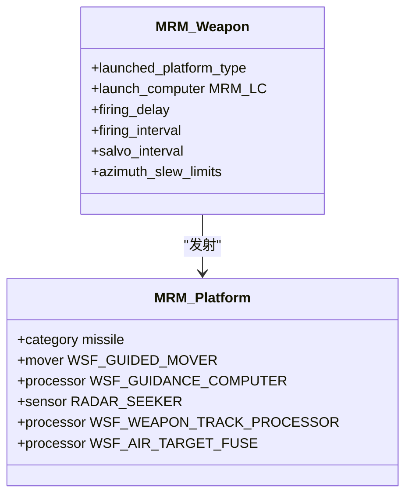
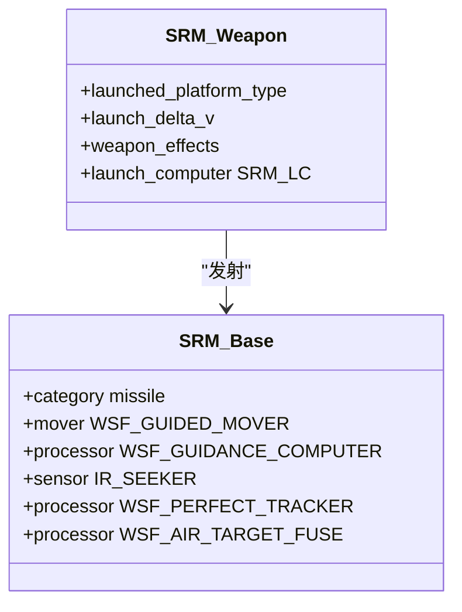
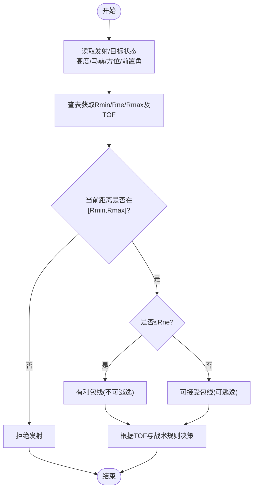
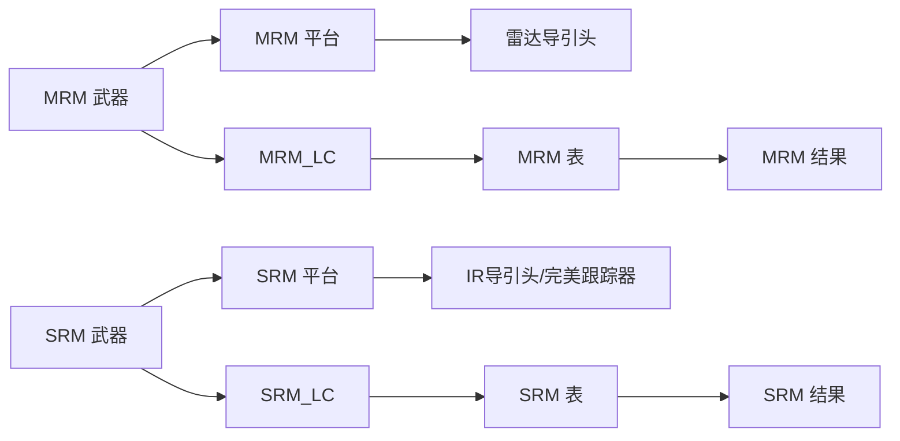

# 武器系统

<cite>
**本文引用的文件**   
- [air_to_air/README.md](file://demos/air_to_air/README.md)
- [medium_range_radar_missile.txt](file://demos/air_to_air/weapons/aam/medium_range_radar_missile.txt)
- [short_range_ir_missile.txt](file://demos/air_to_air/weapons/aam/short_range_ir_missile.txt)
- [mrm_lc.txt](file://demos/air_to_air/weapons/aam/mrm_lc.txt)
- [srm_lc.txt](file://demos/air_to_air/weapons/aam/srm_lc.txt)
- [mrm_launch_computer_table.1.1.txt](file://demos/air_to_air/weapons/aam/mrm_launch_computer_table.1.1.txt)
- [srm_launch_computer_table.1.1.txt](file://demos/air_to_air/weapons/aam/srm_launch_computer_table.1.1.txt)
- [mrm_launch_computer_results.1.1.txt](file://demos/air_to_air/weapons/aam/mrm_launch_computer_results.1.1.txt)
- [srm_launch_computer_results.1.1.txt](file://demos/air_to_air/weapons/aam/srm_launch_computer_results.1.1.txt)
</cite>

## 目录
1. [简介](#简介)
2. [项目结构](#项目结构)
3. [核心组件](#核心组件)
4. [架构总览](#架构总览)
5. [详细组件分析](#详细组件分析)
6. [依赖关系分析](#依赖关系分析)
7. [性能与调优](#性能与调优)
8. [故障排查指南](#故障排查指南)
9. [结论](#结论)

## 简介
本文件聚焦于空中对抗中的空空导弹（AAM）武器系统配置，涵盖中程雷达制导导弹与近程红外制导导弹的类型、射程、制导方式与杀伤机制；同时说明导弹发射计算机（LC）的配置与弹道计算参数（发射包线与交战条件），并提供武器效能评估方法与战术使用策略，以及导弹性能参数的调优建议。内容基于仓库中 air_to_air 演示的武器定义与发射计算机数据表进行系统化梳理。

## 项目结构
- 武器定义位于 demos/air_to_air/weapons/aam 目录下，包含：
  - 中程雷达制导导弹定义与发射计算机引用
  - 近程红外制导导弹定义与发射计算机引用
  - 发射计算机表与拦截结果数据
- 演示说明文档位于 demos/air_to_air/README.md，概述了空对空演示的总体结构与导弹使用约定。

**图表来源** 
- [air_to_air/README.md:1-101](file://demos/air_to_air/README.md#L1-L101)
- [medium_range_radar_missile.txt:1-260](file://demos/air_to_air/weapons/aam/medium_range_radar_missile.txt#L1-L260)
- [short_range_ir_missile.txt:1-238](file://demos/air_to_air/weapons/aam/short_range_ir_missile.txt#L1-L238)
- [mrm_lc.txt:1-13](file://demos/air_to_air/weapons/aam/mrm_lc.txt#L1-L13)
- [srm_lc.txt:1-13](file://demos/air_to_air/weapons/aam/srm_lc.txt#L1-L13)
- [mrm_launch_computer_table.1.1.txt:1-36](file://demos/air_to_air/weapons/aam/mrm_launch_computer_table.1.1.txt#L1-L36)
- [srm_launch_computer_table.1.1.txt:1-36](file://demos/air_to_air/weapons/aam/srm_launch_computer_table.1.1.txt#L1-L36)
- [mrm_launch_computer_results.1.1.txt:1-200](file://demos/air_to_air/weapons/aam/mrm_launch_computer_results.1.1.txt#L1-L200)
- [srm_launch_computer_results.1.1.txt:1-200](file://demos/air_to_air/weapons/aam/srm_launch_computer_results.1.1.txt#L1-L200)

**章节来源**
- [air_to_air/README.md:1-101](file://demos/air_to_air/README.md#L1-L101)

## 核心组件
- 中程雷达制导导弹（MRM）
  - 类型：WSF_EXPLICIT_WEAPON，平台类型为 WSF_PLATFORM，采用 WSF_GUIDED_MOVER 与 WSF_GUIDANCE_COMPUTER
  - 制导：主动雷达导引头（RADAR_SEEKER），武器端激活时间由武器管理器控制
  - 杀伤：WSF_GRADUATED_LETHALITY，半径与概率参数定义毁伤效果
  - 发射计算机：MRM_LC，加载 mrm_launch_computer_table.1.1.txt
- 近程红外制导导弹（SRM）
  - 类型：WSF_EXPLICIT_WEAPON，平台类型为 SHORT_RANGE_IR_MISSILE_BASE，采用 WSF_GUIDED_MOVER 与 WSF_GUIDANCE_COMPUTER
  - 制导：IR_SEEKER（在示例中使用雷达传感器模拟 IR 导引头的观测数据流），并配合 WSF_PERFECT_TRACKER 提供目标真值
  - 杀伤：WSF_GRADUATED_LETHALITY，半径与概率参数定义毁伤效果
  - 发射计算机：SRM_LC，加载 srm_launch_computer_table.1.1.txt

关键要点
- 两类导弹均通过“武器-平台-导引头-制导计算机-保险”的分层结构实现可配置的仿真模型
- 发射计算机以多维查表形式给出 Rmin/Rne/Rmax 及对应飞行时间，作为发射包线判据

**章节来源**
- [medium_range_radar_missile.txt:1-260](file://demos/air_to_air/weapons/aam/medium_range_radar_missile.txt#L1-L260)
- [short_range_ir_missile.txt:1-238](file://demos/air_to_air/weapons/aam/short_range_ir_missile.txt#L1-L238)
- [mrm_lc.txt:1-13](file://demos/air_to_air/weapons/aam/mrm_lc.txt#L1-L13)
- [srm_lc.txt:1-13](file://demos/air_to_air/weapons/aam/srm_lc.txt#L1-L13)

## 架构总览
下图展示从发射决策到导弹飞行的端到端流程，包括发射计算机查表、导引头开关时机、制导阶段切换与杀伤判定。

**图表来源** 
- [medium_range_radar_missile.txt:149-216](file://demos/air_to_air/weapons/aam/medium_range_radar_missile.txt#L149-L216)
- [short_range_ir_missile.txt:124-151](file://demos/air_to_air/weapons/aam/short_range_ir_missile.txt#L124-L151)
- [mrm_lc.txt:10-12](file://demos/air_to_air/weapons/aam/mrm_lc.txt#L10-L12)
- [srm_lc.txt:10-12](file://demos/air_to_air/weapons/aam/srm_lc.txt#L10-L12)

## 详细组件分析

### 中程雷达制导导弹（MRM）
- 平台与运动学
  - 质量、燃料、比冲、推力与推力持续时间定义了推进特性
  - 气动数据（CD随马赫数变化、参考面积、升力系数上限、展弦比等）决定机动能力
- 导引头与传感器
  - 雷达导引头具备扫描模式、天线增益、频率、脉冲重复间隔与接收带宽等参数
  - 武器管理器在拦截前固定时间开启导引头，支持无上行链路（纯主动模式）
- 制导计算机
  - LAUNCH阶段：设置偏置G与最大指令G，并在超时后转入TERMINAL
  - TERMINAL阶段：比例导引增益与速度追踪增益，保持低偏置G
- 杀伤与保险
  - 渐变杀伤模型（半径与命中概率）
  - 最大飞行时间保险防止长时未爆

**图表来源** 
- [medium_range_radar_missile.txt:95-216](file://demos/air_to_air/weapons/aam/medium_range_radar_missile.txt#L95-L216)
- [medium_range_radar_missile.txt:250-259](file://demos/air_to_air/weapons/aam/medium_range_radar_missile.txt#L250-L259)

**章节来源**
- [medium_range_radar_missile.txt:95-216](file://demos/air_to_air/weapons/aam/medium_range_radar_missile.txt#L95-L216)
- [medium_range_radar_missile.txt:250-259](file://demos/air_to_air/weapons/aam/medium_range_radar_missile.txt#L250-L259)

### 近程红外制导导弹（SRM）
- 平台与运动学
  - 质量、燃料、比冲、推力与推力持续时间定义推进特性
  - 气动数据覆盖宽马赫范围，提供高机动性基础
- 导引头与跟踪
  - IR_SEEKER（示例中以雷达传感器模拟IR观测数据流）
  - WSF_PERFECT_TRACKER 提供目标真值用于制导闭环
- 制导计算机
  - 比例导引增益与速度追踪增益较高，适合近距格斗
  - 最大指令G与更新间隔确保快速响应
- 杀伤与保险
  - 渐变杀伤模型（较小半径与命中概率）
  - 最大飞行时间保险

**图表来源** 
- [short_range_ir_missile.txt:94-151](file://demos/air_to_air/weapons/aam/short_range_ir_missile.txt#L94-L151)
- [short_range_ir_missile.txt:203-209](file://demos/air_to_air/weapons/aam/short_range_ir_missile.txt#L203-L209)

**章节来源**
- [short_range_ir_missile.txt:94-151](file://demos/air_to_air/weapons/aam/short_range_ir_missile.txt#L94-L151)
- [short_range_ir_missile.txt:203-209](file://demos/air_to_air/weapons/aam/short_range_ir_missile.txt#L203-L209)

### 发射计算机（LC）与发射包线
- 发射计算机类型
  - WSF_AIR_TO_AIR_LAUNCH_COMPUTER，分别由 MRM_LC 与 SRM_LC 引用
- 独立变量维度
  - 发射机高度（ft）、发射机马赫数
  - 目标高度（ft）、目标马赫数
  - 目标方位角（deg）、目标前置角（deg）
- 拦截结果字段
  - Rmin/RminTOF：最小可用距离与到达时间
  - Rne/RneTOF：不可逃逸距离与到达时间
  - Rmax/RmaxTOF：最大可用距离与到达时间
- 包线判据
  - 当前距离需满足 Rmin ≤ Range ≤ Rmax
  - 若 Range ≤ Rne，则目标不可逃逸，提高命中率预期
  - TOF用于时序约束与火力管理

**图表来源** 
- [mrm_launch_computer_table.1.1.txt:10-35](file://demos/air_to_air/weapons/aam/mrm_launch_computer_table.1.1.txt#L10-L35)
- [srm_launch_computer_table.1.1.txt:10-35](file://demos/air_to_air/weapons/aam/srm_launch_computer_table.1.1.txt#L10-L35)
- [mrm_launch_computer_results.1.1.txt:10-200](file://demos/air_to_air/weapons/aam/mrm_launch_computer_results.1.1.txt#L10-L200)
- [srm_launch_computer_results.1.1.txt:10-200](file://demos/air_to_air/weapons/aam/srm_launch_computer_results.1.1.txt#L10-L200)

**章节来源**
- [mrm_lc.txt:10-12](file://demos/air_to_air/weapons/aam/mrm_lc.txt#L10-L12)
- [srm_lc.txt:10-12](file://demos/air_to_air/weapons/aam/srm_lc.txt#L10-L12)
- [mrm_launch_computer_table.1.1.txt:10-35](file://demos/air_to_air/weapons/aam/mrm_launch_computer_table.1.1.txt#L10-L35)
- [srm_launch_computer_table.1.1.txt:10-35](file://demos/air_to_air/weapons/aam/srm_launch_computer_table.1.1.txt#L10-L35)
- [mrm_launch_computer_results.1.1.txt:10-200](file://demos/air_to_air/weapons/aam/mrm_launch_computer_results.1.1.txt#L10-L200)
- [srm_launch_computer_results.1.1.txt:10-200](file://demos/air_to_air/weapons/aam/srm_launch_computer_results.1.1.txt#L10-L200)

## 依赖关系分析
- 武器与平台
  - MEDIUM_RANGE_RADAR_MISSILE 与 SHORT_RANGE_IR_MISSILE 均为 WSF_EXPLICIT_WEAPON，绑定各自 launched_platform_type
- 发射计算机与数据表
  - MRM_LC 与 SRM_LC 分别加载对应的 launch_computer_table
  - 数据表 include 拦截结果文件，形成完整包线数据集
- 导引头与处理器
  - MRM 使用 RADAR_SEEKER 与 WSF_WEAPON_TRACK_PROCESSOR 控制导引头开启时机
  - SRM 使用 IR_SEEKER 与 WSF_PERFECT_TRACKER 提供目标真值

**图表来源** 
- [medium_range_radar_missile.txt:250-259](file://demos/air_to_air/weapons/aam/medium_range_radar_missile.txt#L250-L259)
- [short_range_ir_missile.txt:203-209](file://demos/air_to_air/weapons/aam/short_range_ir_missile.txt#L203-L209)
- [mrm_lc.txt:10-12](file://demos/air_to_air/weapons/aam/mrm_lc.txt#L10-L12)
- [srm_lc.txt:10-12](file://demos/air_to_air/weapons/aam/srm_lc.txt#L10-L12)
- [mrm_launch_computer_table.1.1.txt:32-35](file://demos/air_to_air/weapons/aam/mrm_launch_computer_table.1.1.txt#L32-L35)
- [srm_launch_computer_table.1.1.txt:32-35](file://demos/air_to_air/weapons/aam/srm_launch_computer_table.1.1.txt#L32-L35)

**章节来源**
- [medium_range_radar_missile.txt:250-259](file://demos/air_to_air/weapons/aam/medium_range_radar_missile.txt#L250-L259)
- [short_range_ir_missile.txt:203-209](file://demos/air_to_air/weapons/aam/short_range_ir_missile.txt#L203-L209)
- [mrm_lc.txt:10-12](file://demos/air_to_air/weapons/aam/mrm_lc.txt#L10-L12)
- [srm_lc.txt:10-12](file://demos/air_to_air/weapons/aam/srm_lc.txt#L10-L12)

## 性能与调优
- 导弹性能参数调优方向
  - 推进系统：调整 thrust/thrust_duration/specific_impulse 以改变能量曲线与续航
  - 气动外形：调节 cl_max、aspect_ratio、oswalds_factor 影响最大过载与转弯率
  - 导引头：优化 antenna_pattern（beamwidth/peak_gain）、transmitter power/frequency、receiver bandwidth 提升探测与跟踪稳定性
  - 制导算法：调整 proportional_navigation_gain/velocity_pursuit_gain/g_bias 平衡捕获与稳定
  - 杀伤模型：调整 radius_and_pk 或改用 SPHERICAL_LETHALITY 以匹配不同目标硬度
- 发射包线调优方法
  - 扩展独立变量网格（增加高度/马赫/方位/前置角分辨率）以提高包线精度
  - 基于 weapon_tools 重新生成拦截结果表，验证新参数下的 Rmin/Rne/Rmax 与 TOF
  - 结合战术规则（如 no_escape_maneuver g 限制）评估包线有效性
- 效能评估指标
  - 包线覆盖率（成功/失败样本统计）
  - 不可逃逸区间占比（Rne 相对 Rmax）
  - 平均 TOF 与峰值过载需求
  - 导引头开机时机对命中率的影响

[本节为通用指导，不直接分析具体文件]

## 故障排查指南
- 导引头未开启或无法跟踪
  - 检查武器管理器的 turn_on_sensor 时间与 uplink_required 配置
  - 确认 track_mgr 与 data_mgr 的内部链接与融合报告设置
- 发射被拒绝
  - 核查当前距离是否落在 Rmin-Rmax 范围内
  - 检查独立变量是否与数据表维度匹配（高度/马赫/方位/前置角）
- 导弹过早脱锁或失能
  - 调整制导计算机的更新间隔与最大指令G
  - 校验气动数据与推力曲线是否合理，避免超出机动包线
- 杀伤未生效
  - 检查 weapon_effects 配置与 fuse 的最大飞行时间
  - 确认目标进入杀伤半径且命中概率阈值满足

**章节来源**
- [medium_range_radar_missile.txt:195-229](file://demos/air_to_air/weapons/aam/medium_range_radar_missile.txt#L195-L229)
- [short_range_ir_missile.txt:158-174](file://demos/air_to_air/weapons/aam/short_range_ir_missile.txt#L158-L174)

## 结论
本文件系统梳理了 AFSIM 空对空演示中的空空导弹武器系统配置，明确了中程雷达制导与近程红外制导导弹的平台结构、导引头与制导逻辑、杀伤模型与发射计算机包线。通过发射计算机的多维查表与拦截结果数据，可实现精确的发射包线评估与战术决策。建议在武器工具链支持下，依据任务场景扩展包线维度与参数集，持续优化导弹性能与战术策略，以提升整体作战效能。