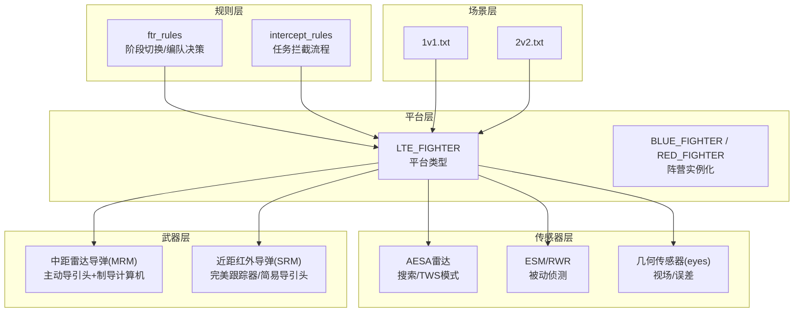
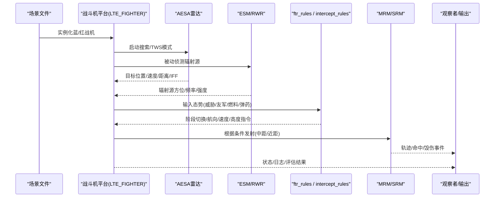
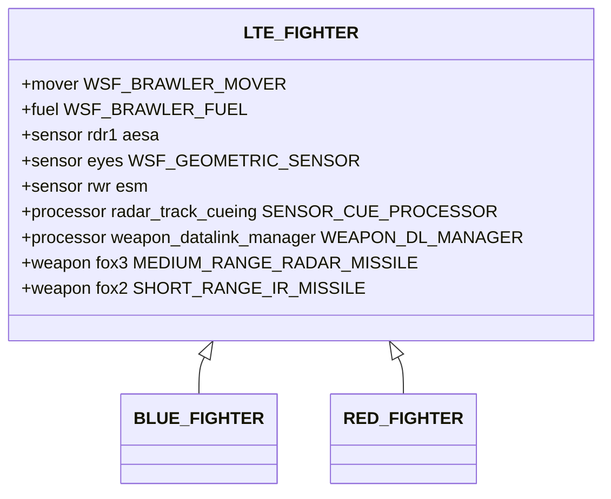
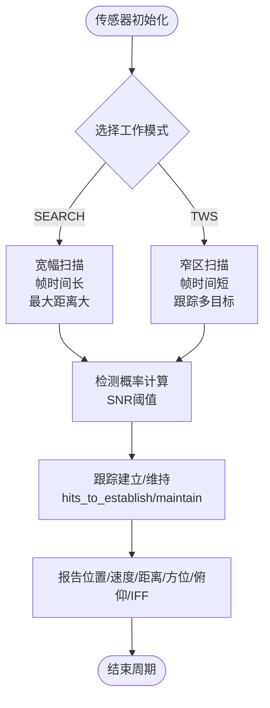
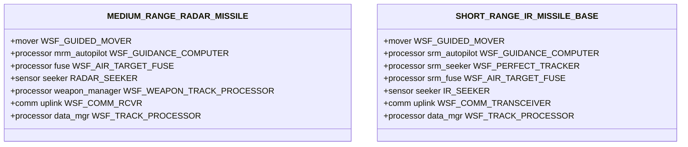
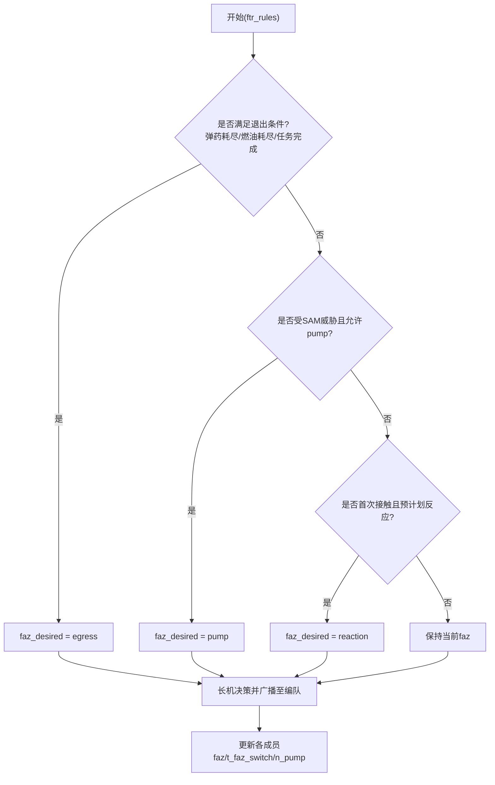
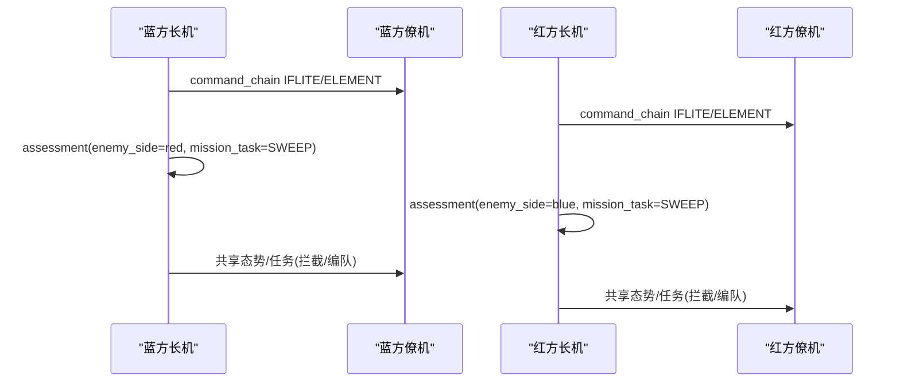
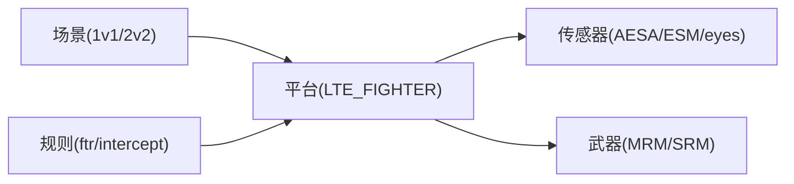

# 空中对抗场景

<cite>
**本文引用的文件**   
- [README.md](file://demos/air_to_air/README.md)
- [1v1.txt](file://demos/air_to_air/scenarios/1v1.txt)
- [2v2.txt](file://demos/air_to_air/scenarios/2v2.txt)
- [lte_fighter.txt](file://demos/air_to_air/platforms/lte_fighter.txt)
- [aesa.txt](file://demos/air_to_air/sensors/radar/aesa.txt)
- [esm.txt](file://demos/air_to_air/sensors/esm_rwr/esm.txt)
- [medium_range_radar_missile.txt](file://demos/air_to_air/weapons/aam/medium_range_radar_missile.txt)
- [short_range_ir_missile.txt](file://demos/air_to_air/weapons/aam/short_range_ir_missile.txt)
- [ftr_rules.txt](file://demos/air_to_air/rules/ftr_rules.txt)
- [intercept_rules.txt](file://demos/air_to_air/rules/intercept_rules.txt)
- [_common.txt](file://demos/air_to_air/_common.txt)
</cite>

## 目录
1. [简介](#简介)
2. [项目结构](#项目结构)
3. [核心组件](#核心组件)
4. [架构总览](#架构总览)
5. [详细组件分析](#详细组件分析)
6. [依赖关系分析](#依赖关系分析)
7. [性能与参数调优](#性能与参数调优)
8. [故障排查指南](#故障排查指南)
9. [结论](#结论)
10. [附录：扩展与自定义战术行为](#附录扩展与自定义战术行为)

## 简介
本教程面向AFSIM的“air_to_air”演示，系统讲解战斗机平台、雷达与红外传感器建模、空空导弹武器系统的配置方法，以及1v1、2v2等对抗模式的场景组织。文档重点解析拦截、缠斗、编队飞行等战术行为的实现机制，说明传感器探测逻辑、目标识别与武器发射条件，并提供战术参数调优与交战效果分析方法，最后给出复杂对抗场景的扩展开发与自定义战术行为实现指导。

## 项目结构
air_to_air目录采用按功能域组织的结构：
- platforms：战斗机平台类型定义（含Brawler处理器、传感器、武器挂载）
- sensors：机载雷达与ESM/RWR传感器模型
- weapons/aam：空空导弹（中距雷达制导、近距红外制导）及其导引头、气动、杀伤模型
- rules：高级行为规则（阶段切换、拦截、编队、机动等）
- scenarios：具体对抗场景（1v1、2v2等）
- prdata：仿真数据与辅助脚本变量
- six_dof_types：六自由度飞行器气动与控制数据（可选）
- signatures/signature_conversion：RCS/IR/Optical签名转换工具

图表来源
- [lte_fighter.txt:10-123](file://demos/air_to_air/platforms/lte_fighter.txt#L10-L123)
- [aesa.txt:14-129](file://demos/air_to_air/sensors/radar/aesa.txt#L14-L129)
- [esm.txt:27-87](file://demos/air_to_air/sensors/esm_rwr/esm.txt#L27-L87)
- [medium_range_radar_missile.txt:116-260](file://demos/air_to_air/weapons/aam/medium_range_radar_missile.txt#L116-L260)
- [short_range_ir_missile.txt:115-209](file://demos/air_to_air/weapons/aam/short_range_ir_missile.txt#L115-L209)
- [ftr_rules.txt:60-339](file://demos/air_to_air/rules/ftr_rules.txt#L60-L339)
- [intercept_rules.txt:23-162](file://demos/air_to_air/rules/intercept_rules.txt#L23-L162)
- [1v1.txt:1-96](file://demos/air_to_air/scenarios/1v1.txt#L1-L96)
- [2v2.txt:1-170](file://demos/air_to_air/scenarios/2v2.txt#L1-L170)

章节来源
- [README.md:1-101](file://demos/air_to_air/README.md#L1-L101)

## 核心组件
- 战斗机平台（LTE_FIGHTER）
  - 使用Brawler移动器与感知/威胁处理器；挂载MRM与SRM；内置AESA雷达、几何传感器与ESM/RWR；通过处理器进行雷达跟踪提示与武器数据链管理。
- 雷达传感器（AESA）
  - 支持SEARCH与TWS两种模式；具备电子扫描、检测概率曲线、多目标跟踪建立/维持命中数、Doppler处理与测量误差报告。
- ESM/RWR传感器
  - 被动侦测雷达辐射源；频率带设置、灵敏度阈值、方位/俯仰扫描范围与误差模型。
- 空空导弹
  - MRM：主动雷达导引头、制导计算机（Launch/Terminal阶段）、简单引信、数据链与跟踪处理器。
  - SRM：近距红外导弹，示例中使用完美跟踪器或简易雷达导引头，提供弹道与杀伤模型。
- 战术规则
  - ftr_rules：编队阶段切换（ingress/pump/egress/reaction等），由长机统一决策并下发至僚机。
  - intercept_rules：基于任务管理器执行拦截，结合编队飞行到拦截点。

章节来源
- [lte_fighter.txt:10-123](file://demos/air_to_air/platforms/lte_fighter.txt#L10-L123)
- [aesa.txt:14-129](file://demos/air_to_air/sensors/radar/aesa.txt#L14-L129)
- [esm.txt:27-87](file://demos/air_to_air/sensors/esm_rwr/esm.txt#L27-L87)
- [medium_range_radar_missile.txt:116-260](file://demos/air_to_air/weapons/aam/medium_range_radar_missile.txt#L116-L260)
- [short_range_ir_missile.txt:115-209](file://demos/air_to_air/weapons/aam/short_range_ir_missile.txt#L115-L209)
- [ftr_rules.txt:60-339](file://demos/air_to_air/rules/ftr_rules.txt#L60-L339)
- [intercept_rules.txt:23-162](file://demos/air_to_air/rules/intercept_rules.txt#L23-L162)

## 架构总览
下图展示从场景到平台、传感器、武器与规则的调用关系，体现“感知—决策—行动—交战”的闭环。

图表来源
- [1v1.txt:1-96](file://demos/air_to_air/scenarios/1v1.txt#L1-L96)
- [2v2.txt:1-170](file://demos/air_to_air/scenarios/2v2.txt#L1-L170)
- [lte_fighter.txt:10-123](file://demos/air_to_air/platforms/lte_fighter.txt#L10-L123)
- [aesa.txt:14-129](file://demos/air_to_air/sensors/radar/aesa.txt#L14-L129)
- [esm.txt:27-87](file://demos/air_to_air/sensors/esm_rwr/esm.txt#L27-L87)
- [ftr_rules.txt:60-339](file://demos/air_to_air/rules/ftr_rules.txt#L60-L339)
- [intercept_rules.txt:23-162](file://demos/air_to_air/rules/intercept_rules.txt#L23-L162)
- [medium_range_radar_missile.txt:116-260](file://demos/air_to_air/weapons/aam/medium_range_radar_missile.txt#L116-L260)
- [short_range_ir_missile.txt:115-209](file://demos/air_to_air/weapons/aam/short_range_ir_missile.txt#L115-L209)

## 详细组件分析

### 战斗机平台配置（LTE_FIGHTER）
- 移动器与燃料
  - WSF_BRAWLER_MOVER配合气动文件；WSF_BRAWLER_FUEL管理燃油消耗。
- 传感器
  - AESA雷达rdr1：开启并链接raw_data_mgr与data_mgr，忽略导弹类别。
  - 几何传感器eyes：全向视场、帧时间、误差模型，报告位置/速度/距离/方位/俯仰/IFF。
  - ESM/RWR rwr：被动侦测，忽略同侧，链接raw_data_mgr与data_mgr。
- 处理器
  - radar_track_cueing：将多源传感器数据提示给AESA雷达，选择TWS模式。
  - weapon_datalink_manager：为武器上链提供传感器名称（如rdr1）。
- 武器挂载
  - fox3（MRM）数量6；fox2（SRM）数量2；其他槽位占位。
- 阵营与评估
  - BLUE_FIGHTER/RED_FIGHTER继承自LTE_FIGHTER，编辑assessment处理器以区分敌我、编队ID与任务。

图表来源
- [lte_fighter.txt:10-123](file://demos/air_to_air/platforms/lte_fighter.txt#L10-L123)
- [lte_fighter.txt:125-147](file://demos/air_to_air/platforms/lte_fighter.txt#L125-L147)

章节来源
- [lte_fighter.txt:10-147](file://demos/air_to_air/platforms/lte_fighter.txt#L10-L147)

### 雷达与红外传感器建模
- AESA雷达（aesa）
  - 模式模板：天线倾斜、视场、高度范围、最大距离、电子扫描、误差、检测概率曲线、PRF因子、Doppler分辨率、跟踪建立/维持命中数、信号处理器simple_doppler。
  - SEARCH模式：宽幅扫描，帧时间较长，用于广域搜索。
  - TWS模式：窄区扫描，短帧时间，高请求计数，适合跟踪多目标。
- ESM/RWR（esm）
  - 固定扫描模式，方位/俯仰全向扫描，频率带X波段，灵敏度阈值，误差模型，报告方位/俯仰/频率/类型/侧向等。

图表来源
- [aesa.txt:14-129](file://demos/air_to_air/sensors/radar/aesa.txt#L14-L129)
- [esm.txt:27-87](file://demos/air_to_air/sensors/esm_rwr/esm.txt#L27-L87)

章节来源
- [aesa.txt:14-129](file://demos/air_to_air/sensors/radar/aesa.txt#L14-L129)
- [esm.txt:27-87](file://demos/air_to_air/sensors/esm_rwr/esm.txt#L27-L87)

### 空空导弹武器系统
- 中距雷达导弹（MRM）
  - 导引头：小型雷达传感器，搜索模式，frame_time较短，one_m2_detect_range设定探测距离。
  - 制导计算机：LAUNCH阶段（g_bias、最大指令G、相位切换条件），TERMINAL阶段（比例导引/速度追踪增益）。
  - 引信：空对空目标引信，最大飞行时间限制。
  - 数据链与跟踪：武器管理器在拦截前一定时间开启导引头，支持主动模式（无需上链）。
- 近距红外导弹（SRM）
  - 导引头：示例使用完美跟踪器或简易雷达导引头，update_interval短，便于近距快速响应。
  - 制导计算机：比例导引与速度追踪增益较高，适应高机动缠斗。
  - 杀伤模型：渐变毁伤半径与概率。

图表来源
- [medium_range_radar_missile.txt:116-260](file://demos/air_to_air/weapons/aam/medium_range_radar_missile.txt#L116-L260)
- [short_range_ir_missile.txt:115-209](file://demos/air_to_air/weapons/aam/short_range_ir_missile.txt#L115-L209)

章节来源
- [medium_range_radar_missile.txt:116-260](file://demos/air_to_air/weapons/aam/medium_range_radar_missile.txt#L116-L260)
- [short_range_ir_missile.txt:115-209](file://demos/air_to_air/weapons/aam/short_range_ir_missile.txt#L115-L209)

### 战术行为与规则实现
- 阶段切换（ftr_rules）
  - 依据弹药/燃油耗尽、任务完成、威胁告警、编队成员意愿等条件决定进入egress/pump/reaction等阶段。
  - 仅长机可统一决策，非长机通过aux数据表达期望阶段，长机汇总后广播至编队。
- 拦截（intercept_rules）
  - 读取任务列表，若存在INTERCEPT任务且目标有效，则计算航向并执行编队飞行至拦截点。
  - 若燃油不足则自动转入egress返回基地。

图表来源
- [ftr_rules.txt:194-339](file://demos/air_to_air/rules/ftr_rules.txt#L194-L339)

章节来源
- [ftr_rules.txt:60-339](file://demos/air_to_air/rules/ftr_rules.txt#L60-L339)
- [intercept_rules.txt:23-162](file://demos/air_to_air/rules/intercept_rules.txt#L23-L162)

### 场景配置（1v1与2v2）
- 1v1
  - 定义蓝/红双方平台，各自设置command_chain（IFLITE/ELEMENT）、初始位置/航向、script_variables（START_TYPE、MISSION_TYPE、ROUTE等），并通过assessment处理器指定敌我类型与任务。
- 2v2
  - 蓝方两机，其中blue_1为指挥者；红方两机，red_1为指挥者。通过command_chain组织编队，设置风险参数（RISK_AVRS、RISK_WPN）、拦截距离（DOR）等。

图表来源
- [1v1.txt:1-96](file://demos/air_to_air/scenarios/1v1.txt#L1-L96)
- [2v2.txt:1-170](file://demos/air_to_air/scenarios/2v2.txt#L1-L170)

章节来源
- [1v1.txt:1-96](file://demos/air_to_air/scenarios/1v1.txt#L1-L96)
- [2v2.txt:1-170](file://demos/air_to_air/scenarios/2v2.txt#L1-L170)

## 依赖关系分析
- 平台依赖传感器与武器：LTE_FIGHTER包含AESA、ESM、几何传感器与MRM/SRM武器挂载。
- 规则依赖平台处理器：ftr_rules与intercept_rules通过WSF_SA_PROCESSOR访问感知与任务管理器。
- 场景依赖平台类型：1v1/2v2通过include_once引入平台定义并实例化平台对象。

图表来源
- [1v1.txt:1-96](file://demos/air_to_air/scenarios/1v1.txt#L1-L96)
- [2v2.txt:1-170](file://demos/air_to_air/scenarios/2v2.txt#L1-L170)
- [lte_fighter.txt:10-123](file://demos/air_to_air/platforms/lte_fighter.txt#L10-L123)
- [ftr_rules.txt:60-339](file://demos/air_to_air/rules/ftr_rules.txt#L60-L339)
- [intercept_rules.txt:23-162](file://demos/air_to_air/rules/intercept_rules.txt#L23-L162)

章节来源
- [1v1.txt:1-96](file://demos/air_to_air/scenarios/1v1.txt#L1-L96)
- [2v2.txt:1-170](file://demos/air_to_air/scenarios/2v2.txt#L1-L170)
- [lte_fighter.txt:10-123](file://demos/air_to_air/platforms/lte_fighter.txt#L10-L123)
- [ftr_rules.txt:60-339](file://demos/air_to_air/rules/ftr_rules.txt#L60-L339)
- [intercept_rules.txt:23-162](file://demos/air_to_air/rules/intercept_rules.txt#L23-L162)

## 性能与参数调优
- 雷达传感器
  - 调整frame_time与scan_limits以平衡搜索覆盖与跟踪刷新率。
  - 优化检测概率曲线与PRF_factor以匹配不同目标RCS与环境。
  - 合理设置hits_to_establish/maintain以控制虚警与漏检。
- 导弹武器
  - MRM：调整LAUNCH/TERMINAL阶段的增益与g_bias以改善中段/末段制导性能；调节turn_on_sensor时机以节省功耗并提高命中率。
  - SRM：提升比例导引与速度追踪增益以适应高机动目标；校准杀伤半径与概率以匹配真实毁伤特性。
- 战术规则
  - ftr_rules：调整t_phase延迟与pump权限策略，避免频繁阶段切换导致编队不稳定。
  - intercept_rules：调整COMMIT_SPD/COMMIT_ALT与编队飞行参数，确保拦截路径最优。
- 场景参数
  - 1v1/2v2：通过RISK_AVRS、RISK_WPN、DOR等脚本变量影响敌方行为与交战距离；WINCHESTER数组控制弹药耗尽判定。

[本节为通用指导，不直接分析具体文件]

## 故障排查指南
- 平台未正确加载传感器/武器
  - 检查platform_type定义中的include_once与sensor/weapon声明是否正确。
- 雷达无目标或跟踪丢失
  - 核查AESA模式模板的检测概率曲线、frame_time与scan_limits；确认ignore_domain与ignore_same_side设置。
- 导弹未发射或无法导引
  - 检查weapon_datalink_manager的uplink传感器名称；确认weapon_manager的turn_on_sensor条件与coast_time。
- 编队阶段切换异常
  - 查看ftr_rules中dzr_change与faz_desired传播逻辑；确认长机命令链与solo标志。
- 输出日志过多或过少
  - 通过log_print与iout_print控制日志开关；检查日志路径配置。

章节来源
- [lte_fighter.txt:10-123](file://demos/air_to_air/platforms/lte_fighter.txt#L10-L123)
- [aesa.txt:14-129](file://demos/air_to_air/sensors/radar/aesa.txt#L14-L129)
- [medium_range_radar_missile.txt:116-260](file://demos/air_to_air/weapons/aam/medium_range_radar_missile.txt#L116-L260)
- [ftr_rules.txt:60-339](file://demos/air_to_air/rules/ftr_rules.txt#L60-L339)

## 结论
air_to_air演示提供了完整的空中对抗建模体系：以LTE_FIGHTER平台为核心，集成AESA与ESM传感器，挂载MRM/SRM武器，并通过ftr_rules与intercept_rules实现编队阶段切换与拦截战术。1v1与2v2场景展示了单对单与双机协同对抗的组织方式。通过对传感器、武器与规则参数的调优，可实现从超视距拦截到近距缠斗的多层次战术行为。扩展开发时，可在现有基础上增加新的传感器模式、武器类型与战术规则，以满足更复杂的对抗需求。

[本节为总结性内容，不直接分析具体文件]

## 附录：扩展与自定义战术行为
- 新增传感器模式
  - 在aesa.txt中添加新mode，定义frame_time、scan_mode、cue_mode与检测参数。
- 自定义武器
  - 参考medium_range_radar_missile.txt与short_range_ir_missile.txt，定义新的platform_type与weapon，包括导引头、制导计算机、引信与杀伤模型。
- 扩展战术规则
  - 在rules目录下新增advanced_behavior，复用ftr_rules的结构，实现新的阶段或机动逻辑；通过assessment处理器注入任务与态势变量。
- 场景扩展
  - 在scenarios下创建新场景文件，组合多个平台与command_chain，设置脚本变量与任务目标。

[本节为概念性指导，不直接分析具体文件]