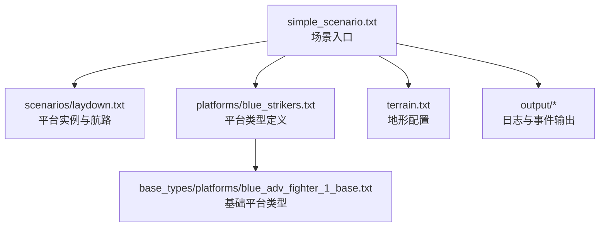
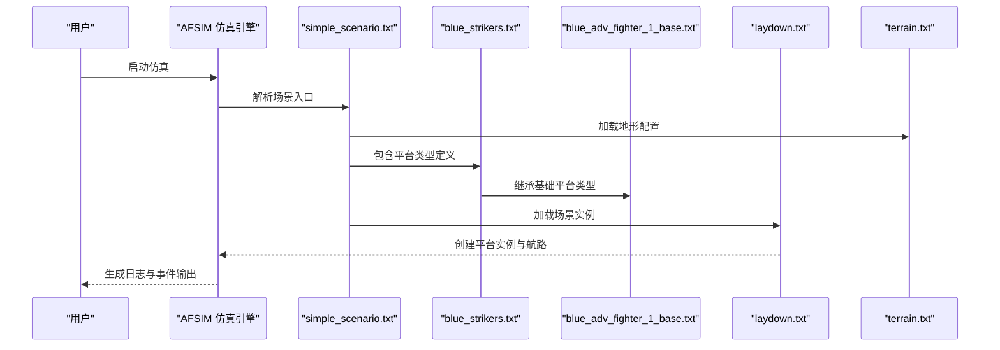
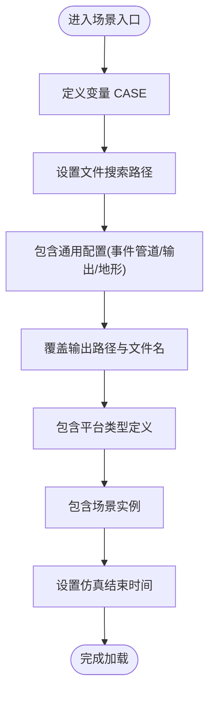
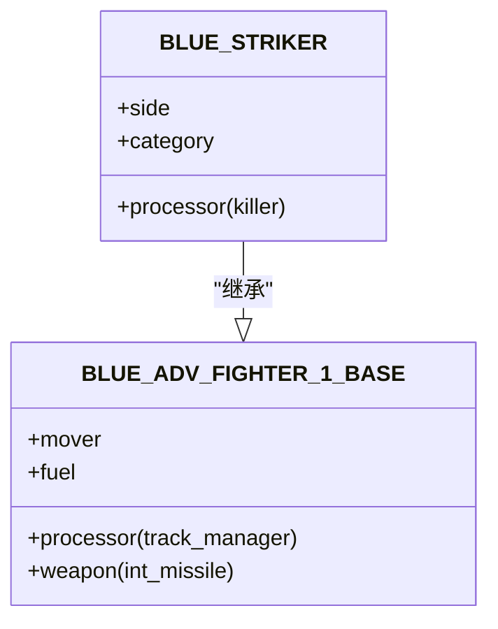
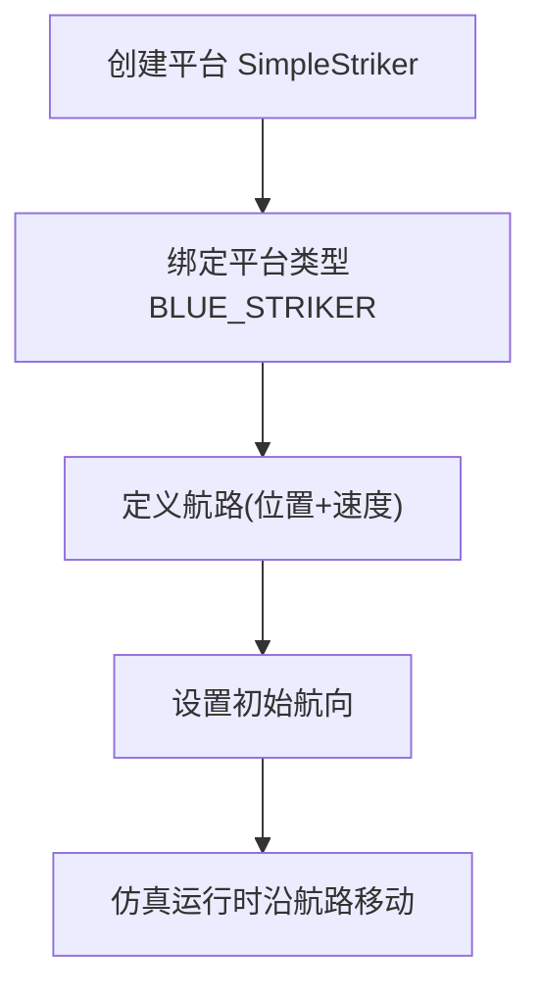
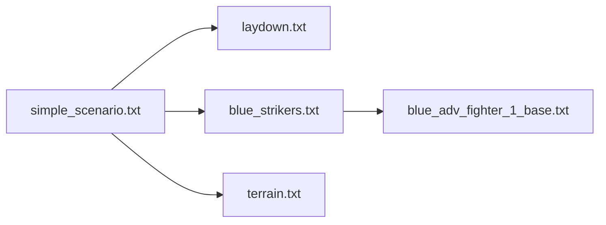

# 简单场景入门

<cite>
**本文引用的文件**   
- [simple_scenario.txt](file://demos/simple_scenario/simple_scenario.txt)
- [terrain.txt](file://demos/simple_scenario/terrain.txt)
- [blue_strikers.txt](file://demos/simple_scenario/platforms/blue_strikers.txt)
- [laydown.txt](file://demos/simple_scenario/scenarios/laydown.txt)
- [README.md](file://demos/simple_scenario/README.md)
- [blue_adv_fighter_1_base.txt](file://demos/base_types/platforms/blue_adv_fighter_1_base.txt)
</cite>

## 目录
1. [简介](#简介)
2. [项目结构](#项目结构)
3. [核心组件](#核心组件)
4. [架构总览](#架构总览)
5. [详细组件分析](#详细组件分析)
6. [依赖关系分析](#依赖关系分析)
7. [性能与运行注意事项](#性能与运行注意事项)
8. [故障排查指南](#故障排查指南)
9. [结论](#结论)
10. [附录：逐步配置修改指南](#附录：逐步配置修改指南)

## 简介
本教程面向AFSIM初学者，基于仓库中的 simple_scenario 示例，系统讲解如何从零开始理解并运行一个简单仿真。你将学习：
- 场景入口、平台定义、地形设置、事件输出与管道输出的作用
- AFSIM 的基本工作流程与关键语法
- 如何运行仿真、查看结果与分析输出数据
- 如何基于该示例扩展出你自己的第一个仿真案例

## 项目结构
simple_scenario 目录采用“按功能分目录”的组织方式，便于初学者快速定位不同职责的文件：
- scenarios：场景实例（具体平台、航路等）
- platforms：平台类型定义（继承自基础平台类型）
- doc：文档与图片
- output：仿真输出目录
- 根目录下的 .txt 为场景入口与通用配置

图表来源
- [simple_scenario.txt:10-28](file://demos/simple_scenario/simple_scenario.txt#L10-L28)
- [laydown.txt:18-29](file://demos/simple_scenario/scenarios/laydown.txt#L18-L29)
- [blue_strikers.txt:11-38](file://demos/simple_scenario/platforms/blue_strikers.txt#L11-L38)
- [blue_adv_fighter_1_base.txt:13-55](file://demos/base_types/platforms/blue_adv_fighter_1_base.txt#L13-L55)

章节来源
- [simple_scenario.txt:10-28](file://demos/simple_scenario/simple_scenario.txt#L10-L28)
- [README.md:1-45](file://demos/simple_scenario/README.md#L1-L45)

## 核心组件
- 场景入口 simple_scenario.txt：定义路径、包含通用配置、输出目标、平台与场景文件、仿真结束时间
- 平台类型 blue_strikers.txt：在基础战斗机之上扩展侧别、类别、处理器逻辑（脚本控制仿真结束）
- 场景实例 laydown.txt：创建平台实例、指定航路与速度、初始航向
- 地形 terrain.txt：当前为空配置（无地形影响）
- 基础平台类型 blue_adv_fighter_1_base.txt：提供运动模型、燃油、跟踪处理器、武器挂载等基础能力

章节来源
- [simple_scenario.txt:10-28](file://demos/simple_scenario/simple_scenario.txt#L10-L28)
- [blue_strikers.txt:11-38](file://demos/simple_scenario/platforms/blue_strikers.txt#L11-L38)
- [laydown.txt:18-29](file://demos/simple_scenario/scenarios/laydown.txt#L18-L29)
- [terrain.txt:10-14](file://demos/simple_scenario/terrain.txt#L10-L14)
- [blue_adv_fighter_1_base.txt:13-55](file://demos/base_types/platforms/blue_adv_fighter_1_base.txt#L13-L55)

## 架构总览
下图展示了从场景入口到平台实例、再到基础平台类型的调用链与数据流。

图表来源
- [simple_scenario.txt:10-28](file://demos/simple_scenario/simple_scenario.txt#L10-L28)
- [blue_strikers.txt:11-38](file://demos/simple_scenario/platforms/blue_strikers.txt#L11-L38)
- [blue_adv_fighter_1_base.txt:13-55](file://demos/base_types/platforms/blue_adv_fighter_1_base.txt#L13-L55)
- [laydown.txt:18-29](file://demos/simple_scenario/scenarios/laydown.txt#L18-L29)
- [terrain.txt:10-14](file://demos/simple_scenario/terrain.txt#L10-L14)

## 详细组件分析

### 场景入口 simple_scenario.txt
- 作用：统一组织路径、包含通用配置、设置输出文件、引入平台与场景、设定仿真时长
- 关键点：
  - define_path_variable 用于定义变量以复用路径
  - file_path 指定搜索路径，支持相对路径与跨目录引用
  - include/include_once 引入通用配置与平台类型
  - log_file/event_output/event_pipe 定义日志与事件输出
  - end_time 设置仿真结束时间

图表来源
- [simple_scenario.txt:10-28](file://demos/simple_scenario/simple_scenario.txt#L10-L28)

章节来源
- [simple_scenario.txt:10-28](file://demos/simple_scenario/simple_scenario.txt#L10-L28)

### 平台类型 blue_strikers.txt
- 作用：定义蓝色打击机器的平台类型，继承基础战斗机类型，附加侧别、类别、处理器逻辑
- 关键点：
  - include_once 引用基础平台类型
  - platform_type 声明新类型并继承 WSF_PLATFORM
  - processor killer WSF_SCRIPT_PROCESSOR 使用脚本处理器实现自定义逻辑（例如根据仿真时间结束仿真）
  - update_interval 控制处理器更新频率
  - on_update 中通过 TIME_NOW 判断是否达到结束条件

图表来源
- [blue_strikers.txt:11-38](file://demos/simple_scenario/platforms/blue_strikers.txt#L11-L38)
- [blue_adv_fighter_1_base.txt:13-55](file://demos/base_types/platforms/blue_adv_fighter_1_base.txt#L13-L55)

章节来源
- [blue_strikers.txt:11-38](file://demos/simple_scenario/platforms/blue_strikers.txt#L11-L38)
- [blue_adv_fighter_1_base.txt:13-55](file://demos/base_types/platforms/blue_adv_fighter_1_base.txt#L13-L55)

### 场景实例 laydown.txt
- 作用：创建具体的平台实例，定义其航路与速度、初始航向
- 关键点：
  - platform 关键字创建实例，关联平台类型
  - route 定义航点序列，每个航点可设置速度与高度
  - heading 设置初始航向

图表来源
- [laydown.txt:18-29](file://demos/simple_scenario/scenarios/laydown.txt#L18-L29)

章节来源
- [laydown.txt:18-29](file://demos/simple_scenario/scenarios/laydown.txt#L18-L29)

### 地形 terrain.txt
- 作用：当前为空配置，表示不使用地形影响
- 关键点：
  - terrain/end_terrain 块存在但内部未启用任何地形数据

章节来源
- [terrain.txt:10-14](file://demos/simple_scenario/terrain.txt#L10-L14)

### 基础平台类型 blue_adv_fighter_1_base.txt
- 作用：提供战斗机的基础能力（运动模型、燃油、跟踪处理器、武器挂载）
- 关键点：
  - mover 定义运动学参数（滚转速率、加速度、爬升率、最大速度/高度等）
  - fuel 定义燃油消耗速率与容量
  - processor track_manager 管理轨迹数据
  - weapon int_missile 挂载空对空导弹

章节来源
- [blue_adv_fighter_1_base.txt:13-55](file://demos/base_types/platforms/blue_adv_fighter_1_base.txt#L13-L55)

## 依赖关系分析
- simple_scenario.txt 依赖：
  - 通用配置（事件管道/输出/地形）
  - 平台类型 blue_strikers.txt
  - 场景实例 laydown.txt
- blue_strikers.txt 依赖：
  - 基础平台类型 blue_adv_fighter_1_base.txt
- laydown.txt 依赖：
  - 平台类型 BLUE_STRIKER（由 blue_strikers.txt 定义）

图表来源
- [simple_scenario.txt:10-28](file://demos/simple_scenario/simple_scenario.txt#L10-L28)
- [blue_strikers.txt:11-38](file://demos/simple_scenario/platforms/blue_strikers.txt#L11-L38)
- [laydown.txt:18-29](file://demos/simple_scenario/scenarios/laydown.txt#L18-L29)
- [blue_adv_fighter_1_base.txt:13-55](file://demos/base_types/platforms/blue_adv_fighter_1_base.txt#L13-L55)
- [terrain.txt:10-14](file://demos/simple_scenario/terrain.txt#L10-L14)

章节来源
- [simple_scenario.txt:10-28](file://demos/simple_scenario/simple_scenario.txt#L10-L28)
- [blue_strikers.txt:11-38](file://demos/simple_scenario/platforms/blue_strikers.txt#L11-L38)
- [laydown.txt:18-29](file://demos/simple_scenario/scenarios/laydown.txt#L18-L29)
- [blue_adv_fighter_1_base.txt:13-55](file://demos/base_types/platforms/blue_adv_fighter_1_base.txt#L13-L55)
- [terrain.txt:10-14](file://demos/simple_scenario/terrain.txt#L10-L14)

## 性能与运行注意事项
- 仿真时长：end_time 设置为分钟级，适合快速验证
- 处理器更新间隔：update_interval 设为秒级，避免过高的计算开销
- 输出文件：event_output 与 event_pipe 会生成大量数据，建议仅在需要时开启或减少采样频率
- 地形：当前未启用地形，若后续启用高精度地形数据，需评估IO与内存占用

[本节为通用指导，不直接分析具体文件]

## 故障排查指南
- 找不到 include 文件：检查 file_path 是否正确指向 base_types 与当前目录
- 平台类型未定义：确认 blue_strikers.txt 被正确 include，且基础平台类型存在
- 仿真提前结束：检查 blue_strikers.txt 中 on_update 的条件（TIME_NOW > 600.0），必要时调整阈值
- 输出文件缺失：确认 log_file/event_output/event_pipe 的路径与权限，确保 output 目录存在并可写
- 航路无效：检查 laydown.txt 中 position 的经纬度格式与 altitude/speed 单位

章节来源
- [simple_scenario.txt:10-28](file://demos/simple_scenario/simple_scenario.txt#L10-L28)
- [blue_strikers.txt:11-38](file://demos/simple_scenario/platforms/blue_strikers.txt#L11-L38)
- [laydown.txt:18-29](file://demos/simple_scenario/scenarios/laydown.txt#L18-L29)

## 结论
simple_scenario 提供了一个最小可用的 AFSIM 仿真骨架：场景入口组织配置，平台类型继承基础能力，场景实例定义行为，地形为空配置。通过本教程，你可以快速理解 AFSIM 的基本工作流，并在此基础上扩展传感器、武器、规则与更复杂的场景。

[本节为总结性内容，不直接分析具体文件]

## 附录：逐步配置修改指南
- 第一步：运行仿真
  - 在 AFSIM 环境中执行 simple_scenario.txt
  - 观察 output 目录下生成的日志与事件文件
- 第二步：修改航路
  - 编辑 laydown.txt 的 route 段，增加或调整航点位置、速度与高度
  - 重新运行，观察平台轨迹变化
- 第三步：调整仿真时长
  - 修改 simple_scenario.txt 的 end_time，延长或缩短仿真时间
- 第四步：扩展平台能力
  - 在 blue_strikers.txt 中添加新的处理器或传感器
  - 参考 base_types 中的雷达与传感器定义进行集成
- 第五步：启用地形
  - 在 terrain.txt 中引入地形数据文件，观察对飞行与传感器的影响
- 第六步：分析输出
  - 打开 event_output 与 event_pipe 文件，提取关键指标（位置、速度、状态事件）
  - 结合可视化或后处理工具进行分析

[本节为操作指导，不直接分析具体文件]