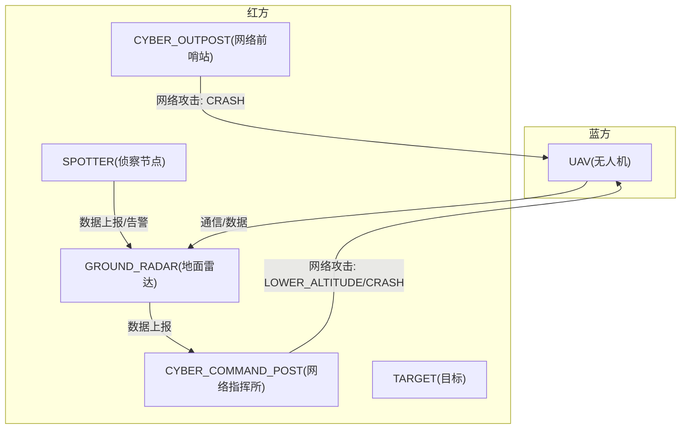
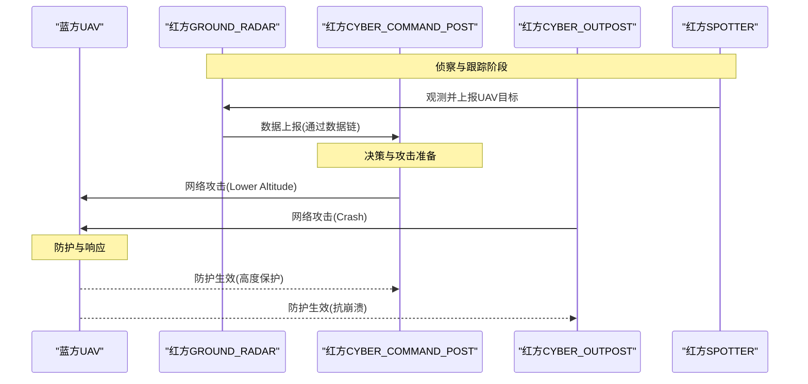
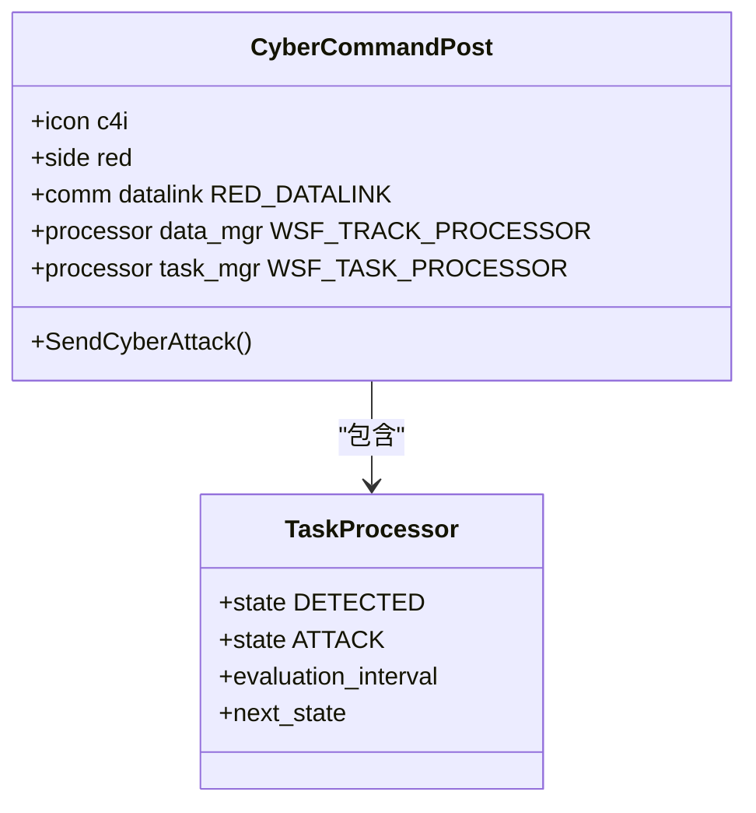
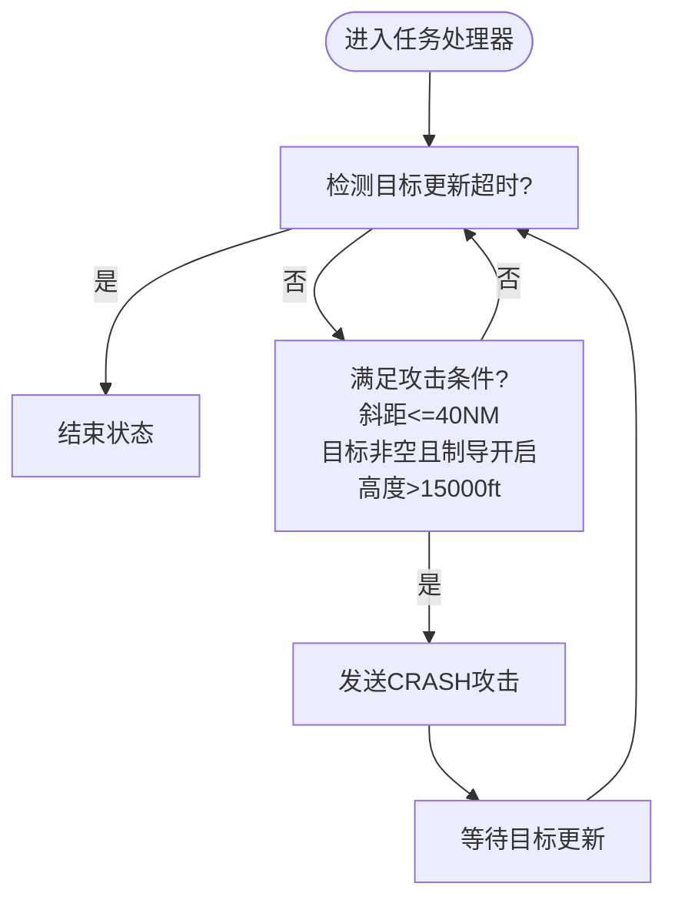
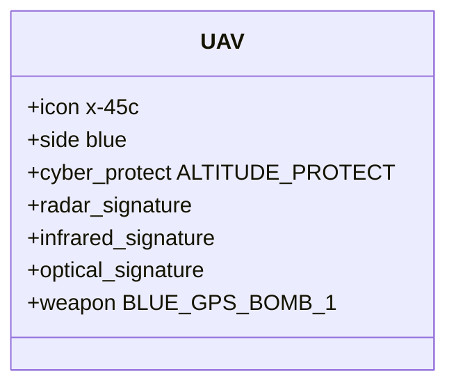
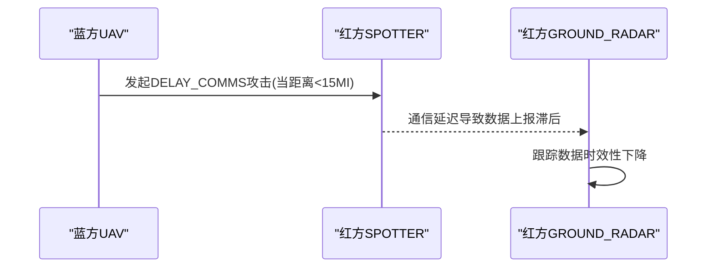
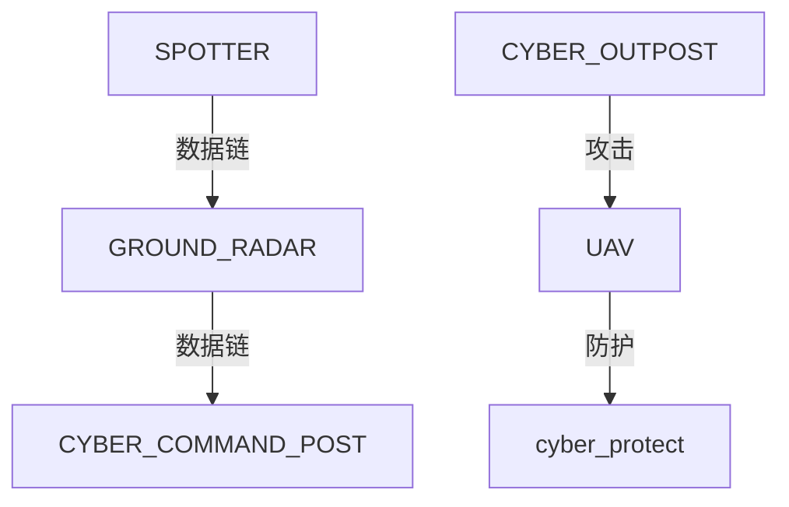

# 网络战场景

<cite>
**本文引用的文件**   
- [README.md](file://demos/cyber/README.md)
- [blue_laydown.txt](file://demos/cyber/scenarios/blue_laydown.txt)
- [red_laydown.txt](file://demos/cyber/scenarios/red_laydown.txt)
- [mitm_blue_laydown.txt](file://demos/cyber/scenarios/mitm_blue_laydown.txt)
- [mitm_red_laydown.txt](file://demos/cyber/scenarios/mitm_red_laydown.txt)
- [cyber_command_post.txt](file://demos/cyber/platforms/cyber_command_post.txt)
- [cyber_outpost.txt](file://demos/cyber/platforms/cyber_outpost.txt)
- [uav.txt](file://demos/cyber/platforms/uav.txt)
- [spotter.txt](file://demos/cyber/platforms/spotter.txt)
- [ground_radar.txt](file://demos/cyber/platforms/ground_radar.txt)
- [target.txt](file://demos/cyber/platforms/target.txt)
</cite>

## 目录
1. [引言](#引言)
2. [项目结构](#项目结构)
3. [核心组件](#核心组件)
4. [架构总览](#架构总览)
5. [详细组件分析](#详细组件分析)
6. [依赖关系分析](#依赖关系分析)
7. [性能与可扩展性](#性能与可扩展性)
8. [故障排查指南](#故障排查指南)
9. [结论](#结论)
10. [附录](#附录)

## 引言
本教程面向AFSIM的网络战场景，聚焦于网络空间的攻击与防御策略、恶意软件传播路径与网络拓扑建模。文档围绕情报收集、网络渗透、数据窃取与网络破坏等作战行动展开，并结合AFSIM的Cyber能力（平台类型、通信链路、处理器状态机、网络战攻击与防护）给出可复现的场景设计与分析方法。同时提供态势感知、威胁情报分析与网络韧性评估的实践方法，并指导复杂网络战场景与多域联合作战的构建。

## 项目结构
AFSIM的“网络战”示例位于 demos/cyber 目录，包含：
- 平台定义：无人机、地面雷达、侦察节点、网络指挥所、网络前哨站、目标等
- 场景配置：蓝方/红方初始部署、中间人（MITM）对抗场景
- 传感器与签名：雷达、目视传感器与多谱段签名
- 武器与处理器：空对地武器、任务处理器与跟踪处理器
- 网络战攻防：攻击脚本、效果与防护机制

图表来源
- [blue_laydown.txt:12-27](file://demos/cyber/scenarios/blue_laydown.txt#L12-L27)
- [red_laydown.txt:11-25](file://demos/cyber/scenarios/red_laydown.txt#L11-L25)
- [mitm_blue_laydown.txt:12-35](file://demos/cyber/scenarios/mitm_blue_laydown.txt#L12-L35)
- [mitm_red_laydown.txt:13-35](file://demos/cyber/scenarios/mitm_red_laydown.txt#L13-L35)
- [cyber_command_post.txt:14-47](file://demos/cyber/platforms/cyber_command_post.txt#L14-L47)
- [cyber_outpost.txt:14-74](file://demos/cyber/platforms/cyber_outpost.txt#L14-L74)
- [uav.txt:22-46](file://demos/cyber/platforms/uav.txt#L22-L46)
- [ground_radar.txt:14-40](file://demos/cyber/platforms/ground_radar.txt#L14-L40)
- [spotter.txt:14-44](file://demos/cyber/platforms/spotter.txt#L14-L44)

章节来源
- [README.md:1-48](file://demos/cyber/README.md#L1-L48)

## 核心组件
- 平台类型与角色
  - CYBER_COMMAND_POST：红方网络指挥所，负责跟踪处理与任务调度，触发网络攻击
  - CYBER_OUTPOST：红方网络前哨站，具备条件触发的网络攻击逻辑
  - GROUND_RADAR：红方地面雷达，负责探测与数据上报
  - SPOTTER：红方侦察节点，观测并上报目标信息
  - UAV：蓝方无人机，携带武器，受网络防护保护
  - TARGET：固定目标
- 通信与网络
  - RED_DATALINK：红方数据链，支持主从网络拓扑
  - 内部链路：processor与comm之间的internal_link用于数据流转
- 处理器与状态机
  - WSF_TRACK_PROCESSOR：跟踪数据处理
  - WSF_TASK_PROCESSOR：任务处理，含状态机（DETECTED/ATTACK/REPORT等）
- 网络战能力
  - CyberAttack/CyberAttackStatus：发起与查询网络攻击状态
  - cyber_protect：平台级网络防护（如高度保护）

章节来源
- [cyber_command_post.txt:14-47](file://demos/cyber/platforms/cyber_command_post.txt#L14-L47)
- [cyber_outpost.txt:14-74](file://demos/cyber/platforms/cyber_outpost.txt#L14-L74)
- [ground_radar.txt:14-40](file://demos/cyber/platforms/ground_radar.txt#L14-L40)
- [spotter.txt:14-44](file://demos/cyber/platforms/spotter.txt#L14-L44)
- [uav.txt:22-46](file://demos/cyber/platforms/uav.txt#L22-L46)

## 架构总览
下图展示蓝方无人机与红方网络体系在典型网络战流程中的交互：侦察、跟踪、决策、攻击与防护。

图表来源
- [mitm_blue_laydown.txt:12-35](file://demos/cyber/scenarios/mitm_blue_laydown.txt#L12-L35)
- [mitm_red_laydown.txt:13-35](file://demos/cyber/scenarios/mitm_red_laydown.txt#L13-L35)
- [cyber_command_post.txt:24-47](file://demos/cyber/platforms/cyber_command_post.txt#L24-L47)
- [cyber_outpost.txt:28-74](file://demos/cyber/platforms/cyber_outpost.txt#L28-L74)
- [uav.txt:22-46](file://demos/cyber/platforms/uav.txt#L22-L46)

## 详细组件分析

### 组件A：网络指挥所（CYBER_COMMAND_POST）
- 职责
  - 接入数据链，接收来自雷达/侦察节点的跟踪数据
  - 使用WSF_TASK_PROCESSOR实现状态机，基于距离与目标类型判定是否发起网络攻击
  - 调用PLATFORM.CyberAttack向目标发送LOWER_ALTITUDE攻击
- 关键设计
  - 内部链路将sensor/processor与comm打通，形成数据流闭环
  - 状态机包含DETECTED→ATTACK转换，附带评估间隔与条件判断
  - 日志输出便于态势记录与事后复盘

图表来源
- [cyber_command_post.txt:14-47](file://demos/cyber/platforms/cyber_command_post.txt#L14-L47)

章节来源
- [cyber_command_post.txt:14-47](file://demos/cyber/platforms/cyber_command_post.txt#L14-L47)

### 组件B：网络前哨站（CYBER_OUTPOST）
- 职责
  - 独立于指挥所的前线节点，具备更激进的触发条件（斜距、目标高度、制导开启等）
  - 在满足条件时发起CRASH攻击，并在攻击后回退到检测状态等待下一次机会
- 关键设计
  - 状态机包含DETECTED/ATTACK/END_STATE，具备时间阈值与条件分支
  - 通过CyberAttackStatus检查目标是否已受攻击，避免重复攻击

图表来源
- [cyber_outpost.txt:28-74](file://demos/cyber/platforms/cyber_outpost.txt#L28-L74)

章节来源
- [cyber_outpost.txt:28-74](file://demos/cyber/platforms/cyber_outpost.txt#L28-L74)

### 组件C：无人机（UAV）与防护
- 职责
  - 蓝方空中平台，携带武器，具备多谱段签名
  - 启用cyber_protect（例如ALTITUDE_PROTECT），抵御LOWER_ALTITUDE类攻击
- 关键设计
  - 通过include引入签名与武器定义
  - 防护机制与平台行为解耦，便于扩展其他防护策略

图表来源
- [uav.txt:22-46](file://demos/cyber/platforms/uav.txt#L22-L46)

章节来源
- [uav.txt:22-46](file://demos/cyber/platforms/uav.txt#L22-L46)

### 组件D：地面雷达（GROUND_RADAR）与侦察节点（SPOTTER）
- 职责
  - 地面雷达负责扫描与跟踪，并通过数据链上报至指挥所
  - 侦察节点进行目视观测，并将目标信息转发给雷达
- 关键设计
  - 双数据链（datalink/datalink2）区分主从网络，支撑不同方向的通信需求
  - 传感器与处理器通过internal_link连接，形成数据流

图表来源
- [ground_radar.txt:22-40](file://demos/cyber/platforms/ground_radar.txt#L22-L40)
- [spotter.txt:18-44](file://demos/cyber/platforms/spotter.txt#L18-L44)

章节来源
- [ground_radar.txt:22-40](file://demos/cyber/platforms/ground_radar.txt#L22-L40)
- [spotter.txt:18-44](file://demos/cyber/platforms/spotter.txt#L18-L44)

### 组件E：中间人（MITM）网络战场景
- 蓝方无人机在接近侦察节点时主动发起DELAY_COMMS攻击，干扰其通信
- 红方网络体系通过数据链维持态势感知，但通信延迟会影响实时性

图表来源
- [mitm_blue_laydown.txt:12-35](file://demos/cyber/scenarios/mitm_blue_laydown.txt#L12-L35)
- [mitm_red_laydown.txt:13-35](file://demos/cyber/scenarios/mitm_red_laydown.txt#L13-L35)

章节来源
- [mitm_blue_laydown.txt:12-35](file://demos/cyber/scenarios/mitm_blue_laydown.txt#L12-L35)
- [mitm_red_laydown.txt:13-35](file://demos/cyber/scenarios/mitm_red_laydown.txt#L13-L35)

## 依赖关系分析
- 平台间依赖
  - GROUND_RADAR依赖RED_DATALINK与内部data_mgr处理器
  - CYBER_COMMAND_POST依赖RED_DATALINK与task_mgr处理器
  - SPOTTER依赖RED_DATALINK与eyeball传感器
  - UAV依赖cyber_protect与武器系统
- 场景与平台耦合
  - blue_laydown与red_laydown分别初始化蓝红双方实体
  - mitm_*场景引入attack脚本与on_update逻辑，驱动网络战行为

图表来源
- [uav.txt:22-46](file://demos/cyber/platforms/uav.txt#L22-L46)
- [ground_radar.txt:22-40](file://demos/cyber/platforms/ground_radar.txt#L22-L40)
- [spotter.txt:18-44](file://demos/cyber/platforms/spotter.txt#L18-L44)
- [cyber_outpost.txt:28-74](file://demos/cyber/platforms/cyber_outpost.txt#L28-L74)

章节来源
- [blue_laydown.txt:12-27](file://demos/cyber/scenarios/blue_laydown.txt#L12-L27)
- [red_laydown.txt:11-25](file://demos/cyber/scenarios/red_laydown.txt#L11-L25)
- [mitm_blue_laydown.txt:12-35](file://demos/cyber/scenarios/mitm_blue_laydown.txt#L12-L35)
- [mitm_red_laydown.txt:13-35](file://demos/cyber/scenarios/mitm_red_laydown.txt#L13-L35)

## 性能与可扩展性
- 处理器并发
  - CYBER_OUTPOST的任务处理器设置number_of_servers=100，提升并发处理能力
- 评估间隔与时间阈值
  - 各状态设置evaluation_interval与time_to_evaluate，平衡计算开销与响应速度
- 数据链路负载
  - 多数据链（datalink/datalink2）分担通信压力，需关注带宽与延迟对态势感知的影响
- 可扩展点
  - 新增cyber_protect策略以增强平台韧性
  - 扩展WSF_TASK_PROCESSOR状态机以支持更多攻击/防御模式

[本节为通用指导，不直接分析具体文件]

## 故障排查指南
- 常见问题
  - 网络攻击未触发：检查CyberAttackStatus返回值与触发条件（斜距、目标类型、高度、制导开关）
  - 通信中断或延迟：确认数据链network_name与internal_link配置是否正确
  - 防护失效：核查cyber_protect是否启用及对应防护策略是否匹配攻击类型
- 定位建议
  - 查看处理器on_entry日志输出，确认状态切换与攻击发送时机
  - 使用事件输出与跟踪数据验证传感器与数据上报链路

章节来源
- [cyber_command_post.txt:24-47](file://demos/cyber/platforms/cyber_command_post.txt#L24-L47)
- [cyber_outpost.txt:28-74](file://demos/cyber/platforms/cyber_outpost.txt#L28-L74)
- [ground_radar.txt:22-40](file://demos/cyber/platforms/ground_radar.txt#L22-L40)
- [spotter.txt:18-44](file://demos/cyber/platforms/spotter.txt#L18-L44)

## 结论
AFSIM的网络战示例通过平台类型、通信链路、处理器状态机与网络战API构建了完整的蓝红对抗环境。借助CYBER_COMMAND_POST与CYBER_OUTPOST的攻击逻辑、UAV的防护机制以及GROUND_RADAR/SPOTTER的数据链协作，可以模拟情报收集、网络渗透、数据窃取与破坏等典型作战行动。结合场景配置与日志输出，能够开展态势感知、威胁情报分析与网络韧性评估，并为复杂网络战与多域联合作战提供可扩展的建模基础。

[本节为总结性内容，不直接分析具体文件]

## 附录
- 实战步骤建议
  - 初始化蓝红双方平台与传感器（参考blue_laydown与red_laydown）
  - 启用MITM场景，观察通信延迟对态势的影响（参考mitm_*）
  - 调整攻击触发条件与防护策略，评估网络韧性变化
- 指标与方法
  - 态势感知：跟踪更新频率、数据上报延迟、目标识别准确率
  - 威胁情报：攻击成功率、防护命中率、通信中断时长
  - 网络韧性：系统在部分节点受损时的功能恢复时间与效能保持率

[本节为补充说明，不直接分析具体文件]