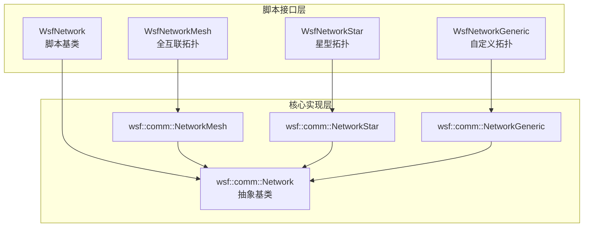
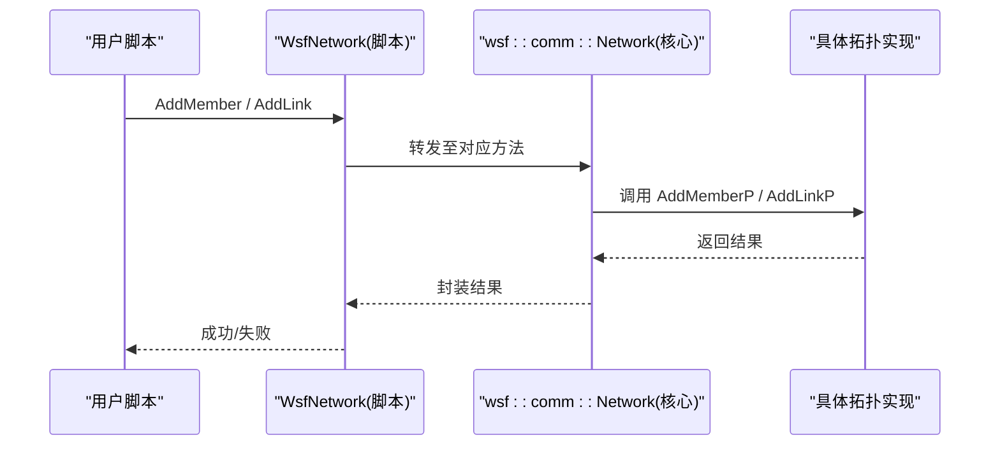
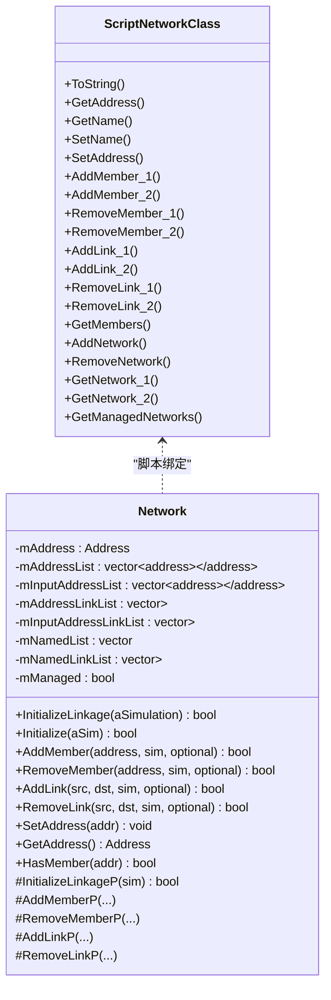
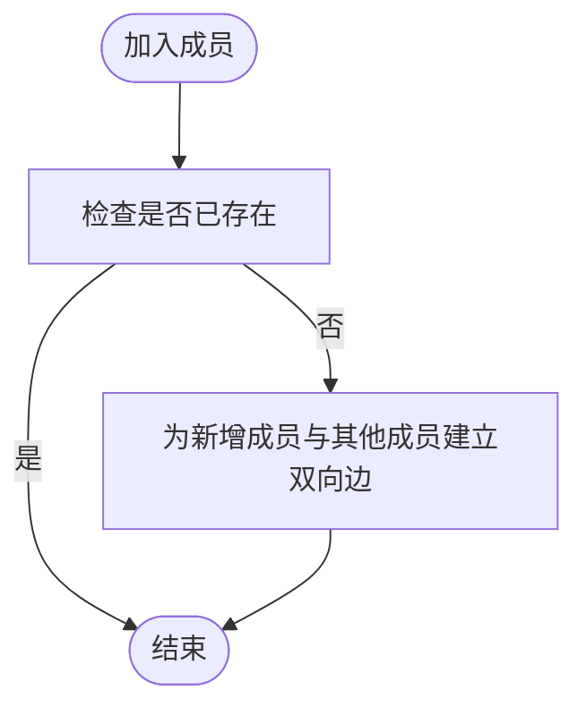
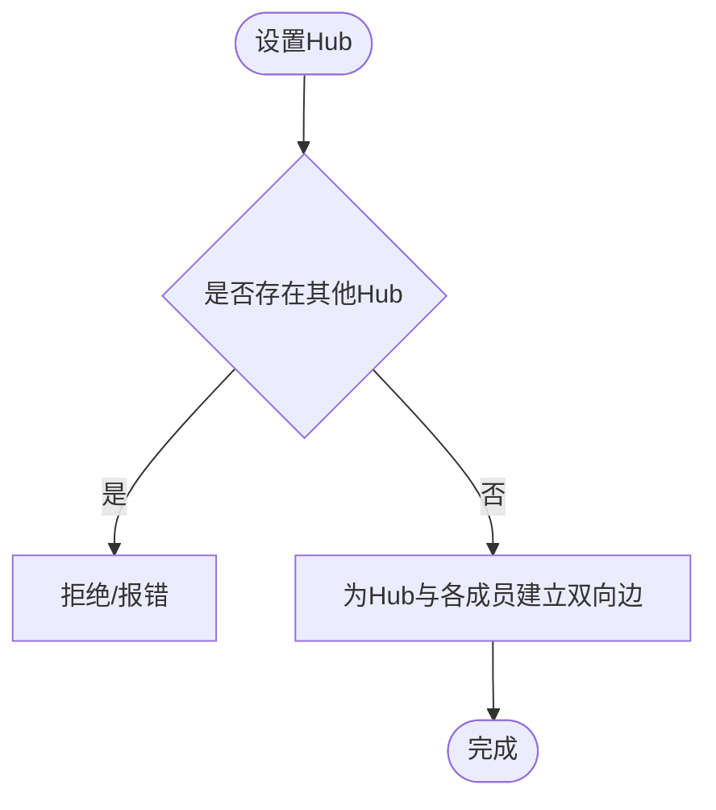
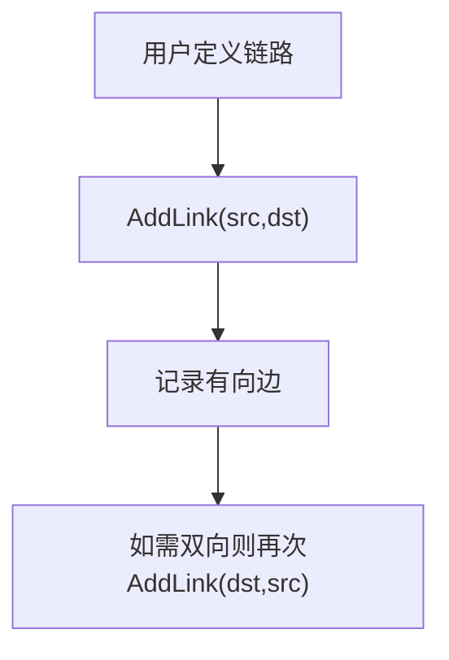
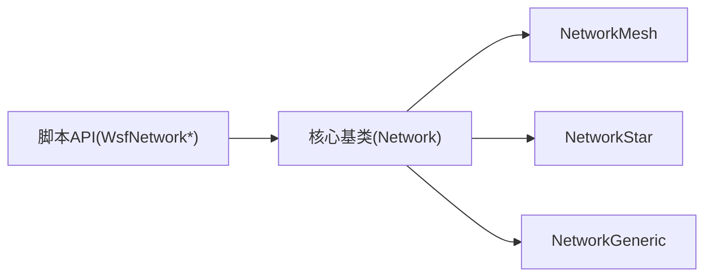
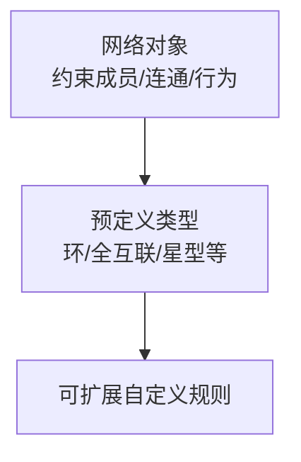

# 网络拓扑

<cite>
**本文引用的文件**   
- [WsfCommNetwork.hpp](file://swdev/src/core/wsf/source/comm/WsfCommNetwork.hpp)
- [WsfCommNetworkMesh.hpp](file://swdev/src/core/wsf/source/comm/WsfCommNetworkMesh.hpp)
- [WsfCommNetworkStar.hpp](file://swdev/src/core/wsf/source/comm/WsfCommNetworkStar.hpp)
- [WsfCommNetworkGeneric.hpp](file://swdev/src/core/wsf/source/comm/WsfCommNetworkGeneric.hpp)
- [network.rst.txt](file://documentation/html/_sources/docs/network.rst.txt)
- [wsfnetwork.rst.txt](file://documentation/html/_sources/docs/script/wsfnetwork.rst.txt)
- [wsfnetworkmesh.rst.txt](file://documentation/html/_sources/docs/script/wsfnetworkmesh.rst.txt)
- [wsfnetworkstar.rst.txt](file://documentation/html/_sources/docs/script/wsfnetworkstar.rst.txt)
- [communications_primer.rst.txt](file://documentation/html/_sources/docs/analyst_ocd/communications_primer.rst.txt)
- [comm_2_4_conversion_guide.rst.txt](file://documentation/html/_sources/docs/analyst_ocd/comm_2_4_conversion_guide.rst.txt)
- [router.rst.txt](file://documentation/html/_sources/docs/router.rst.txt)
</cite>

## 目录
1. [引言](#引言)
2. [项目结构](#项目结构)
3. [核心组件](#核心组件)
4. [架构总览](#架构总览)
5. [详细组件分析](#详细组件分析)
6. [依赖关系分析](#依赖关系分析)
7. [性能与优化](#性能与优化)
8. [故障排查指南](#故障排查指南)
9. [结论](#结论)
10. [附录](#附录)

## 引言
本文件面向网络战中的网络拓扑建模与管理，围绕节点配置、链路建立与路由管理展开，重点说明动态拓扑重构与弹性恢复的技术实现路径，并给出拓扑优化与性能调优方法。同时结合复杂网络环境下的多域联合作战场景，提供可操作的架构设计建议。内容基于AFSIM通信框架的脚本接口与核心网络类实现进行系统化梳理。

## 项目结构
AFSIM在网络拓扑方面的能力由“脚本接口 + 核心网络类”共同构成：
- 脚本接口层：通过 WsfNetwork 及其派生类型（如 Mesh、Star、Generic）暴露统一的拓扑操作API，支持添加/移除成员、增删链路、查询成员等。
- 核心实现层：以 wsf::comm::Network 为抽象基类，具体拓扑（全互联、星型、自定义）分别由 NetworkMesh、NetworkStar、NetworkGeneric 实现。
- 文档层：提供命令语法、脚本方法与行为约束说明，指导用户在不同规模与约束下选择合适的拓扑与配置策略。

图表来源
- [WsfCommNetwork.hpp:50-228](file://swdev/src/core/wsf/source/comm/WsfCommNetwork.hpp#L50-L228)
- [WsfCommNetworkMesh.hpp:23-41](file://swdev/src/core/wsf/source/comm/WsfCommNetworkMesh.hpp#L23-L41)
- [WsfCommNetworkStar.hpp:22-57](file://swdev/src/core/wsf/source/comm/WsfCommNetworkStar.hpp#L22-L57)
- [WsfCommNetworkGeneric.hpp:22-49](file://swdev/src/core/wsf/source/comm/WsfCommNetworkGeneric.hpp#L22-L49)

章节来源
- [network.rst.txt:32-52](file://documentation/html/_sources/docs/network.rst.txt#L32-L52)
- [wsfnetwork.rst.txt:15-108](file://documentation/html/_sources/docs/script/wsfnetwork.rst.txt#L15-L108)

## 核心组件
- 抽象网络基类（脚本与C++双视角）
  - 脚本侧：WsfNetwork 提供 AddNetwork/RemoveNetwork、AddMember/RemoveMember、AddLink/RemoveLink、GetMembers 等统一接口。
  - C++侧：wsf::comm::Network 定义地址容器、命名成员列表、链接列表及生命周期钩子（Initialize/InitializeLinkageP），并提供受保护的 AddMemberP/RemoveMemberP/AddLinkP/RemoveLinkP 供派生类扩展。
- 拓扑实现
  - 全互联（Mesh）：任意两个成员之间双向连通；存在 Legacy 版本用于兼容旧行为。
  - 星型（Star）：所有成员与单一 Hub 双向连通；提供 AddHub/RemoveHub 专用接口。
  - 通用（Generic）：完全由用户显式定义链路，无固定拓扑约束。
- 地址与成员管理
  - 网络可分配地址段（CIDR），成员加入时获得地址；支持按名称或地址查询/操作。
- 初始化与联动
  - InitializeLinkage 将命名成员解析为地址并建立初始链路；派生类在 InitializeLinkageP 中实现拓扑特定的连接逻辑。

章节来源
- [wsfnetwork.rst.txt:15-108](file://documentation/html/_sources/docs/script/wsfnetwork.rst.txt#L15-L108)
- [WsfCommNetwork.hpp:50-228](file://swdev/src/core/wsf/source/comm/WsfCommNetwork.hpp#L50-L228)
- [WsfCommNetworkMesh.hpp:23-41](file://swdev/src/core/wsf/source/comm/WsfCommNetworkMesh.hpp#L23-L41)
- [WsfCommNetworkStar.hpp:22-57](file://swdev/src/core/wsf/source/comm/WsfCommNetworkStar.hpp#L22-L57)
- [WsfCommNetworkGeneric.hpp:22-49](file://swdev/src/core/wsf/source/comm/WsfCommNetworkGeneric.hpp#L22-L49)

## 架构总览
下图展示从脚本到核心实现的调用链路与职责划分：

图表来源
- [wsfnetwork.rst.txt:80-102](file://documentation/html/_sources/docs/script/wsfnetwork.rst.txt#L80-L102)
- [WsfCommNetwork.hpp:106-204](file://swdev/src/core/wsf/source/comm/WsfCommNetwork.hpp#L106-L204)

## 详细组件分析

### 抽象网络基类（WsfNetwork / wsf::comm::Network）
- 关键职责
  - 统一管理网络地址段、成员集合与链路集合。
  - 提供统一的 Add/Remove Member/Link 接口，并在内部委托给派生类的 Protected 钩子。
  - 维护“是否被仿真管理器托管”的状态，避免重复释放内存。
- 重要方法
  - 脚本侧：AddNetwork/RemoveNetwork、AddMember/RemoveMember、AddLink/RemoveLink、GetMembers、GetAddress/SetAddress、GetName/SetName。
  - 核心侧：InitializeLinkage、InitializeLinkageP、AddMemberP/RemoveMemberP/AddLinkP/RemoveLinkP。
- 复杂度与数据流
  - 成员与链路均以向量存储，查询与遍历为 O(n)/O(e)。
  - 命名成员到地址的转换在初始化阶段完成，运行时以地址为主键进行快速查找。

图表来源
- [WsfCommNetwork.hpp:50-228](file://swdev/src/core/wsf/source/comm/WsfCommNetwork.hpp#L50-L228)
- [WsfCommNetwork.hpp:230-278](file://swdev/src/core/wsf/source/comm/WsfCommNetwork.hpp#L230-L278)

章节来源
- [WsfCommNetwork.hpp:50-228](file://swdev/src/core/wsf/source/comm/WsfCommNetwork.hpp#L50-L228)
- [wsfnetwork.rst.txt:15-108](file://documentation/html/_sources/docs/script/wsfnetwork.rst.txt#L15-L108)

### 全互联拓扑（WsfNetworkMesh / NetworkMesh）
- 行为特征
  - 任意两个成员之间均建立双向链路。
  - 提供 Legacy 变体以兼容历史默认行为（成员间连通性取决于是否能“互相通话”）。
- 扩展点
  - 重写 InitializeLinkageP 构建全互联边集。
  - 重写 AddMemberP/RemoveMemberP 处理成员变更时的边更新。

图表来源
- [WsfCommNetworkMesh.hpp:23-41](file://swdev/src/core/wsf/source/comm/WsfCommNetworkMesh.hpp#L23-L41)
- [wsfnetworkmesh.rst.txt:12-18](file://documentation/html/_sources/docs/script/wsfnetworkmesh.rst.txt#L12-L18)

章节来源
- [WsfCommNetworkMesh.hpp:23-41](file://swdev/src/core/wsf/source/comm/WsfCommNetworkMesh.hpp#L23-L41)
- [wsfnetworkmesh.rst.txt:12-18](file://documentation/html/_sources/docs/script/wsfnetworkmesh.rst.txt#L12-L18)

### 星型拓扑（WsfNetworkStar / NetworkStar）
- 行为特征
  - 所有成员与单一 Hub 双向连通；Hub 唯一且可通过 AddHub/RemoveHub 设置或移除。
- 扩展点
  - InitializeLinkageP 根据 Hub 与成员集合生成星型边集。
  - AddHub/RemoveHub 负责 Hub 切换时的边重建。

图表来源
- [WsfCommNetworkStar.hpp:22-57](file://swdev/src/core/wsf/source/comm/WsfCommNetworkStar.hpp#L22-L57)
- [wsfnetworkstar.rst.txt:12-35](file://documentation/html/_sources/docs/script/wsfnetworkstar.rst.txt#L12-L35)

章节来源
- [WsfCommNetworkStar.hpp:22-57](file://swdev/src/core/wsf/source/comm/WsfCommNetworkStar.hpp#L22-L57)
- [wsfnetworkstar.rst.txt:12-35](file://documentation/html/_sources/docs/script/wsfnetworkstar.rst.txt#L12-L35)

### 通用拓扑（WsfNetworkGeneric / NetworkGeneric）
- 行为特征
  - 不强制任何拓扑形状，完全由用户显式定义链路（AddLink/RemoveLink）。
- 适用场景
  - 需要精确控制端到端连通性的复杂网络，或多域异构网络的细粒度编排。

图表来源
- [WsfCommNetworkGeneric.hpp:22-49](file://swdev/src/core/wsf/source/comm/WsfCommNetworkGeneric.hpp#L22-L49)
- [wsfnetwork.rst.txt:86-102](file://documentation/html/_sources/docs/script/wsfnetwork.rst.txt#L86-L102)

章节来源
- [WsfCommNetworkGeneric.hpp:22-49](file://swdev/src/core/wsf/source/comm/WsfCommNetworkGeneric.hpp#L22-L49)
- [wsfnetwork.rst.txt:86-102](file://documentation/html/_sources/docs/script/wsfnetwork.rst.txt#L86-L102)

## 依赖关系分析
- 脚本接口与核心实现的解耦
  - 脚本层仅暴露稳定API，核心层通过 Protected 钩子实现拓扑差异，降低耦合度。
- 拓扑间的继承关系
  - NetworkMesh、NetworkStar、NetworkGeneric 均继承自 Network，复用地址与成员管理逻辑。
- 外部约束
  - 某些网络类型与自动化接口链接不兼容，需避免启用该选项以免破坏拓扑一致性。

图表来源
- [WsfCommNetwork.hpp:50-228](file://swdev/src/core/wsf/source/comm/WsfCommNetwork.hpp#L50-L228)
- [WsfCommNetworkMesh.hpp:23-41](file://swdev/src/core/wsf/source/comm/WsfCommNetworkMesh.hpp#L23-L41)
- [WsfCommNetworkStar.hpp:22-57](file://swdev/src/core/wsf/source/comm/WsfCommNetworkStar.hpp#L22-L57)
- [WsfCommNetworkGeneric.hpp:22-49](file://swdev/src/core/wsf/source/comm/WsfCommNetworkGeneric.hpp#L22-L49)

章节来源
- [router.rst.txt:111-111](file://documentation/html/_sources/docs/router.rst.txt#L111-L111)

## 性能与优化
- 拓扑选择与规模
  - 默认全互联拓扑在大规模平台下会产生大量链路，导致性能问题；当平台数量达到数千级时，建议采用星型拓扑以降低边数与开销。
- 地址规划
  - 合理分配网络地址段（CIDR），避免地址冲突与浪费，提升成员管理与路由查找效率。
- 初始化时机
  - 通信框架在所有平台初始化完成后才就绪；多数网络脚本方法在 on_initialize 阶段无效，应在 on_initialize2 后使用。
- 链路最小化
  - 对仅需部分直连的场景，优先使用 Generic 拓扑并显式定义必要链路，避免全互联带来的冗余边。

章节来源
- [comm_2_4_conversion_guide.rst.txt:133-133](file://documentation/html/_sources/docs/analyst_ocd/comm_2_4_conversion_guide.rst.txt#L133-L133)
- [wsfnetwork.rst.txt:17-17](file://documentation/html/_sources/docs/script/wsfnetwork.rst.txt#L17-L17)
- [network.rst.txt:32-52](file://documentation/html/_sources/docs/network.rst.txt#L32-L52)

## 故障排查指南
- 脚本方法不可用
  - 现象：在 on_initialize 阶段调用网络脚本方法失败。
  - 原因：通信框架尚未初始化完成。
  - 解决：将相关逻辑移至 on_initialize2 之后执行。
- 拓扑不一致或自动链接冲突
  - 现象：启用自动化接口链接后拓扑异常。
  - 原因：某些网络类型与自动化链接不兼容。
  - 解决：关闭自动化链接或改用兼容的网络类型。
- 成员未加入或链路未建立
  - 现象：AddMember/AddLink 返回失败。
  - 原因：成员已属于其他网络、拓扑不允许该链路、或参数非法。
  - 解决：确认成员当前归属、拓扑约束与参数有效性；必要时先 RemoveMember 再重新加入。

章节来源
- [wsfnetwork.rst.txt:17-17](file://documentation/html/_sources/docs/script/wsfnetwork.rst.txt#L17-L17)
- [router.rst.txt:111-111](file://documentation/html/_sources/docs/router.rst.txt#L111-L111)
- [wsfnetwork.rst.txt:80-102](file://documentation/html/_sources/docs/script/wsfnetwork.rst.txt#L80-L102)

## 结论
AFSIM 的网络拓扑体系通过脚本接口与核心实现的清晰分层，提供了灵活而高效的网络建模能力。针对网络战中的动态变化与弹性恢复需求，推荐：
- 在大规模场景中优先采用星型或通用拓扑，减少冗余边与计算开销。
- 通过显式链路定义与 Hub 机制实现可控的动态重构。
- 在通信框架初始化完成后进行拓扑操作，确保状态一致性与正确性。
- 结合地址规划与拓扑选择，平衡连通性、可扩展性与性能。

## 附录
- 概念概览
  - 网络对象为用户可定义对象，既可通过场景输入也可通过脚本语言创建，用于约束成员资格、连通性与行为规则。
  - 预定义网络类型包括环、全互联、星型等，并可扩展自定义规则。

章节来源
- [communications_primer.rst.txt:67-67](file://documentation/html/_sources/docs/analyst_ocd/communications_primer.rst.txt#L67-L67)