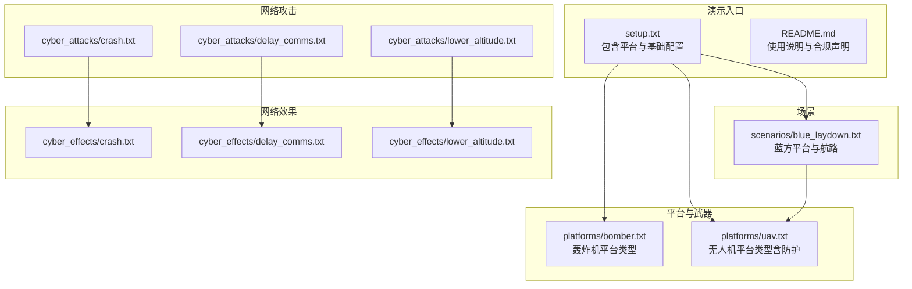
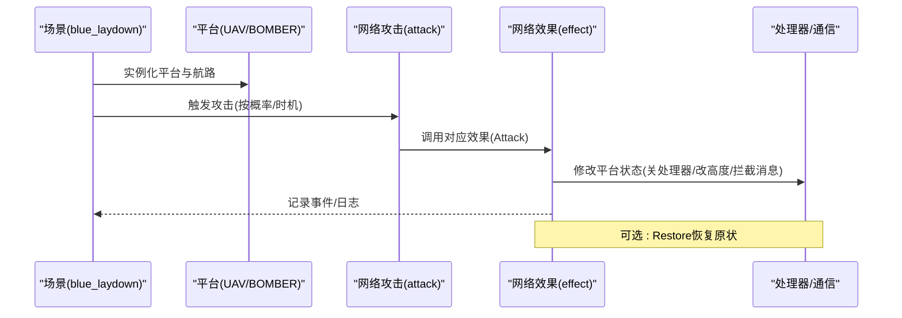
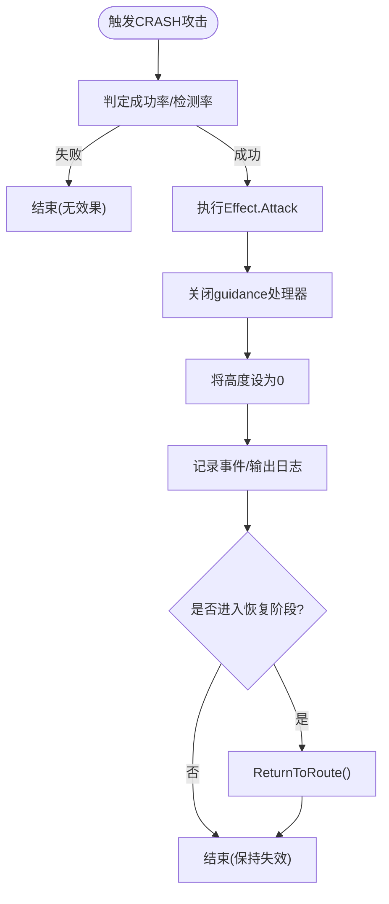
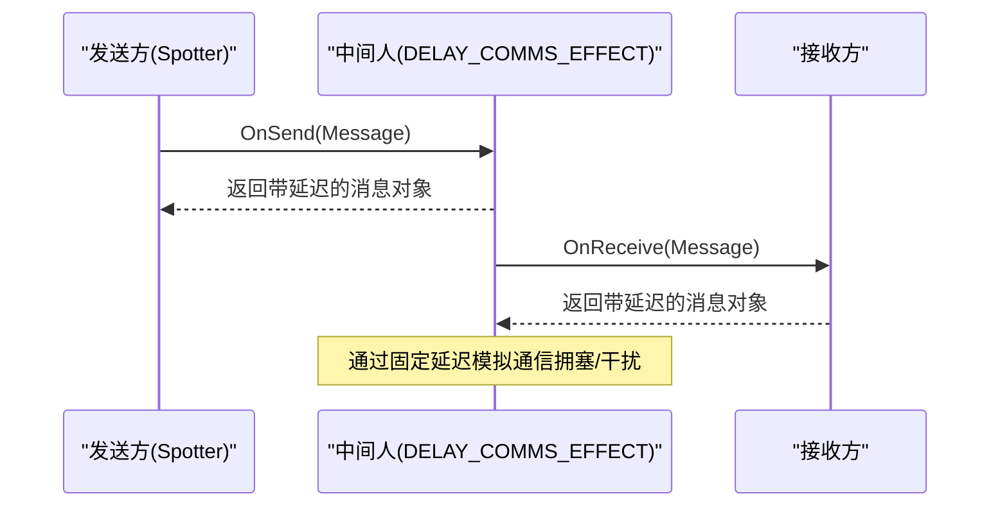
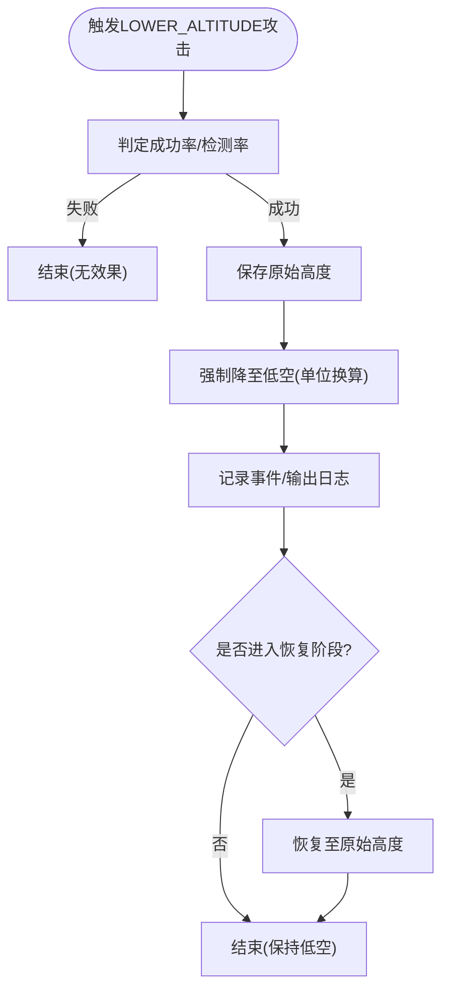
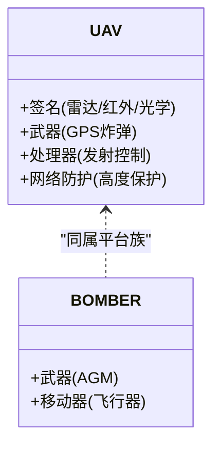
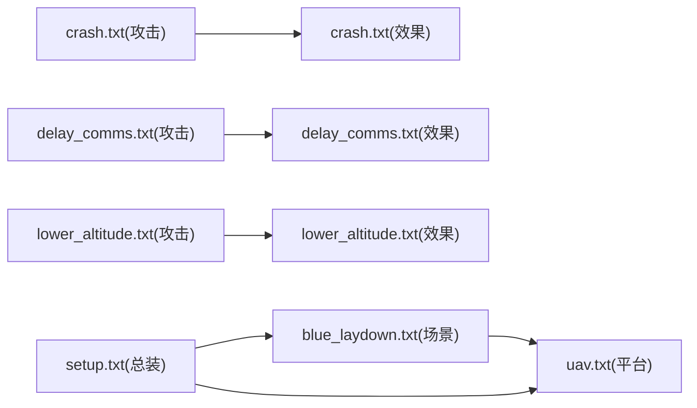

# 网络攻击

<cite>
**本文引用的文件**   
- [README.md](file://demos/cyber/README.md)
- [setup.txt](file://demos/cyber/setup.txt)
- [blue_laydown.txt](file://demos/cyber/scenarios/blue_laydown.txt)
- [bomber.txt](file://demos/cyber/platforms/bomber.txt)
- [uav.txt](file://demos/cyber/platforms/uav.txt)
- [crash.txt（攻击）](file://demos/cyber/cyber/cyber_attacks/crash.txt)
- [delay_comms.txt（攻击）](file://demos/cyber/cyber/cyber_attacks/delay_comms.txt)
- [lower_altitude.txt（攻击）](file://demos/cyber/cyber/cyber_attacks/lower_altitude.txt)
- [crash.txt（效果）](file://demos/cyber/cyber/cyber_effects/crash.txt)
- [delay_comms.txt（效果）](file://demos/cyber/cyber/cyber_effects/delay_comms.txt)
- [lower_altitude.txt（效果）](file://demos/cyber/cyber/cyber_effects/lower_altitude.txt)
</cite>

## 目录
1. [简介](#简介)
2. [项目结构](#项目结构)
3. [核心组件](#核心组件)
4. [架构总览](#架构总览)
5. [详细组件分析](#详细组件分析)
6. [依赖关系分析](#依赖关系分析)
7. [性能与可观测性](#性能与可观测性)
8. [故障排查指南](#故障排查指南)
9. [结论](#结论)
10. [附录：脚本示例与使用要点](#附录脚本示例与使用要点)

## 简介
本文件面向网络战仿真场景，系统化解析AFSIM中“网络攻击”相关能力与实现方式。重点覆盖：
- 网络渗透、恶意软件注入、数据篡改与拒绝服务在仿真中的建模方法
- 攻击链构建、攻击时机选择与攻击效果评估的技术路径
- 隐蔽性与策略设计建议
- 以具体脚本为例的实战分析：系统崩溃（crash）、通信延迟（delay_comms）、高度降低（lower_altitude）

说明：本仓库为仿真演示工程，提供的是“攻击行为的效果建模与流程编排”，并非可直接用于真实网络的攻击工具或漏洞利用代码。

## 项目结构
该网络战演示位于 demos/cyber 下，采用“攻击-效果-防护”分层组织，并通过平台定义与场景编排串联起完整的仿真链路。

图示来源
- [setup.txt:1-22](file://demos/cyber/setup.txt#L1-L22)
- [README.md:1-48](file://demos/cyber/README.md#L1-L48)
- [bomber.txt:1-22](file://demos/cyber/platforms/bomber.txt#L1-L22)
- [uav.txt:1-50](file://demos/cyber/platforms/uav.txt#L1-L50)
- [blue_laydown.txt:1-27](file://demos/cyber/scenarios/blue_laydown.txt#L1-L27)

章节来源
- [setup.txt:1-22](file://demos/cyber/setup.txt#L1-L22)
- [README.md:1-48](file://demos/cyber/README.md#L1-L48)

## 核心组件
- 攻击定义（cyber_attack）：描述攻击类型、概率、检测/归因概率、绘制频率、扫描与投递延迟等参数，并绑定到具体效果。
- 效果定义（cyber_effect）：定义攻击生效时的动作（如关闭处理器、改变高度、中间人消息拦截与延迟），以及恢复逻辑。
- 平台与防护：平台类型定义传感器、武器、处理器与网络防护；防护模块可在受攻击后尝试恢复状态。
- 场景编排：实例化平台、设置航路与任务，驱动攻击与效果的时序执行。

章节来源
- [crash.txt（攻击）:14-33](file://demos/cyber/cyber/cyber_attacks/crash.txt#L14-L33)
- [delay_comms.txt（攻击）:14-31](file://demos/cyber/cyber/cyber_attacks/delay_comms.txt#L14-L31)
- [lower_altitude.txt（攻击）:14-31](file://demos/cyber/cyber/cyber_attacks/lower_altitude.txt#L14-L31)
- [crash.txt（效果）:12-26](file://demos/cyber/cyber/cyber_effects/crash.txt#L12-L26)
- [delay_comms.txt（效果）:12-26](file://demos/cyber/cyber/cyber_effects/delay_comms.txt#L12-L26)
- [lower_altitude.txt（效果）:16-29](file://demos/cyber/cyber/cyber_effects/lower_altitude.txt#L16-L29)
- [uav.txt:22-46](file://demos/cyber/platforms/uav.txt#L22-L46)

## 架构总览
下图展示从“攻击定义→效果执行→平台状态变化”的端到端流程，以及中间人通信延迟的拦截点。

图示来源
- [blue_laydown.txt:12-25](file://demos/cyber/scenarios/blue_laydown.txt#L12-L25)
- [crash.txt（攻击）:14-33](file://demos/cyber/cyber/cyber_attacks/crash.txt#L14-L33)
- [crash.txt（效果）:12-26](file://demos/cyber/cyber/cyber_effects/crash.txt#L12-L26)
- [delay_comms.txt（效果）:12-26](file://demos/cyber/cyber/cyber_effects/delay_comms.txt#L12-L26)
- [lower_altitude.txt（效果）:16-29](file://demos/cyber/cyber/cyber_effects/lower_altitude.txt#L16-L29)

## 详细组件分析

### 系统崩溃攻击（crash）
- 攻击定义要点
  - 绑定效果 CRASH_EFFECT
  - 探测/成功/检测/归因概率与绘制频率可调
  - 扫描与投递延迟控制攻击节奏
- 效果实现要点
  - Attack：关闭目标平台的“guidance”处理器，并将目标高度置零（模拟坠毁/失控）
  - Restore：使目标返回原航路（恢复阶段）
- 典型用途
  - 对导航/制导子系统实施“软杀伤”，导致平台失去可控性
  - 配合其他物理打击形成复合效应

图示来源
- [crash.txt（攻击）:14-33](file://demos/cyber/cyber/cyber_attacks/crash.txt#L14-L33)
- [crash.txt（效果）:12-26](file://demos/cyber/cyber/cyber_effects/crash.txt#L12-L26)

章节来源
- [crash.txt（攻击）:14-33](file://demos/cyber/cyber/cyber_attacks/crash.txt#L14-L33)
- [crash.txt（效果）:12-26](file://demos/cyber/cyber/cyber_effects/crash.txt#L12-L26)

### 通信延迟攻击（delay_comms）
- 攻击定义要点
  - 绑定效果 DELAY_COMMS_EFFECT
  - 通过概率与绘制频率控制攻击可见性与持续性
  - 扫描与投递延迟影响攻击窗口
- 效果实现要点
  - 针对特定平台类型（SPOTTER）的发送/接收消息进行中间人处理
  - OnSend/OnReceive构造带固定延迟的消息对象，从而引入通信时延
- 典型用途
  - 破坏指挥控制链路的实时性，造成态势感知滞后与决策迟滞
  - 与拒止/欺骗类效果组合，放大体系级混乱

图示来源
- [delay_comms.txt（攻击）:14-31](file://demos/cyber/cyber/cyber_attacks/delay_comms.txt#L14-L31)
- [delay_comms.txt（效果）:12-26](file://demos/cyber/cyber/cyber_effects/delay_comms.txt#L12-L26)

章节来源
- [delay_comms.txt（攻击）:14-31](file://demos/cyber/cyber/cyber_attacks/delay_comms.txt#L14-L31)
- [delay_comms.txt（效果）:12-26](file://demos/cyber/cyber/cyber_effects/delay_comms.txt#L12-L26)

### 高度降低攻击（lower_altitude）
- 攻击定义要点
  - 绑定效果 LOWER_ALTITUDE_EFFECT
  - 高成功率与可视化绘制频率便于观察效果
  - 扫描与投递延迟控制攻击节奏
- 效果实现要点
  - Attack：记录原始高度，随后强制目标降至指定低空（单位换算后）
  - Restore：恢复到原始高度，体现“可逆”的网络扰动
- 典型用途
  - 迫使平台进入低空危险区，增加被防空火力发现/命中的概率
  - 与传感器/武器效能模型联动，放大战术收益

图示来源
- [lower_altitude.txt（攻击）:14-31](file://demos/cyber/cyber/cyber_attacks/lower_altitude.txt#L14-L31)
- [lower_altitude.txt（效果）:16-29](file://demos/cyber/cyber/cyber_effects/lower_altitude.txt#L16-L29)

章节来源
- [lower_altitude.txt（攻击）:14-31](file://demos/cyber/cyber/cyber_attacks/lower_altitude.txt#L14-L31)
- [lower_altitude.txt（效果）:16-29](file://demos/cyber/cyber/cyber_effects/lower_altitude.txt#L16-L29)

### 平台与防护（UAV/BOMBER）
- UAV平台
  - 集成雷达/红外/光学签名
  - 挂载武器与发射处理器
  - 启用网络防护（altitude_protect），用于对抗高度降低类攻击
- BOMBER平台
  - 作为空中载具，携带武器并在场景中参与任务

图示来源
- [uav.txt:22-46](file://demos/cyber/platforms/uav.txt#L22-L46)
- [bomber.txt:11-20](file://demos/cyber/platforms/bomber.txt#L11-L20)

章节来源
- [uav.txt:22-46](file://demos/cyber/platforms/uav.txt#L22-L46)
- [bomber.txt:11-20](file://demos/cyber/platforms/bomber.txt#L11-L20)

## 依赖关系分析
- 攻击与效果解耦：攻击仅负责“何时、以何概率”触发，效果负责“如何改变系统状态”。
- 平台类型与效果匹配：例如 delay_comms 效果限定 SPOTTER 平台类型，确保作用域正确。
- 场景驱动：场景实例化平台与航路，决定攻击的目标与时间线。

图示来源
- [crash.txt（攻击）:12-12](file://demos/cyber/cyber/cyber_attacks/crash.txt#L12-L12)
- [crash.txt（效果）:12-26](file://demos/cyber/cyber/cyber_effects/crash.txt#L12-L26)
- [delay_comms.txt（攻击）:12-12](file://demos/cyber/cyber/cyber_attacks/delay_comms.txt#L12-L12)
- [delay_comms.txt（效果）:12-26](file://demos/cyber/cyber/cyber_effects/delay_comms.txt#L12-L26)
- [lower_altitude.txt（攻击）:12-12](file://demos/cyber/cyber/cyber_attacks/lower_altitude.txt#L12-L12)
- [lower_altitude.txt（效果）:16-29](file://demos/cyber/cyber/cyber_effects/lower_altitude.txt#L16-L29)
- [blue_laydown.txt:12-25](file://demos/cyber/scenarios/blue_laydown.txt#L12-L25)
- [setup.txt:13-21](file://demos/cyber/setup.txt#L13-L21)

章节来源
- [setup.txt:13-21](file://demos/cyber/setup.txt#L13-L21)
- [blue_laydown.txt:12-25](file://demos/cyber/scenarios/blue_laydown.txt#L12-L25)

## 性能与可观测性
- 绘制频率（draw_frequency）
  - always：每次仿真步都输出，便于调试但可能产生大量日志
  - 按需调整以降低I/O压力
- 概率参数
  - probability_of_attack_success：控制攻击实际生效比例
  - probability_of_attack_detection / attribution：影响“被发现/被归因”的概率，可用于评估隐蔽性
- 延迟参数
  - scan_delay_time / delivery_delay_time：调节攻击节奏，避免瞬时集中触发导致仿真抖动

[本节为通用指导，不直接分析具体文件]

## 故障排查指南
- 攻击未生效
  - 检查 probability_of_attack_success 是否为0或过低
  - 确认 cyber_attack 绑定的 effect 名称与 cyber_effect 定义一致
- 效果未作用于目标
  - 核对平台类型是否匹配（如 delay_comms 效果限定 SPOTTER）
  - 检查平台是否包含被攻击影响的处理器/通信模块
- 日志过多或过少
  - 调整 attack_success_draw_frequency / status_report_draw_frequency / attack_detection_draw_frequency
- 恢复逻辑异常
  - 检查 Restore 脚本是否正确读取/写入平台状态（如 originalAltitude 映射）

章节来源
- [crash.txt（效果）:12-26](file://demos/cyber/cyber/cyber_effects/crash.txt#L12-L26)
- [delay_comms.txt（效果）:12-26](file://demos/cyber/cyber/cyber_effects/delay_comms.txt#L12-L26)
- [lower_altitude.txt（效果）:16-29](file://demos/cyber/cyber/cyber_effects/lower_altitude.txt#L16-L29)

## 结论
本演示工程以“攻击-效果-防护-平台-场景”的分层结构，展示了网络战在仿真环境中的建模方法。通过概率、延迟与绘制频率等参数，可实现对系统崩溃、通信延迟与高度操控等典型网络效应的可控复现。结合平台防护与场景编排，能够支撑攻击链设计与效果评估，并为隐蔽性与策略优化提供量化依据。

[本节为总结性内容，不直接分析具体文件]

## 附录：脚本示例与使用要点
- 系统崩溃攻击（crash）
  - 关键参数：effect、probability_of_attack_success、scan_delay_time、delivery_delay_time
  - 效果动作：关闭导航处理器、置零高度；恢复时返回原航路
  - 参考路径
    - [crash.txt（攻击）:14-33](file://demos/cyber/cyber/cyber_attacks/crash.txt#L14-L33)
    - [crash.txt（效果）:12-26](file://demos/cyber/cyber/cyber_effects/crash.txt#L12-L26)
- 通信延迟攻击（delay_comms）
  - 关键参数：effect、probability_of_attack_success、scan_delay_time、delivery_delay_time
  - 效果动作：对指定平台类型的发送/接收消息施加固定延迟
  - 参考路径
    - [delay_comms.txt（攻击）:14-31](file://demos/cyber/cyber/cyber_attacks/delay_comms.txt#L14-L31)
    - [delay_comms.txt（效果）:12-26](file://demos/cyber/cyber/cyber_effects/delay_comms.txt#L12-L26)
- 高度降低攻击（lower_altitude）
  - 关键参数：effect、probability_of_attack_success、scan_delay_time、delivery_delay_time
  - 效果动作：记录并切换至低空；恢复时回到原高度
  - 参考路径
    - [lower_altitude.txt（攻击）:14-31](file://demos/cyber/cyber/cyber_attacks/lower_altitude.txt#L14-L31)
    - [lower_altitude.txt（效果）:16-29](file://demos/cyber/cyber/cyber_effects/lower_altitude.txt#L16-L29)
- 平台与场景
  - 平台定义与防护：UAV 集成签名、武器、处理器与网络防护
  - 场景编排：实例化平台与航路，驱动攻击时序
  - 参考路径
    - [uav.txt:22-46](file://demos/cyber/platforms/uav.txt#L22-L46)
    - [blue_laydown.txt:12-25](file://demos/cyber/scenarios/blue_laydown.txt#L12-L25)
    - [setup.txt:13-21](file://demos/cyber/setup.txt#L13-L21)

[本节为示例索引，不直接分析具体文件]