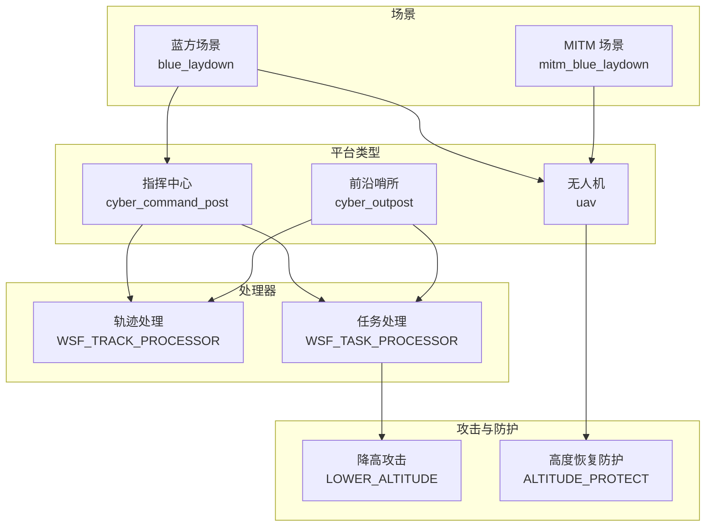
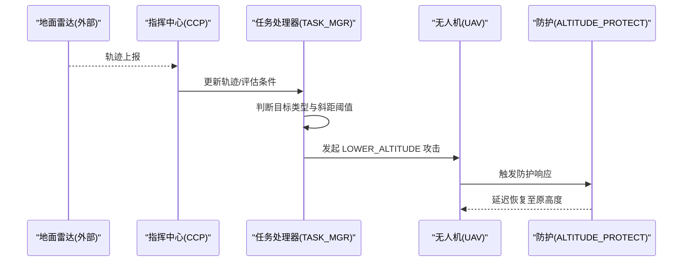
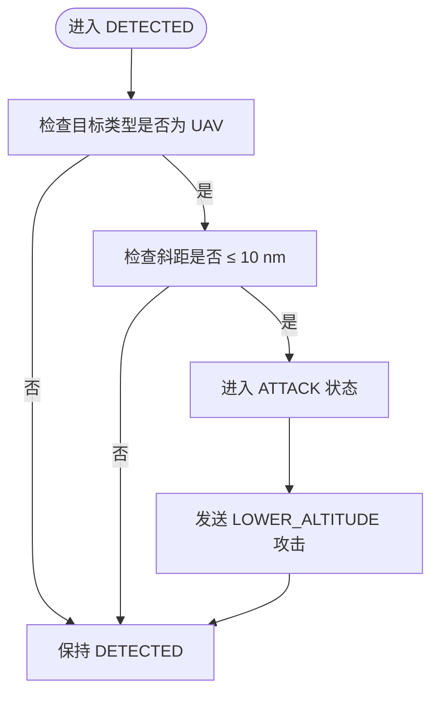
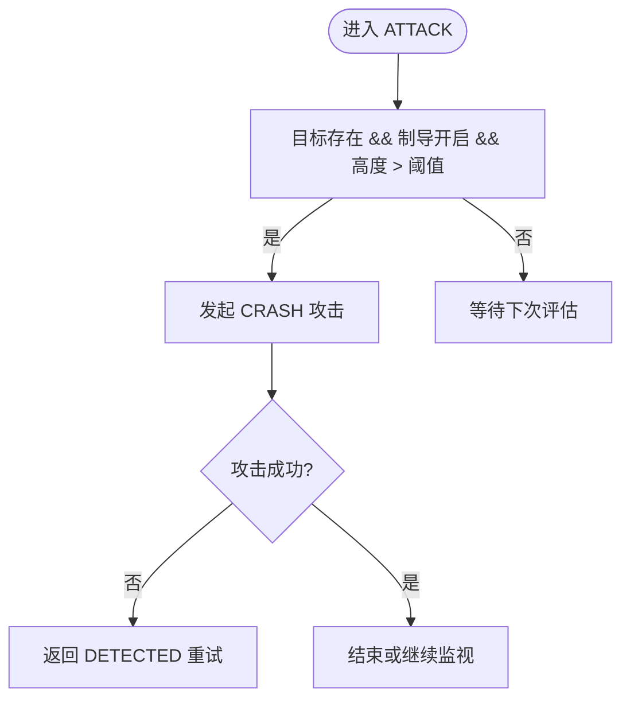
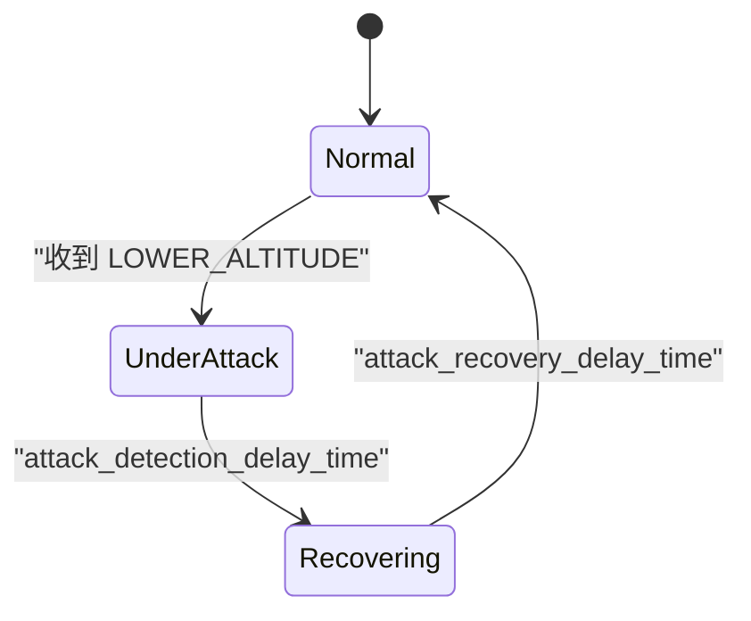
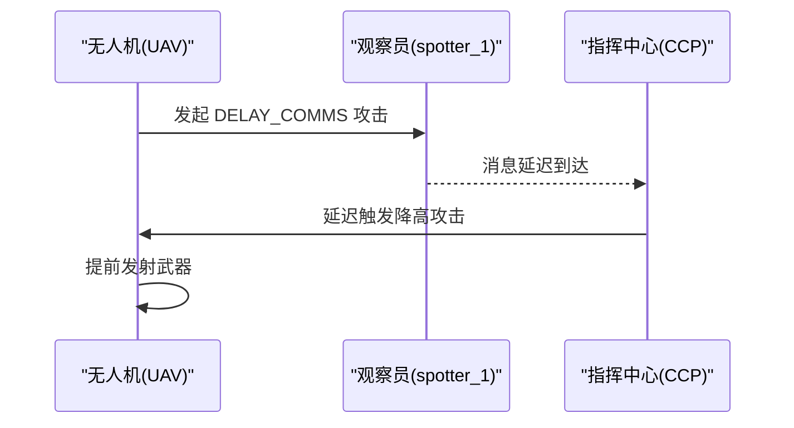
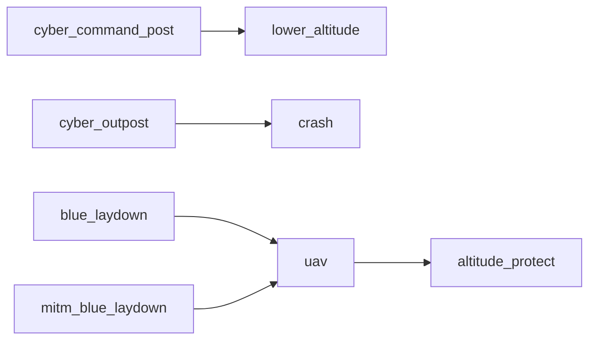

# 网络防御

<cite>
**本文引用的文件**   
- [demos/cyber/doc/cyber.rst](file://demos/cyber/doc/cyber.rst)
- [demos/cyber/README.md](file://demos/cyber/README.md)
- [demos/cyber/platforms/cyber_command_post.txt](file://demos/cyber/platforms/cyber_command_post.txt)
- [demos/cyber/platforms/cyber_outpost.txt](file://demos/cyber/platforms/cyber_outpost.txt)
- [demos/cyber/platforms/uav.txt](file://demos/cyber/platforms/uav.txt)
- [demos/cyber/cyber/cyber_attacks/lower_altitude.txt](file://demos/cyber/cyber/cyber_attacks/lower_altitude.txt)
- [demos/cyber/cyber/cyber_protections/altitude_protect.txt](file://demos/cyber/cyber/cyber_protections/altitude_protect.txt)
- [demos/cyber/scenarios/blue_laydown.txt](file://demos/cyber/scenarios/blue_laydown.txt)
- [demos/cyber/scenarios/mitm_blue_laydown.txt](file://demos/cyber/scenarios/mitm_blue_laydown.txt)
</cite>

## 目录
1. [引言](#引言)
2. [项目结构](#项目结构)
3. [核心组件](#核心组件)
4. [架构总览](#架构总览)
5. [详细组件分析](#详细组件分析)
6. [依赖关系分析](#依赖关系分析)
7. [性能与可观测性](#性能与可观测性)
8. [故障排查指南](#故障排查指南)
9. [结论](#结论)
10. [附录：关键配置要点清单](#附录关键配置要点清单)

## 引言
本文件围绕 AFSIM 的“网络（赛博）”演示，系统化解析网络防御体系的构建与配置。重点覆盖入侵检测、防火墙式访问控制、安全监控与应急响应机制；并解释网络隔离、访问控制与数据加密在仿真中的技术实现方式；同时给出面向网络安全指挥中心与前沿哨所等关键节点的防护策略与加固方法。内容以仓库中 cyber 演示为蓝本，结合平台、处理器、攻击与防护定义进行分层说明，帮助读者从概念到落地逐步掌握体系化防御设计。

## 项目结构
AFSIM 的 cyber 演示采用“平台 + 处理器 + 攻击/防护 + 场景”的分层组织方式：
- 平台类型定义：如指挥中心、前沿哨所、无人机等
- 处理器：负责态势感知、任务编排与状态机驱动
- 攻击与防护：定义赛博攻击效果、成功概率、延迟与恢复策略
- 场景：编排实体、通信链路、传感器与行为脚本

图表来源
- [demos/cyber/platforms/cyber_command_post.txt:14-47](file://demos/cyber/platforms/cyber_command_post.txt#L14-L47)
- [demos/cyber/platforms/cyber_outpost.txt:14-74](file://demos/cyber/platforms/cyber_outpost.txt#L14-L74)
- [demos/cyber/platforms/uav.txt:22-46](file://demos/cyber/platforms/uav.txt#L22-L46)
- [demos/cyber/cyber/cyber_attacks/lower_altitude.txt:14-31](file://demos/cyber/cyber/cyber_attacks/lower_altitude.txt#L14-L31)
- [demos/cyber/cyber/cyber_protections/altitude_protect.txt:13-26](file://demos/cyber/cyber/cyber_protections/altitude_protect.txt#L13-L26)
- [demos/cyber/scenarios/blue_laydown.txt:12-27](file://demos/cyber/scenarios/blue_laydown.txt#L12-L27)
- [demos/cyber/scenarios/mitm_blue_laydown.txt:14-37](file://demos/cyber/scenarios/mitm_blue_laydown.txt#L14-L37)

章节来源
- [demos/cyber/doc/cyber.rst:27-64](file://demos/cyber/doc/cyber.rst#L27-L64)

## 核心组件
- 网络安全指挥中心（CYBER_COMMAND_POST）
  - 通过 WSF_TRACK_PROCESSOR 接收雷达轨迹，使用 WSF_TASK_PROCESSOR 执行任务状态机，当目标为 UAV 且距离小于阈值时发起降高攻击。
- 前沿哨所（CYBER_OUTPOST）
  - 具备轨迹清理周期与多服务器并发能力，对巡航导弹类目标实施“CRASH”攻击，并在失败后周期性重试。
- 无人机（UAV）
  - 挂载武器与多种签名，内置 ALTITUDE_PROTECT 防护，在遭受 LOWER_ALTITUDE 攻击后按恢复时间回到原高度。
- 攻击与防护
  - LOWER_ALTITUDE：扫描、投递、检测与未来免疫的概率与时延参数可控。
  - ALTITUDE_PROTECT：针对 LOWER_ALTITUDE 的攻击响应，包含检测延迟与恢复延迟。

章节来源
- [demos/cyber/platforms/cyber_command_post.txt:14-47](file://demos/cyber/platforms/cyber_command_post.txt#L14-L47)
- [demos/cyber/platforms/cyber_outpost.txt:14-74](file://demos/cyber/platforms/cyber_outpost.txt#L14-L74)
- [demos/cyber/platforms/uav.txt:22-46](file://demos/cyber/platforms/uav.txt#L22-L46)
- [demos/cyber/cyber/cyber_attacks/lower_altitude.txt:14-31](file://demos/cyber/cyber/cyber_attacks/lower_altitude.txt#L14-L31)
- [demos/cyber/cyber/cyber_protections/altitude_protect.txt:13-26](file://demos/cyber/cyber/cyber_protections/altitude_protect.txt#L13-L26)

## 架构总览
下图展示指挥中心—前沿哨所—无人机之间的交互流程，包括探测、决策、攻击与防护恢复的关键步骤。

图表来源
- [demos/cyber/platforms/cyber_command_post.txt:24-47](file://demos/cyber/platforms/cyber_command_post.txt#L24-L47)
- [demos/cyber/platforms/uav.txt:27-28](file://demos/cyber/platforms/uav.txt#L27-L28)
- [demos/cyber/cyber/cyber_protections/altitude_protect.txt:13-26](file://demos/cyber/cyber/cyber_protections/altitude_protect.txt#L13-L26)

## 详细组件分析

### 网络安全指挥中心（CYBER_COMMAND_POST）
- 职责
  - 接入数据链，连接内部 data_mgr 与 task_mgr。
  - 使用 WSF_TRACK_PROCESSOR 管理轨迹。
  - 使用 WSF_TASK_PROCESSOR 实现状态机：DETECTED→ATTACK，依据目标类型与斜距阈值触发攻击。
- 关键逻辑
  - 当 TRACK.TargetType() == "UAV" 且 PLATFORM.SlantRangeTo(TRACK) <= 10 nm 时进入 ATTACK 状态。
  - 在 ATTACK 状态调用 SendCyberAttack() 对目标发起 LOWER_ALTITUDE 攻击。
- 防御意义
  - 作为“网络安全指挥中心”，集中化决策与调度，体现指挥控制节点在网络防御中的中枢作用。

图表来源
- [demos/cyber/platforms/cyber_command_post.txt:24-47](file://demos/cyber/platforms/cyber_command_post.txt#L24-L47)

章节来源
- [demos/cyber/platforms/cyber_command_post.txt:14-47](file://demos/cyber/platforms/cyber_command_post.txt#L14-L47)

### 前沿哨所（CYBER_OUTPOST）
- 职责
  - 维护轨迹清理周期（purge_interval），支持多服务器并发（number_of_servers）。
  - 对符合条件的目标（如巡航导弹）发起 CRASH 攻击，并在失败后周期性重试。
- 关键逻辑
  - 在 ATTACK 状态内，若目标存在且制导系统开启且高度高于阈值，则发起攻击。
  - 若攻击未成功，返回 DETECTED 状态等待下一次评估。
- 防御意义
  - 作为“前沿哨所”，贴近威胁方向，提供快速反应与持续压制能力。

图表来源
- [demos/cyber/platforms/cyber_outpost.txt:28-68](file://demos/cyber/platforms/cyber_outpost.txt#L28-L68)

章节来源
- [demos/cyber/platforms/cyber_outpost.txt:14-74](file://demos/cyber/platforms/cyber_outpost.txt#L14-L74)

### 无人机（UAV）与防护（ALTITUDE_PROTECT）
- 职责
  - 挂载武器与多谱段签名，内置 ALTITUDE_PROTECT 防护。
  - 在遭受 LOWER_ALTITUDE 攻击后，经过 attack_detection_delay_time 与 attack_recovery_delay_time 恢复至原高度。
- 关键逻辑
  - 防护对象为 LOWER_ALTITUDE 攻击，恢复时间为固定值。
- 防御意义
  - 体现终端平台的抗干扰与自愈能力，是网络防御闭环中的重要一环。

图表来源
- [demos/cyber/platforms/uav.txt:27-28](file://demos/cyber/platforms/uav.txt#L27-L28)
- [demos/cyber/cyber/cyber_protections/altitude_protect.txt:13-26](file://demos/cyber/cyber/cyber_protections/altitude_protect.txt#L13-L26)

章节来源
- [demos/cyber/platforms/uav.txt:22-46](file://demos/cyber/platforms/uav.txt#L22-L46)
- [demos/cyber/cyber/cyber_protections/altitude_protect.txt:13-26](file://demos/cyber/cyber/cyber_protections/altitude_protect.txt#L13-L26)

### MITM 与通信延迟（DELAY_COMMS）
- 背景
  - 在 MITM 场景中，UAV 主动对 spotter_1 发起 DELAY_COMMS 攻击，延迟其消息传递，从而改变指挥链路的时序。
- 关键逻辑
  - UAV 在更新回调中检测与 spotter_1 的距离，若满足条件且尚未被延迟，则发起 DELAY_COMMS 攻击。
- 防御意义
  - 体现通信链路的脆弱性与中间人攻击的影响，强调通信安全与时效性在防御体系中的重要性。

图表来源
- [demos/cyber/scenarios/mitm_blue_laydown.txt:29-35](file://demos/cyber/scenarios/mitm_blue_laydown.txt#L29-L35)

章节来源
- [demos/cyber/scenarios/mitm_blue_laydown.txt:14-37](file://demos/cyber/scenarios/mitm_blue_laydown.txt#L14-L37)

## 依赖关系分析
- 平台类型依赖
  - cyber_command_post 依赖 lower_altitude 攻击与 WSF_TASK_PROCESSOR。
  - cyber_outpost 依赖 crash 攻击与 WSF_TASK_PROCESSOR。
  - uav 依赖 altitude_protect 防护与武器释放处理器。
- 场景依赖
  - blue_laydown 将 UAV 编入场景，配合指挥中心完成攻击流程。
  - mitm_blue_laydown 引入 spotter_1 与 DELAY_COMMS 攻击，改变通信时序。

图表来源
- [demos/cyber/platforms/cyber_command_post.txt:12-13](file://demos/cyber/platforms/cyber_command_post.txt#L12-L13)
- [demos/cyber/platforms/cyber_outpost.txt:12-13](file://demos/cyber/platforms/cyber_outpost.txt#L12-L13)
- [demos/cyber/platforms/uav.txt:20-21](file://demos/cyber/platforms/uav.txt#L20-L21)
- [demos/cyber/scenarios/blue_laydown.txt:12-27](file://demos/cyber/scenarios/blue_laydown.txt#L12-L27)
- [demos/cyber/scenarios/mitm_blue_laydown.txt:12-13](file://demos/cyber/scenarios/mitm_blue_laydown.txt#L12-L13)

章节来源
- [demos/cyber/platforms/cyber_command_post.txt:12-13](file://demos/cyber/platforms/cyber_command_post.txt#L12-L13)
- [demos/cyber/platforms/cyber_outpost.txt:12-13](file://demos/cyber/platforms/cyber_outpost.txt#L12-L13)
- [demos/cyber/platforms/uav.txt:20-21](file://demos/cyber/platforms/uav.txt#L20-L21)
- [demos/cyber/scenarios/blue_laydown.txt:12-27](file://demos/cyber/scenarios/blue_laydown.txt#L12-L27)
- [demos/cyber/scenarios/mitm_blue_laydown.txt:12-13](file://demos/cyber/scenarios/mitm_blue_laydown.txt#L12-L13)

## 性能与可观测性
- 轨迹清理与并发
  - 前沿哨所的轨迹清理周期（purge_interval）与服务器数量（number_of_servers）影响内存占用与并发处理能力。
- 评估间隔与延迟
  - 任务处理器的 evaluation_interval 与 time_to_evaluate 决定攻击频率与响应时延。
- 可观测性
  - 通过事件输出与日志打印（writeln）观察攻击触发、状态切换与恢复过程。

章节来源
- [demos/cyber/platforms/cyber_outpost.txt:24-30](file://demos/cyber/platforms/cyber_outpost.txt#L24-L30)
- [demos/cyber/platforms/cyber_command_post.txt:33-46](file://demos/cyber/platforms/cyber_command_post.txt#L33-L46)

## 故障排查指南
- 攻击未触发
  - 检查目标类型与斜距阈值是否符合条件。
  - 确认任务处理器的状态机是否正确进入 ATTACK 状态。
- 防护未恢复
  - 检查防护的 attack_detection_delay_time 与 attack_recovery_delay_time 设置。
- 通信延迟异常
  - 在 MITM 场景中，确认 UAV 对 spotter_1 的 DELAY_COMMS 攻击是否成功，以及消息延迟是否达到预期。

章节来源
- [demos/cyber/platforms/cyber_command_post.txt:33-46](file://demos/cyber/platforms/cyber_command_post.txt#L33-L46)
- [demos/cyber/cyber/cyber_protections/altitude_protect.txt:22-24](file://demos/cyber/cyber/cyber_protections/altitude_protect.txt#L22-L24)
- [demos/cyber/scenarios/mitm_blue_laydown.txt:29-35](file://demos/cyber/scenarios/mitm_blue_laydown.txt#L29-L35)

## 结论
AFSIM 的 cyber 演示通过“指挥中心—前沿哨所—无人机”的协同，展示了网络防御的核心要素：入侵检测（轨迹上报）、访问控制（基于距离与类型的判定）、安全监控（状态机与日志）、应急响应（攻击与防护恢复）。在此基础上，结合通信延迟与中间人攻击，进一步凸显了通信链路与数据流在防御体系中的关键地位。实际工程中，应据此建立分层防御、纵深防护与快速恢复的体系化方案。

## 附录：关键配置要点清单
- 入侵检测
  - 使用 WSF_TRACK_PROCESSOR 接收雷达轨迹，确保轨迹更新及时。
- 访问控制
  - 基于目标类型与斜距阈值进行访问控制（如 UAV 且 ≤ 10 nm）。
- 安全监控
  - 使用 WSF_TASK_PROCESSOR 的状态机记录与可视化攻击与防护过程。
- 应急响应
  - 定义攻击（如 LOWER_ALTITUDE）与防护（如 ALTITUDE_PROTECT），合理设置概率与时延。
- 网络隔离
  - 通过数据链 network_name 与 internal_link 划分不同域，限制跨域访问。
- 数据加密
  - 在通信层启用加密（示例中未直接体现，可在数据链配置中增加加密参数）。
- 关键节点防护
  - 指挥中心：集中化决策与调度，强化态势融合与任务编排。
  - 前沿哨所：贴近威胁方向，提供快速反应与持续压制能力。

章节来源
- [demos/cyber/platforms/cyber_command_post.txt:18-22](file://demos/cyber/platforms/cyber_command_post.txt#L18-L22)
- [demos/cyber/platforms/cyber_outpost.txt:18-22](file://demos/cyber/platforms/cyber_outpost.txt#L18-L22)
- [demos/cyber/cyber/cyber_attacks/lower_altitude.txt:17-31](file://demos/cyber/cyber/cyber_attacks/lower_altitude.txt#L17-L31)
- [demos/cyber/cyber/cyber_protections/altitude_protect.txt:13-26](file://demos/cyber/cyber/cyber_protections/altitude_protect.txt#L13-L26)