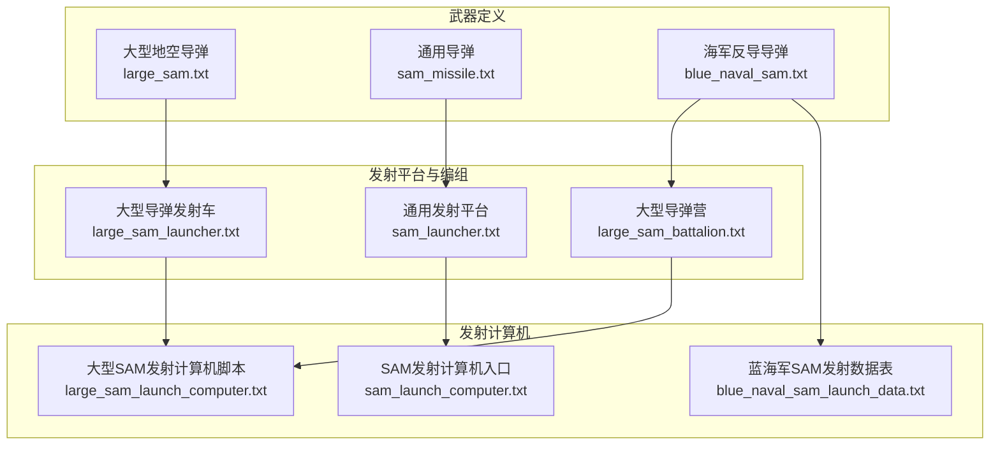
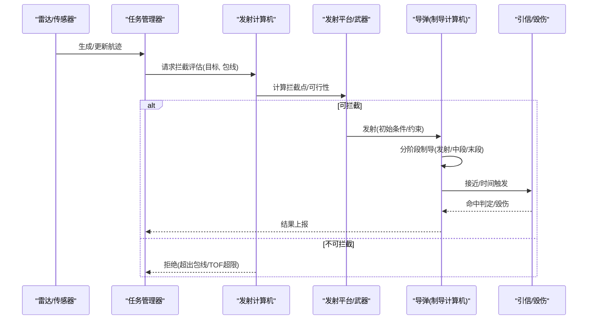
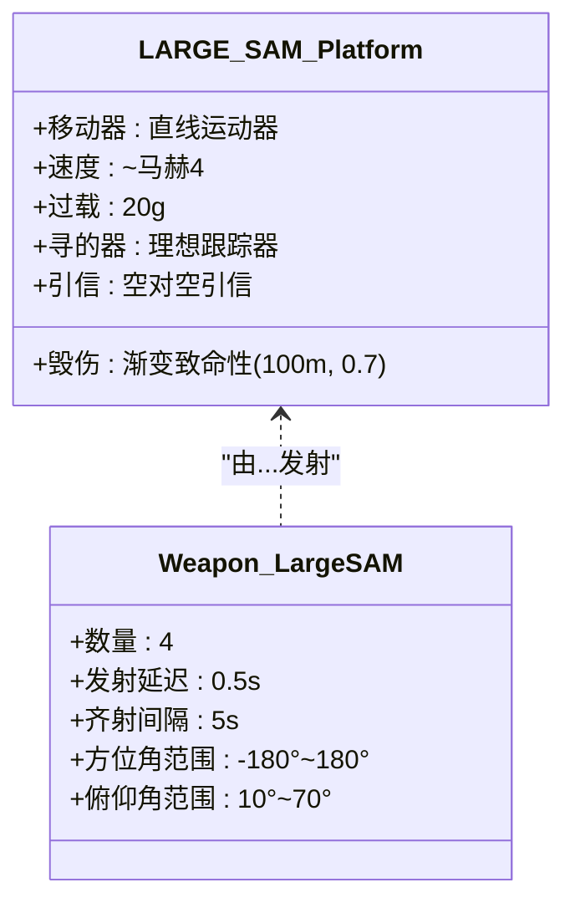
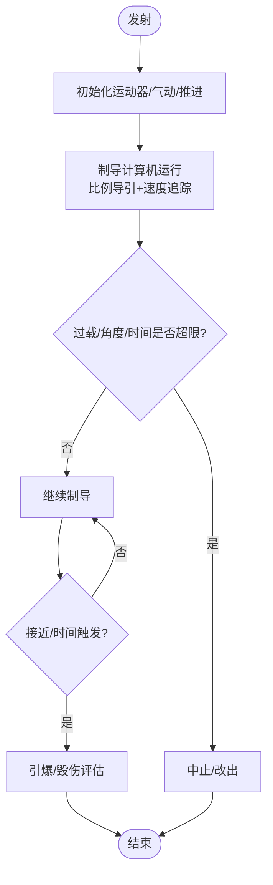
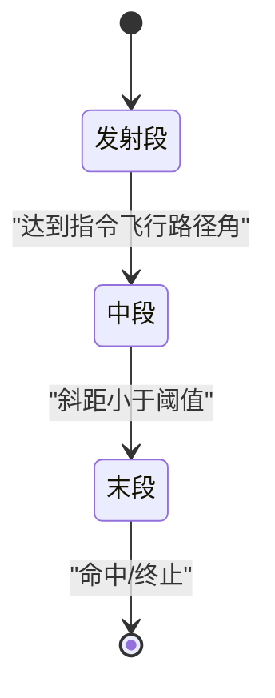
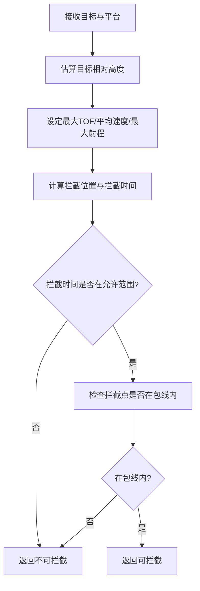
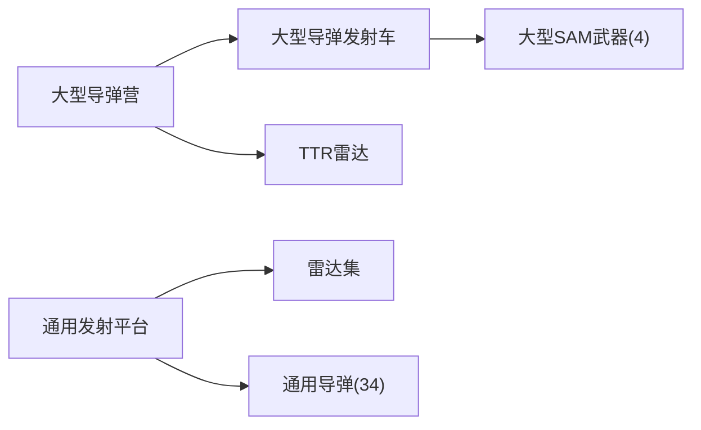
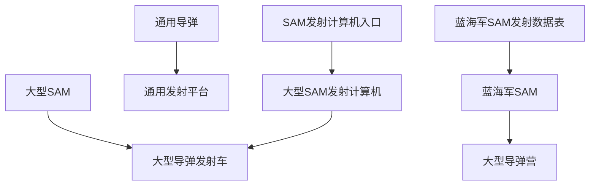

# 导弹防御

<cite>
**本文引用的文件**   
- [large_sam.txt](file://demos/iads/weapons/sam/large_sam.txt)
- [large_sam_launch_computer.txt](file://demos/iads/weapons/sam/large_sam_launch_computer.txt)
- [sam_launch_computer.txt](file://demos/iads/weapons/sam/sam_launch_computer.txt)
- [sam_missile.txt](file://demos/launcher/weapons/sam/sam_missile.txt)
- [blue_naval_sam.txt](file://demos/ballistic_missile_shootdown/weapons/sam/blue_naval_sam.txt)
- [blue_naval_sam_launch_data.txt](file://demos/ballistic_missile_shootdown/weapons/sam/blue_naval_sam_launch_data.txt)
- [large_sam_battalion.txt](file://demos/iads/platforms/large_sam_battalion.txt)
- [large_sam_launcher.txt](file://demos/iads/platforms/large_sam_launcher.txt)
- [sam_launcher.txt](file://demos/launcher/platforms/sam_launcher.txt)
</cite>

## 目录
1. [引言](#引言)
2. [项目结构](#项目结构)
3. [核心组件](#核心组件)
4. [架构总览](#架构总览)
5. [详细组件分析](#详细组件分析)
6. [依赖关系分析](#依赖关系分析)
7. [性能与仿真特性](#性能与仿真特性)
8. [故障排查指南](#故障排查指南)
9. [结论](#结论)
10. [附录：战术与效能评估方法](#附录战术与效能评估方法)

## 引言
本文件面向防空导弹系统（地空导弹，SAM）的建模、配置与作战逻辑，基于仓库中的示例场景与武器定义，系统性说明以下方面：
- SAM 类型与能力边界：射程、杀伤区、拦截概率等关键参数在配置中的体现。
- 发射阵地部署与弹药管理：平台、武器、通信与任务处理器的组织方式。
- 火力控制流程：从目标跟踪到发射计算机决策、弹道预测与发射授权。
- 拦截弹道计算：制导计算机阶段化飞行控制、寻的器与引信逻辑。
- 战术与效能评估：可操作的指标与方法建议，便于在仿真中量化评估。

## 项目结构
围绕 SAM 的关键文件分布在 weapons、platforms 与 launchers 三类目录中：
- 武器定义：包含导弹平台类型、气动/推进、制导、引信、毁伤效果及武器发射约束。
- 发射平台与营级编组：定义雷达传感器、数据链、任务处理器与杀伤包线区域。
- 发射机示例：展示雷达-武器联动、任务处理器与数据流集成。

图示来源
- [large_sam.txt:1-94](file://demos/iads/weapons/sam/large_sam.txt#L1-L94)
- [sam_missile.txt:1-70](file://demos/launcher/weapons/sam/sam_missile.txt#L1-L70)
- [blue_naval_sam.txt:1-220](file://demos/ballistic_missile_shootdown/weapons/sam/blue_naval_sam.txt#L1-L220)
- [large_sam_battalion.txt:1-120](file://demos/iads/platforms/large_sam_battalion.txt#L1-L120)
- [large_sam_launcher.txt:1-36](file://demos/iads/platforms/large_sam_launcher.txt#L1-L36)
- [sam_launcher.txt:1-40](file://demos/launcher/platforms/sam_launcher.txt#L1-L40)
- [large_sam_launch_computer.txt:1-49](file://demos/iads/weapons/sam/large_sam_launch_computer.txt#L1-L49)
- [sam_launch_computer.txt:1-31](file://demos/iads/weapons/sam/sam_launch_computer.txt#L1-L31)
- [blue_naval_sam_launch_data.txt:1-800](file://demos/ballistic_missile_shootdown/weapons/sam/blue_naval_sam_launch_data.txt#L1-L800)

章节来源
- [large_sam.txt:1-94](file://demos/iads/weapons/sam/large_sam.txt#L1-L94)
- [sam_missile.txt:1-70](file://demos/launcher/weapons/sam/sam_missile.txt#L1-L70)
- [blue_naval_sam.txt:1-220](file://demos/ballistic_missile_shootdown/weapons/sam/blue_naval_sam.txt#L1-L220)
- [large_sam_battalion.txt:1-120](file://demos/iads/platforms/large_sam_battalion.txt#L1-L120)
- [large_sam_launcher.txt:1-36](file://demos/iads/platforms/large_sam_launcher.txt#L1-L36)
- [sam_launcher.txt:1-40](file://demos/launcher/platforms/sam_launcher.txt#L1-L40)
- [large_sam_launch_computer.txt:1-49](file://demos/iads/weapons/sam/large_sam_launch_computer.txt#L1-L49)
- [sam_launch_computer.txt:1-31](file://demos/iads/weapons/sam/sam_launch_computer.txt#L1-L31)
- [blue_naval_sam_launch_data.txt:1-800](file://demos/ballistic_missile_shootdown/weapons/sam/blue_naval_sam_launch_data.txt#L1-L800)

## 核心组件
本节聚焦 SAM 的核心构件及其职责：
- 导弹平台与武器定义：描述导弹的运动学、制导、引信与毁伤模型，以及发射约束（数量、间隔、方位/俯仰限制）。
- 发射平台与营级编组：提供雷达探测、数据链通信、任务管理与杀伤包线区域。
- 发射计算机：根据目标轨迹、导弹速度与包线约束，计算拦截点并判定是否可拦截。
- 制导计算机：分阶段控制导弹飞行（发射段、中段、末段），结合比例导引与速度追踪策略。
- 引信与寻的器：近炸/时间引信与理想跟踪器，决定命中判据与更新频率。

章节来源
- [large_sam.txt:1-94](file://demos/iads/weapons/sam/large_sam.txt#L1-L94)
- [sam_missile.txt:1-70](file://demos/launcher/weapons/sam/sam_missile.txt#L1-L70)
- [blue_naval_sam.txt:1-220](file://demos/ballistic_missile_shootdown/weapons/sam/blue_naval_sam.txt#L1-L220)
- [large_sam_battalion.txt:1-120](file://demos/iads/platforms/large_sam_battalion.txt#L1-L120)
- [large_sam_launcher.txt:1-36](file://demos/iads/platforms/large_sam_launcher.txt#L1-L36)
- [sam_launcher.txt:1-40](file://demos/launcher/platforms/sam_launcher.txt#L1-L40)
- [large_sam_launch_computer.txt:1-49](file://demos/iads/weapons/sam/large_sam_launch_computer.txt#L1-L49)
- [sam_launch_computer.txt:1-31](file://demos/iads/weapons/sam/sam_launch_computer.txt#L1-L31)

## 架构总览
下图展示了从雷达探测到导弹拦截的端到端流程，包括任务分配、发射计算机决策、导弹制导与毁伤评估。

图示来源
- [large_sam_battalion.txt:18-80](file://demos/iads/platforms/large_sam_battalion.txt#L18-L80)
- [large_sam_launch_computer.txt:16-48](file://demos/iads/weapons/sam/large_sam_launch_computer.txt#L16-L48)
- [sam_launch_computer.txt:18-30](file://demos/iads/weapons/sam/sam_launch_computer.txt#L18-L30)
- [blue_naval_sam.txt:139-183](file://demos/ballistic_missile_shootdown/weapons/sam/blue_naval_sam.txt#L139-L183)
- [blue_naval_sam.txt:186-217](file://demos/ballistic_missile_shootdown/weapons/sam/blue_naval_sam.txt#L186-L217)

## 详细组件分析

### 大型地空导弹（LARGE_SAM）
- 平台与运动：直线运动器，平均速度约马赫4，最大侧向过载20g，采用前缘追击制导模式。
- 寻的器与引信：理想跟踪器（0.5s更新），空对空引信（最大飞行时间27s对应约25nm）。
- 毁伤效果：渐变致命性，半径100m，单发命中概率0.7；附带脚本输出交战信息（命中距离、Pk、相对航向/速度/斜距等）。
- 武器发射约束：每批4枚，发射延迟0.5s，齐射间隔5s；方位角-180°~180°，俯仰10°~70°。

图示来源
- [large_sam.txt:26-46](file://demos/iads/weapons/sam/large_sam.txt#L26-L46)
- [large_sam.txt:48-78](file://demos/iads/weapons/sam/large_sam.txt#L48-L78)
- [large_sam.txt:80-93](file://demos/iads/weapons/sam/large_sam.txt#L80-L93)

章节来源
- [large_sam.txt:1-94](file://demos/iads/weapons/sam/large_sam.txt#L1-L94)

### 通用导弹（SAM_MISSILE）
- 平台与运动：引导式运动器，质量84.5kg，燃料25.45kg，推力5200lbf，持续20s；气动系数与参考面积已定义。
- 制导计算机：比例导引增益6.0，速度追踪增益6.0，G偏置1.2g，最大指令过载25g，更新间隔0.1s。
- 引信：空对空引信，最大飞行时间45s。
- 毁伤效果：渐变致命性，半径20m，Pk=0.8。
- 武器发射约束：数量8，发射延迟1s，齐射间隔3s；方位角-180°~180°，俯仰10°~80°。

图示来源
- [sam_missile.txt:12-20](file://demos/launcher/weapons/sam/sam_missile.txt#L12-L20)
- [sam_missile.txt:22-53](file://demos/launcher/weapons/sam/sam_missile.txt#L22-L53)
- [sam_missile.txt:55-68](file://demos/launcher/weapons/sam/sam_missile.txt#L55-L68)

章节来源
- [sam_missile.txt:1-70](file://demos/launcher/weapons/sam/sam_missile.txt#L1-L70)

### 蓝海军反导导弹（BLUE_NAVAL_SAM）
- 多级推进与气动：四段固体火箭发动机，各段参考面积与阻力系数已定义；支持高马赫数（至10）。
- 制导计算机阶段化控制：
  - 发射段：按发射计算机提供的飞行路径角控制，关闭比例导引与速度追踪。
  - 中段：保持指令飞行路径角一段时间，随后转入末段。
  - 末段：启用增强型比例导引（增益10），关闭速度追踪与G偏置。
- 引信：近炸/时间引信，粗/细更新间隔分别为0.5s/0.01s，待发时间60s。
- 发射计算机：球弹道发射计算机，最大飞行时间1000s，使用外部发射数据表；限制最大拦截角60°；要求升弧角。
- 发射约束：倾角89.9°，指向预测拦截点，方位角扫描-180°~180°，仅允许升弧角。

图示来源
- [blue_naval_sam.txt:44-80](file://demos/ballistic_missile_shootdown/weapons/sam/blue_naval_sam.txt#L44-L80)
- [blue_naval_sam.txt:82-126](file://demos/ballistic_missile_shootdown/weapons/sam/blue_naval_sam.txt#L82-L126)
- [blue_naval_sam.txt:139-183](file://demos/ballistic_missile_shootdown/weapons/sam/blue_naval_sam.txt#L139-L183)
- [blue_naval_sam.txt:186-217](file://demos/ballistic_missile_shootdown/weapons/sam/blue_naval_sam.txt#L186-L217)

章节来源
- [blue_naval_sam.txt:1-220](file://demos/ballistic_missile_shootdown/weapons/sam/blue_naval_sam.txt#L1-L220)

### 发射计算机与拦截判定
- 大型SAM发射计算机脚本：
  - 输入：目标航迹、发射平台、包线名称、发射延迟。
  - 计算：估算目标相对高度、导弹平均速度、最大飞行时间与最大射程；通过拦截位置函数得到拦截点与拦截时间；若拦截时间在允许范围内且拦截点位于包线内，则判定可拦截。
- SAM发射计算机入口：根据分配平台子类型（营/发射车）调用具体实现。

图示来源
- [large_sam_launch_computer.txt:16-48](file://demos/iads/weapons/sam/large_sam_launch_computer.txt#L16-L48)
- [sam_launch_computer.txt:18-30](file://demos/iads/weapons/sam/sam_launch_computer.txt#L18-L30)

章节来源
- [large_sam_launch_computer.txt:1-49](file://demos/iads/weapons/sam/large_sam_launch_computer.txt#L1-L49)
- [sam_launch_computer.txt:1-31](file://demos/iads/weapons/sam/sam_launch_computer.txt#L1-L31)

### 发射平台与营级编组
- 大型导弹营（LARGE_SAM_BATTALION）：
  - 任务管理器：服务器数量2；初始化设置传感器名、所需航迹质量、传感器模式、武器名、包线名、齐射规模。
  - 操作电平控制：当有任务或处于“ENGAGE”状态时，提升侦察雷达操作电平；无任务时降低。
  - 通信：命令网与子网数据链，内部链接数据与任务处理器。
  - 杀伤包线：圆形区域，最大高度30km，最大半径25nm。
- 大型导弹发射车（LARGE_SAM_LAUNCHER）：
  - 武器：挂载大型SAM，数量4。
  - 通信与处理器：命令网数据链、数据与任务处理器。
- 通用发射平台（SAM_LAUNCHER）：
  - 传感器：雷达集，开启并连接数据与任务处理器。
  - 武器：通用导弹，数量34，发射延迟5s，发射间隔20s。
  - 通信与处理器：上行链路、任务与数据处理器。

图示来源
- [large_sam_battalion.txt:18-80](file://demos/iads/platforms/large_sam_battalion.txt#L18-L80)
- [large_sam_battalion.txt:82-119](file://demos/iads/platforms/large_sam_battalion.txt#L82-L119)
- [large_sam_launcher.txt:16-35](file://demos/iads/platforms/large_sam_launcher.txt#L16-L35)
- [sam_launcher.txt:12-39](file://demos/launcher/platforms/sam_launcher.txt#L12-L39)

章节来源
- [large_sam_battalion.txt:1-120](file://demos/iads/platforms/large_sam_battalion.txt#L1-L120)
- [large_sam_launcher.txt:1-36](file://demos/iads/platforms/large_sam_launcher.txt#L1-L36)
- [sam_launcher.txt:1-40](file://demos/launcher/platforms/sam_launcher.txt#L1-L40)

## 依赖关系分析
- 武器与平台的耦合：
  - 大型SAM由大型导弹发射车挂载；通用导弹由通用发射平台挂载；蓝海军SAM用于反导任务。
- 发射计算机与平台类型的解耦：
  - 通过入口脚本按平台子类型路由到具体实现，便于扩展不同型号SAM。
- 数据驱动：
  - 蓝海军SAM使用外部发射数据表（地面射程、高度、TOF、速度、飞行路径角），提高发射决策的可重复性与可验证性。

图示来源
- [large_sam.txt:80-93](file://demos/iads/weapons/sam/large_sam.txt#L80-L93)
- [sam_missile.txt:59-68](file://demos/launcher/weapons/sam/sam_missile.txt#L59-L68)
- [blue_naval_sam.txt:197-217](file://demos/ballistic_missile_shootdown/weapons/sam/blue_naval_sam.txt#L197-L217)
- [large_sam_launch_computer.txt:16-48](file://demos/iads/weapons/sam/large_sam_launch_computer.txt#L16-L48)
- [sam_launch_computer.txt:18-30](file://demos/iads/weapons/sam/sam_launch_computer.txt#L18-L30)
- [blue_naval_sam_launch_data.txt:1-800](file://demos/ballistic_missile_shootdown/weapons/sam/blue_naval_sam_launch_data.txt#L1-L800)

章节来源
- [large_sam.txt:80-93](file://demos/iads/weapons/sam/large_sam.txt#L80-L93)
- [sam_missile.txt:59-68](file://demos/launcher/weapons/sam/sam_missile.txt#L59-L68)
- [blue_naval_sam.txt:197-217](file://demos/ballistic_missile_shootdown/weapons/sam/blue_naval_sam.txt#L197-L217)
- [large_sam_launch_computer.txt:16-48](file://demos/iads/weapons/sam/large_sam_launch_computer.txt#L16-L48)
- [sam_launch_computer.txt:18-30](file://demos/iads/weapons/sam/sam_launch_computer.txt#L18-L30)
- [blue_naval_sam_launch_data.txt:1-800](file://demos/ballistic_missile_shootdown/weapons/sam/blue_naval_sam_launch_data.txt#L1-L800)

## 性能与仿真特性
- 制导与更新频率：
  - 大型SAM寻的器更新间隔0.5s；通用导弹制导计算机更新间隔0.1s；蓝海军SAM引信细更新0.01s。
- 过载与机动性：
  - 大型SAM最大侧向过载20g；通用导弹最大指令过载25g；蓝海军SAM末段启用增强比例导引。
- 射程与飞行时间：
  - 大型SAM最大射程约25nm，最大TOF约27s；通用导弹最大TOF约45s；蓝海军SAM最大TOF可达1000s。
- 毁伤与命中概率：
  - 大型SAM半径100m，Pk=0.7；通用导弹半径20m，Pk=0.8；蓝海军SAM半径3km，Pk=1.0（示例值）。
- 发射约束：
  - 方位角与俯仰角限制、发射延迟与齐射间隔、倾角与升弧角要求等，直接影响可用包线与拦截成功率。

[本节为一般性指导，不直接分析具体文件]

## 故障排查指南
- 无法拦截或拦截失败：
  - 检查拦截时间是否超过最大TOF；确认拦截点是否在包线内；核对方位/俯仰 slew 限制是否满足。
- 命中率偏低：
  - 核查毁伤半径与Pk设置；检查引信触发条件（近炸/时间）与更新间隔；评估目标机动与导弹过载裕度。
- 发射计算机未授权：
  - 确认平台子类型是否正确路由；检查包线名称与区域定义；验证目标航迹质量与传感器模式。
- 数据不一致：
  - 核对发射数据表列顺序与单位（地面射程、高度、TOF、速度、飞行路径角）；确保与发射计算机期望一致。

章节来源
- [large_sam_launch_computer.txt:16-48](file://demos/iads/weapons/sam/large_sam_launch_computer.txt#L16-L48)
- [blue_naval_sam.txt:186-217](file://demos/ballistic_missile_shootdown/weapons/sam/blue_naval_sam.txt#L186-L217)
- [blue_naval_sam_launch_data.txt:1-800](file://demos/ballistic_missile_shootdown/weapons/sam/blue_naval_sam_launch_data.txt#L1-L800)

## 结论
通过对仓库中SAM相关文件的系统梳理，可以构建完整的防空导弹建模与仿真体系：
- 武器定义明确导弹的运动、制导、引信与毁伤特性；
- 发射平台与营级编组提供传感器、通信与任务管理能力；
- 发射计算机负责拦截判定与发射授权；
- 制导计算机实现分阶段飞行控制；
- 数据表与包线定义支撑可重复与可验证的拦截弹道计算。
在此基础上，可通过调整参数与战术规则，进行多场景演练与效能评估。

[本节为总结性内容，不直接分析具体文件]

## 附录：战术与效能评估方法
- 拦截成功率（Pk）统计：
  - 以单次交战的命中与否为样本，累计命中率；区分不同目标类型、高度、速度区间。
- 平均拦截时间与资源消耗：
  - 记录从任务分配到导弹落地的时间；统计每批次发射数量与弹药消耗。
- 包线利用率：
  - 统计拦截点落在包线内的比例；分析包线边界对拦截可行性的影响。
- 雷达与传感器影响：
  - 比较不同传感器模式（ACQUIRE/TRACK）与航迹质量阈值对拦截成功率的影响。
- 抗干扰与鲁棒性：
  - 引入噪声/误差于目标航迹与传感器测量，评估拦截成功率下降幅度与恢复策略。

[本节为概念性内容，不直接分析具体文件]