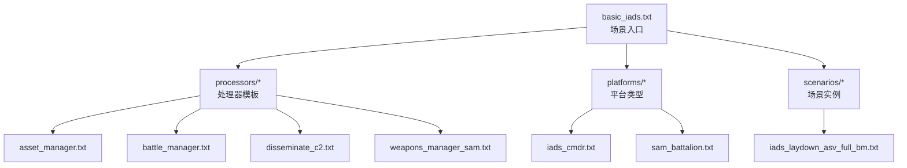
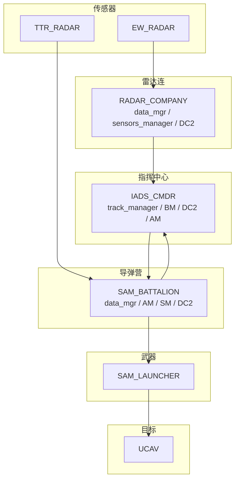
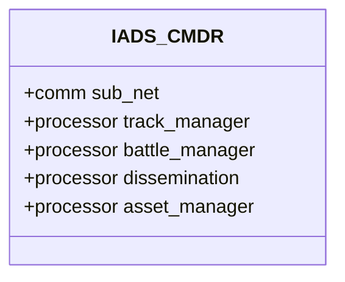
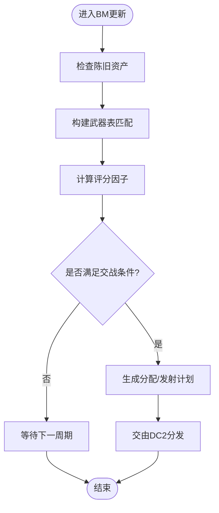
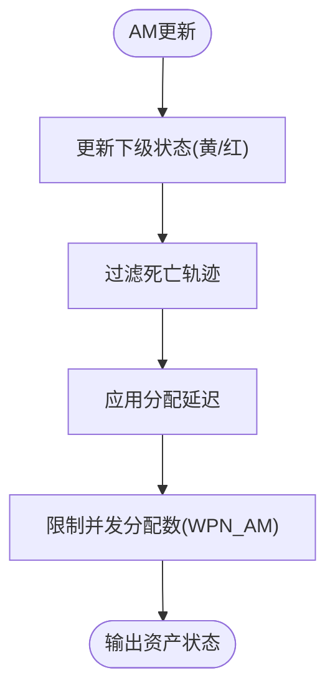
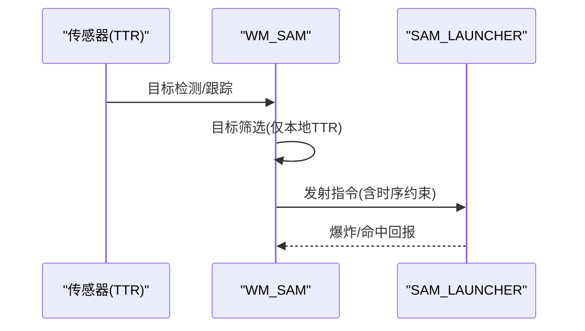
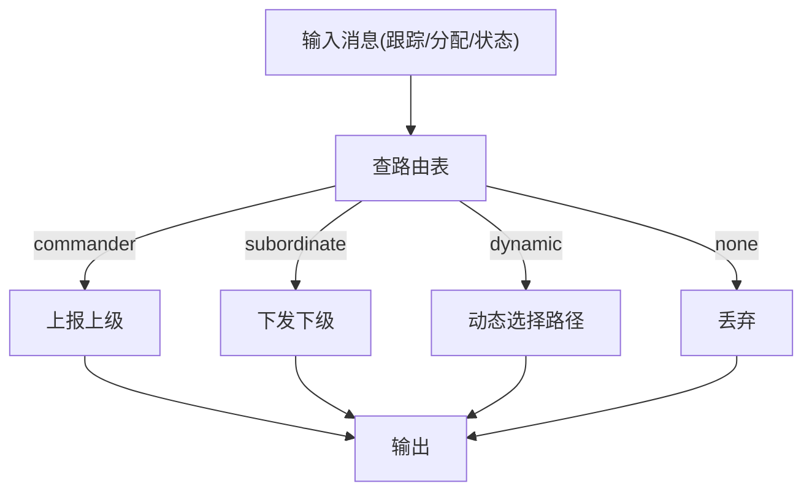
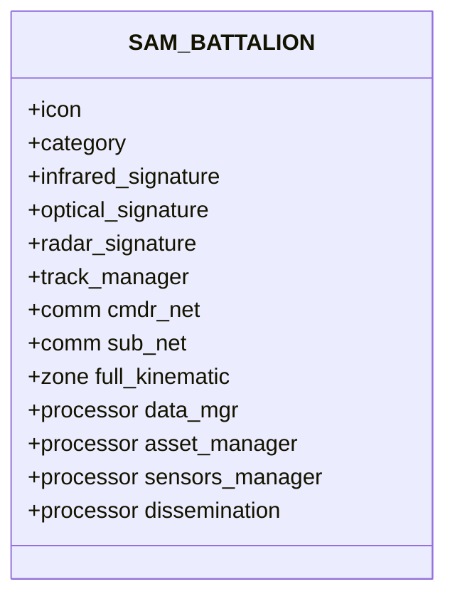
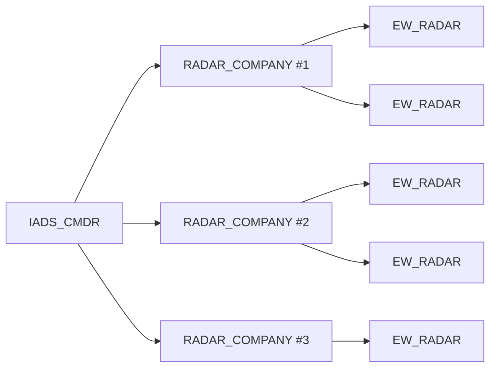
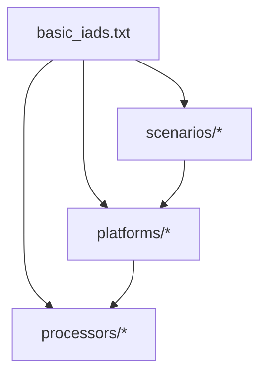

# 指挥控制系统

<cite>
**本文引用的文件**   
- [basic_iads.txt](file://demos/iads_c2_demos/basic_iads.txt)
- [battle_manager.txt](file://demos/iads_c2_demos/processors/battle_manager.txt)
- [asset_manager.txt](file://demos/iads_c2_demos/processors/asset_manager.txt)
- [disseminate_c2.txt](file://demos/iads_c2_demos/processors/disseminate_c2.txt)
- [weapons_manager_sam.txt](file://demos/iads_c2_demos/processors/weapons_manager_sam.txt)
- [iads_cmdr.txt](file://demos/iads_c2_demos/platforms/iads_cmdr.txt)
- [sam_battalion.txt](file://demos/iads_c2_demos/platforms/sam_battalion.txt)
- [iads_laydown_asv_full_bm.txt](file://demos/iads_c2_demos/scenarios/iads_laydown_asv_full_bm.txt)
- [wsfbmassetrecord.rst.txt](file://documentation/html/_sources/docs/script/wsfbmassetrecord.rst.txt)
</cite>

## 目录
1. [简介](#简介)
2. [项目结构](#项目结构)
3. [核心组件](#核心组件)
4. [架构总览](#架构总览)
5. [详细组件分析](#详细组件分析)
6. [依赖关系分析](#依赖关系分析)
7. [性能与参数优化](#性能与参数优化)
8. [故障排查指南](#故障排查指南)
9. [结论](#结论)

## 简介
本文件面向防空系统（IADS）的指挥控制（C2）架构，聚焦于指挥中心在任务规划、资源分配与决策逻辑中的角色，解释命令链传递、信息分发与协同作战机制。文档基于AFSIM的iads_c2_demos示例工程，给出可操作的配置与优化指导，涵盖：
- IADS指挥官平台的配置方法
- 战术处理器（资产/武器/传感器管理、战斗管理、C2分发）的编写规范
- 多平台协调作战的实现细节（雷达连、电子战雷达、地空导弹营/发射器、UCAV目标等）

## 项目结构
iads_c2_demos采用“场景驱动+处理器模板+平台类型”的组织方式：
- 场景入口：basic_iads.txt 引入处理器、平台、通信与场景定义
- 处理器模板：资产/武器/传感器管理、战斗管理、C2分发
- 平台类型：IADS_CMDR、SAM_BATTALION 等
- 场景实例：iads_laydown_asv_full_bm.txt 构建多层级指挥链与兵力部署

图表来源
- [basic_iads.txt:14-40](file://demos/iads_c2_demos/basic_iads.txt#L14-L40)
- [battle_manager.txt:14-65](file://demos/iads_c2_demos/processors/battle_manager.txt#L14-L65)
- [asset_manager.txt:14-29](file://demos/iads_c2_demos/processors/asset_manager.txt#L14-L29)
- [disseminate_c2.txt:14-27](file://demos/iads_c2_demos/processors/disseminate_c2.txt#L14-L27)
- [weapons_manager_sam.txt:14-32](file://demos/iads_c2_demos/processors/weapons_manager_sam.txt#L14-L32)
- [iads_cmdr.txt:14-34](file://demos/iads_c2_demos/platforms/iads_cmdr.txt#L14-L34)
- [sam_battalion.txt:14-67](file://demos/iads_c2_demos/platforms/sam_battalion.txt#L14-L67)
- [iads_laydown_asv_full_bm.txt:14-19](file://demos/iads_c2_demos/scenarios/iads_laydown_asv_full_bm.txt#L14-L19)

章节来源
- [basic_iads.txt:14-40](file://demos/iads_c2_demos/basic_iads.txt#L14-L40)

## 核心组件
- 战斗管理器（BM）：负责目标优先级、武器选择、交战规则与评分因子
- 资产管理器（AM）：维护资产状态、隶属关系、分配延迟与最大并发分配数
- 武器管理器（WM_SAM）：地空导弹发射策略、目标筛选、发射时序与传感器关联
- C2分发器（DC2）：按路由表将跟踪更新、分配、状态等信息在指挥链中传播
- 平台类型：IADS_CMDR（指挥中心）、SAM_BATTALION（导弹营）等

章节来源
- [battle_manager.txt:14-65](file://demos/iads_c2_demos/processors/battle_manager.txt#L14-L65)
- [asset_manager.txt:14-29](file://demos/iads_c2_demos/processors/asset_manager.txt#L14-L29)
- [weapons_manager_sam.txt:14-32](file://demos/iads_c2_demos/processors/weapons_manager_sam.txt#L14-L32)
- [disseminate_c2.txt:14-27](file://demos/iads_c2_demos/processors/disseminate_c2.txt#L14-L27)
- [iads_cmdr.txt:14-34](file://demos/iads_c2_demos/platforms/iads_cmdr.txt#L14-L34)
- [sam_battalion.txt:14-67](file://demos/iads_c2_demos/platforms/sam_battalion.txt#L14-L67)

## 架构总览
IADS指挥控制由“传感器→跟踪管理→资产/武器管理→战斗管理→C2分发→执行平台”的闭环构成。指挥中心（IADS_CMDR）作为顶层节点，向下通过数据链连接雷达连、EW雷达与导弹营；导弹营内部包含数据管理、资产管理与传感器管理，并向上汇报融合跟踪结果。

图表来源
- [iads_cmdr.txt:14-34](file://demos/iads_c2_demos/platforms/iads_cmdr.txt#L14-L34)
- [sam_battalion.txt:22-67](file://demos/iads_c2_demos/platforms/sam_battalion.txt#L22-L67)
- [iads_laydown_asv_full_bm.txt:14-19](file://demos/iads_c2_demos/scenarios/iads_laydown_asv_full_bm.txt#L14-L19)

## 详细组件分析

### 指挥中心（IADS_CMDR）
- 通信：子网主节点，内部链接track_manager与dissemination
- 处理器：track_manager（轨迹清理/循环报告抑制）、BM（战斗管理）、DC2（C2分发）、AM（资产管理）
- 作用：汇总下属单位状态、生成分配决策、向上下级分发指令与状态

图表来源
- [iads_cmdr.txt:14-34](file://demos/iads_c2_demos/platforms/iads_cmdr.txt#L14-L34)

章节来源
- [iads_cmdr.txt:14-34](file://demos/iads_c2_demos/platforms/iads_cmdr.txt#L14-L34)

### 战斗管理器（BM）
- 更新间隔、提交权限、投影跟踪延迟
- 陈旧资产超时、射击条令、最大发射时间
- 武器表：速度/高度属性、目标偏好与优先级、杀伤概率与AI/SAM优先级
- 评分因子：武器类型/子类型、拦截范围/时间、PK、工作负载
- IFF交战许可：仅对敌方可开火

图表来源
- [battle_manager.txt:14-65](file://demos/iads_c2_demos/processors/battle_manager.txt#L14-L65)

章节来源
- [battle_manager.txt:14-65](file://demos/iads_c2_demos/processors/battle_manager.txt#L14-L65)

### 资产管理器（AM）
- 状态超时：下级黄色/红色超时阈值
- 分配延迟与日志开关
- 过滤死亡轨迹
- 武器型AM继承基础AM，增加最大并发分配数

图表来源
- [asset_manager.txt:14-29](file://demos/iads_c2_demos/processors/asset_manager.txt#L14-L29)

章节来源
- [asset_manager.txt:14-29](file://demos/iads_c2_demos/processors/asset_manager.txt#L14-L29)

### 武器管理器（WM_SAM）
- 更新间隔、爆炸时回传（haveco_reporting_strategy）
- 交战设置：禁用EW/TAR目标，启用TTR目标且仅本地TTR
- 时序：两次交战间隔、预期传感器获取时间

图表来源
- [weapons_manager_sam.txt:14-32](file://demos/iads_c2_demos/processors/weapons_manager_sam.txt#L14-L32)

章节来源
- [weapons_manager_sam.txt:14-32](file://demos/iads_c2_demos/processors/weapons_manager_sam.txt#L14-L32)

### C2分发器（DC2）
- 更新间隔
- 路由表：跟踪更新、分配跟踪、分配、分配状态、取消分配、状态的上/下游路由策略（none/commander/dynamic）

图表来源
- [disseminate_c2.txt:14-27](file://demos/iads_c2_demos/processors/disseminate_c2.txt#L14-L27)

章节来源
- [disseminate_c2.txt:14-27](file://demos/iads_c2_demos/processors/disseminate_c2.txt#L14-L27)

### 导弹营（SAM_BATTALION）
- 图标/分类、签名模型
- 轨迹管理：战术过滤器
- 通信：cmdr_net（从属）与sub_net（主），内部链接data_mgr与dissemination
- 防御区：全运动学包线圆形区域
- 处理器：data_mgr（融合跟踪上报至上级via cmdr_net到sub_net）、AM（覆盖更短超时）、SM（传感器管理）、DC2

图表来源
- [sam_battalion.txt:14-67](file://demos/iads_c2_demos/platforms/sam_battalion.txt#L14-L67)

章节来源
- [sam_battalion.txt:14-67](file://demos/iads_c2_demos/platforms/sam_battalion.txt#L14-L67)

### 场景与指挥链（iads_laydown_asv_full_bm.txt）
- 顶层IADS_CMDR为SELF指挥官，位置固定
- 多个RADAR_COMPANY作为中间节点，各自管辖若干EW_RADAR
- 所有平台side=red，形成统一阵营

图表来源
- [iads_laydown_asv_full_bm.txt:14-19](file://demos/iads_c2_demos/scenarios/iads_laydown_asv_full_bm.txt#L14-L19)
- [iads_laydown_asv_full_bm.txt:22-27](file://demos/iads_c2_demos/scenarios/iads_laydown_asv_full_bm.txt#L22-L27)
- [iads_laydown_asv_full_bm.txt:94-99](file://demos/iads_c2_demos/scenarios/iads_laydown_asv_full_bm.txt#L94-L99)
- [iads_laydown_asv_full_bm.txt:192-197](file://demos/iads_c2_demos/scenarios/iads_laydown_asv_full_bm.txt#L192-L197)
- [iads_laydown_asv_full_bm.txt:277-282](file://demos/iads_c2_demos/scenarios/iads_laydown_asv_full_bm.txt#L277-L282)

章节来源
- [iads_laydown_asv_full_bm.txt:14-19](file://demos/iads_c2_demos/scenarios/iads_laydown_asv_full_bm.txt#L14-L19)

## 依赖关系分析
- basic_iads.txt 作为场景入口，顺序引入处理器模板、通信、平台类型与具体场景
- 平台类型依赖处理器模板（如IADS_CMDR依赖BM/DC2/AM）
- 场景实例依赖平台类型，并通过commander建立层级关系
- 数据流：传感器→data_mgr→AM/WM→BM→DC2→执行平台

图表来源
- [basic_iads.txt:14-40](file://demos/iads_c2_demos/basic_iads.txt#L14-L40)

章节来源
- [basic_iads.txt:14-40](file://demos/iads_c2_demos/basic_iads.txt#L14-L40)

## 性能与参数优化
- 战斗管理器（BM）
  - update_interval：建议1秒，平衡实时性与开销
  - stale_asset_time：根据传感器刷新率调整，避免误判陈旧
  - shot_doctrine/max_firing_time：依据威胁紧迫度与火力节奏调优
  - weapon_table/target_pref/priority：按任务阶段调整目标优先级与权重
  - scoring_factors：合理加权拦截范围/时间与PK，避免过度追求单一指标
  - engage_iff_permissions：严格IFF校验，降低误伤风险
- 资产管理器（AM）
  - subord_yellow_timeout/subord_red_timeout：缩短可提升态势感知灵敏度，但可能增加告警噪声
  - assignment_delay：为低带宽链路预留缓冲
  - max_assignments（WPN_AM）：限制并发分配，防止过载
- 武器管理器（WM_SAM）
  - haveco_reporting_strategy：爆炸时回报可减少持续遥测开销
  - engagement_settings：仅启用TTR目标且本地化，减少跨域数据压力
  - delays：time_between_engagements与expected_sensor_acquisition需与传感器刷新和武器再装填匹配
- C2分发器（DC2）
  - routing_table：对高频跟踪更新使用none或dynamic，关键分配/状态使用commander确保可靠上行
  - update_interval：0.5秒适合快速态势同步，但需评估网络拥塞

章节来源
- [battle_manager.txt:14-65](file://demos/iads_c2_demos/processors/battle_manager.txt#L14-L65)
- [asset_manager.txt:14-29](file://demos/iads_c2_demos/processors/asset_manager.txt#L14-L29)
- [weapons_manager_sam.txt:14-32](file://demos/iads_c2_demos/processors/weapons_manager_sam.txt#L14-L32)
- [disseminate_c2.txt:14-27](file://demos/iads_c2_demos/processors/disseminate_c2.txt#L14-L27)

## 故障排查指南
- 无分配或分配不生效
  - 检查BM的weapon_table与target_pref是否匹配当前目标类型
  - 确认engage_iff_permissions允许对当前目标开火
  - 核查AM的assignment_delay与max_assignments是否限制分配
- 跟踪丢失或陈旧
  - 调整BM.stale_asset_time与传感器刷新频率
  - 检查data_mgr的report_interval与fused_track_reporting
- C2未上送或下行错误
  - 核对DC2.routing_table中对应消息类型的路由策略
  - 验证平台comm的network_name与internal_link配置
- 武器发射时序异常
  - 检查WM_SAM.delays与武器自身发射间隔/延时参数
  - 确认engagement_settings中对目标类型的筛选是否符合预期

章节来源
- [battle_manager.txt:14-65](file://demos/iads_c2_demos/processors/battle_manager.txt#L14-L65)
- [asset_manager.txt:14-29](file://demos/iads_c2_demos/processors/asset_manager.txt#L14-L29)
- [weapons_manager_sam.txt:14-32](file://demos/iads_c2_demos/processors/weapons_manager_sam.txt#L14-L32)
- [disseminate_c2.txt:14-27](file://demos/iads_c2_demos/processors/disseminate_c2.txt#L14-L27)
- [sam_battalion.txt:22-67](file://demos/iads_c2_demos/platforms/sam_battalion.txt#L22-L67)

## 结论
该IADS指挥控制体系以“传感器-跟踪-资产/武器-战斗-分发-执行”的闭环为核心，通过清晰的命令链与路由策略实现多平台协同。通过对BM/AM/WM/DC2的参数精细化调优，可在保证态势一致性的同时提升响应速度与资源利用率。建议在实战演练中结合不同威胁谱与通信条件，迭代优化上述参数，以获得稳定可靠的指挥控制效果。