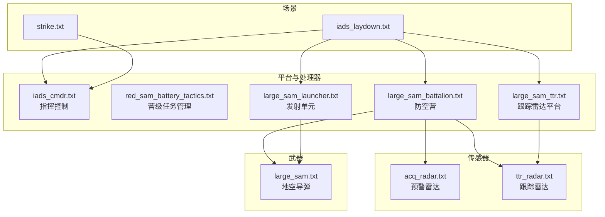
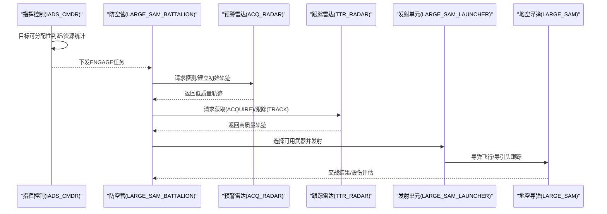
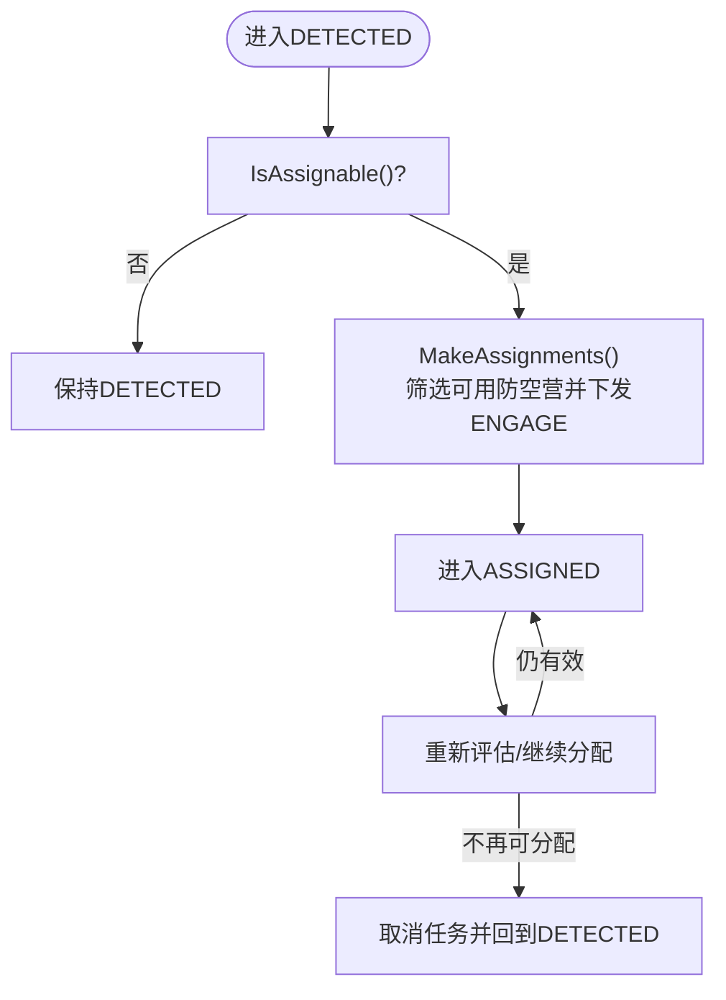
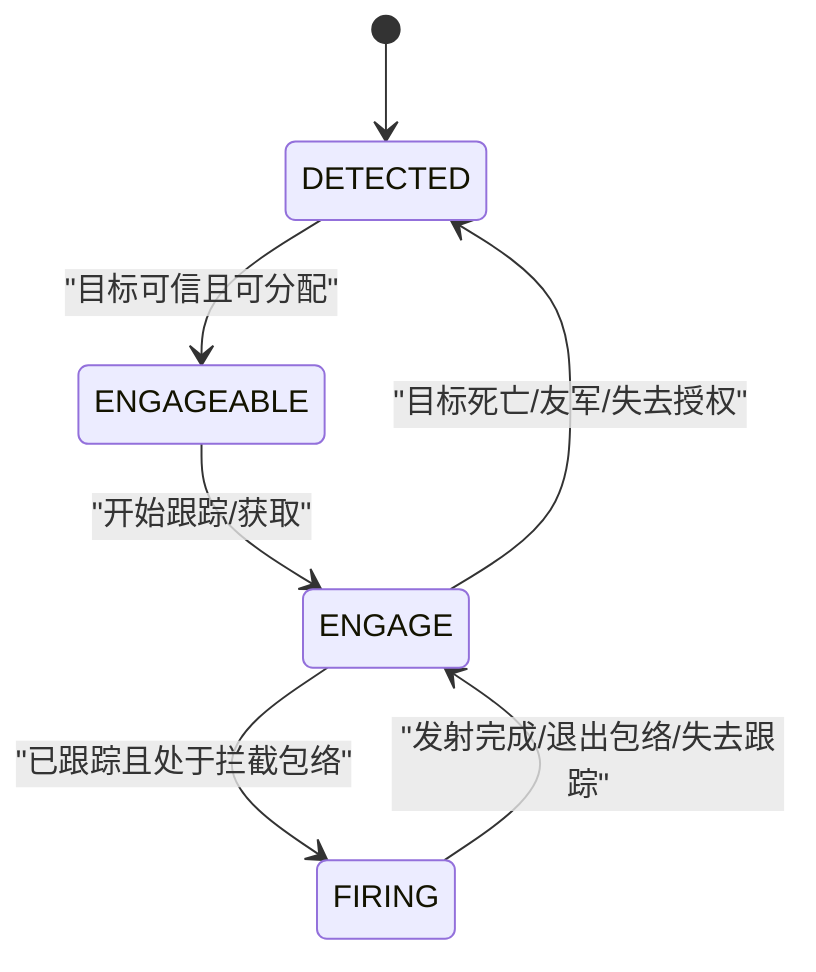
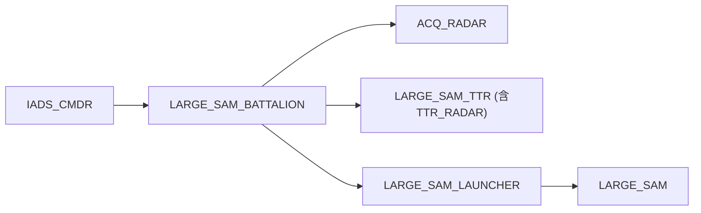

# 防空系统场景

<cite>
**本文引用的文件**   
- [iads_laydown.txt](file://demos/iads/scenarios/iads_laydown.txt)
- [strike.txt](file://demos/iads/scenarios/strike.txt)
- [iads_cmdr.txt](file://demos/iads/platforms/iads_cmdr.txt)
- [red_sam_battery_tactics.txt](file://demos/iads/platforms/red_sam_battery_tactics.txt)
- [large_sam_battalion.txt](file://demos/iads/platforms/large_sam_battalion.txt)
- [large_sam_launcher.txt](file://demos/iads/platforms/large_sam_launcher.txt)
- [large_sam_ttr.txt](file://demos/iads/platforms/large_sam_ttr.txt)
- [acq_radar.txt](file://demos/iads/sensors/radar/acq_radar.txt)
- [ttr_radar.txt](file://demos/iads/sensors/radar/ttr_radar.txt)
- [large_sam.txt](file://demos/iads/weapons/sam/large_sam.txt)
</cite>

## 目录
1. [引言](#引言)
2. [项目结构](#项目结构)
3. [核心组件](#核心组件)
4. [架构总览](#架构总览)
5. [详细组件分析](#详细组件分析)
6. [依赖关系分析](#依赖关系分析)
7. [性能与调优](#性能与调优)
8. [故障排查指南](#故障排查指南)
9. [结论](#结论)
10. [附录](#附录)

## 引言
本教程面向AFSIM用户，围绕demos/iads示例，系统化讲解综合防空系统（IADS）的多层防御架构与实战演练方法。内容涵盖预警雷达、跟踪雷达、指挥控制中心与防空导弹部队的协同流程；深入解析态势感知、威胁评估、武器分配与火力控制；说明多传感器融合、目标关联与轨迹跟踪的技术要点；并提供战术优化与系统性能调优建议，帮助读者构建复杂防空作战场景并开展仿真演练。

## 项目结构
IADS示例采用“场景+平台/传感器/武器定义+处理器脚本”的分层组织方式：
- 场景层：scenarios/*.txt 定义战场布局、兵力编成与任务流
- 实体层：platforms/*.txt 定义平台类型、通信链路、数据管理与任务管理处理器
- 传感器层：sensors/radar/*.txt 定义雷达天线、收发机参数、扫描模式与跟踪质量
- 武器层：weapons/sam/*.txt 定义导弹平台、引信、导引头与杀伤效果
- 典型场景：iads_laydown.txt 为完整防空阵地布设；strike.txt 为蓝方突防与干扰编队

图示来源
- [iads_laydown.txt:14-341](file://demos/iads/scenarios/iads_laydown.txt#L14-L341)
- [strike.txt:16-138](file://demos/iads/scenarios/strike.txt#L16-L138)
- [iads_cmdr.txt:14-148](file://demos/iads/platforms/iads_cmdr.txt#L14-L148)
- [red_sam_battery_tactics.txt:18-309](file://demos/iads/platforms/red_sam_battery_tactics.txt#L18-L309)
- [large_sam_battalion.txt:18-117](file://demos/iads/platforms/large_sam_battalion.txt#L18-L117)
- [large_sam_launcher.txt:16-35](file://demos/iads/platforms/large_sam_launcher.txt#L16-L35)
- [large_sam_ttr.txt:16-42](file://demos/iads/platforms/large_sam_ttr.txt#L16-L42)
- [acq_radar.txt:23-62](file://demos/iads/sensors/radar/acq_radar.txt#L23-L62)
- [ttr_radar.txt:24-89](file://demos/iads/sensors/radar/ttr_radar.txt#L24-L89)
- [large_sam.txt:26-93](file://demos/iads/weapons/sam/large_sam.txt#L26-L93)

章节来源
- [iads_laydown.txt:14-776](file://demos/iads/scenarios/iads_laydown.txt#L14-L776)
- [strike.txt:16-138](file://demos/iads/scenarios/strike.txt#L16-L138)

## 核心组件
- 指挥控制中心（IADS_CMDR）
  - 负责目标可分配性判断、武器资源统计与向防空营的任务分配
  - 通过状态机在DETECTED/ASSIGNED之间切换，周期性评估并下发ENGAGE任务
- 防空营（LARGE_SAM_BATTALION）
  - 集成预警雷达、跟踪雷达与多个发射单元
  - 内嵌营级任务管理器RED_SAM_BATTERY_TASK_MGR，实现探测→获取→跟踪→射击的闭环
- 预警雷达（ACQ_RADAR）
  - 宽视场搜索，提供低精度但高覆盖的目标检测
- 跟踪雷达（TTR_RADAR）
  - 窄波束高精度跟踪，支持ACQUIRE/TRACK两种模式，逐步提升跟踪质量
- 发射单元（LARGE_SAM_LAUNCHER）
  - 挂载地空导弹，具备方位/俯仰机动能力，受营级任务管理器调度
- 地空导弹（LARGE_SAM）
  - 包含运动模型、引信与导引头，附带杀伤效果脚本用于记录交战细节

章节来源
- [iads_cmdr.txt:14-148](file://demos/iads/platforms/iads_cmdr.txt#L14-L148)
- [large_sam_battalion.txt:18-117](file://demos/iads/platforms/large_sam_battalion.txt#L18-L117)
- [acq_radar.txt:23-62](file://demos/iads/sensors/radar/acq_radar.txt#L23-L62)
- [ttr_radar.txt:24-89](file://demos/iads/sensors/radar/ttr_radar.txt#L24-L89)
- [large_sam_launcher.txt:16-35](file://demos/iads/platforms/large_sam_launcher.txt#L16-L35)
- [large_sam.txt:26-93](file://demos/iads/weapons/sam/large_sam.txt#L26-L93)

## 架构总览
IADS采用“指挥控制—防空营—传感器—武器”的分层架构，结合数据链路与内部处理器进行信息流转与任务分发。

图示来源
- [iads_cmdr.txt:75-98](file://demos/iads/platforms/iads_cmdr.txt#L75-L98)
- [red_sam_battery_tactics.txt:151-221](file://demos/iads/platforms/red_sam_battery_tactics.txt#L151-L221)
- [acq_radar.txt:23-62](file://demos/iads/sensors/radar/acq_radar.txt#L23-L62)
- [ttr_radar.txt:61-89](file://demos/iads/sensors/radar/ttr_radar.txt#L61-L89)
- [large_sam_launcher.txt:32-34](file://demos/iads/platforms/large_sam_launcher.txt#L32-L34)
- [large_sam.txt:80-93](file://demos/iads/weapons/sam/large_sam.txt#L80-L93)

## 详细组件分析

### 指挥控制中心（IADS_CMDR）
- 职责
  - 判定目标是否可分配（非友邻、更新时效）
  - 统计下属防空营及其子单位的剩余弹药
  - 筛选满足区域与任务上限约束的防空营，按每目标最大分配数下发ENGAGE任务
- 关键逻辑
  - IsAssignable()：基于IFF与时间戳过滤
  - WeaponsAvailable()：递归统计武器库存
  - MakeAssignments()：按区域与任务上限分配
- 状态机
  - DETECTED → ASSIGNED：当目标可分配时发起分配
  - ASSIGNED → DETECTED：不可分配或无资源时取消任务

图示来源
- [iads_cmdr.txt:33-98](file://demos/iads/platforms/iads_cmdr.txt#L33-L98)
- [iads_cmdr.txt:102-123](file://demos/iads/platforms/iads_cmdr.txt#L102-L123)

章节来源
- [iads_cmdr.txt:14-148](file://demos/iads/platforms/iads_cmdr.txt#L14-L148)

### 防空营任务管理器（RED_SAM_BATTERY_TASK_MGR）
- 职责
  - 根据轨迹质量与拦截包络，驱动预警雷达→跟踪雷达→发射单元的协作
  - 管理探测、获取、跟踪、射击等阶段的状态转移
- 关键函数
  - HasDetected()/HasAcquired()/TrackingNow()：以轨迹质量阈值区分阶段
  - InInterceptEnvelopeOf()：调用外部发射计算机判断是否可拦截
  - Engage()：优先分配跟踪任务，其次分配获取任务
  - LaunchWeapon()：选择可用武器并执行发射
- 状态机
  - DETECTED → ENGAGEABLE → ENGAGE → FIRING → ENGAGE（循环直至终止条件）

图示来源
- [red_sam_battery_tactics.txt:65-78](file://demos/iads/platforms/red_sam_battery_tactics.txt#L65-L78)
- [red_sam_battery_tactics.txt:151-221](file://demos/iads/platforms/red_sam_battery_tactics.txt#L151-L221)
- [red_sam_battery_tactics.txt:225-306](file://demos/iads/platforms/red_sam_battery_tactics.txt#L225-L306)

章节来源
- [red_sam_battery_tactics.txt:18-309](file://demos/iads/platforms/red_sam_battery_tactics.txt#L18-L309)

### 预警雷达（ACQ_RADAR）
- 特点
  - 宽视场扫描，帧周期较长，适合大范围搜索
  - 输出范围、方位、俯仰与IFF信息
  - 轨迹质量较低，用于早期探测与粗略定位
- 关键参数
  - 天线方向图、发射功率、接收带宽、虚警概率、所需探测概率
  - 建立/维持轨迹命中次数阈值

章节来源
- [acq_radar.txt:14-62](file://demos/iads/sensors/radar/acq_radar.txt#L14-L62)

### 跟踪雷达（TTR_RADAR）
- 特点
  - 窄波束高精度跟踪，支持ACQUIRE与TRACK两种模式
  - ACQUIRE模式用于快速捕获目标，TRACK模式用于武器级跟踪
  - 输出范围、方位、俯仰与速度信息
- 关键参数
  - 不同模式的扫描范围、帧周期、轨迹质量与请求数量限制

章节来源
- [ttr_radar.txt:14-89](file://demos/iads/sensors/radar/ttr_radar.txt#L14-L89)

### 发射单元与地空导弹（LARGE_SAM_LAUNCHER / LARGE_SAM）
- 发射单元
  - 挂载导弹，具备方位/俯仰机动能力
  - 通过内部数据链路与营级任务管理器交互
- 地空导弹
  - 直线运动模型、制导模式、引信与完美跟踪器
  - 杀伤效果脚本记录交战过程与毁伤概率

章节来源
- [large_sam_launcher.txt:16-35](file://demos/iads/platforms/large_sam_launcher.txt#L16-L35)
- [large_sam.txt:26-93](file://demos/iads/weapons/sam/large_sam.txt#L26-L93)

### 场景与兵力编成（iads_laydown.txt / strike.txt）
- iads_laydown.txt
  - 部署指挥控制、雷达连、电子战雷达与多个防空营
  - 每个防空营包含预警雷达、跟踪雷达与若干发射单元
  - 使用battalion_sector区域划分防空责任区
- strike.txt
  - 蓝方UCAV编队突防与SOJ干扰机配合，测试IADS探测与拦截能力

章节来源
- [iads_laydown.txt:14-776](file://demos/iads/scenarios/iads_laydown.txt#L14-L776)
- [strike.txt:16-138](file://demos/iads/scenarios/strike.txt#L16-L138)

## 依赖关系分析
- 平台与处理器
  - IADS_CMDR依赖IADS_CMDR_DATA_MGR与IADS_CMDR_TASK_MGR
  - LARGE_SAM_BATTALION依赖data_mgr与task_mgr，并通过comm链路连接上级与下级
- 传感器与平台
  - LARGE_SAM_TTR内置TTR_RADAR传感器，并通过datalink上报轨迹
  - ACQ_RADAR作为独立平台挂载于防空营下
- 武器与平台
  - LARGE_SAM_LAUNCHER挂载LARGE_SAM导弹，受任务管理器调度

图示来源
- [iads_cmdr.txt:127-148](file://demos/iads/platforms/iads_cmdr.txt#L127-L148)
- [large_sam_battalion.txt:82-117](file://demos/iads/platforms/large_sam_battalion.txt#L82-L117)
- [large_sam_ttr.txt:16-42](file://demos/iads/platforms/large_sam_ttr.txt#L16-L42)
- [large_sam_launcher.txt:16-35](file://demos/iads/platforms/large_sam_launcher.txt#L16-L35)
- [large_sam.txt:26-93](file://demos/iads/weapons/sam/large_sam.txt#L26-L93)

章节来源
- [iads_cmdr.txt:127-148](file://demos/iads/platforms/iads_cmdr.txt#L127-L148)
- [large_sam_battalion.txt:82-117](file://demos/iads/platforms/large_sam_battalion.txt#L82-L117)
- [large_sam_ttr.txt:16-42](file://demos/iads/platforms/large_sam_ttr.txt#L16-L42)
- [large_sam_launcher.txt:16-35](file://demos/iads/platforms/large_sam_launcher.txt#L16-L35)
- [large_sam.txt:26-93](file://demos/iads/weapons/sam/large_sam.txt#L26-L93)

## 性能与调优
- 传感器调度与容量
  - 合理设置ACQUIRE/TRACK模式的maximum_request_count，避免过载导致跟踪丢失
  - 调整frame_time与hits_to_establish_track/maintain_track，平衡发现速度与稳定性
- 任务管理器阈值
  - REQUIRED_TRACK_QUALITY、HasDetected/HasAcquired/TrackingNow阈值需与传感器track_quality匹配
  - SALVO_SIZE与ENVELOPE影响火力密度与拦截窗口
- 指挥控制策略
  - MAX_SAMS_PER_TARGET与MAX_ASSIGNMENTS_PER_SAM控制火力集中度与任务负载
  - 区域划分（battalion_sector）应覆盖主要威胁走廊，减少跨区调度延迟
- 数据链与处理器
  - data_mgr purge_interval与track_update_interval影响内存占用与态势新鲜度
  - number_of_servers提高任务处理吞吐，降低排队延迟

[本节为通用指导，不直接分析具体文件]

## 故障排查指南
- 无法分配任务
  - 检查IsAssignable()条件：IFF是否为友军、目标更新时间是否超时
  - 确认上级OperatingLevelFor("ENGAGE")是否开启
- 雷达未跟踪或频繁丢迹
  - 核查传感器模式请求数是否达到上限
  - 调整track_quality阈值与required_pd/probability_of_false_alarm
- 发射失败或无响应
  - 确认InInterceptEnvelopeOf()返回true（处于拦截包络）
  - 检查武器QuantityRemaining与TasksAssignedTo限制
- 日志与调试
  - 启用script_debug_writes与show_state_transitions观察状态转移
  - 关注营级任务管理器的writeln_d输出，定位决策断点

章节来源
- [iads_cmdr.txt:33-98](file://demos/iads/platforms/iads_cmdr.txt#L33-L98)
- [red_sam_battery_tactics.txt:65-117](file://demos/iads/platforms/red_sam_battery_tactics.txt#L65-L117)
- [red_sam_battery_tactics.txt:225-306](file://demos/iads/platforms/red_sam_battery_tactics.txt#L225-L306)

## 结论
通过AFSIM的IADS示例，可以清晰复现多层防空体系的协同流程：预警雷达广域探测、跟踪雷达高精度锁定、指挥控制统一分配、防空营闭环处置与导弹精确拦截。借助场景配置与处理器脚本，用户可灵活调整传感器参数、任务阈值与指挥策略，从而开展复杂防空作战的仿真与演练，并持续优化战术与系统性能。

[本节为总结性内容，不直接分析具体文件]

## 附录
- 典型演练步骤
  - 加载iads_laydown.txt，观察红方防空阵地的部署与数据链连通
  - 加载strike.txt，启动蓝方UCAV与SOJ编队突防，验证IADS探测与拦截效果
  - 调整传感器参数与任务阈值，对比不同配置下的拦截成功率与资源消耗
- 扩展建议
  - 增加电子战对抗（如噪声/欺骗干扰），评估IADS鲁棒性
  - 引入多源传感器融合（ESM/EO/IR），提升态势感知与抗干扰能力
  - 设计多波次饱和攻击，检验防空体系的任务编排与火力调度极限

[本节为概念性内容，不直接分析具体文件]