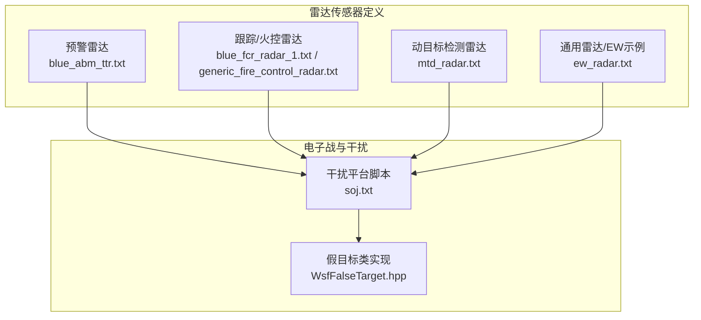
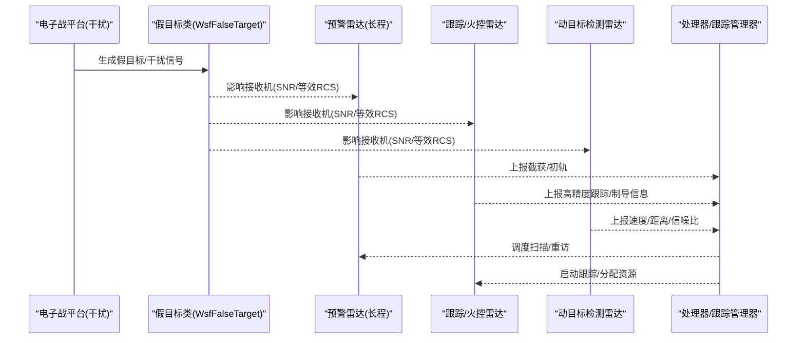
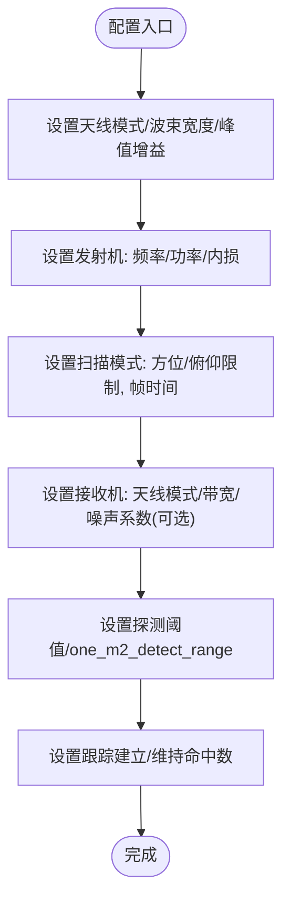
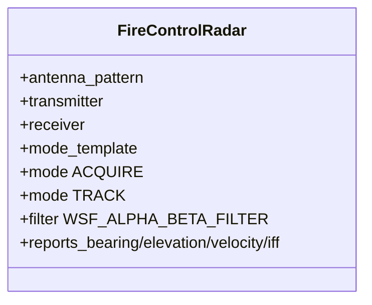
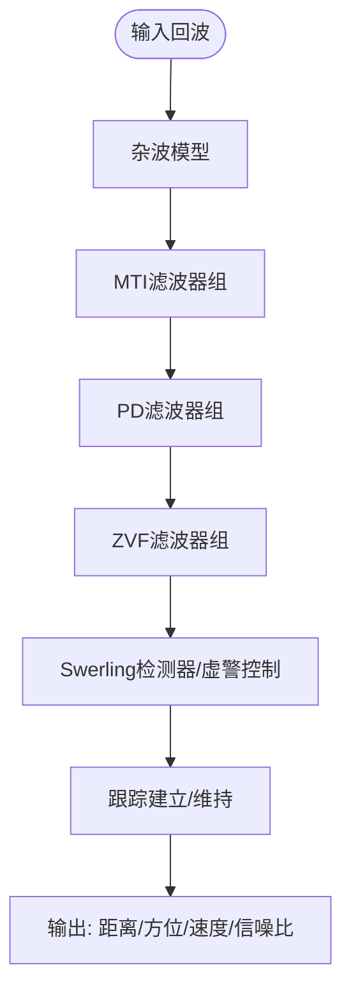
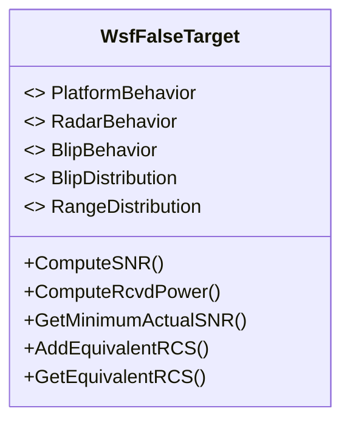
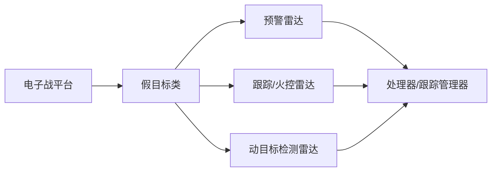

# 雷达网络

<cite>
**本文引用的文件**   
- [blue_fcr_radar_1.txt](file://demos/base_types/sensors/radar/blue_fcr_radar_1.txt)
- [blue_abm_ttr.txt](file://demos/base_types/sensors/radar/blue_abm_ttr.txt)
- [generic_fire_control_radar.txt](file://demos/base_types/sensors/radar/generic_fire_control_radar.txt)
- [mtd_radar.txt](file://demos/base_types/sensors/radar/mtd_radar.txt)
- [ew_radar.txt](file://training/user/10_Other_Topics/bam/scenarios/floridistan/27_floridistan_cluster_gci/sensors/radar/ew_radar.txt)
- [soj.txt](file://demos/aea_iads/platforms/soj.txt)
- [WsfFalseTarget.hpp](file://swdev/src/core/wsf_mil/source/ew/WsfFalseTarget.hpp)
</cite>

## 目录
1. [引言](#引言)
2. [项目结构](#项目结构)
3. [核心组件](#核心组件)
4. [架构总览](#架构总览)
5. [详细组件分析](#详细组件分析)
6. [依赖关系分析](#依赖关系分析)
7. [性能与调优](#性能与调优)
8. [故障排查指南](#故障排查指南)
9. [结论](#结论)
10. [附录](#附录)

## 引言
本文件面向防空雷达网络的配置与管理，聚焦预警雷达与跟踪雷达的角色差异、参数化配置方法、多传感器协同与数据共享机制、网络拓扑管理思路，以及雷达性能调优与抗干扰策略。文档基于仓库中的雷达传感器定义与电子战相关实现进行系统化梳理，帮助读者从“概念—配置—协同—优化—排障”的完整链路掌握AFSIM中雷达网络的建模与实践。

## 项目结构
围绕雷达网络的相关素材主要分布在以下位置：
- 基础类型雷达传感器定义（含预警/跟踪/火控/MTD等）：demos/base_types/sensors/radar
- 电子战平台与干扰脚本示例：demos/aea_iads/platforms/soj.txt
- 训练场景中的雷达与EW示例：training/user/.../sensors/radar/ew_radar.txt
- 电子战假目标类实现（支撑假目标干扰与多站一致性建模）：swdev/src/core/wsf_mil/source/ew/WsfFalseTarget.hpp

图表来源
- [blue_abm_ttr.txt:1-101](file://demos/base_types/sensors/radar/blue_abm_ttr.txt#L1-L101)
- [blue_fcr_radar_1.txt:1-109](file://demos/base_types/sensors/radar/blue_fcr_radar_1.txt#L1-L109)
- [generic_fire_control_radar.txt:141-263](file://demos/base_types/sensors/radar/generic_fire_control_radar.txt#L141-L263)
- [mtd_radar.txt:1-113](file://demos/base_types/sensors/radar/mtd_radar.txt#L1-L113)
- [ew_radar.txt:15-42](file://training/user/10_Other_Topics/bam/scenarios/floridistan/27_floridistan_cluster_gci/sensors/radar/ew_radar.txt#L15-L42)
- [soj.txt:43-63](file://demos/aea_iads/platforms/soj.txt#L43-L63)
- [WsfFalseTarget.hpp:64-102](file://swdev/src/core/wsf_mil/source/ew/WsfFalseTarget.hpp#L64-L102)

章节来源
- [blue_abm_ttr.txt:1-101](file://demos/base_types/sensors/radar/blue_abm_ttr.txt#L1-L101)
- [blue_fcr_radar_1.txt:1-109](file://demos/base_types/sensors/radar/blue_fcr_radar_1.txt#L1-L109)
- [generic_fire_control_radar.txt:141-263](file://demos/base_types/sensors/radar/generic_fire_control_radar.txt#L141-L263)
- [mtd_radar.txt:1-113](file://demos/base_types/sensors/radar/mtd_radar.txt#L1-L113)
- [ew_radar.txt:15-42](file://training/user/10_Other_Topics/bam/scenarios/floridistan/27_floridistan_cluster_gci/sensors/radar/ew_radar.txt#L15-L42)
- [soj.txt:43-63](file://demos/aea_iads/platforms/soj.txt#L43-L63)
- [WsfFalseTarget.hpp:64-102](file://swdev/src/core/wsf_mil/source/ew/WsfFalseTarget.hpp#L64-L102)

## 核心组件
- 预警雷达（长程探测）：以蓝方反导预警雷达为例，具备大视场扫描、远距探测能力，典型用于早期发现与粗定位。
- 跟踪/火控雷达（高精度跟踪与制导）：以蓝方火控雷达和通用火控雷达为例，具备高增益窄波束、多目标跟踪、制导级精度输出。
- 动目标检测雷达（MTD/PD）：提供杂波抑制、多普勒滤波、速度/距离门限处理，增强低可观测目标探测能力。
- 电子战与干扰：通过干扰平台脚本选择不同干扰样式（噪声、随机脉冲、假目标、JTOS增益压制等），并驱动假目标类进行多站一致性建模。

章节来源
- [blue_abm_ttr.txt:34-100](file://demos/base_types/sensors/radar/blue_abm_ttr.txt#L34-L100)
- [blue_fcr_radar_1.txt:45-108](file://demos/base_types/sensors/radar/blue_fcr_radar_1.txt#L45-L108)
- [generic_fire_control_radar.txt:141-263](file://demos/base_types/sensors/radar/generic_fire_control_radar.txt#L141-L263)
- [mtd_radar.txt:10-113](file://demos/base_types/sensors/radar/mtd_radar.txt#L10-L113)
- [soj.txt:43-63](file://demos/aea_iads/platforms/soj.txt#L43-L63)
- [WsfFalseTarget.hpp:64-102](file://swdev/src/core/wsf_mil/source/ew/WsfFalseTarget.hpp#L64-L102)

## 架构总览
防空雷达网络在AFSIM中的典型工作流如下：
- 预警雷达负责广域搜索与初步截获；
- 跟踪/火控雷达对感兴趣目标进行高精度跟踪与可能的武器引导；
- MTD/PD雷达在强杂波环境下提升探测概率；
- 电子战平台根据任务需求对不同雷达实施干扰，假目标类在多雷达间保持一致性建模；
- 上层处理器（如任务/跟踪管理器）协调多传感器资源分配与数据融合。

图表来源
- [soj.txt:43-63](file://demos/aea_iads/platforms/soj.txt#L43-L63)
- [WsfFalseTarget.hpp:338-423](file://swdev/src/core/wsf_mil/source/ew/WsfFalseTarget.hpp#L338-L423)
- [blue_abm_ttr.txt:40-100](file://demos/base_types/sensors/radar/blue_abm_ttr.txt#L40-L100)
- [blue_fcr_radar_1.txt:51-108](file://demos/base_types/sensors/radar/blue_fcr_radar_1.txt#L51-L108)
- [mtd_radar.txt:20-113](file://demos/base_types/sensors/radar/mtd_radar.txt#L20-L113)

## 详细组件分析

### 预警雷达（长程探测）
- 角色与用途：远距离截获、大范围覆盖、为后续跟踪提供初始线索。
- 关键配置要点：
  - 天线模式与大视场扫描范围；
  - 发射功率与频率设置以满足远距探测方程；
  - 帧时间与扫描模式平衡覆盖率与更新率；
  - 探测阈值与单米RCS探测距离标定系统灵敏度。
- 典型参考：蓝方反导预警雷达定义。

图表来源
- [blue_abm_ttr.txt:34-100](file://demos/base_types/sensors/radar/blue_abm_ttr.txt#L34-L100)

章节来源
- [blue_abm_ttr.txt:34-100](file://demos/base_types/sensors/radar/blue_abm_ttr.txt#L34-L100)

### 跟踪/火控雷达（高精度跟踪与制导）
- 角色与用途：对已截获目标进行高精度跟踪，必要时提供武器制导所需的高保真测量。
- 关键配置要点：
  - 窄波束高增益天线与电子束扫限；
  - 多模式模板（搜索/跟踪/制导）与资源上限；
  - 滤波器与误差模型（方位/俯仰/距离误差）；
  - 报告字段（方位/俯仰/速度/IFF等）。
- 典型参考：蓝方火控雷达与通用火控雷达定义。

图表来源
- [generic_fire_control_radar.txt:141-263](file://demos/base_types/sensors/radar/generic_fire_control_radar.txt#L141-L263)
- [blue_fcr_radar_1.txt:45-108](file://demos/base_types/sensors/radar/blue_fcr_radar_1.txt#L45-L108)

章节来源
- [generic_fire_control_radar.txt:141-263](file://demos/base_types/sensors/radar/generic_fire_control_radar.txt#L141-L263)
- [blue_fcr_radar_1.txt:45-108](file://demos/base_types/sensors/radar/blue_fcr_radar_1.txt#L45-L108)

### 动目标检测雷达（MTD/PD）
- 角色与用途：在强地杂波背景下提取运动目标，提供速度与距离信息，提高低可观测目标探测概率。
- 关键配置要点：
  - 杂波模型与MTI/PD/ZVF滤波器组；
  - 脉冲重复频率集与压缩比；
  - Swerling目标模型、检测律、虚警概率与积分脉冲数；
  - 输出字段包含速度/距离/信噪比等。
- 典型参考：MTD雷达定义。

图表来源
- [mtd_radar.txt:10-113](file://demos/base_types/sensors/radar/mtd_radar.txt#L10-L113)

章节来源
- [mtd_radar.txt:10-113](file://demos/base_types/sensors/radar/mtd_radar.txt#L10-L113)

### 电子战与干扰（多样式与多站一致性）
- 干扰样式：噪声干扰、随机脉冲干扰、假目标干扰、JTOS增益压制等，由平台脚本按频段与FOV动态分配。
- 多站一致性：假目标类支持在不同雷达站之间的一致性/随机性建模，确保多站融合时的物理合理性。
- 关键接口：SNR计算、等效RCS、干扰到雷达距离、最小实际SNR等。

图表来源
- [WsfFalseTarget.hpp:64-102](file://swdev/src/core/wsf_mil/source/ew/WsfFalseTarget.hpp#L64-L102)
- [WsfFalseTarget.hpp:338-423](file://swdev/src/core/wsf_mil/source/ew/WsfFalseTarget.hpp#L338-L423)

章节来源
- [soj.txt:43-63](file://demos/aea_iads/platforms/soj.txt#L43-L63)
- [WsfFalseTarget.hpp:64-102](file://swdev/src/core/wsf_mil/source/ew/WsfFalseTarget.hpp#L64-L102)
- [WsfFalseTarget.hpp:338-423](file://swdev/src/core/wsf_mil/source/ew/WsfFalseTarget.hpp#L338-L423)

### 雷达间协调与数据共享
- 协调机制：通过处理器（如跟踪管理器/任务处理器）统一调度各雷达的扫描、跟踪与资源分配，避免冲突与过度占用。
- 数据共享：雷达上报的方位/俯仰/速度/距离/频率/IFF等字段供上层融合与决策使用。
- 实践建议：
  - 明确预警与跟踪的职责边界，避免功能重叠；
  - 合理设置frame_time/revisit_time/dwell_time，保证更新率与覆盖率的平衡；
  - 使用统一的track_id与时间戳，便于跨传感器关联。

章节来源
- [generic_fire_control_radar.txt:178-263](file://demos/base_types/sensors/radar/generic_fire_control_radar.txt#L178-L263)
- [blue_fcr_radar_1.txt:51-108](file://demos/base_types/sensors/radar/blue_fcr_radar_1.txt#L51-L108)

### 网络拓扑管理
- 站点布局：依据地形与威胁方向布置预警与跟踪雷达，形成互补覆盖；
- 通信与同步：通过仿真框架的时间同步与事件管道，确保多站数据时序一致；
- 可扩展性：采用模块化传感器定义与脚本化干扰策略，便于扩展新雷达与新干扰样式。

章节来源
- [ew_radar.txt:15-42](file://training/user/10_Other_Topics/bam/scenarios/floridistan/27_floridistan_cluster_gci/sensors/radar/ew_radar.txt#L15-L42)
- [soj.txt:43-63](file://demos/aea_iads/platforms/soj.txt#L43-L63)

## 依赖关系分析
- 传感器定义之间的耦合度较低，主要通过上层处理器与仿真时间线进行协作；
- 电子战与雷达之间存在明确的“干扰—被干扰”关系，假目标类作为中间层抽象了多站一致性；
- 外部依赖包括杂波模型、滤波器库与检测器实现（在传感器定义中通过关键字启用）。

图表来源
- [blue_abm_ttr.txt:40-100](file://demos/base_types/sensors/radar/blue_abm_ttr.txt#L40-L100)
- [blue_fcr_radar_1.txt:51-108](file://demos/base_types/sensors/radar/blue_fcr_radar_1.txt#L51-L108)
- [mtd_radar.txt:20-113](file://demos/base_types/sensors/radar/mtd_radar.txt#L20-L113)
- [soj.txt:43-63](file://demos/aea_iads/platforms/soj.txt#L43-L63)
- [WsfFalseTarget.hpp:338-423](file://swdev/src/core/wsf_mil/source/ew/WsfFalseTarget.hpp#L338-L423)

章节来源
- [blue_abm_ttr.txt:40-100](file://demos/base_types/sensors/radar/blue_abm_ttr.txt#L40-L100)
- [blue_fcr_radar_1.txt:51-108](file://demos/base_types/sensors/radar/blue_fcr_radar_1.txt#L51-L108)
- [mtd_radar.txt:20-113](file://demos/base_types/sensors/radar/mtd_radar.txt#L20-L113)
- [soj.txt:43-63](file://demos/aea_iads/platforms/soj.txt#L43-L63)
- [WsfFalseTarget.hpp:338-423](file://swdev/src/core/wsf_mil/source/ew/WsfFalseTarget.hpp#L338-L423)

## 性能与调优
- 探测方程调参：
  - 通过one_m2_detect_range与detection_threshold标定系统灵敏度；
  - 调整发射功率、天线增益、接收机带宽与噪声系数以匹配期望探测距离；
  - 合理设置Swerling目标模型、检测律与虚警概率，平衡探测概率与虚警。
- 扫描与跟踪：
  - 预警雷达：增大frame_time或降低扫描扇区以提升覆盖率；
  - 跟踪雷达：缩短revisit_time与dwell_time以提高更新率，但需权衡多目标容量；
  - 使用合适的滤波器（如Alpha-Beta）与误差模型以降低跟踪抖动。
- 抗干扰策略：
  - 频率捷变/跳频、波形多样化（PRF集）、极化分集；
  - 杂波抑制（MTI/PD/ZVF）与自适应滤波；
  - 多站融合与一致性校验（利用假目标类的多站一致性建模）。

章节来源
- [blue_abm_ttr.txt:58-100](file://demos/base_types/sensors/radar/blue_abm_ttr.txt#L58-L100)
- [blue_fcr_radar_1.txt:51-108](file://demos/base_types/sensors/radar/blue_fcr_radar_1.txt#L51-L108)
- [generic_fire_control_radar.txt:178-263](file://demos/base_types/sensors/radar/generic_fire_control_radar.txt#L178-L263)
- [mtd_radar.txt:30-113](file://demos/base_types/sensors/radar/mtd_radar.txt#L30-L113)
- [WsfFalseTarget.hpp:338-423](file://swdev/src/core/wsf_mil/source/ew/WsfFalseTarget.hpp#L338-L423)

## 故障排查指南
- 探测距离不达标：
  - 检查one_m2_detect_range与detection_threshold是否匹配；
  - 核对发射功率、天线增益与接收机噪声参数是否合理。
- 跟踪丢失频繁：
  - 检查hits_to_establish_track/hits_to_maintain_track是否过严；
  - 调整revisit_time/dwell_time，确保足够的采样密度。
- 干扰效果异常：
  - 确认干扰样式与频段/FOV匹配；
  - 核查假目标类的多站一致性设置与实际场景是否一致。
- 杂波抑制不足：
  - 检查MTI/PD/ZVF滤波器组参数与门限设置；
  - 验证杂波模型与地形/海况匹配。

章节来源
- [blue_fcr_radar_1.txt:85-108](file://demos/base_types/sensors/radar/blue_fcr_radar_1.txt#L85-L108)
- [generic_fire_control_radar.txt:220-263](file://demos/base_types/sensors/radar/generic_fire_control_radar.txt#L220-L263)
- [mtd_radar.txt:54-113](file://demos/base_types/sensors/radar/mtd_radar.txt#L54-L113)
- [soj.txt:43-63](file://demos/aea_iads/platforms/soj.txt#L43-L63)
- [WsfFalseTarget.hpp:338-423](file://swdev/src/core/wsf_mil/source/ew/WsfFalseTarget.hpp#L338-L423)

## 结论
通过对预警雷达、跟踪/火控雷达与动目标检测雷达的配置解析，结合电子战干扰与假目标一致性建模，AFSIM提供了完整的防空雷达网络建模与评估能力。实践中应注重职责分工、参数标定、扫描策略与抗干扰设计的协同，以实现高可靠、高鲁棒的雷达网络体系。

## 附录
- 常用雷达传感器定义路径：demos/base_types/sensors/radar
- 电子战平台与干扰脚本示例：demos/aea_iads/platforms/soj.txt
- 训练场景雷达与EW示例：training/user/.../sensors/radar/ew_radar.txt
- 假目标类实现：swdev/src/core/wsf_mil/source/ew/WsfFalseTarget.hpp