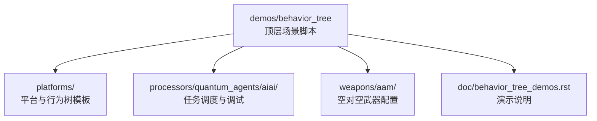
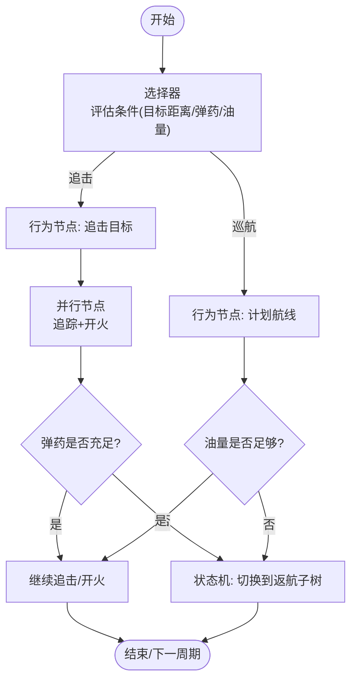
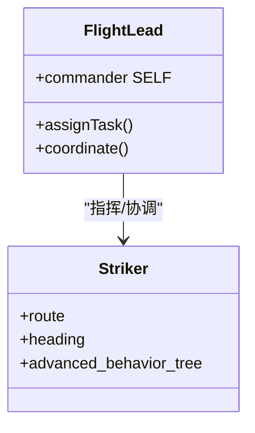
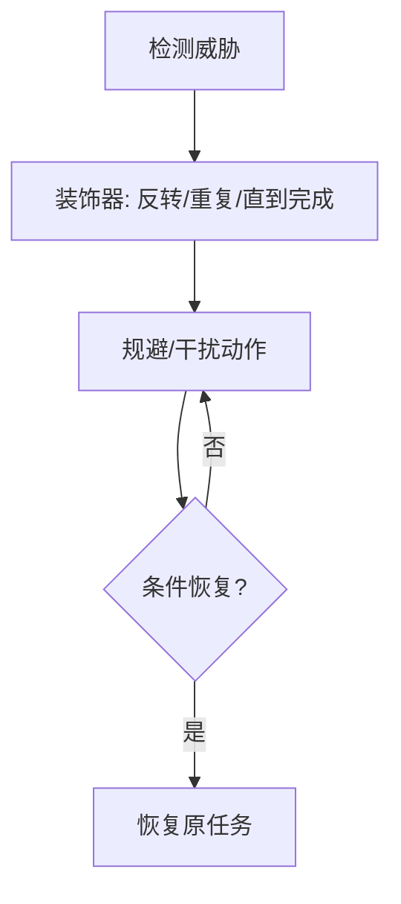
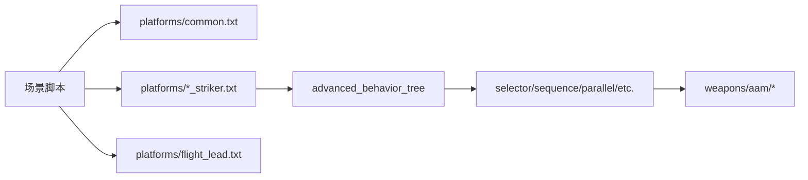

# 决策模式与最佳实践

<cite>
**本文引用的文件**   
- [behavior_tree_demos.rst](file://demos/behavior_tree/doc/behavior_tree_demos.rst)
- [README.md](file://demos/behavior_tree/README.md)
- [blackboard.txt](file://demos/behavior_tree/blackboard.txt)
- [condition.txt](file://demos/behavior_tree/condition.txt)
- [decorator.txt](file://demos/behavior_tree/decorator.txt)
- [parallel.txt](file://demos/behavior_tree/parallel.txt)
- [priority_selector.txt](file://demos/behavior_tree/priority_selector.txt)
- [run_tree.txt](file://demos/behavior_tree/run_tree.txt)
- [selector.txt](file://demos/behavior_tree/selector.txt)
- [selector_with_memory.txt](file://demos/behavior_tree/selector_with_memory.txt)
- [sequence.txt](file://demos/behavior_tree/sequence.txt)
- [sequence_with_memory.txt](file://demos/behavior_tree/sequence_with_memory.txt)
- [state_machine.txt](file://demos/behavior_tree/state_machine.txt)
- [subtrees.txt](file://demos/behavior_tree/subtrees.txt)
- [weighted_random.txt](file://demos/behavior_tree/weighted_random.txt)
</cite>

## 目录
1. [引言](#引言)
2. [项目结构](#项目结构)
3. [核心组件](#核心组件)
4. [架构总览](#架构总览)
5. [详细组件分析](#详细组件分析)
6. [依赖关系分析](#依赖关系分析)
7. [性能考虑](#性能考虑)
8. [故障排查指南](#故障排查指南)
9. [结论](#结论)
10. [附录](#附录)

## 引言
本指南面向AFSIM行为决策系统的使用者与开发者，聚焦于“行为树”在战术决策中的模式化设计与工程实践。文档总结了搜索-攻击循环、编队协调、威胁响应等典型场景的实现方法，并围绕行为树设计原则（模块化、可重用性、可测试性）展开。同时提供从简单条件判断到复杂多智能体协作的示例路径，给出性能优化技巧与调试验证方法，帮助读者快速构建高质量、可维护的决策系统。

## 项目结构
AFSIM的行为树演示位于 demos/behavior_tree 目录，包含：
- 顶层场景脚本：用于定义平台、传感器、处理器与行为树配置
- platforms 子目录：平台类型与行为树模板（如 STRIKER、FLIGHT_LEAD 等）
- processors/quantum_agents/aiai：任务调度器与行为调试相关配置
- weapons/aam：空对空武器相关配置（与攻击行为配合）
- doc/behavior_tree_demos.rst：行为树演示说明文档



图表来源
- [README.md:1-49](file://demos/behavior_tree/README.md#L1-L49)
- [behavior_tree_demos.rst:10-91](file://demos/behavior_tree/doc/behavior_tree_demos.rst#L10-L91)

章节来源
- [README.md:1-49](file://demos/behavior_tree/README.md#L1-L49)
- [behavior_tree_demos.rst:10-91](file://demos/behavior_tree/doc/behavior_tree_demos.rst#L10-L91)

## 核心组件
- 行为树节点类型
  - 序列（Sequence）：按顺序执行子节点，遇到失败或全部成功结束
  - 选择器（Selector）：逐个评估子节点，任一成功则整体成功，全部失败则失败
  - 优先级选择器（Priority Selector）：根据权重/优先级选择最高分子节点执行
  - 并行（Parallel）：并行执行多个子树，支持策略（如 succeed_on_one/succeed_on_all）
  - 装饰器（Decorator）：包装子节点以改变其行为（如反转、重复、直到完成）
  - 条件（Condition）：仅返回成功/失败的判定节点
  - 状态机（State Machine）：管理多个子树的状态切换
  - 黑板（Blackboard）：跨节点共享数据，用于记忆与可视化
  - 加权随机（Weighted Random）：基于权重的随机选择
- 平台与处理器
  - STRIKER：典型攻击机平台，承载行为树逻辑
  - FLIGHT_LEAD：编队长机，负责编队协调与任务分配
  - 处理器 task_mgr：通过 advanced_behavior_tree 启用行为树引擎，并可配置并行、选择器等
- 武器与目标
  - 空对空导弹（AAM）：与 pursue_weapon_task_target、engage_weapon_task_target 等行为节点配合实现搜索-攻击循环

章节来源
- [behavior_tree_demos.rst:27-91](file://demos/behavior_tree/doc/behavior_tree_demos.rst#L27-L91)
- [run_tree.txt:46-75](file://demos/behavior_tree/run_tree.txt#L46-L75)

## 架构总览
下图展示了一个典型的“搜索-攻击循环”行为树架构：选择器根据当前态势（目标距离、弹药、油量等）决定是追击目标还是沿计划航线飞行；一旦进入攻击阶段，并行节点协调追踪与开火动作；当弹药耗尽或油量不足时，状态机切换到返航子树。



图表来源
- [run_tree.txt:46-75](file://demos/behavior_tree/run_tree.txt#L46-L75)
- [selector.txt:38-59](file://demos/behavior_tree/selector.txt#L38-L59)
- [selector_with_memory.txt:43-52](file://demos/behavior_tree/selector_with_memory.txt#L43-L52)

## 详细组件分析

### 搜索-攻击循环（Search-Engage Loop）
- 关键节点
  - 选择器（Selector）：根据条件（如目标是否在射程内）选择追击或巡航
  - 并行（Parallel）：同时执行追踪与开火，提高反应速度
  - 条件（Condition）：检查弹药、油量、敌我识别等前置条件
- 典型流程
  - 扫描环境 → 选择追击 → 并行追踪与开火 → 条件不满足时切换至巡航或返航
- 参考示例
  - run_tree.txt 中通过 choose_tree 与 sequence/parallel 组合实现“交战/巡航/返航”三大子树的动态切换

```mermaid
sequenceDiagram
participant BT as "行为树"
participant Sel as "选择器"
participant Par as "并行节点"
participant Cond as "条件节点"
participant Act as "动作节点"
BT->>Sel : 评估当前态势
Sel-->>BT : 返回分支(追击/巡航/返航)
alt 追击
BT->>Par : 启动并行(追踪+开火)
Par->>Cond : 检查弹药/目标可见性
Cond-->>Par : 成功/失败
Par->>Act : 执行追踪/开火
Act-->>BT : 完成/继续
else 巡航/返航
BT->>Act : 执行航线/返航
Act-->>BT : 完成
end
```

图表来源
- [run_tree.txt:46-75](file://demos/behavior_tree/run_tree.txt#L46-L75)
- [selector.txt:38-59](file://demos/behavior_tree/selector.txt#L38-L59)

章节来源
- [run_tree.txt:46-75](file://demos/behavior_tree/run_tree.txt#L46-L75)
- [selector.txt:38-59](file://demos/behavior_tree/selector.txt#L38-L59)

### 编队协调（Formation Coordination）
- 关键角色
  - FLIGHT_LEAD：编队长机，负责任务分配与协同指令
  - STRIKER：编队成员，遵循长机指令并执行各自行为树
- 典型模式
  - 长机通过 commander 属性将控制权交给自身或外部指挥节点
  - 成员平台使用 selector/sequence 组合，依据长机指令与环境变化调整行动
- 参考示例
  - selector.txt 与 run_tree.txt 中 flight_lead_1 作为编队长机，Blue_1/Blue_2 为成员



图表来源
- [selector.txt:28-59](file://demos/behavior_tree/selector.txt#L28-L59)
- [run_tree.txt:28-45](file://demos/behavior_tree/run_tree.txt#L28-L45)

章节来源
- [selector.txt:28-59](file://demos/behavior_tree/selector.txt#L28-L59)
- [run_tree.txt:28-45](file://demos/behavior_tree/run_tree.txt#L28-L45)

### 威胁响应（Threat Response）
- 关键节点
  - 带记忆的序列/选择器（Sequence/Selector with Memory）：避免在条件短暂失效时反复重算
  - 装饰器（Decorator）：如 inverter/succeeder/repeater 控制子节点行为
- 典型流程
  - 检测到威胁 → 触发规避/干扰 → 条件恢复后回到原任务
- 参考示例
  - decorator.txt 展示了 inverter/succeeder/repeater 的组合用法
  - selector_with_memory.txt 展示了范围条件随距离变化的记忆机制



图表来源
- [decorator.txt:1-53](file://demos/behavior_tree/decorator.txt#L1-L53)
- [selector_with_memory.txt:43-52](file://demos/behavior_tree/selector_with_memory.txt#L43-L52)

章节来源
- [decorator.txt:1-53](file://demos/behavior_tree/decorator.txt#L1-L53)
- [selector_with_memory.txt:43-52](file://demos/behavior_tree/selector_with_memory.txt#L43-L52)

### 行为树设计原则
- 模块化设计
  - 使用 subtrees 将复杂逻辑拆分为独立子树，便于复用与维护
  - 参考 subtrees.txt 中 checkpoints1234/checkpoints34/checkpoints321 的子树组织
- 可重用性
  - 通过 platforms/common.txt 与各 striker 模板统一接口，减少重复配置
  - 参考 blackboard.txt、condition.txt、parallel.txt 等模板
- 可测试性
  - 使用 random_seed 固定随机数种子，确保结果可复现
  - 使用 event_pipe 输出 BEHAVIOR_TOOL 事件，便于日志分析与可视化
  - 参考各场景脚本顶部的 event_pipe 与 random_seed 设置

章节来源
- [subtrees.txt:1-57](file://demos/behavior_tree/subtrees.txt#L1-L57)
- [blackboard.txt:1-53](file://demos/behavior_tree/blackboard.txt#L1-L53)
- [condition.txt:1-53](file://demos/behavior_tree/condition.txt#L1-L53)
- [parallel.txt:1-33](file://demos/behavior_tree/parallel.txt#L1-L33)

### 复杂度级别示例
- 简单条件判断
  - condition.txt：仅使用条件节点进行可达性判定
- 中等复杂度
  - sequence.txt/sequence_with_memory.txt：顺序执行多个任务，结合记忆提升效率
  - priority_selector.txt：基于权重的优先级选择
- 高复杂度
  - run_tree.txt：多子树动态切换（交战/巡航/返航），并行与选择器组合
  - state_machine.txt：状态机驱动的多子树切换
  - parallel.txt：并行执行多个子树，支持不同成功策略

章节来源
- [condition.txt:1-53](file://demos/behavior_tree/condition.txt#L1-L53)
- [sequence.txt:1-68](file://demos/behavior_tree/sequence.txt#L1-L68)
- [sequence_with_memory.txt:1-68](file://demos/behavior_tree/sequence_with_memory.txt#L1-L68)
- [priority_selector.txt:1-53](file://demos/behavior_tree/priority_selector.txt#L1-L53)
- [run_tree.txt:1-135](file://demos/behavior_tree/run_tree.txt#L1-L135)
- [state_machine.txt:1-77](file://demos/behavior_tree/state_machine.txt#L1-L77)
- [parallel.txt:1-33](file://demos/behavior_tree/parallel.txt#L1-L33)

## 依赖关系分析
- 场景脚本依赖
  - 所有场景脚本均 include_once platforms/common.txt 与各 striker 模板
  - 部分场景引入 flight_lead.txt 以支持编队
- 行为树与处理器
  - 通过 processor task_mgr 的 advanced_behavior_tree 启用行为树引擎
  - 行为树内部节点（selector/sequence/parallel 等）相互依赖，形成层次结构
- 武器与行为
  - pursue_weapon_task_target 与 engage_weapon_task_target 依赖 weapons/aam 配置



图表来源
- [run_tree.txt:14-17](file://demos/behavior_tree/run_tree.txt#L14-L17)
- [run_tree.txt:46-75](file://demos/behavior_tree/run_tree.txt#L46-L75)

章节来源
- [run_tree.txt:14-17](file://demos/behavior_tree/run_tree.txt#L14-L17)
- [run_tree.txt:46-75](file://demos/behavior_tree/run_tree.txt#L46-L75)

## 性能考虑
- 计算负载分布
  - 使用 Parallel 并行执行多个子树，降低单线程瓶颈
  - 使用 Sequence/Selector with Memory 避免重复计算已完成的节点
- 内存使用优化
  - 合理使用 Blackboard 存储临时状态，避免全局变量膨胀
  - 使用 subtrees 拆分大逻辑，减少单次 tick 的计算量
- 执行效率提升
  - 通过 Priority Selector 优先执行高价值分支，缩短关键路径
  - 使用 Decorator 的控制（如 repeater until_done）精确控制执行次数，避免无效循环

[本节为通用指导，无需具体文件引用]

## 故障排查指南
- 日志分析
  - 启用 event_pipe 与 BEHAVIOR_TOOL，输出行为树执行事件到 output/*.aer
  - 使用 Mystic Behavior Tree View 可视化行为树执行过程
- 可视化调试
  - 通过 behavior_tree_demos.rst 提供的说明，理解各节点行为与可视化对应关系
- 单元测试
  - 使用 random_seed 固定随机数，确保测试可复现
  - 针对关键分支（如追击/巡航/返航）编写最小场景，验证条件与动作的正确性

章节来源
- [behavior_tree_demos.rst:27-91](file://demos/behavior_tree/doc/behavior_tree_demos.rst#L27-L91)
- [blackboard.txt:17-20](file://demos/behavior_tree/blackboard.txt#L17-L20)
- [condition.txt:17-20](file://demos/behavior_tree/condition.txt#L17-L20)
- [decorator.txt:17-20](file://demos/behavior_tree/decorator.txt#L17-L20)
- [parallel.txt:17-20](file://demos/behavior_tree/parallel.txt#L17-L20)
- [priority_selector.txt:17-20](file://demos/behavior_tree/priority_selector.txt#L17-L20)
- [run_tree.txt:18-21](file://demos/behavior_tree/run_tree.txt#L18-L21)
- [selector.txt:18-21](file://demos/behavior_tree/selector.txt#L18-L21)
- [selector_with_memory.txt:18-21](file://demos/behavior_tree/selector_with_memory.txt#L18-L21)
- [sequence.txt:18-21](file://demos/behavior_tree/sequence.txt#L18-L21)
- [sequence_with_memory.txt:18-21](file://demos/behavior_tree/sequence_with_memory.txt#L18-L21)
- [state_machine.txt:17-20](file://demos/behavior_tree/state_machine.txt#L17-L20)
- [subtrees.txt:17-20](file://demos/behavior_tree/subtrees.txt#L17-L20)
- [weighted_random.txt:17-20](file://demos/behavior_tree/weighted_random.txt#L17-L20)

## 结论
AFSIM 的行为树为战术决策提供了高度模块化、可重用且可测试的框架。通过合理运用序列、选择器、并行、装饰器、状态机等节点类型，并结合黑板与任务调度器，可以构建从简单条件判断到复杂多智能体协作的完整决策系统。实践中应注重性能优化（并行、记忆、优先级）与调试验证（日志、可视化、单元测试），以确保决策系统的稳定性与可扩展性。

[本节为总结性内容，无需具体文件引用]

## 附录
- 常见战术决策模式清单
  - 搜索-攻击循环：selector + parallel + condition
  - 编队协调：flight_lead + strikers + commander
  - 威胁响应：decorator + sequence/selector with memory
- 行为树节点速查
  - 序列：顺序执行，遇失败中断
  - 选择器：首个成功即止
  - 优先级选择器：按权重选择最高分
  - 并行：并发执行，支持多种成功策略
  - 装饰器：包装子节点改变行为
  - 条件：仅返回成功/失败
  - 状态机：多子树状态切换
  - 黑板：跨节点共享数据
  - 加权随机：基于权重的随机选择

[本节为概念性内容，无需具体文件引用]