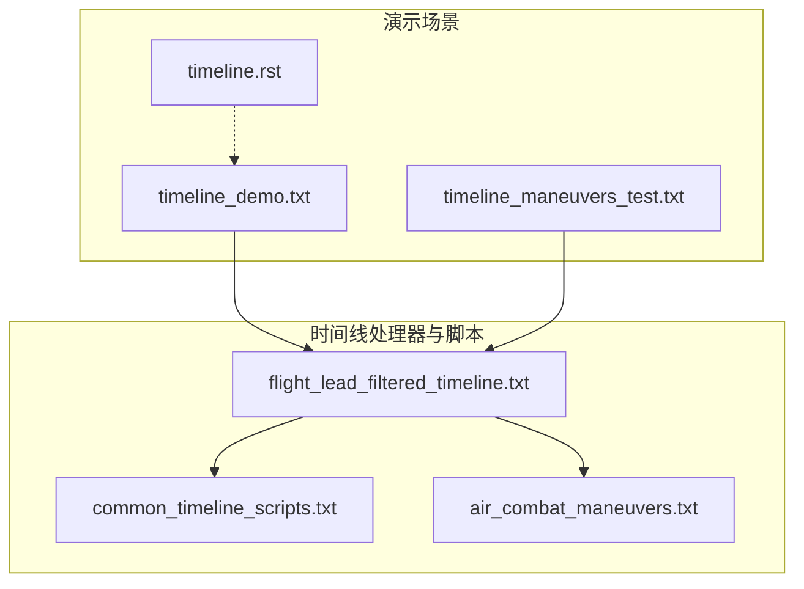
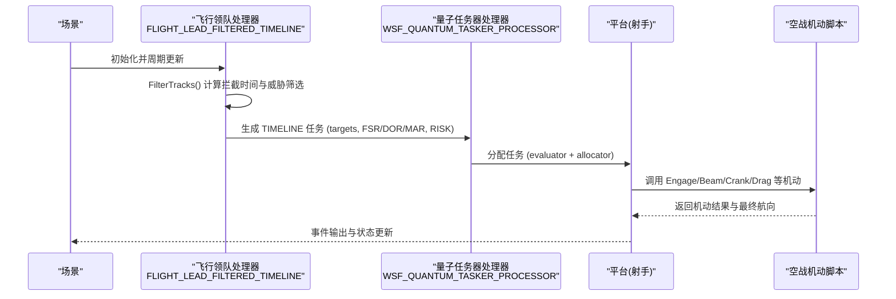
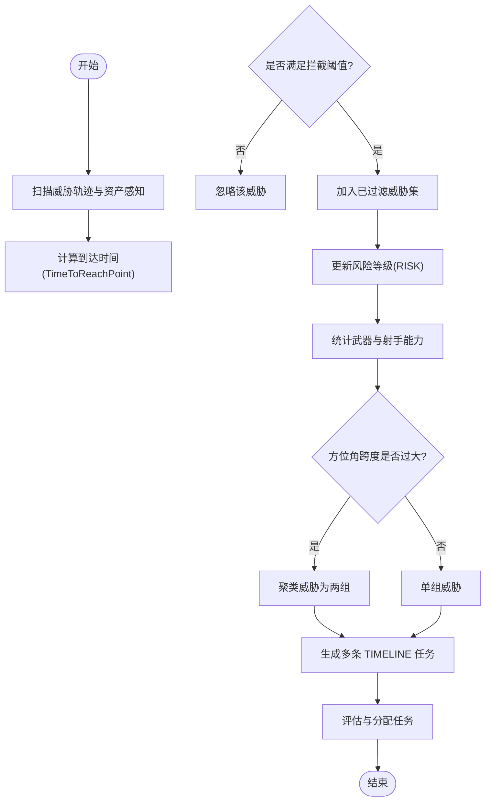
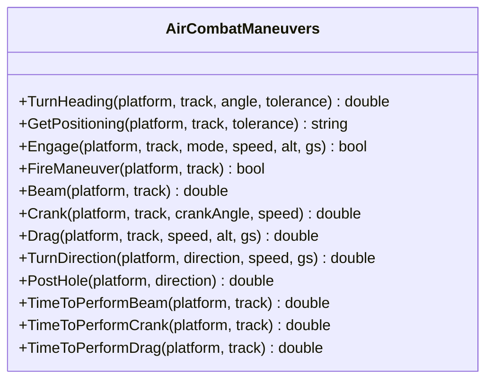
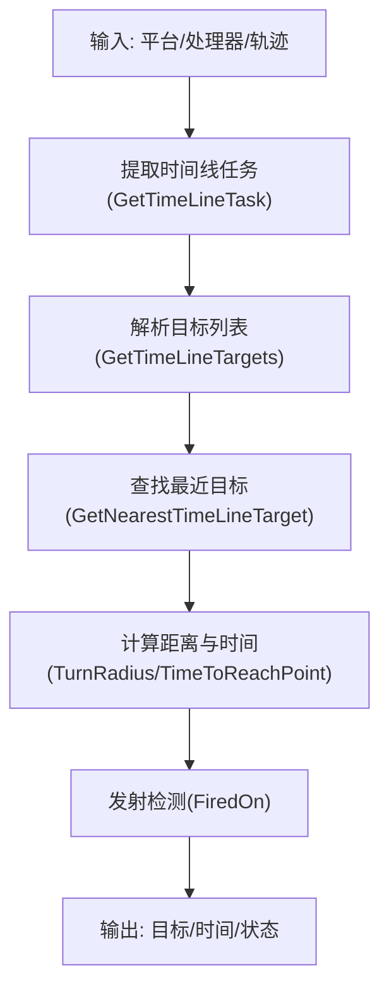
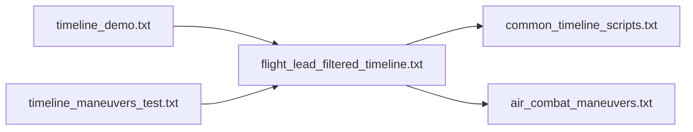

# 时间线系统

<cite>
**本文引用的文件**   
- [timeline_demo.txt](file://demos/timeline/timeline_demo.txt)
- [timeline_maneuvers_test.txt](file://demos/timeline/timeline_maneuvers_test.txt)
- [README.md](file://demos/timeline/README.md)
- [timeline.rst](file://demos/timeline/doc/timeline.rst)
- [air_combat_maneuvers.txt](file://demos/base_types/processors/timeline_agents/air_combat_maneuvers.txt)
- [common_timeline_scripts.txt](file://demos/base_types/processors/timeline_agents/common_timeline_scripts.txt)
- [flight_lead_filtered_timeline.txt](file://demos/base_types/processors/timeline_agents/flight_lead_filtered_timeline.txt)
</cite>

## 目录
1. [引言](#引言)
2. [项目结构](#项目结构)
3. [核心组件](#核心组件)
4. [架构总览](#架构总览)
5. [详细组件分析](#详细组件分析)
6. [依赖关系分析](#依赖关系分析)
7. [性能考虑](#性能考虑)
8. [故障排查指南](#故障排查指南)
9. [结论](#结论)
10. [附录](#附录)

## 引言
本技术文档聚焦于 AFSIM 的时间线（Timeline）系统，围绕以下目标展开：
- 解释时间线的概念与作用，包括任务调度的基本原理与时间管理策略。
- 文档化时间线的创建、配置与管理方法，包括时间点定义、任务序列编排、依赖关系设置等。
- 说明时间线与行为树（Behavior Tree）的集成方式，包括事件触发、状态同步、冲突解决机制。
- 提供时间线设计的最佳实践，包括任务分解、时间优化、资源协调等策略。
- 展示复杂军事行动的时间线设计示例，如联合演习、多阶段作战等场景。
- 说明时间线的调试方法与性能监控工具，以及版本管理与回滚机制的使用指南。

AFSIM 的时间线通过“量子任务器处理器”（WSF_QUANTUM_TASKER_PROCESSOR）将高层战术意图转化为可执行的任务序列，驱动平台在仿真时间轴上按序执行机动、交战、支援等行为。该机制以任务为中心，结合脚本化的机动库与通用工具函数，实现灵活且可扩展的战术编排。

## 项目结构
时间线相关示例位于 demos/timeline 与 demos/base_types/processors/timeline_agents 两个主要区域：
- demos/timeline：演示场景入口、平台类型、武器与处理器（量子任务器）的配置。
- demos/base_types/processors/timeline_agents：时间线相关的脚本库与处理器模板，包含空战机动脚本、通用时间线工具函数、飞行领队的过滤与任务生成逻辑。

图示来源
- [timeline_demo.txt:10-32](file://demos/timeline/timeline_demo.txt#L10-L32)
- [timeline_maneuvers_test.txt:10-30](file://demos/timeline/timeline_maneuvers_test.txt#L10-L30)
- [flight_lead_filtered_timeline.txt:10-12](file://demos/base_types/processors/timeline_agents/flight_lead_filtered_timeline.txt#L10-L12)
- [common_timeline_scripts.txt:10-21](file://demos/base_types/processors/timeline_agents/common_timeline_scripts.txt#L10-L21)
- [air_combat_maneuvers.txt:14-23](file://demos/base_types/processors/timeline_agents/air_combat_maneuvers.txt#L14-L23)

章节来源
- [timeline_demo.txt:10-32](file://demos/timeline/timeline_demo.txt#L10-L32)
- [timeline_maneuvers_test.txt:10-30](file://demos/timeline/timeline_maneuvers_test.txt#L10-L30)
- [timeline.rst:10-27](file://demos/timeline/doc/timeline.rst#L10-L27)

## 核心组件
- 时间线处理器（WSF_QUANTUM_TASKER_PROCESSOR）
  - 负责接收、评估、分配与调度“TIMELINE”类型的任务。
  - 支持自定义 generator（任务生成）、evaluator（任务评估）、allocator（任务分配）策略。
  - 典型配置项包括 update_interval、asset_representation、reallocation_strategy、generator、evaluator、allocator 等。
- 任务对象（WsfTask / WsfQuantumTask）
  - 承载任务类型、辅助数据（AuxData）、目标列表（targets）、风险等级（RISK）、关键参数（FSR/DOR/MAR）等。
  - 通过 AuxData 传递上下文信息，供下游处理器或行为树使用。
- 通用时间线脚本库（common_timeline_scripts.txt）
  - 提供轨道筛选、最近目标查找、距离计算、发射检测、任务提取等工具函数。
  - 作为时间线处理器与平台/轨迹交互的桥梁。
- 空战机动脚本库（air_combat_maneuvers.txt）
  - 定义 Engage/FireManeuver/Beam/Crank/Drag/TurnDirection/PostHole 等机动命令。
  - 提供相对航向计算、位置关系判断、机动时间估算等能力。
- 飞行领队过滤与任务生成（flight_lead_filtered_timeline.txt）
  - 根据威胁拦截时间阈值、方位角分离、武器数量等因素，动态生成单条或多条时间线任务。
  - 维护风险等级（LOW/MEDIUM/HIGH），并据此调整战术策略。

章节来源
- [flight_lead_filtered_timeline.txt:12-12](file://demos/base_types/processors/timeline_agents/flight_lead_filtered_timeline.txt#L12-L12)
- [flight_lead_filtered_timeline.txt:505-518](file://demos/base_types/processors/timeline_agents/flight_lead_filtered_timeline.txt#L505-L518)
- [common_timeline_scripts.txt:208-288](file://demos/base_types/processors/timeline_agents/common_timeline_scripts.txt#L208-L288)
- [air_combat_maneuvers.txt:167-404](file://demos/base_types/processors/timeline_agents/air_combat_maneuvers.txt#L167-L404)

## 架构总览
时间线系统的整体流程如下：
- 场景启动后，飞行领队处理器（FLIGHT_LEAD_FILTERED_TIMELINE）周期性扫描威胁轨迹与资产感知。
- 基于拦截时间与方位角分布，生成一个或多个“TIMELINE”任务，附带目标集合与战术参数。
- 量子任务器处理器根据评估函数与分配策略，将任务分派给合适的平台（射手）。
- 被分配的平台依据时间线任务中的目标与参数，调用空战机动脚本执行具体动作（如 Engage、Beam、Crank、Drag）。
- 在执行过程中，平台持续更新状态，并通过事件管道输出日志与观测数据。

图示来源
- [flight_lead_filtered_timeline.txt:129-204](file://demos/base_types/processors/timeline_agents/flight_lead_filtered_timeline.txt#L129-L204)
- [flight_lead_filtered_timeline.txt:209-464](file://demos/base_types/processors/timeline_agents/flight_lead_filtered_timeline.txt#L209-L464)
- [flight_lead_filtered_timeline.txt:467-518](file://demos/base_types/processors/timeline_agents/flight_lead_filtered_timeline.txt#L467-L518)
- [air_combat_maneuvers.txt:167-404](file://demos/base_types/processors/timeline_agents/air_combat_maneuvers.txt#L167-L404)

## 详细组件分析

### 飞行领队过滤与任务生成（FLIGHT_LEAD_FILTERED_TIMELINE）
- 威胁过滤
  - 计算每条轨迹到资产的到达时间（TimeToReachPoint），筛选出即将拦截的威胁。
  - 维护最短拦截时间（mSoonestIntercept）与最大威胁（mBiggestThreat）。
- 风险等级管理
  - 根据受保护位置与威胁距离，动态更新风险等级（LOW/MEDIUM/HIGH）。
- 任务生成
  - 统计武器数量与射手能力，决定生成单条或两条时间线任务。
  - 若威胁方位角跨度较大或武器不足，则使用聚类（ClusterManager）将威胁分为两组，分别生成任务。
  - 为每个任务附加 targets、FSR/DOR/MAR、RISK、聚类中心点等辅助数据。
- 任务评估与分配
  - evaluator 基于目标簇均值距离与武器数量进行价值评估。
  - allocator 采用 optimal_profit/greedy_profit 策略进行任务分配。

图示来源
- [flight_lead_filtered_timeline.txt:129-204](file://demos/base_types/processors/timeline_agents/flight_lead_filtered_timeline.txt#L129-L204)
- [flight_lead_filtered_timeline.txt:209-464](file://demos/base_types/processors/timeline_agents/flight_lead_filtered_timeline.txt#L209-L464)
- [flight_lead_filtered_timeline.txt:467-518](file://demos/base_types/processors/timeline_agents/flight_lead_filtered_timeline.txt#L467-L518)

章节来源
- [flight_lead_filtered_timeline.txt:129-204](file://demos/base_types/processors/timeline_agents/flight_lead_filtered_timeline.txt#L129-L204)
- [flight_lead_filtered_timeline.txt:209-464](file://demos/base_types/processors/timeline_agents/flight_lead_filtered_timeline.txt#L209-L464)
- [flight_lead_filtered_timeline.txt:467-518](file://demos/base_types/processors/timeline_agents/flight_lead_filtered_timeline.txt#L467-L518)

### 空战机动脚本库（air_combat_maneuvers.txt）
- 机动命令
  - Engage：根据模式（intercept/lead/pure）选择目标点，控制转向、速度与高度。
  - FireManeuver：计算俯仰角与爬升率，执行开火机动。
  - Beam/Crank/Drag：根据相对方位与航向，计算最终航向并执行机动。
  - TurnDirection/PostHole：方向反转与洞位机动。
- 辅助函数
  - TurnHeading：计算相对航向。
  - GetPositioning：判断相对位置关系（head-to-tail、tail-to-head 等）。
  - TimeToPerform*：估算机动所需时间。

图示来源
- [air_combat_maneuvers.txt:25-78](file://demos/base_types/processors/timeline_agents/air_combat_maneuvers.txt#L25-L78)
- [air_combat_maneuvers.txt:167-404](file://demos/base_types/processors/timeline_agents/air_combat_maneuvers.txt#L167-L404)
- [air_combat_maneuvers.txt:406-486](file://demos/base_types/processors/timeline_agents/air_combat_maneuvers.txt#L406-L486)
- [air_combat_maneuvers.txt:513-669](file://demos/base_types/processors/timeline_agents/air_combat_maneuvers.txt#L513-L669)

章节来源
- [air_combat_maneuvers.txt:167-404](file://demos/base_types/processors/timeline_agents/air_combat_maneuvers.txt#L167-L404)
- [air_combat_maneuvers.txt:406-486](file://demos/base_types/processors/timeline_agents/air_combat_maneuvers.txt#L406-L486)
- [air_combat_maneuvers.txt:513-669](file://demos/base_types/processors/timeline_agents/air_combat_maneuvers.txt#L513-L669)

### 通用时间线脚本库（common_timeline_scripts.txt）
- 轨道与目标工具
  - GetMasterTrackByName：根据名称获取主轨迹。
  - GetTimeLineTask/GetTimeLineTargets：从处理器中提取时间线任务与目标。
  - GetNearestTimeLineTarget/GetNearestTimeLineLocalTarget：查找最近目标。
- 距离与时间计算
  - TurnRadius/TimeToTurn/TimeToReachPoint：计算转弯半径、时间与到达时间。
- 发射检测
  - FiredOn：检测是否已被射击（含同伴检测）。
- 其他工具
  - SortTracksByValue/SortLocalTracksByValue：排序轨迹。
  - GetAssetCentroid：计算资产质心。

图示来源
- [common_timeline_scripts.txt:10-21](file://demos/base_types/processors/timeline_agents/common_timeline_scripts.txt#L10-L21)
- [common_timeline_scripts.txt:208-288](file://demos/base_types/processors/timeline_agents/common_timeline_scripts.txt#L208-L288)
- [common_timeline_scripts.txt:290-353](file://demos/base_types/processors/timeline_agents/common_timeline_scripts.txt#L290-L353)
- [common_timeline_scripts.txt:356-399](file://demos/base_types/processors/timeline_agents/common_timeline_scripts.txt#L356-L399)

章节来源
- [common_timeline_scripts.txt:10-21](file://demos/base_types/processors/timeline_agents/common_timeline_scripts.txt#L10-L21)
- [common_timeline_scripts.txt:208-288](file://demos/base_types/processors/timeline_agents/common_timeline_scripts.txt#L208-L288)
- [common_timeline_scripts.txt:290-353](file://demos/base_types/processors/timeline_agents/common_timeline_scripts.txt#L290-L353)
- [common_timeline_scripts.txt:356-399](file://demos/base_types/processors/timeline_agents/common_timeline_scripts.txt#L356-L399)

## 依赖关系分析
- 飞行领队处理器依赖通用时间线脚本库与空战机动脚本库。
- 量子任务器处理器依赖任务对象与评估/分配策略。
- 平台在执行时间线任务时依赖空战机动脚本库提供的机动命令。
- 场景入口文件（timeline_demo.txt/timeline_maneuvers_test.txt）通过 include_once 引入平台类型与处理器，确保依赖正确加载。

图示来源
- [timeline_demo.txt:10-32](file://demos/timeline/timeline_demo.txt#L10-L32)
- [timeline_maneuvers_test.txt:10-30](file://demos/timeline/timeline_maneuvers_test.txt#L10-L30)
- [flight_lead_filtered_timeline.txt:10-12](file://demos/base_types/processors/timeline_agents/flight_lead_filtered_timeline.txt#L10-L12)

章节来源
- [timeline_demo.txt:10-32](file://demos/timeline/timeline_demo.txt#L10-L32)
- [timeline_maneuvers_test.txt:10-30](file://demos/timeline/timeline_maneuvers_test.txt#L10-L30)
- [flight_lead_filtered_timeline.txt:10-12](file://demos/base_types/processors/timeline_agents/flight_lead_filtered_timeline.txt#L10-L12)

## 性能考虑
- 更新间隔（update_interval）
  - 飞行领队处理器的更新间隔影响威胁过滤与任务生成的频率，需权衡实时性与计算开销。
- 拦截时间阈值（mInterceptTimeThreshold）
  - 较大的阈值会纳入更多威胁，增加计算量；较小的阈值可能遗漏潜在威胁。
- 聚类与方位角判断
  - 聚类算法与方位角跨度判断会影响任务分割的复杂度，需根据战场态势调整参数。
- 评估与分配策略
  - optimal_profit 与 greedy_profit 的选择影响任务分配的收敛速度与全局最优性。

[本节为一般性指导，不直接分析具体文件]

## 故障排查指南
- 日志与事件输出
  - timeline_demo.txt 与 timeline_maneuvers_test.txt 中启用了 log_file、event_pipe、event_output，便于追踪时间线任务的生成、分配与执行过程。
- 常见问题
  - 未生成任务：检查威胁过滤条件（拦截时间阈值、已知目标类型）是否正确。
  - 任务分配失败：确认评估函数返回值与分配策略是否匹配。
  - 机动执行异常：检查空战机动脚本的参数（速度、高度、G值）是否合理。
- 调试建议
  - 启用 script_debug_writes 输出详细调试信息。
  - 使用 Draw 功能可视化威胁簇、分离线与任务目标。

章节来源
- [timeline_demo.txt:18-24](file://demos/timeline/timeline_demo.txt#L18-L24)
- [timeline_maneuvers_test.txt:17-23](file://demos/timeline/timeline_maneuvers_test.txt#L17-L23)
- [flight_lead_filtered_timeline.txt:72-89](file://demos/base_types/processors/timeline_agents/flight_lead_filtered_timeline.txt#L72-L89)

## 结论
AFSIM 的时间线系统通过量子任务器处理器与脚本化的机动库，实现了从高层战术意图到具体平台行为的自动化编排。飞行领队处理器负责威胁过滤与任务生成，通用时间线脚本库提供工具函数，空战机动脚本库提供具体机动命令。该架构具备良好的扩展性与灵活性，适用于联合演习、多阶段作战等复杂军事行动场景。通过合理的参数配置与调试手段，可有效提升时间线系统的性能与可靠性。

[本节为总结性内容，不直接分析具体文件]

## 附录
- 时间线设计与最佳实践
  - 任务分解：将复杂战术拆分为多个时间线任务，明确每个任务的目标与参数。
  - 时间优化：合理设置拦截时间阈值与更新间隔，平衡实时性与计算开销。
  - 资源协调：根据武器数量与射手能力，动态调整任务分配策略。
- 版本管理与回滚机制
  - 建议使用版本控制系统（如 Git）管理时间线脚本与处理器配置，便于回溯与协作。
  - 在变更处理器逻辑或机动脚本前，先进行小规模测试验证，确保稳定性。

[本节为一般性指导，不直接分析具体文件]