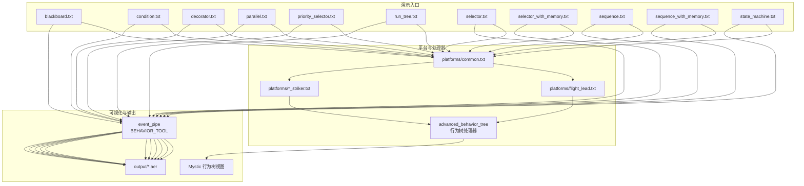
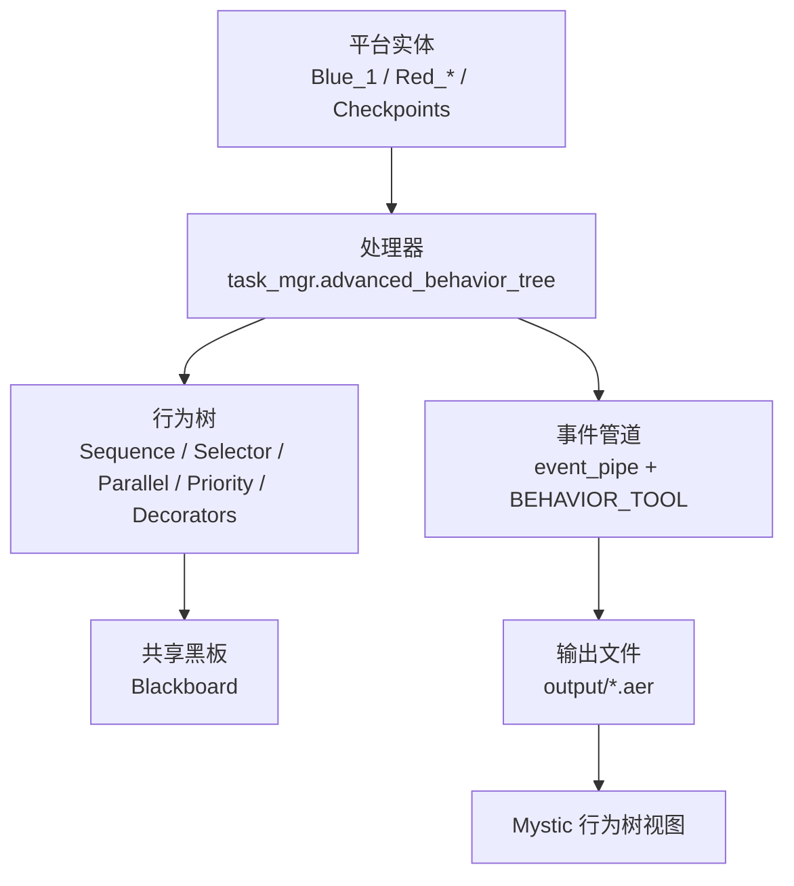
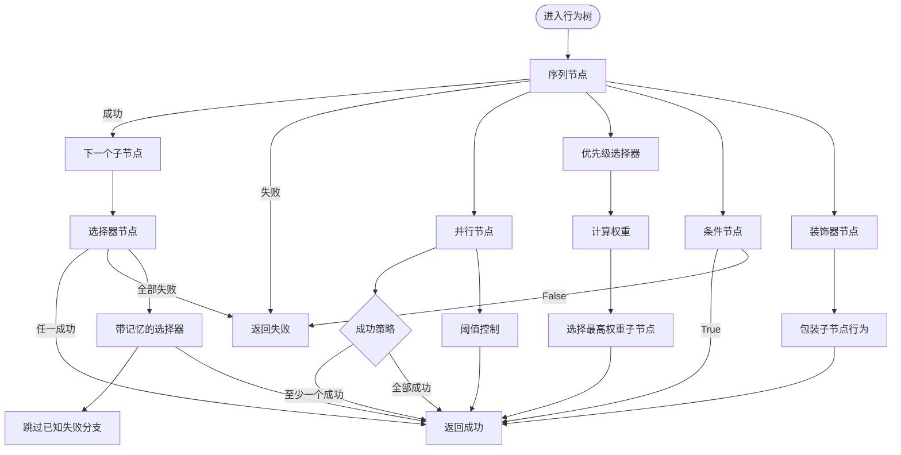
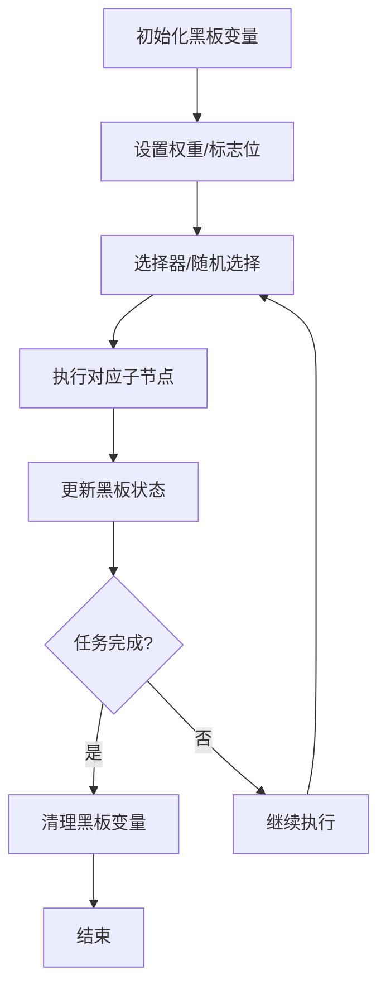
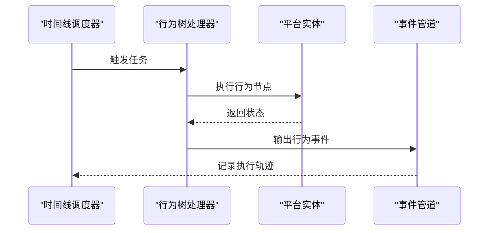
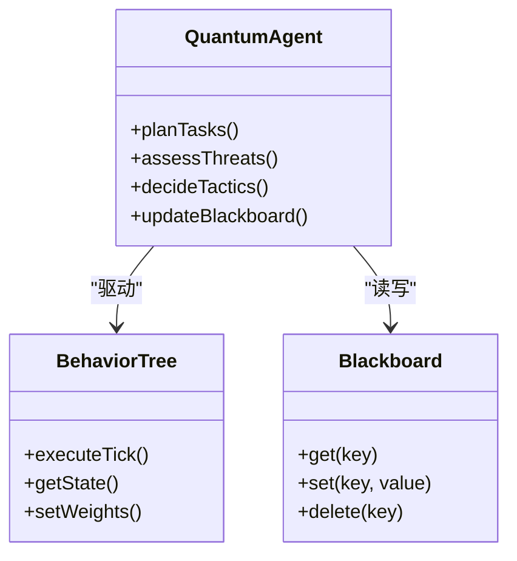
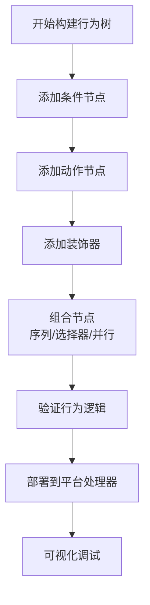
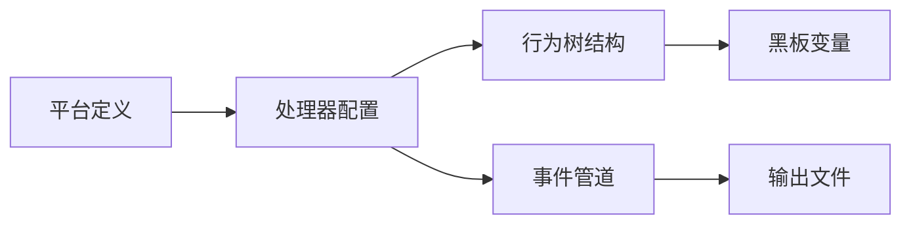

# 行为决策系统

<cite>
**本文引用的文件**   
- [behavior_tree_demos.rst](file://demos/behavior_tree/doc/behavior_tree_demos.rst)
- [README.md](file://demos/behavior_tree/README.md)
- [blackboard.txt](file://demos/behavior_tree/blackboard.txt)
- [condition.txt](file://demos/behavior_tree/condition.txt)
- [decorator.txt](file://demos/behavior_tree/decorator.txt)
- [parallel.txt](file://demos/behavior_tree/parallel.txt)
- [priority_selector.txt](file://demos/behavior_tree/priority_selector.txt)
- [run_tree.txt](file://demos/behavior_tree/run_tree.txt)
- [selector.txt](file://demos/behavior_tree/selector.txt)
- [selector_with_memory.txt](file://demos/behavior_tree/selector_with_memory.txt)
- [sequence.txt](file://demos/behavior_tree/sequence.txt)
- [sequence_with_memory.txt](file://demos/behavior_tree/sequence_with_memory.txt)
- [state_machine.txt](file://demos/behavior_tree/state_machine.txt)
</cite>

## 目录
1. [简介](#简介)
2. [项目结构](#项目结构)
3. [核心组件](#核心组件)
4. [架构总览](#架构总览)
5. [详细组件分析](#详细组件分析)
6. [依赖关系分析](#依赖关系分析)
7. [性能考虑](#性能考虑)
8. [故障排查指南](#故障排查指南)
9. [结论](#结论)
10. [附录](#附录)

## 简介
本技术文档面向AFSIM的行为决策系统，聚焦行为树（Behavior Tree）架构与量子代理（Quantum Agents）AI系统的协同工作。内容涵盖：
- 行为树的设计理念、节点类型、执行流程与状态管理
- 量子代理的任务规划、威胁评估与战术决策机制
- 行为树的构建方法：条件节点、动作节点、装饰器的使用与组合
- 时间线（Timeline）系统的任务调度与执行机制
- 决策系统的配置语法与调试工具
- 复杂战术场景的设计模式与最佳实践
- AI行为的可视化调试与分析方法
- 自定义决策逻辑与行为节点的扩展方式

## 项目结构
behavior_tree演示目录提供了多套行为树示例与可视化能力，配合Mystic的“行为树视图”进行观察与调试。关键组织方式如下：
- 顶层脚本：每个演示以独立txt文件定义平台、处理器与事件管道，启用BEHAVIOR_TOOL用于行为树可视化
- 平台定义：包含蓝/红方平台、检查点、编队长等实体
- 处理器配置：通过advanced_behavior_tree节点挂载行为树，内部由序列、选择器、并行、优先级选择器等组合
- 文档说明：doc/behavior_tree_demos.rst对各演示用例的功能与预期行为进行说明

图示来源
- [blackboard.txt:17-20](file://demos/behavior_tree/blackboard.txt#L17-L20)
- [run_tree.txt:18-21](file://demos/behavior_tree/run_tree.txt#L18-L21)
- [run_tree.txt:46-75](file://demos/behavior_tree/run_tree.txt#L46-L75)

章节来源
- [README.md:1-49](file://demos/behavior_tree/README.md#L1-L49)
- [behavior_tree_demos.rst:10-25](file://demos/behavior_tree/doc/behavior_tree_demos.rst#L10-L25)

## 核心组件
- 行为树节点类型
  - 序列（Sequence）：按顺序执行子节点，遇到失败则停止；支持记忆模式以跳过已成功的节点
  - 选择器（Selector）：依次尝试子节点，任一成功即返回成功；支持记忆模式以跳过已知失败的分支
  - 并行（Parallel）：同时运行多个子树，依据策略（如全部成功或至少一个成功）判定结果
  - 优先级选择器（Priority Selector）：根据预条件的权重选择最高优先的子节点执行
  - 加权随机（Weighted Random）：基于权重进行随机选择，适合多样化行为采样
  - 条件节点（Condition）：仅做判断，返回成功或失败，不产生Running状态
  - 装饰器（Decorator）：对子节点行为进行包装，如反转、重复、超时、循环等
  - 状态机（State Machine）：在多个行为树之间切换，实现高层状态驱动
  - 子树（Subtrees）：将行为树模块化，便于复用与单独查看
- 共享黑板（Blackboard）
  - 提供跨节点的数据共享，支持int、bool、float、string四种基本类型
  - 常用于标记任务完成、设置权重、存储中间结果
- 高级行为树处理器（Advanced Behavior Tree Processor）
  - 通过advanced_behavior_tree节点挂载完整的行为树结构
  - 支持btt开关控制可视化，结合event_pipe输出.aer供Mystic解析

章节来源
- [behavior_tree_demos.rst:27-91](file://demos/behavior_tree/doc/behavior_tree_demos.rst#L27-L91)
- [run_tree.txt:46-75](file://demos/behavior_tree/run_tree.txt#L46-L75)

## 架构总览
AFSIM行为决策系统采用“平台-处理器-行为树”的分层架构：
- 平台层：定义实体（飞机、检查点、编队长等），并关联处理器
- 处理器层：通过advanced_behavior_tree挂载行为树，负责每tick的执行与状态更新
- 行为树层：由多种节点组合构成，表达战术逻辑与任务编排
- 可视化层：通过event_pipe启用BEHAVIOR_TOOL，输出.aer到Mystic进行可视化调试

图示来源
- [run_tree.txt:46-75](file://demos/behavior_tree/run_tree.txt#L46-L75)
- [blackboard.txt:17-20](file://demos/behavior_tree/blackboard.txt#L17-L20)

## 详细组件分析

### 行为树节点类型与执行流程
- 序列（Sequence）
  - 执行顺序：从左到右（从上到下）
  - 终止条件：遇到失败或全部成功
  - 记忆模式：成功后推进记忆指针，避免重复执行
- 选择器（Selector）
  - 执行顺序：从左到右
  - 终止条件：任一成功即返回成功；全部失败则返回失败
  - 记忆模式：跳过已知失败的分支，直到重置
- 并行（Parallel）
  - 执行策略：同时运行所有子树
  - 成功策略：succeed_on_one或succeed_on_all，或阈值控制
- 优先级选择器（Priority Selector）
  - 选择依据：预条件的权重值（fitness value）
  - 动态调整：可通过黑板变量修改权重，改变优先级
- 加权随机（Weighted Random）
  - 选择依据：权重概率分布
  - 适用场景：需要多样性的行为采样
- 条件节点（Condition）
  - 返回值：Success或Failure
  - 用途：前置条件判断，不产生Running
- 装饰器（Decorator）
  - 常见类型：Inverter（反转）、Succeeder（总是成功）、Repeater（重复执行）
  - 用途：包装子节点，改变其语义或生命周期
- 状态机（State Machine）
  - 功能：在不同行为树之间切换
  - 典型用法：按阶段执行不同任务树（蓝/绿/红检查点）

图示来源
- [behavior_tree_demos.rst:32-91](file://demos/behavior_tree/doc/behavior_tree_demos.rst#L32-L91)

章节来源
- [behavior_tree_demos.rst:32-91](file://demos/behavior_tree/doc/behavior_tree_demos.rst#L32-L91)

### 共享黑板（Blackboard）机制
- 作用：跨节点共享数据，支持int、bool、float、string
- 典型用法：
  - 标记任务是否已完成
  - 设置权重以影响优先级选择器或加权随机
  - 存储中间结果供后续节点读取
- 生命周期：可在任务开始时设置，完成后删除

图示来源
- [behavior_tree_demos.rst:27-31](file://demos/behavior_tree/doc/behavior_tree_demos.rst#L27-L31)

章节来源
- [behavior_tree_demos.rst:27-31](file://demos/behavior_tree/doc/behavior_tree_demos.rst#L27-L31)

### 时间线（Timeline）系统
- 功能：任务调度与执行机制，按时间轴安排行为
- 与行为树的关系：行为树可驱动时间线上的任务，或在时间线的约束下执行
- 典型场景：编队飞行、任务分派、资源分配

[此图为概念性时序图，未直接映射具体源码文件]

### 量子代理（Quantum Agents）AI系统
- 任务规划：基于行为树的结构化任务编排，支持多目标与多阶段
- 威胁评估：通过条件节点与黑板变量评估敌我态势
- 战术决策：利用优先级选择器与装饰器实现动态战术切换
- 可视化调试：结合Mystic行为树视图观察决策过程

[此图为概念类图，展示量子代理与行为树、黑板的关系]

### 行为树构建方法与组合
- 条件节点：用于前置条件判断，确保仅在满足条件时执行后续动作
- 动作节点：执行具体行为，如飞向检查点、攻击目标、返航
- 装饰器：包装动作节点，实现重复、反转、超时等控制流
- 组合模式：
  - 序列+选择器：先判断再选择最优路径
  - 并行+优先级：多任务并行且按优先级调度
  - 状态机+子树：按阶段切换不同行为树

[此图为概念流程图，指导行为树构建步骤]

## 依赖关系分析
- 平台与处理器耦合：平台通过processor.task_mgr.advanced_behavior_tree挂载行为树
- 行为树与黑板解耦：黑板作为共享状态容器，行为树节点通过键值访问
- 可视化与执行分离：event_pipe与BEHAVIOR_TOOL仅用于输出与调试，不影响核心执行

图示来源
- [run_tree.txt:46-75](file://demos/behavior_tree/run_tree.txt#L46-L75)
- [blackboard.txt:17-20](file://demos/behavior_tree/blackboard.txt#L17-L20)

章节来源
- [run_tree.txt:46-75](file://demos/behavior_tree/run_tree.txt#L46-L75)
- [blackboard.txt:17-20](file://demos/behavior_tree/blackboard.txt#L17-L20)

## 性能考虑
- 行为树执行开销：每tick遍历节点，复杂树结构可能带来CPU压力
- 黑板访问频率：频繁读写黑板变量可能成为瓶颈
- 并行节点数量：过多并行子树会增加同步与调度成本
- 优化建议：
  - 使用记忆模式减少重复执行
  - 合理设计权重以降低优先级选择器的计算量
  - 限制并行子树数量，必要时拆分行为树

[本节为通用性能讨论，不涉及具体源码分析]

## 故障排查指南
- 行为树无输出：检查event_pipe是否启用BEHAVIOR_TOOL，确认output路径正确
- 行为树未按预期执行：查看Mystic中的行为树状态，确认节点返回值与黑板变量
- 权重异常：检查优先级选择器或加权随机节点的权重设置与黑板更新逻辑
- 并行节点策略错误：确认succeed_on_one或succeed_on_all是否符合预期

章节来源
- [blackboard.txt:17-20](file://demos/behavior_tree/blackboard.txt#L17-L20)
- [run_tree.txt:18-21](file://demos/behavior_tree/run_tree.txt#L18-L21)

## 结论
AFSIM的行为决策系统通过行为树与量子代理的结合，提供了灵活、可扩展的战术编排能力。借助共享黑板与可视化调试工具，用户能够高效地设计与验证复杂行为逻辑。在实际应用中，应注重行为树结构的清晰性与性能优化，以确保仿真效率与决策质量。

[本节为总结性内容，不涉及具体源码分析]

## 附录
- 常用行为树节点速查表
  - Sequence：顺序执行，遇失败停止
  - Selector：尝试子节点，任一成功即成功
  - Parallel：并行执行，策略决定成功条件
  - Priority Selector：按权重选择最高优先级
  - Weighted Random：按权重随机选择
  - Condition：仅判断，返回成功或失败
  - Decorator：包装子节点，改变行为
  - State Machine：在多个行为树间切换
- 配置语法要点
  - advanced_behavior_tree：挂载行为树
  - btt on/off：控制可视化
  - event_pipe + BEHAVIOR_TOOL：启用行为事件输出
- 调试工具
  - Mystic行为树视图：实时观察节点状态与执行流
  - output/*.aer：行为事件数据文件，供离线分析

[本节为补充信息，不涉及具体源码分析]