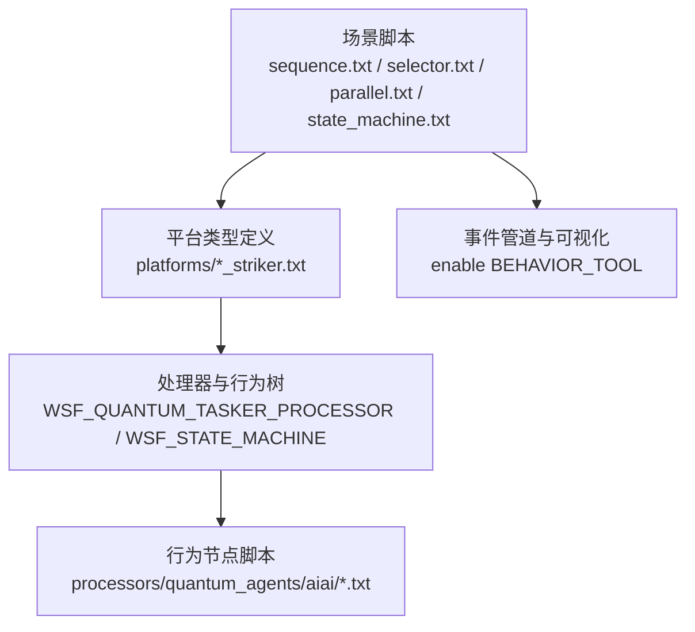
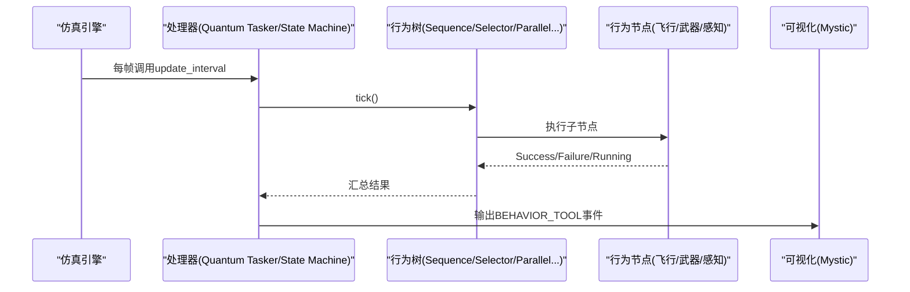
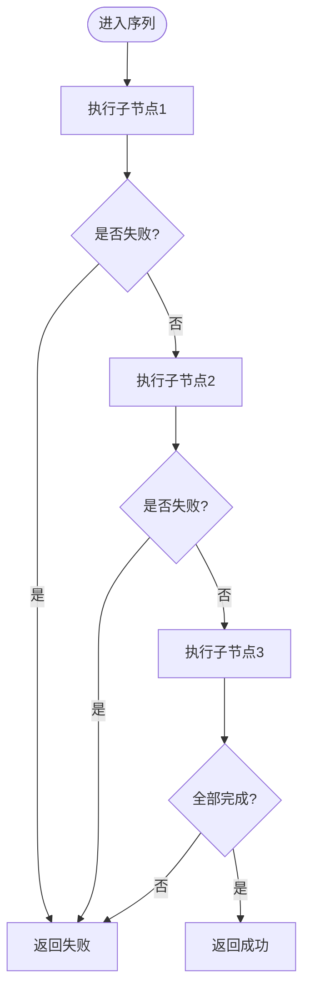
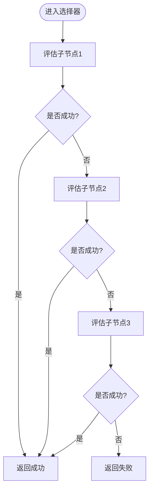
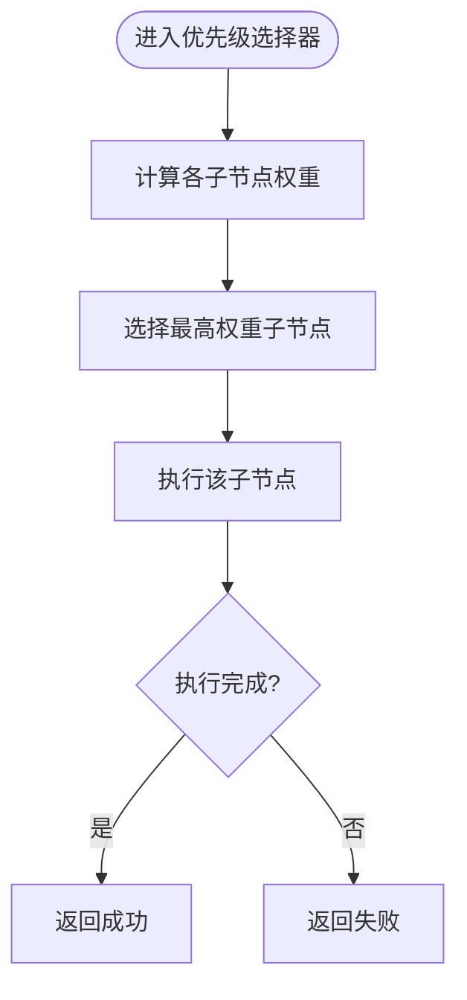
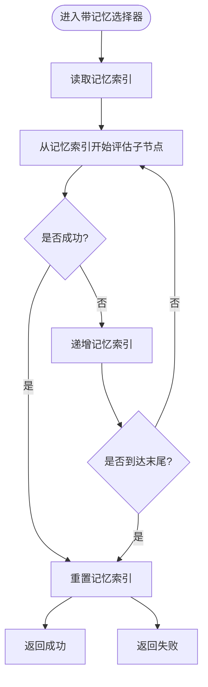
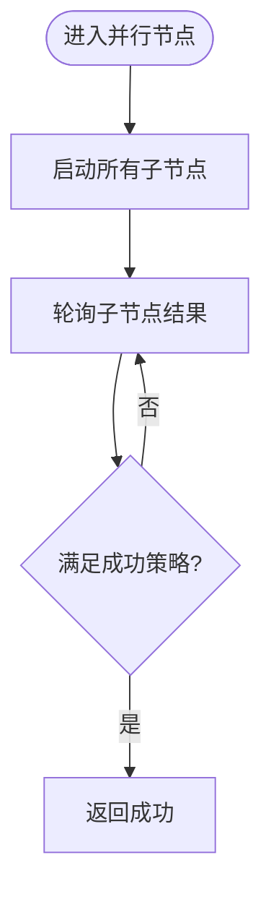
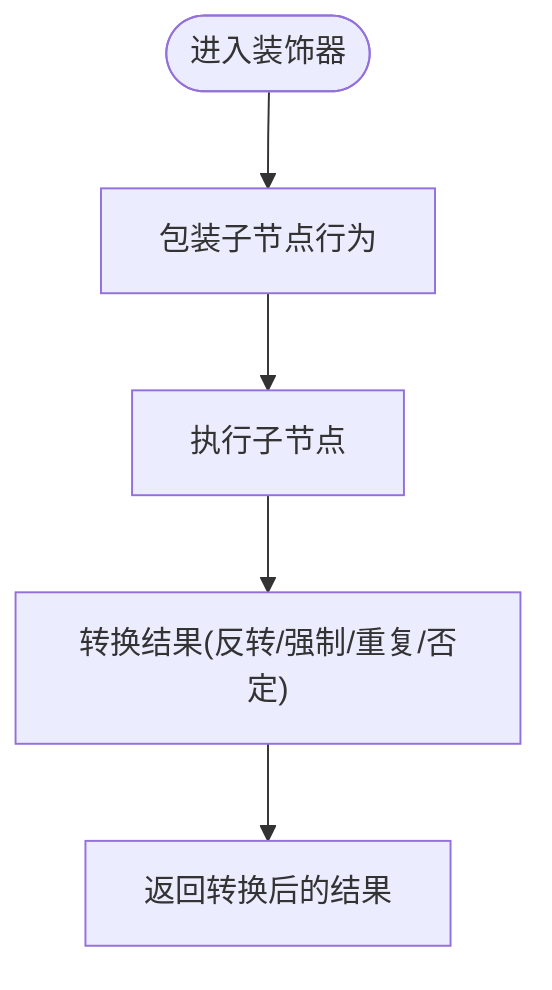
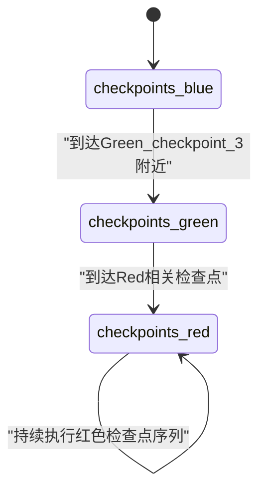
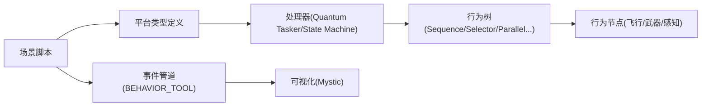

# 行为树架构

<cite>
**本文引用的文件**   
- [behavior_tree_demos.rst](file://demos/behavior_tree/doc/behavior_tree_demos.rst)
- [README.md](file://demos/behavior_tree/README.md)
- [sequence.txt](file://demos/behavior_tree/sequence.txt)
- [selector.txt](file://demos/behavior_tree/selector.txt)
- [parallel.txt](file://demos/behavior_tree/parallel.txt)
- [state_machine.txt](file://demos/behavior_tree/state_machine.txt)
- [platforms/sequence_striker.txt](file://demos/behavior_tree/platforms/sequence_striker.txt)
- [platforms/selector_striker.txt](file://demos/behavior_tree/platforms/selector_striker.txt)
- [platforms/parallel_striker.txt](file://demos/behavior_tree/platforms/parallel_striker.txt)
- [platforms/state_machine_striker.txt](file://demos/behavior_tree/platforms/state_machine_striker.txt)
- [platforms/blackboard_striker.txt](file://demos/behavior_tree/platforms/blackboard_striker.txt)
- [platforms/decorator_striker.txt](file://demos/behavior_tree/platforms/decorator_striker.txt)
- [platforms/priority_selector_striker.txt](file://demos/behavior_tree/platforms/priority_selector_striker.txt)
- [platforms/selector_with_memory_striker.txt](file://demos/behavior_tree/platforms/selector_with_memory_striker.txt)
</cite>

## 目录
1. [简介](#简介)
2. [项目结构](#项目结构)
3. [核心组件](#核心组件)
4. [架构总览](#架构总览)
5. [详细组件分析](#详细组件分析)
6. [依赖关系分析](#依赖关系分析)
7. [性能与优化](#性能与优化)
8. [故障排查指南](#故障排查指南)
9. [结论](#结论)
10. [附录](#附录)

## 简介
本技术文档面向AFSIM中的高级行为树（Advanced Behavior Tree）能力，系统阐述其设计理念、节点类型、执行流程、状态管理、错误处理策略以及可视化调试方法。文档结合demos/behavior_tree下的示例场景，覆盖序列节点（Sequence）、选择器节点（Selector）、优先级选择器（Priority Selector）、带记忆的选择器（Selector with Memory）、并行节点（Parallel）、装饰器（Decorator）、条件节点（Condition）、黑板（Blackboard）、子树（Subtrees）与状态机（State Machine）等关键概念，并给出战术决策构建的最佳实践与常见问题解决方案。

## 项目结构
behavior_tree演示目录组织方式以“场景脚本 + 平台定义 + 处理器/行为树脚本”分层：
- 顶层场景脚本：定义仿真参数、平台实例、事件管道与可视化开关
- platforms/*_striker.txt：平台类型定义，包含mover、fuel、processor及advanced_behavior_tree配置
- processors/quantum_agents/aiai/*.txt：具体行为节点或子树的脚本实现
- doc/behavior_tree_demos.rst：各演示的说明与行为描述

图表来源
- [sequence.txt:10-21](file://demos/behavior_tree/sequence.txt#L10-L21)
- [selector.txt:10-21](file://demos/behavior_tree/selector.txt#L10-L21)
- [parallel.txt:10-21](file://demos/behavior_tree/parallel.txt#L10-L21)
- [state_machine.txt:10-21](file://demos/behavior_tree/state_machine.txt#L10-L21)
- [platforms/sequence_striker.txt:42-56](file://demos/behavior_tree/platforms/sequence_striker.txt#L42-L56)
- [platforms/selector_striker.txt:86-100](file://demos/behavior_tree/platforms/selector_striker.txt#L86-L100)
- [platforms/parallel_striker.txt:50-74](file://demos/behavior_tree/platforms/parallel_striker.txt#L50-L74)
- [platforms/state_machine_striker.txt:46-121](file://demos/behavior_tree/platforms/state_machine_striker.txt#L46-L121)

章节来源
- [README.md:1-49](file://demos/behavior_tree/README.md#L1-L49)
- [behavior_tree_demos.rst:10-91](file://demos/behavior_tree/doc/behavior_tree_demos.rst#L10-L91)

## 核心组件
- 序列节点（Sequence）：按顺序从左到右执行子节点，遇到失败立即返回失败；全部成功则返回成功。适用于线性任务流（如依次飞越多个检查点）。
- 选择器节点（Selector）：依次评估子节点，任一成功即返回成功；全部失败才返回失败。适合“优先尝试A，否则B，否则C”的分支逻辑。
- 优先级选择器（Priority Selector）：根据子节点的权重/优先级选择最高优先级子节点执行，常用于动态目标选择或资源分配。
- 带记忆的选择器（Selector with Memory）：跳过之前失败的子节点，直到所有子节点成功或整体失败后重置记忆，减少重复评估开销。
- 并行节点（Parallel）：同时运行多个子节点，支持多种成功策略（如succeed_on_one、succeed_on_all、threshold阈值），用于并发动作组合（如边转弯边变速）。
- 装饰器（Decorator）：对子节点进行行为包装，如反转结果（inverter）、强制成功（succeeder）、重复执行（repeater）、否定（negator）等。
- 条件节点（Condition）：仅含前置条件的判断节点，只返回Success或Failure，不返回Running。
- 黑板（Blackboard）：共享变量存储机制，支持int/bool/float/string类型，用于跨节点数据共享与可视化。
- 子树（Subtrees）：将行为树作为子树引用，便于复用与独立可视化。
- 状态机（State Machine）：在多个行为树之间切换状态，每个状态可绑定一个行为树，并通过条件触发状态迁移。

章节来源
- [behavior_tree_demos.rst:27-91](file://demos/behavior_tree/doc/behavior_tree_demos.rst#L27-L91)

## 架构总览
AFSIM的行为树通过平台处理器驱动执行：
- WSF_QUANTUM_TASKER_PROCESSOR：承载advanced_behavior_tree，负责tick调度、节点执行与状态更新
- WSF_STATE_MACHINE：承载多棵行为树的状态机，维护当前状态与迁移条件
- 事件管道（event_pipe）+ BEHAVIOR_TOOL：输出行为树执行轨迹，供Mystic可视化查看

图表来源
- [platforms/sequence_striker.txt:42-56](file://demos/behavior_tree/platforms/sequence_striker.txt#L42-L56)
- [platforms/selector_striker.txt:86-100](file://demos/behavior_tree/platforms/selector_striker.txt#L86-L100)
- [platforms/parallel_striker.txt:50-74](file://demos/behavior_tree/platforms/parallel_striker.txt#L50-L74)
- [platforms/state_machine_striker.txt:46-121](file://demos/behavior_tree/platforms/state_machine_striker.txt#L46-L121)
- [sequence.txt:18-21](file://demos/behavior_tree/sequence.txt#L18-L21)
- [selector.txt:18-21](file://demos/behavior_tree/selector.txt#L18-L21)
- [parallel.txt:17-21](file://demos/behavior_tree/parallel.txt#L17-L21)
- [state_machine.txt:17-21](file://demos/behavior_tree/state_machine.txt#L17-L21)

## 详细组件分析

### 序列节点（Sequence）
- 工作原理：按顺序执行子节点，任一失败立即返回失败；全部成功返回成功。
- 典型用法：依次飞越多个检查点，确保顺序性。
- 配置要点：在advanced_behavior_tree中使用sequence包裹多个behavior_node。

图表来源
- [platforms/sequence_striker.txt:46-55](file://demos/behavior_tree/platforms/sequence_striker.txt#L46-L55)

章节来源
- [behavior_tree_demos.rst:67-70](file://demos/behavior_tree/doc/behavior_tree_demos.rst#L67-L70)
- [platforms/sequence_striker.txt:46-55](file://demos/behavior_tree/platforms/sequence_striker.txt#L46-L55)

### 选择器节点（Selector）
- 工作原理：依次评估子节点，第一个成功的子节点使整个选择器返回成功；全部失败才返回失败。
- 典型用法：先尝试规避威胁，其次护航，再次编队夹击，最后按计划航线飞行。

图表来源
- [platforms/selector_striker.txt:90-100](file://demos/behavior_tree/platforms/selector_striker.txt#L90-L100)

章节来源
- [behavior_tree_demos.rst:57-60](file://demos/behavior_tree/doc/behavior_tree_demos.rst#L57-L60)
- [platforms/selector_striker.txt:90-100](file://demos/behavior_tree/platforms/selector_striker.txt#L90-L100)

### 优先级选择器（Priority Selector）
- 工作原理：根据子节点的权重/优先级选择最高优先级子节点执行，常用于动态目标选择。
- 典型用法：为不同检查点设置不同权重，按权重从高到低访问。

图表来源
- [platforms/priority_selector_striker.txt:43-51](file://demos/behavior_tree/platforms/priority_selector_striker.txt#L43-L51)

章节来源
- [behavior_tree_demos.rst:47-50](file://demos/behavior_tree/doc/behavior_tree_demos.rst#L47-L50)
- [platforms/priority_selector_striker.txt:43-51](file://demos/behavior_tree/platforms/priority_selector_striker.txt#L43-L51)

### 带记忆的选择器（Selector with Memory）
- 工作原理：跳过之前失败的子节点，直到所有子节点成功或整体失败后重置记忆，减少重复评估开销。
- 典型用法：距离条件随时间变化，避免反复评估已失败的近距离条件。

图表来源
- [platforms/selector_with_memory_striker.txt:43-51](file://demos/behavior_tree/platforms/selector_with_memory_striker.txt#L43-L51)

章节来源
- [behavior_tree_demos.rst:62-65](file://demos/behavior_tree/doc/behavior_tree_demos.rst#L62-L65)
- [platforms/selector_with_memory_striker.txt:43-51](file://demos/behavior_tree/platforms/selector_with_memory_striker.txt#L43-L51)

### 并行节点（Parallel）
- 工作原理：同时运行多个子节点，支持success_policy（succeed_on_one、succeed_on_all）或threshold阈值。
- 典型用法：组合转弯与速度控制，形成复合机动。

图表来源
- [platforms/parallel_striker.txt:54-73](file://demos/behavior_tree/platforms/parallel_striker.txt#L54-L73)

章节来源
- [behavior_tree_demos.rst:42-45](file://demos/behavior_tree/doc/behavior_tree_demos.rst#L42-L45)
- [platforms/parallel_striker.txt:54-73](file://demos/behavior_tree/platforms/parallel_striker.txt#L54-L73)

### 装饰器（Decorator）
- 工作原理：对子节点进行行为包装，如反转结果、强制成功、重复执行、否定等。
- 典型用法：让原本会失败的节点继续执行序列，或在限定时间内重复某动作。

图表来源
- [platforms/decorator_striker.txt:45-68](file://demos/behavior_tree/platforms/decorator_striker.txt#L45-L68)

章节来源
- [behavior_tree_demos.rst:37-40](file://demos/behavior_tree/doc/behavior_tree_demos.rst#L37-L40)
- [platforms/decorator_striker.txt:45-68](file://demos/behavior_tree/platforms/decorator_striker.txt#L45-L68)

### 条件节点（Condition）
- 工作原理：仅含前置条件的判断节点，只返回Success或Failure，不返回Running。
- 典型用法：距离条件、可见性条件等纯判断逻辑。

章节来源
- [behavior_tree_demos.rst:32-35](file://demos/behavior_tree/doc/behavior_tree_demos.rst#L32-L35)

### 黑板（Blackboard）
- 工作原理：提供共享变量存储，支持int/bool/float/string类型，用于跨节点数据共享与可视化。
- 典型用法：记录已访问的检查点、任务权重、随机选择结果等。

章节来源
- [behavior_tree_demos.rst:27-31](file://demos/behavior_tree/doc/behavior_tree_demos.rst#L27-L31)
- [platforms/blackboard_striker.txt:47-63](file://demos/behavior_tree/platforms/blackboard_striker.txt#L47-L63)

### 子树（Subtrees）
- 工作原理：将行为树作为子树引用，便于复用与独立可视化。
- 典型用法：将不同检查点路径封装为子树，在主树中按序调用。

章节来源
- [behavior_tree_demos.rst:82-85](file://demos/behavior_tree/doc/behavior_tree_demos.rst#L82-L85)

### 状态机（State Machine）
- 工作原理：维护当前状态与迁移条件，每个状态绑定一棵行为树，通过on_update或条件触发状态切换。
- 典型用法：分阶段执行不同检查点序列（蓝→绿→红）。

图表来源
- [platforms/state_machine_striker.txt:46-121](file://demos/behavior_tree/platforms/state_machine_striker.txt#L46-L121)

章节来源
- [behavior_tree_demos.rst:77-80](file://demos/behavior_tree/doc/behavior_tree_demos.rst#L77-L80)
- [platforms/state_machine_striker.txt:46-121](file://demos/behavior_tree/platforms/state_machine_striker.txt#L46-L121)

## 依赖关系分析
- 场景脚本依赖平台类型定义，平台类型定义依赖处理器与行为树脚本
- 处理器（Quantum Tasker/State Machine）驱动行为树执行，行为树节点依赖具体的飞行/武器/感知脚本
- 事件管道与BEHAVIOR_TOOL启用后，行为树执行轨迹输出至可视化

图表来源
- [sequence.txt:10-21](file://demos/behavior_tree/sequence.txt#L10-L21)
- [selector.txt:10-21](file://demos/behavior_tree/selector.txt#L10-L21)
- [parallel.txt:10-21](file://demos/behavior_tree/parallel.txt#L10-L21)
- [state_machine.txt:10-21](file://demos/behavior_tree/state_machine.txt#L10-L21)
- [platforms/sequence_striker.txt:42-56](file://demos/behavior_tree/platforms/sequence_striker.txt#L42-L56)
- [platforms/selector_striker.txt:86-100](file://demos/behavior_tree/platforms/selector_striker.txt#L86-L100)
- [platforms/parallel_striker.txt:50-74](file://demos/behavior_tree/platforms/parallel_striker.txt#L50-L74)
- [platforms/state_machine_striker.txt:46-121](file://demos/behavior_tree/platforms/state_machine_striker.txt#L46-L121)

## 性能与优化
- 使用带记忆的选择器（Selector with Memory）减少重复评估开销
- 合理设置update_interval，平衡行为树响应速度与仿真负载
- 使用并行节点（Parallel）时注意成功策略与阈值，避免不必要的并发开销
- 利用装饰器（Decorator）的repeat/for等控制，避免在节点内部实现复杂循环逻辑
- 通过黑板（Blackboard）缓存中间结果，减少重复计算

[本节为通用指导，不涉及具体文件分析]

## 故障排查指南
- 启用BEHAVIOR_TOOL并在场景脚本中开启event_pipe，以便在Mystic中观察行为树执行轨迹
- 检查处理器update_interval是否过短导致频繁tick，影响性能
- 确认行为树节点返回值是否符合预期（Success/Failure/Running），避免死循环
- 对于状态机，检查next_state条件是否正确，避免无法迁移或自环
- 使用黑板变量记录关键状态，辅助定位问题

章节来源
- [sequence.txt:18-21](file://demos/behavior_tree/sequence.txt#L18-L21)
- [selector.txt:18-21](file://demos/behavior_tree/selector.txt#L18-L21)
- [parallel.txt:17-21](file://demos/behavior_tree/parallel.txt#L17-L21)
- [state_machine.txt:17-21](file://demos/behavior_tree/state_machine.txt#L17-L21)

## 结论
AFSIM的高级行为树通过灵活的节点类型与处理器驱动，提供了强大的战术决策建模能力。序列、选择器、优先级选择器、带记忆的选择器、并行、装饰器、条件、黑板、子树与状态机等组件共同构成了可扩展、可观测、可调试的行为树体系。结合Mystic可视化与事件管道，用户能够高效地设计、验证与优化复杂战术行为。

[本节为总结性内容，不涉及具体文件分析]

## 附录
- 战术决策最佳实践
  - 条件判断：使用条件节点表达纯判断逻辑，保持行为树清晰
  - 动作执行：将具体动作封装为行为节点，便于复用与测试
  - 装饰器使用：用装饰器包装通用行为（如重复、反转、强制成功），提升可读性
  - 状态机设计：将长周期任务拆分为状态，每个状态绑定行为树，便于管理与可视化
- 常见场景示例
  - 空中对抗：选择器优先规避威胁，其次护航，再次编队夹击，最后按计划航线飞行
  - 编队飞行：并行节点组合转弯与速度控制，形成复合机动
  - 多阶段任务：状态机驱动不同检查点序列，按条件迁移状态

[本节为概念性内容，不涉及具体文件分析]