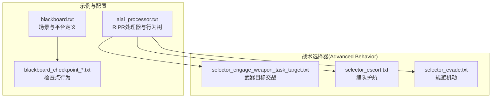
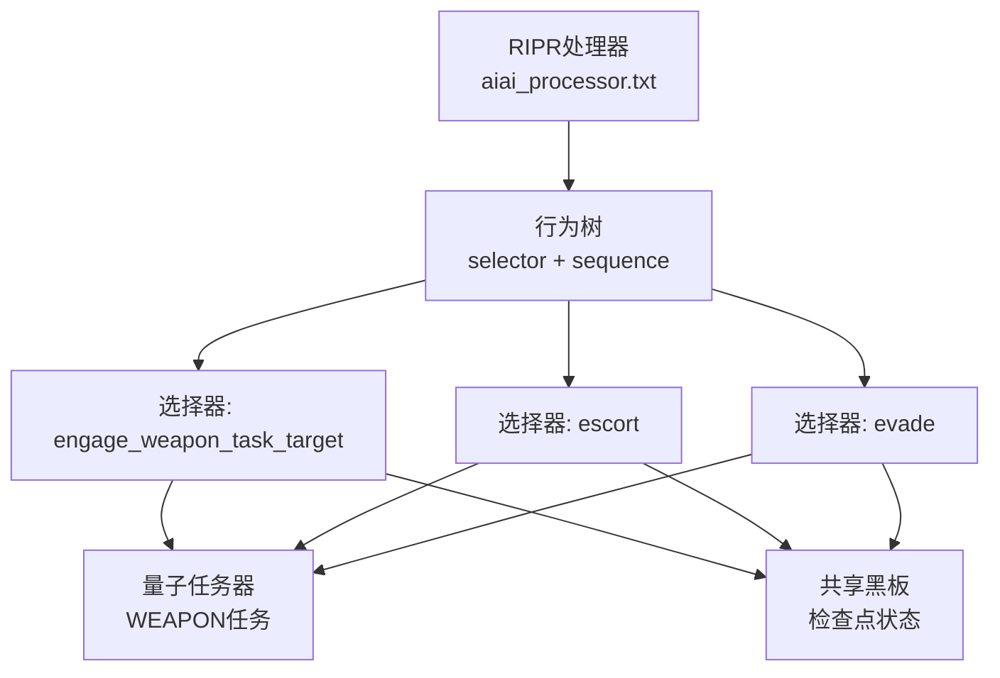
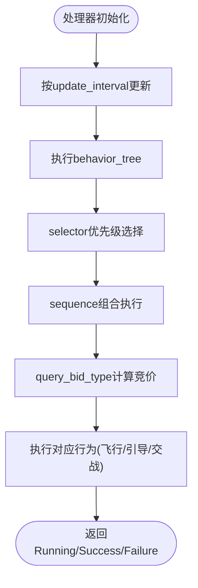
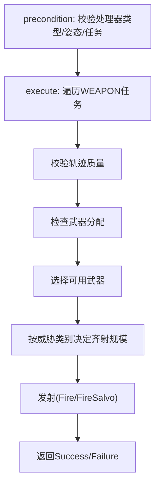
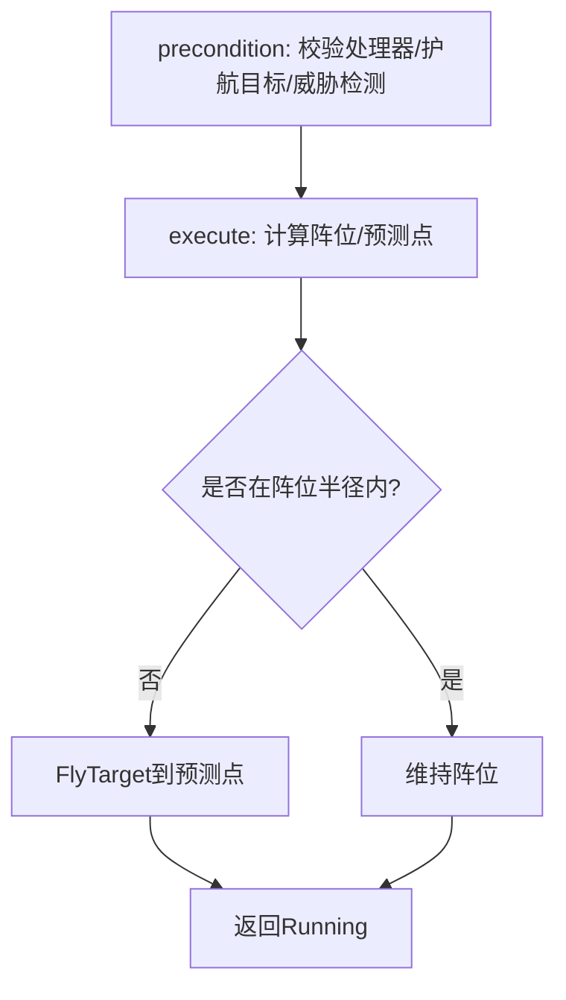
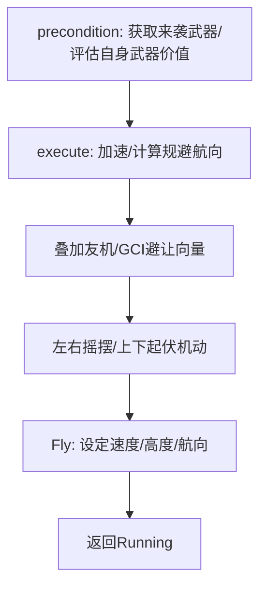
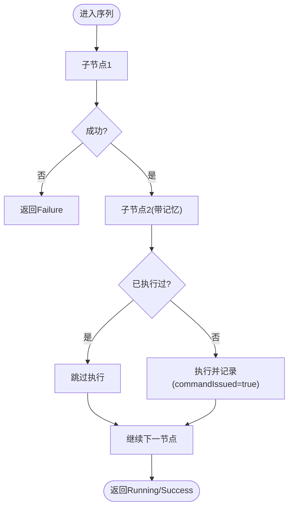
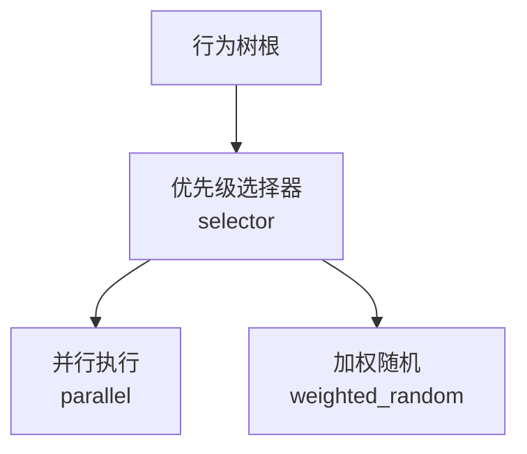
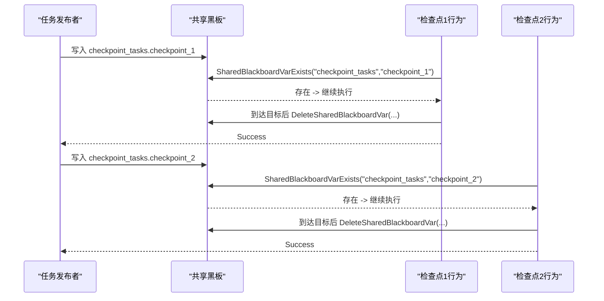
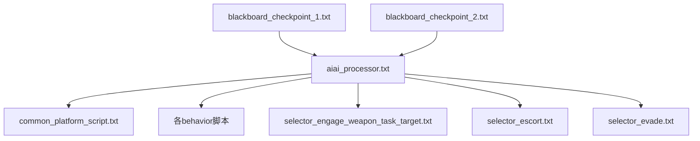

# AI代理接口(aiai)

<cite>
**本文引用的文件**   
- [aiai_processor.txt](file://demos/base_types/processors/ripr_agents/aiai/aiai_processor.txt)
- [selector_engage_weapon_task_target.txt](file://demos/behavior_tree/processors/quantum_agents/aiai/selector_engage_weapon_task_target.txt)
- [selector_escort.txt](file://demos/behavior_tree/processors/quantum_agents/aiai/selector_escort.txt)
- [selector_evade.txt](file://demos/behavior_tree/processors/quantum_agents/aiai/selector_evade.txt)
- [blackboard.txt](file://demos/behavior_tree/blackboard.txt)
- [blackboard_checkpoint_1.txt](file://demos/behavior_tree/processors/quantum_agents/aiai/blackboard_checkpoint_1.txt)
- [blackboard_checkpoint_2.txt](file://demos/behavior_tree/processors/quantum_agents/aiai/blackboard_checkpoint_2.txt)
- [blackboard_checkpoint_3.txt](file://demos/behavior_tree/processors/quantum_agents/aiai/blackboard_checkpoint_3.txt)
- [blackboard_checkpoint_4.txt](file://demos/behavior_tree/processors/quantum_agents/aiai/blackboard_checkpoint_4.txt)
</cite>

## 目录
1. [简介](#简介)
2. [项目结构](#项目结构)
3. [核心组件](#核心组件)
4. [架构总览](#架构总览)
5. [详细组件分析](#详细组件分析)
6. [依赖关系分析](#依赖关系分析)
7. [性能与调度特性](#性能与调度特性)
8. [故障排查指南](#故障排查指南)
9. [结论](#结论)
10. [附录：配置语法与最佳实践](#附录配置语法与最佳实践)

## 简介
本技术文档面向AFSIM的AI代理接口（aiai）系统，聚焦其作为通用AI代理接口的核心概念与架构设计。内容涵盖任务调度器、行为树执行引擎、状态管理机制等关键组件；详解多种战术选择器（Selector）的实现原理与使用场景，如武器目标交战、编队护航、规避机动；说明序列节点与带记忆序列的工作机制；解释并行执行、优先级选择、加权随机等高级调度算法；并介绍黑板检查点（checkpoint）在调试与监控中的作用。文末提供完整的配置语法示例与最佳实践指南，帮助读者快速构建可维护、可扩展的AI代理行为。

## 项目结构
aiai相关代码与示例主要分布在以下位置：
- 处理器脚本与行为定义：demos/base_types/processors/ripr_agents/aiai/
- 行为树与量子任务器示例：demos/behavior_tree/platforms/ 与 demos/behavior_tree/processors/quantum_agents/aiai/
- 黑板与检查点示例：demos/behavior_tree/blackboard.txt 及 processors/quantum_agents/aiai/blackboard_checkpoint_*.txt

图表来源
- [aiai_processor.txt:113-134](file://demos/base_types/processors/ripr_agents/aiai/aiai_processor.txt#L113-L134)
- [blackboard.txt:17-53](file://demos/behavior_tree/blackboard.txt#L17-L53)
- [blackboard_checkpoint_1.txt:12-44](file://demos/behavior_tree/processors/quantum_agents/aiai/blackboard_checkpoint_1.txt#L12-L44)

章节来源
- [aiai_processor.txt:113-134](file://demos/base_types/processors/ripr_agents/aiai/aiai_processor.txt#L113-L134)
- [blackboard.txt:17-53](file://demos/behavior_tree/blackboard.txt#L17-L53)

## 核心组件
- 任务调度器（Quantum Tasker Processor）
  - 负责接收、分发与执行任务（如WEAPON类型任务），为行为树节点提供任务上下文。
  - 通过TasksReceivedOfType等方法获取任务列表，驱动具体战术行为。
- 行为树执行引擎
  - 以selector、sequence、advanced_behavior等节点组合成决策流程。
  - 支持precondition与execute两阶段：先判定条件，再执行动作。
- 状态管理（共享黑板SharedBlackboard）
  - 用于跨行为/节点的状态持久化与同步，例如检查点任务的完成标记。
- 战术选择器（Selector）
  - 将复杂战术逻辑封装为可复用的advanced_behavior，如engage_weapon_task_target、escort、evade。

章节来源
- [selector_engage_weapon_task_target.txt:130-162](file://demos/behavior_tree/processors/quantum_agents/aiai/selector_engage_weapon_task_target.txt#L130-L162)
- [selector_escort.txt:136-198](file://demos/behavior_tree/processors/quantum_agents/aiai/selector_escort.txt#L136-L198)
- [selector_evade.txt:151-250](file://demos/behavior_tree/processors/quantum_agents/aiai/selector_evade.txt#L151-L250)
- [blackboard_checkpoint_1.txt:18-42](file://demos/behavior_tree/processors/quantum_agents/aiai/blackboard_checkpoint_1.txt#L18-L42)

## 架构总览
aiai系统以“处理器+行为树+选择器”为核心架构：
- aiai_processor.txt定义WSF_RIPR_PROCESSOR，包含update_interval、script_variables以及behavior_tree。
- behavior_tree内嵌套selector与sequence，按优先级与顺序执行各advanced_behavior。
- advanced_behavior（如engage_weapon_task_target、escort、evade）实现具体战术逻辑，并通过WsfQuantumTaskerProcessor与任务系统交互。
- 共享黑板用于跨行为的状态同步与检查点控制。

图表来源
- [aiai_processor.txt:113-134](file://demos/base_types/processors/ripr_agents/aiai/aiai_processor.txt#L113-L134)
- [selector_engage_weapon_task_target.txt:153-162](file://demos/behavior_tree/processors/quantum_agents/aiai/selector_engage_weapon_task_target.txt#L153-L162)
- [blackboard_checkpoint_1.txt:18-42](file://demos/behavior_tree/processors/quantum_agents/aiai/blackboard_checkpoint_1.txt#L18-L42)

## 详细组件分析

### 任务调度器与行为树执行
- 更新周期与变量
  - update_interval控制处理器更新频率；script_variables定义代理常量、竞价参数、作战模式开关等。
- 行为树结构
  - selector优先尝试高优先级行为（如evade、go_home、escort、cap-route），随后进入sequence组合（pursue-target/pursue-point/default-flight + guide_weapons）。
- 竞价机制（query_bid_type）
  - 针对不同类型任务（pursue-target、cap-route、pincer、pursue-point、weapon_uplink）计算竞价分数，考虑斜距、接近速度、油量、武器能力、威胁类别等因素。

图表来源
- [aiai_processor.txt:34-38](file://demos/base_types/processors/ripr_agents/aiai/aiai_processor.txt#L34-L38)
- [aiai_processor.txt:113-134](file://demos/base_types/processors/ripr_agents/aiai/aiai_processor.txt#L113-L134)
- [aiai_processor.txt:180-300](file://demos/base_types/processors/ripr_agents/aiai/aiai_processor.txt#L180-L300)

章节来源
- [aiai_processor.txt:34-38](file://demos/base_types/processors/ripr_agents/aiai/aiai_processor.txt#L34-L38)
- [aiai_processor.txt:113-134](file://demos/base_types/processors/ripr_agents/aiai/aiai_processor.txt#L113-L134)
- [aiai_processor.txt:180-300](file://demos/base_types/processors/ripr_agents/aiai/aiai_processor.txt#L180-L300)

### 选择器：武器目标交战（selector_engage_weapon_task_target）
- 前置条件（precondition）
  - 校验处理器类型为WSF_QUANTUM_TASKER_PROCESSOR。
  - 检查平台姿态（滚转、俯仰角）是否满足发射限制。
  - 从任务器获取WEAPON类型任务，若存在则返回Success。
- 执行逻辑（execute）
  - 遍历任务列表，定位目标轨迹（Track）。
  - 校验轨迹质量（TrackQuality）是否达到阈值。
  - 检查是否已有武器分配给该目标。
  - 根据武器能力与射程范围筛选可用武器。
  - 根据威胁类别决定齐射规模（salvo），调用Fire或FireSalvo发射。
- 关键参数
  - 协同交战开关、发射角度限制、不同威胁类型的所需轨迹质量与齐射规模、武器-威胁射程百分比映射。

图表来源
- [selector_engage_weapon_task_target.txt:130-162](file://demos/behavior_tree/processors/quantum_agents/aiai/selector_engage_weapon_task_target.txt#L130-L162)
- [selector_engage_weapon_task_target.txt:166-273](file://demos/behavior_tree/processors/quantum_agents/aiai/selector_engage_weapon_task_target.txt#L166-L273)

章节来源
- [selector_engage_weapon_task_target.txt:130-162](file://demos/behavior_tree/processors/quantum_agents/aiai/selector_engage_weapon_task_target.txt#L130-L162)
- [selector_engage_weapon_task_target.txt:166-273](file://demos/behavior_tree/processors/quantum_agents/aiai/selector_engage_weapon_task_target.txt#L166-L273)

### 选择器：编队护航（selector_escort）
- 前置条件（precondition）
  - 校验处理器类型。
  - 查找护航目标平台（escortPlatform）。
  - 根据mCheckOnlyTasks或mCheckMasterTracks判断是否存在对护航包构成威胁的目标；若有威胁则返回Failure，阻止继续护航飞行。
- 执行逻辑（execute）
  - 计算期望阵位（formationPoint），考虑前向/侧向偏移与高度。
  - 若未到达阵位半径，则向前预测点（lookAhead）并以匹配速度飞向目标。
  - 返回Running持续护航。
- 可视化辅助
  - 可选绘制保护圈与阵位连线，便于调试。

图表来源
- [selector_escort.txt:136-198](file://demos/behavior_tree/processors/quantum_agents/aiai/selector_escort.txt#L136-L198)
- [selector_escort.txt:219-314](file://demos/behavior_tree/processors/quantum_agents/aiai/selector_escort.txt#L219-L314)

章节来源
- [selector_escort.txt:136-198](file://demos/behavior_tree/processors/quantum_agents/aiai/selector_escort.txt#L136-L198)
- [selector_escort.txt:219-314](file://demos/behavior_tree/processors/quantum_agents/aiai/selector_escort.txt#L219-L314)

### 选择器：规避机动（selector_evade）
- 前置条件（precondition）
  - 从威胁处理器或incoming_threats处理器获取来袭武器平台列表。
  - 若自身仍有活跃武器且更靠近目标，则可能不立即规避；否则返回Success触发规避。
- 执行逻辑（execute）
  - 提升速度至规避速度。
  - 基于来袭威胁方位与距离加权计算平均规避航向。
  - 考虑GCI/友机群心避免，加入避让向量。
  - 左右摇摆（bank）与上下起伏（dive/climb）增强机动性。
  - 调用Fly函数设置速度、高度与航向，返回Running。
- 关键参数
  - 规避速度、高度范围、摇摆角度、爬升率、垂直加速度、更新间隔等。

图表来源
- [selector_evade.txt:151-250](file://demos/behavior_tree/processors/quantum_agents/aiai/selector_evade.txt#L151-L250)
- [selector_evade.txt:252-458](file://demos/behavior_tree/processors/quantum_agents/aiai/selector_evade.txt#L252-L458)

章节来源
- [selector_evade.txt:151-250](file://demos/behavior_tree/processors/quantum_agents/aiai/selector_evade.txt#L151-L250)
- [selector_evade.txt:252-458](file://demos/behavior_tree/processors/quantum_agents/aiai/selector_evade.txt#L252-L458)

### 序列节点与带记忆序列
- 序列节点（Sequence）
  - 按顺序执行子节点，任一失败即终止；成功时继续下一个节点。
  - 常用于组合多个动作（如先追击目标，再引导武器）。
- 带记忆序列（Sequence with Memory）
  - 在执行过程中保持状态，避免重复命令下发（如commandIssued标志）。
  - 结合共享黑板（SharedBlackboardVarExists/DeleteSharedBlackboardVar）实现跨行为的状态同步与检查点推进。

图表来源
- [blackboard_checkpoint_1.txt:18-42](file://demos/behavior_tree/processors/quantum_agents/aiai/blackboard_checkpoint_1.txt#L18-L42)
- [blackboard_checkpoint_2.txt:18-42](file://demos/behavior_tree/processors/quantum_agents/aiai/blackboard_checkpoint_2.txt#L18-L42)
- [blackboard_checkpoint_3.txt:18-42](file://demos/behavior_tree/processors/quantum_agents/aiai/blackboard_checkpoint_3.txt#L18-L42)
- [blackboard_checkpoint_4.txt:18-42](file://demos/behavior_tree/processors/quantum_agents/aiai/blackboard_checkpoint_4.txt#L18-L42)

章节来源
- [blackboard_checkpoint_1.txt:18-42](file://demos/behavior_tree/processors/quantum_agents/aiai/blackboard_checkpoint_1.txt#L18-L42)
- [blackboard_checkpoint_2.txt:18-42](file://demos/behavior_tree/processors/quantum_agents/aiai/blackboard_checkpoint_2.txt#L18-L42)
- [blackboard_checkpoint_3.txt:18-42](file://demos/behavior_tree/processors/quantum_agents/aiai/blackboard_checkpoint_3.txt#L18-L42)
- [blackboard_checkpoint_4.txt:18-42](file://demos/behavior_tree/processors/quantum_agents/aiai/blackboard_checkpoint_4.txt#L18-L42)

### 并行执行、优先级选择、加权随机
- 优先级选择（Priority Selector）
  - 在behavior_tree中通过selector节点实现，按声明顺序从高到低尝试分支，首个Success即停止。
- 并行执行（Parallel）
  - 通过并行节点同时执行多个子行为，适用于多任务并发（如同时护航与雷达控制）。
- 加权随机（Weighted Random）
  - 根据权重随机选择分支，适合探索式战术或多样化行为生成。

图表来源
- [aiai_processor.txt:113-134](file://demos/base_types/processors/ripr_agents/aiai/aiai_processor.txt#L113-L134)

章节来源
- [aiai_processor.txt:113-134](file://demos/base_types/processors/ripr_agents/aiai/aiai_processor.txt#L113-L134)

### 黑板检查点（Checkpoint）机制
- 作用
  - 通过SharedBlackboardVarExists/DeleteSharedBlackboardVar在共享黑板上标记检查点任务是否已发布/完成。
  - 每个检查点行为在precondition中检查对应键值，若不存在则返回Failure；在execute中当到达目标区域后删除键值并返回Success。
- 典型流程
  - 外部任务发布者写入“checkpoint_tasks.checkpoint_N”。
  - 检查点行为检测到键值后开始执行，到达目标后删除键值，通知上层流程继续。

图表来源
- [blackboard_checkpoint_1.txt:18-42](file://demos/behavior_tree/processors/quantum_agents/aiai/blackboard_checkpoint_1.txt#L18-L42)
- [blackboard_checkpoint_2.txt:18-42](file://demos/behavior_tree/processors/quantum_agents/aiai/blackboard_checkpoint_2.txt#L18-L42)

章节来源
- [blackboard_checkpoint_1.txt:18-42](file://demos/behavior_tree/processors/quantum_agents/aiai/blackboard_checkpoint_1.txt#L18-L42)
- [blackboard_checkpoint_2.txt:18-42](file://demos/behavior_tree/processors/quantum_agents/aiai/blackboard_checkpoint_2.txt#L18-L42)

## 依赖关系分析
- aiai_processor.txt依赖common_platform_script.txt与各behavior脚本（bid_on_jobs、default-flight、engage-target、escort、evade、go-home、guide-weapons、pincer、pursue-point、radar-control等）。
- 选择器依赖WsfQuantumTaskerProcessor进行任务查询与发射控制。
- 检查点行为依赖共享黑板API进行状态同步。

图表来源
- [aiai_processor.txt:14-28](file://demos/base_types/processors/ripr_agents/aiai/aiai_processor.txt#L14-L28)
- [selector_engage_weapon_task_target.txt:130-162](file://demos/behavior_tree/processors/quantum_agents/aiai/selector_engage_weapon_task_target.txt#L130-L162)
- [blackboard_checkpoint_1.txt:18-42](file://demos/behavior_tree/processors/quantum_agents/aiai/blackboard_checkpoint_1.txt#L18-L42)

章节来源
- [aiai_processor.txt:14-28](file://demos/base_types/processors/ripr_agents/aiai/aiai_processor.txt#L14-L28)
- [selector_engage_weapon_task_target.txt:130-162](file://demos/behavior_tree/processors/quantum_agents/aiai/selector_engage_weapon_task_target.txt#L130-L162)
- [blackboard_checkpoint_1.txt:18-42](file://demos/behavior_tree/processors/quantum_agents/aiai/blackboard_checkpoint_1.txt#L18-L42)

## 性能与调度特性
- 更新间隔（update_interval）
  - 合理设置可平衡响应速度与计算开销；规避行为中可根据态势切换快/慢更新间隔。
- 竞价算法复杂度
  - pursue-target竞价涉及斜距、接近速度、油量、武器能力、威胁类别等多维因素，时间复杂度与武器数量、威胁数量线性相关。
- 武器发射路径
  - 遍历武器列表与任务列表，需避免重复分配与无效发射；建议缓存可用武器索引以提升性能。
- 并行与优先级
  - 合理使用并行节点减少串行阻塞；优先级选择确保高紧急行为优先执行。

[本节为一般性指导，无需列出具体文件来源]

## 故障排查指南
- 常见错误与处理
  - 非量子任务器处理器：选择器precondition会返回Failure，需确认PROCESSOR类型。
  - 轨迹质量不足：无法发射，需提升传感器精度或等待跟踪稳定。
  - 无可用武器：检查武器库存与域能力（AIR/LAND/SURFACE）。
  - 检查点未触发：确认共享黑板键值是否正确写入与删除。
- 调试建议
  - 启用script_debug_writes输出日志。
  - 使用事件管道（event_pipe）与BEHAVIOR_TOOL观察行为状态。
  - 可视化绘制（DrawThreat、保护圈、阵位线）辅助定位问题。

章节来源
- [selector_engage_weapon_task_target.txt:130-162](file://demos/behavior_tree/processors/quantum_agents/aiai/selector_engage_weapon_task_target.txt#L130-L162)
- [selector_escort.txt:136-198](file://demos/behavior_tree/processors/quantum_agents/aiai/selector_escort.txt#L136-L198)
- [blackboard_checkpoint_1.txt:18-42](file://demos/behavior_tree/processors/quantum_agents/aiai/blackboard_checkpoint_1.txt#L18-L42)

## 结论
aiai系统通过RIPR处理器与行为树引擎，将战术决策解耦为可复用的选择器与序列节点，配合共享黑板实现跨行为的协作与状态同步。武器目标交战、编队护航与规避机动等典型战术均能以清晰的precondition/execute结构表达，并通过任务调度器与量子任务器无缝集成。借助优先级选择、并行执行与加权随机等高级调度机制，aiai能够灵活应对复杂战场态势。检查点机制为调试与监控提供了可靠支撑，使行为树的可观测性与可控性显著提升。

[本节为总结性内容，无需列出具体文件来源]

## 附录：配置语法与最佳实践
- 处理器定义
  - processor AIAI-thinker WSF_RIPR_PROCESSOR
  - update_interval 1.0 sec
  - script_debug_writes off
- 行为树定义
  - behavior_tree
    - behavior_node bid_on_jobs
    - selector ... end_selector
    - sequence ... end_sequence
    - behavior_node radar-control
    - behavior_node engage-target
  - end_behavior_tree
- 变量与函数
  - script_variables ... end_script_variables
  - script bool/int/void FunctionName(params) ... end_script
- 竞价块
  - query_bid_type <job-name> ... end_query_bid_type
- 行为定义
  - advanced_behavior <name> enabled true ... end_advanced_behavior
- 共享黑板
  - SharedBlackboardVarExists(group, key)
  - DeleteSharedBlackboardVar(group, key)
- 最佳实践
  - 将高频决策放入selector顶层，低优先级行为置于底层。
  - 使用带记忆序列避免重复命令下发。
  - 通过共享黑板协调多行为间的状态与进度。
  - 合理设置update_interval与fast/slow更新策略。
  - 利用可视化绘制与事件管道进行调试与监控。

章节来源
- [aiai_processor.txt:34-38](file://demos/base_types/processors/ripr_agents/aiai/aiai_processor.txt#L34-L38)
- [aiai_processor.txt:113-134](file://demos/base_types/processors/ripr_agents/aiai/aiai_processor.txt#L113-L134)
- [blackboard_checkpoint_1.txt:18-42](file://demos/behavior_tree/processors/quantum_agents/aiai/blackboard_checkpoint_1.txt#L18-L42)