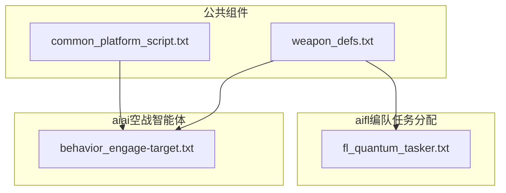
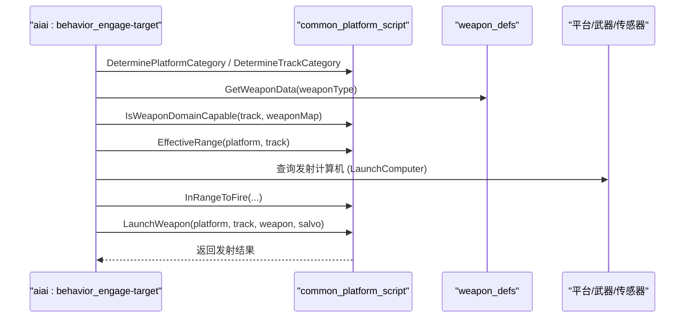
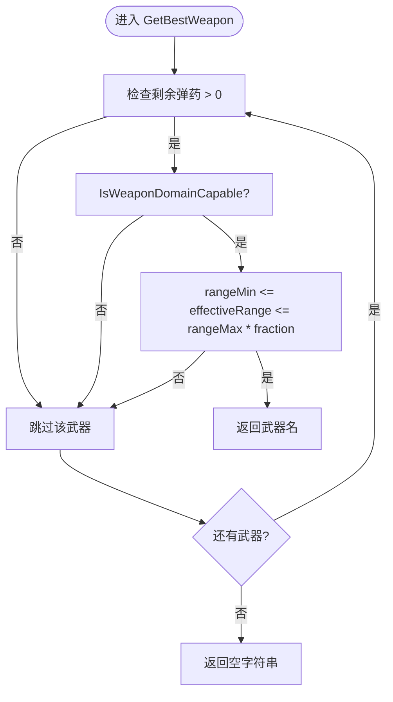
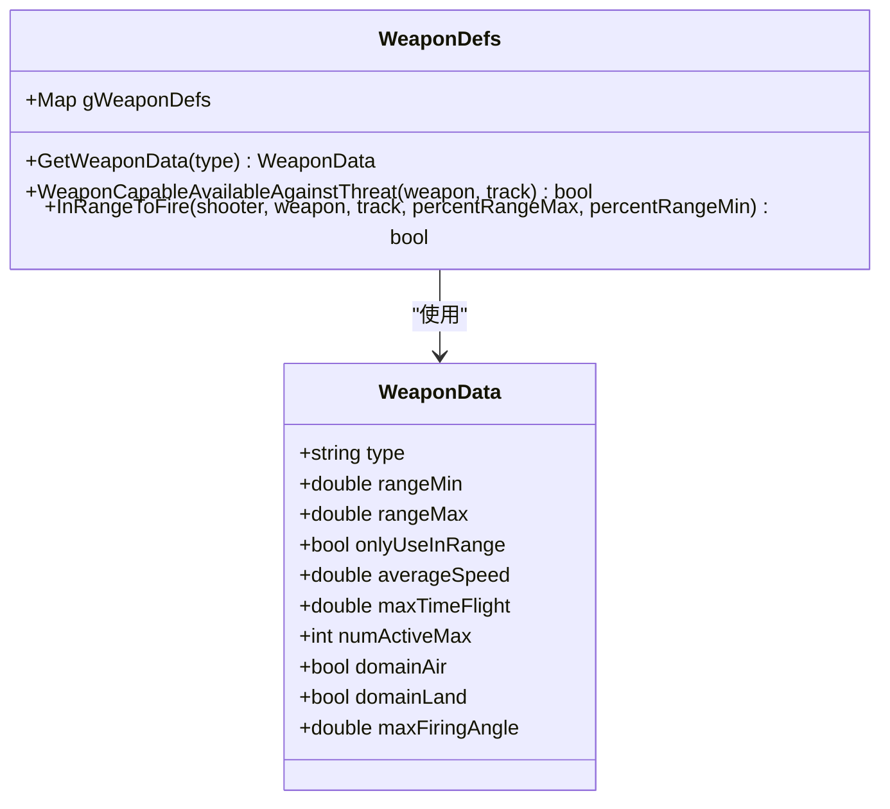
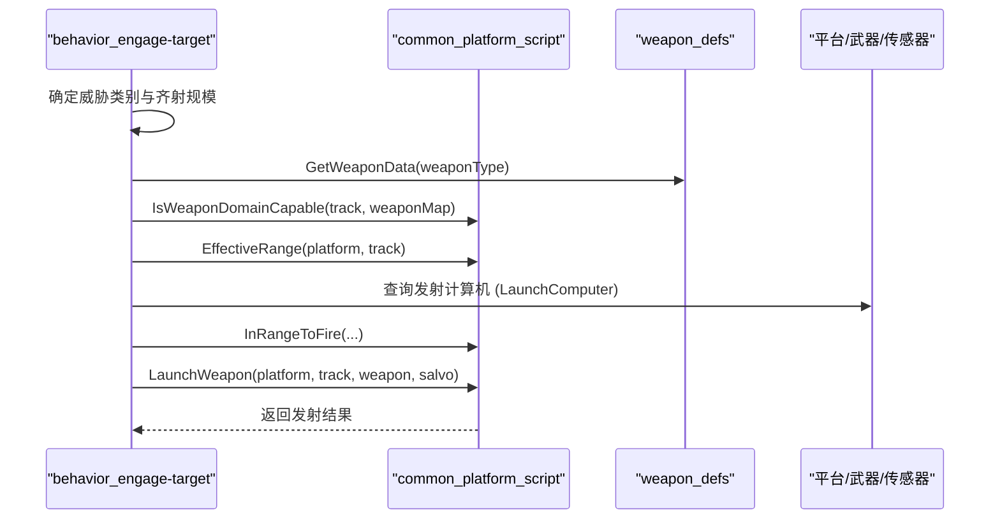
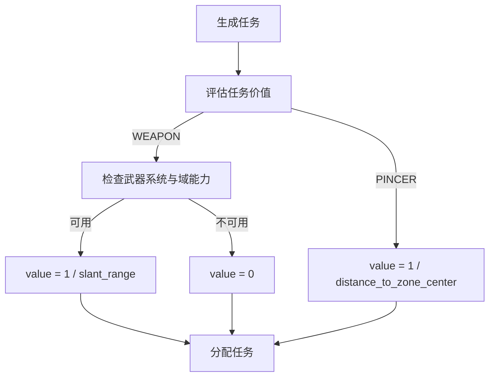
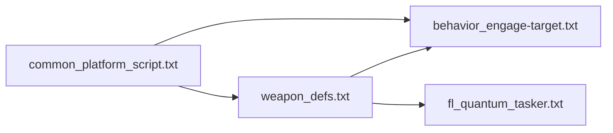

# 公共组件

<cite>
**本文引用的文件**   
- [common_platform_script.txt](file://demos/base_types/processors/quantum_agents/common/common_platform_script.txt)
- [weapon_defs.txt](file://demos/base_types/processors/quantum_agents/common/weapon_defs.txt)
- [behavior_engage-target.txt](file://demos/base_types/processors/quantum_agents/aiai/behavior_engage-target.txt)
- [fl_quantum_tasker.txt](file://demos/base_types/processors/quantum_agents/aifl/fl_quantum_tasker.txt)
</cite>

## 目录
1. [引言](#引言)
2. [项目结构](#项目结构)
3. [核心组件](#核心组件)
4. [架构总览](#架构总览)
5. [详细组件分析](#详细组件分析)
6. [依赖关系分析](#依赖关系分析)
7. [性能与可扩展性](#性能与可扩展性)
8. [故障排查指南](#故障排查指南)
9. [结论](#结论)
10. [附录：配置示例与扩展接口](#附录配置示例与扩展接口)

## 引言
本技术文档聚焦于量子代理AI系统的“公共组件”，包括平台通用脚本与武器定义。目标是：
- 解释 common_platform_script.txt 中定义的平台通用脚本能力与配置项（平台属性、传感器分类、飞行控制、目标域判定、武器选择与发射等）。
- 文档化 weapon_defs.txt 中的武器定义格式与参数规范（类型、射程、精度、杀伤半径、最大发射角、域能力等）。
- 说明这些公共组件如何被 aiai（空战智能体）与 aifl（编队任务分配器）子系统复用，以及在多仿真场景中的适配方式。
- 提供自定义公共组件的开发指南与扩展接口说明，并给出实际配置文件示例与常见问题解决方案。

## 项目结构
在 base_types 演示包下，公共组件位于 processors/quantum_agents/common 目录，aiai 与 aifl 分别位于同级目录下，形成“公共脚本 + 行为逻辑”的分层组织：
- common：公共脚本与武器定义，供上层行为与处理器复用。
- aiai：空战智能体的行为脚本（如 engage-target），调用公共脚本进行武器选择、域能力判断、发射控制等。
- aifl：编队任务生成与评估（如 fl_quantum_tasker），复用武器定义进行任务价值评估与资源分配。

图表来源
- [common_platform_script.txt:1-1155](file://demos/base_types/processors/quantum_agents/common/common_platform_script.txt#L1-L1155)
- [weapon_defs.txt:1-258](file://demos/base_types/processors/quantum_agents/common/weapon_defs.txt#L1-L258)
- [behavior_engage-target.txt:1-630](file://demos/base_types/processors/quantum_agents/aiai/behavior_engage-target.txt#L1-L630)
- [fl_quantum_tasker.txt:1-444](file://demos/base_types/processors/quantum_agents/aifl/fl_quantum_tasker.txt#L1-L444)

章节来源
- [common_platform_script.txt:1-1155](file://demos/base_types/processors/quantum_agents/common/common_platform_script.txt#L1-L1155)
- [weapon_defs.txt:1-258](file://demos/base_types/processors/quantum_agents/common/weapon_defs.txt#L1-L258)
- [behavior_engage-target.txt:1-630](file://demos/base_types/processors/quantum_agents/aiai/behavior_engage-target.txt#L1-L630)
- [fl_quantum_tasker.txt:1-444](file://demos/base_types/processors/quantum_agents/aifl/fl_quantum_tasker.txt#L1-L444)

## 核心组件
- 平台通用脚本（common_platform_script.txt）
  - 提供平台类别判定、传感器类别判定、跟踪类别判定、颜色工具函数、飞行控制（保持航向/高度/速度、飞向目标点）、有效射程估算、目标方位角计算、最佳武器选择、发射控制、目标域判定、相对位置关系计算等。
  - 维护全局变量：类别集合、武器包络（按阵营与类别的默认射程）、基础颜色映射、TTR/AIAI名称数组等。
- 武器定义（weapon_defs.txt）
  - 定义 WeaponData 结构体，包含 type、rangeMin/rangeMax、averageSpeed、maxTimeFlight、numActiveMax、domainAir/domainLand、maxFiringAngle 等字段。
  - 提供 gWeaponDefs 字典与 GetWeaponData 查询接口。
  - 提供武器能力检查（WeaponCapableAvailableAgainstThreat）与入距判定（InRangeToFire），支持通过发射计算机或脚本参数进行约束校验。

章节来源
- [common_platform_script.txt:1-1155](file://demos/base_types/processors/quantum_agents/common/common_platform_script.txt#L1-L1155)
- [weapon_defs.txt:1-258](file://demos/base_types/processors/quantum_agents/common/weapon_defs.txt#L1-L258)

## 架构总览
公共组件为上层行为与处理器提供统一的能力抽象：
- aiai 行为脚本（如 engage-target）通过公共脚本进行武器选择、域能力判断、发射控制；同时使用公共脚本提供的 Track/Platform/Sensor 类别判定与飞行控制方法。
- aifl 任务分配器（fl_quantum_tasker）通过武器定义进行任务价值评估（例如对武器系统类型的域能力匹配），并结合距离、速度等指标生成与分配任务。

图表来源
- [behavior_engage-target.txt:200-410](file://demos/base_types/processors/quantum_agents/aiai/behavior_engage-target.txt#L200-L410)
- [common_platform_script.txt:329-470](file://demos/base_types/processors/quantum_agents/common/common_platform_script.txt#L329-L470)
- [weapon_defs.txt:70-256](file://demos/base_types/processors/quantum_agents/common/weapon_defs.txt#L70-L256)

## 详细组件分析

### 平台通用脚本（common_platform_script.txt）
- 平台/传感器/跟踪类别判定
  - DeterminePlatformCategory：根据平台所属类别返回类别字符串。
  - DetermineSensorCategory：根据传感器类别返回类别字符串。
  - DetermineTrackCategory：从跟踪对象反查平台并返回类别。
  - Test*Category：用于条件分支的快速匹配。
- 飞行控制
  - FlyHold：根据航向、高度、速度控制飞行器（区分 WSF_6DOF_MOVER 与 WSF_AIR_MOVER）。
  - FlyTarget：飞向指定地理点，处理不同移动器类型。
- 武器相关
  - EffectiveRange：基于地面距离、相对高度、接近速度估算“有效射程”。
  - TargetAspect：计算目标方位角（LOS与目标速度向量夹角）。
  - GetBestWeapon：遍历武器数组，依据域能力、最小/最大射程、剩余弹药等选择最佳武器。
  - LaunchWeapon：检查武器状态与库存，执行齐射。
  - GetWeaponNumberActiveMax：查询某类武器的最大并发数。
  - GetTargetDomain：判定目标域（AIR/LAND/SURFACE/SUBSURFACE/SPACE）。
  - IsWeaponDomainCapable：根据武器域标志或发射计算机类型判断是否具备打击能力。
- 其他工具
  - GetNextBasicColor、RedVal/GrnVal/BluVal：可视化颜色管理。
  - CalculatePositioning：计算平台与目标的相对位置关系（head-to-tail、tail-to-head 等）。
  - GetWeaponsEnvelope：按阵营与类别获取默认武器包络。

图表来源
- [common_platform_script.txt:557-588](file://demos/base_types/processors/quantum_agents/common/common_platform_script.txt#L557-L588)

章节来源
- [common_platform_script.txt:1-1155](file://demos/base_types/processors/quantum_agents/common/common_platform_script.txt#L1-L1155)

### 武器定义（weapon_defs.txt）
- 数据结构
  - WeaponData：type、rangeMin、rangeMax、onlyUseInRange、averageSpeed、maxTimeFlight、numActiveMax、domainAir、domainLand、maxFiringAngle。
  - gWeaponDefs：以武器类型为键的结构体字典。
  - GetWeaponData：按类型查询结构体，若不存在则返回空结构体。
- 能力检查
  - WeaponCapableAvailableAgainstThreat：优先使用 WeaponData 的域标志；若无定义，则回退到发射计算机类型（WSF_AIR_TO_AIR_LAUNCH_COMPUTER 或 WSF_ATG_LAUNCH_COMPUTER）。
- 入距判定
  - InRangeToFire：根据发射计算机返回的 Rmax/Rmin/Rne 等值与百分比阈值进行约束判断；若无发射计算机，则使用 WeaponData 的 rangeMin/rangeMax/maxFiringAngle/averageSpeed/maxTimeFlight 进行近似判断。

图表来源
- [weapon_defs.txt:11-63](file://demos/base_types/processors/quantum_agents/common/weapon_defs.txt#L11-L63)
- [weapon_defs.txt:70-256](file://demos/base_types/processors/quantum_agents/common/weapon_defs.txt#L70-L256)

章节来源
- [weapon_defs.txt:1-258](file://demos/base_types/processors/quantum_agents/common/weapon_defs.txt#L1-L258)

### aiai 子系统（behavior_engage-target.txt）
- 行为职责
  - 根据威胁类别决定齐射规模（salvo）。
  - 根据武器与威胁类别动态调整 Rmax 百分比与最大发射角。
  - 选择武器：优先使用强制武器映射（ThreatTypeWeapon），否则遍历 mWeaponArray，结合域能力、发射计算机、射程与角度约束进行选择。
  - 发射控制：检查轨道质量、并发武器数量、协同交战规则，调用公共脚本的 LaunchWeapon 完成发射。
- 与公共组件的集成
  - 使用 IsWeaponDomainCapable 与 EffectiveRange 进行武器能力与射程判断。
  - 使用 GetWeaponNumberActiveMax 限制并发武器数量。
  - 使用 TestTrackCategory 与 GetTargetDomain 进行目标类别与域判定。

图表来源
- [behavior_engage-target.txt:200-410](file://demos/base_types/processors/quantum_agents/aiai/behavior_engage-target.txt#L200-L410)
- [common_platform_script.txt:329-470](file://demos/base_types/processors/quantum_agents/common/common_platform_script.txt#L329-L470)
- [weapon_defs.txt:70-256](file://demos/base_types/processors/quantum_agents/common/weapon_defs.txt#L70-L256)

章节来源
- [behavior_engage-target.txt:1-630](file://demos/base_types/processors/quantum_agents/aiai/behavior_engage-target.txt#L1-L630)

### aifl 子系统（fl_quantum_tasker.txt）
- 行为职责
  - 生成武器任务（WEAPON）与钳形机动任务（PINCER）。
  - 对武器任务进行评估：若武器系统有剩余弹药且具备域能力（通过 WeaponData 或发射计算机类型），则赋予较高价值（与斜距倒数成正比）。
  - 对钳形任务进行评估：根据到区域中心的距离赋予价值。
- 与公共组件的集成
  - include_once weapon_defs.txt，使用 GetWeaponData 进行域能力匹配。
  - 使用 TestTrackCategory 与聚类管理器进行威胁分组与任务生成。

图表来源
- [fl_quantum_tasker.txt:123-427](file://demos/base_types/processors/quantum_agents/aifl/fl_quantum_tasker.txt#L123-L427)
- [weapon_defs.txt:54-63](file://demos/base_types/processors/quantum_agents/common/weapon_defs.txt#L54-L63)

章节来源
- [fl_quantum_tasker.txt:1-444](file://demos/base_types/processors/quantum_agents/aifl/fl_quantum_tasker.txt#L1-L444)

## 依赖关系分析
- common_platform_script.txt 被 weapon_defs.txt 通过 include_once 引用（在武器能力检查与入距判定中使用公共脚本的工具函数）。
- aiai 行为脚本引用公共脚本的类别判定、域能力判断、射程估算与发射控制。
- aifl 任务分配器引用武器定义进行任务价值评估。

图表来源
- [weapon_defs.txt:66-66](file://demos/base_types/processors/quantum_agents/common/weapon_defs.txt#L66-L66)
- [behavior_engage-target.txt:200-410](file://demos/base_types/processors/quantum_agents/aiai/behavior_engage-target.txt#L200-L410)
- [fl_quantum_tasker.txt:11-11](file://demos/base_types/processors/quantum_agents/aifl/fl_quantum_tasker.txt#L11-L11)

章节来源
- [weapon_defs.txt:66-66](file://demos/base_types/processors/quantum_agents/common/weapon_defs.txt#L66-L66)
- [behavior_engage-target.txt:200-410](file://demos/base_types/processors/quantum_agents/aiai/behavior_engage-target.txt#L200-L410)
- [fl_quantum_tasker.txt:11-11](file://demos/base_types/processors/quantum_agents/aifl/fl_quantum_tasker.txt#L11-L11)

## 性能与可扩展性
- 性能考虑
  - 类别判定与域能力判断采用 Map 查找与简单循环，复杂度低；但在大规模目标与武器列表时需注意遍历开销。
  - 发射计算机 LookupResult 可能带来额外计算，建议在高频路径中缓存必要结果。
- 可扩展性
  - 新增武器类型：在 weapon_defs.txt 中添加 WeaponData 条目，并在必要时扩展 IsWeaponDomainCapable 与 InRangeToFire 的判断逻辑。
  - 新增平台/传感器类别：在 common_platform_script.txt 的 mCategories 中添加新类别，并在行为脚本中增加相应策略。
  - 自定义公共组件：可新增脚本函数并通过 include_once 引入到行为脚本或处理器中，保持接口一致。

[本节为通用指导，不直接分析具体文件]

## 故障排查指南
- 无可用武器或域能力不匹配
  - 现象：GetBestWeapon 返回空字符串，或 WeaponCapableAvailableAgainstThreat 返回 false。
  - 排查：确认 WeaponData 的 domainAir/domainLand 设置与目标域匹配；或确保武器配备正确的发射计算机类型。
  - 参考：[weapon_defs.txt:70-114](file://demos/base_types/processors/quantum_agents/common/weapon_defs.txt#L70-L114)
- 射程约束失败
  - 现象：InRangeToFire 因 Rmin/Rmax/Rne 或百分比阈值拒绝发射。
  - 排查：检查发射计算机返回值与百分比阈值（DefaultPercentRangeMin/DefaultPercentRangeMax）；在无发射计算机时检查 WeaponData 的 rangeMin/rangeMax/maxFiringAngle。
  - 参考：[weapon_defs.txt:117-256](file://demos/base_types/processors/quantum_agents/common/weapon_defs.txt#L117-L256)
- 并发武器超限
  - 现象：行为脚本报告已激活的同类武器数量达到上限。
  - 排查：调整 GetWeaponNumberActiveMax 或行为脚本中的并发限制逻辑。
  - 参考：[common_platform_script.txt:473-488](file://demos/base_types/processors/quantum_agents/common/common_platform_script.txt#L473-L488)
- 目标类别识别错误
  - 现象：TestTrackCategory 或 DetermineTrackCategory 返回 unknown。
  - 排查：确认平台/传感器的 CategoryMemberOf 设置与 mCategories 列表一致。
  - 参考：[common_platform_script.txt:212-325](file://demos/base_types/processors/quantum_agents/common/common_platform_script.txt#L212-L325)

章节来源
- [weapon_defs.txt:70-256](file://demos/base_types/processors/quantum_agents/common/weapon_defs.txt#L70-L256)
- [common_platform_script.txt:212-488](file://demos/base_types/processors/quantum_agents/common/common_platform_script.txt#L212-L488)

## 结论
公共组件通过统一的脚本接口与数据模型，为 aiai 与 aifl 提供了稳定的能力支撑：
- common_platform_script.txt 提供平台/传感器/跟踪类别判定、飞行控制、域能力判断、射程估算与发射控制等基础功能。
- weapon_defs.txt 定义武器数据结构与能力检查逻辑，支持发射计算机与脚本参数的双重约束。
- aiai 与 aifl 通过复用这些公共能力，实现一致的武器选择、域能力匹配与任务评估流程，便于在多仿真场景中扩展与维护。

[本节为总结性内容，不直接分析具体文件]

## 附录：配置示例与扩展接口

### 武器定义示例（weapon_defs.txt）
- 新增武器类型
  - 在 gWeaponDefs 中添加新条目，设置 type、rangeMin/rangeMax、averageSpeed、maxTimeFlight、numActiveMax、domainAir/domainLand、maxFiringAngle。
  - 示例路径：[weapon_defs.txt:29-49](file://demos/base_types/processors/quantum_agents/common/weapon_defs.txt#L29-L49)
- 查询接口
  - 使用 GetWeaponData(type) 获取 WeaponData 结构体。
  - 示例路径：[weapon_defs.txt:54-63](file://demos/base_types/processors/quantum_agents/common/weapon_defs.txt#L54-L63)

章节来源
- [weapon_defs.txt:29-63](file://demos/base_types/processors/quantum_agents/common/weapon_defs.txt#L29-L63)

### 平台通用脚本扩展接口（common_platform_script.txt）
- 新增类别
  - 在 mCategories 中添加新类别，并在 DeterminePlatformCategory/DetermineSensorCategory 中自动生效。
  - 示例路径：[common_platform_script.txt:23-39](file://demos/base_types/processors/quantum_agents/common/common_platform_script.txt#L23-L39)
- 新增飞行控制方法
  - 可仿照 FlyHold/FlyTarget 添加新的控制函数，支持不同移动器类型。
  - 示例路径：[common_platform_script.txt:158-209](file://demos/base_types/processors/quantum_agents/common/common_platform_script.txt#L158-L209)
- 新增武器选择逻辑
  - 可在 GetBestWeapon 中增加新的筛选条件（如 TOF、平均速度差等）。
  - 示例路径：[common_platform_script.txt:557-588](file://demos/base_types/processors/quantum_agents/common/common_platform_script.txt#L557-L588)

章节来源
- [common_platform_script.txt:23-39](file://demos/base_types/processors/quantum_agents/common/common_platform_script.txt#L23-L39)
- [common_platform_script.txt:158-209](file://demos/base_types/processors/quantum_agents/common/common_platform_script.txt#L158-L209)
- [common_platform_script.txt:557-588](file://demos/base_types/processors/quantum_agents/common/common_platform_script.txt#L557-L588)

### aiai 行为脚本扩展（behavior_engage-target.txt）
- 新增威胁类别策略
  - 在 ThreatTypeSalvo/ThreatTypeRequiredTrackQuality/WeaponThreatRmaxMap 等映射中添加新类别的策略。
  - 示例路径：[behavior_engage-target.txt:48-87](file://demos/base_types/processors/quantum_agents/aiai/behavior_engage-target.txt#L48-L87)
- 新增武器强制映射
  - 在 ThreatTypeWeapon 中添加特定威胁到武器的映射。
  - 示例路径：[behavior_engage-target.txt:64-68](file://demos/base_types/processors/quantum_agents/aiai/behavior_engage-target.txt#L64-L68)

章节来源
- [behavior_engage-target.txt:48-87](file://demos/base_types/processors/quantum_agents/aiai/behavior_engage-target.txt#L48-L87)

### aifl 任务分配器扩展（fl_quantum_tasker.txt）
- 新增任务类型评估
  - 在 FlightLeadEvaluation 中为新任务类型添加评估逻辑。
  - 示例路径：[fl_quantum_tasker.txt:358-427](file://demos/base_types/processors/quantum_agents/aifl/fl_quantum_tasker.txt#L358-L427)
- 新增任务生成逻辑
  - 在 FlightLeadTaskGeneration 中为新任务类型添加生成逻辑。
  - 示例路径：[fl_quantum_tasker.txt:123-180](file://demos/base_types/processors/quantum_agents/aifl/fl_quantum_tasker.txt#L123-L180)

章节来源
- [fl_quantum_tasker.txt:123-180](file://demos/base_types/processors/quantum_agents/aifl/fl_quantum_tasker.txt#L123-L180)
- [fl_quantum_tasker.txt:358-427](file://demos/base_types/processors/quantum_agents/aifl/fl_quantum_tasker.txt#L358-L427)