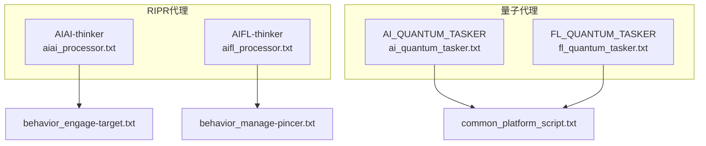
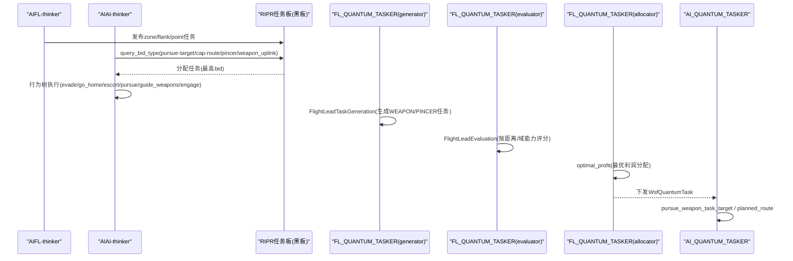
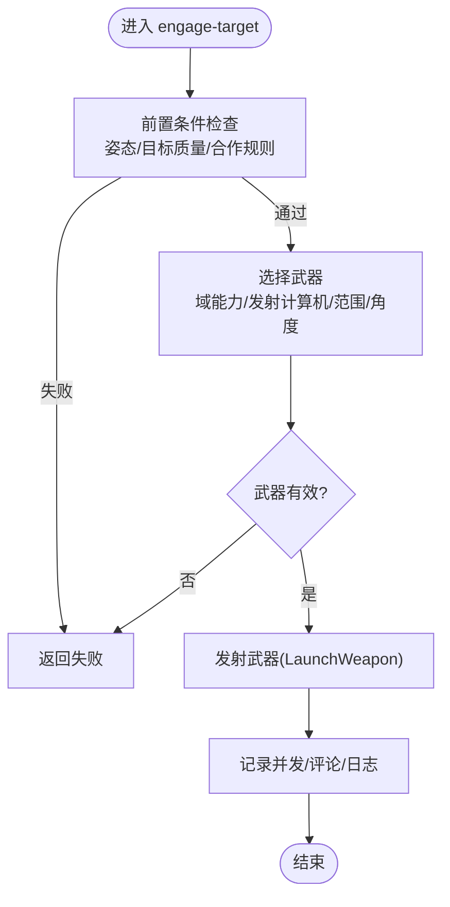
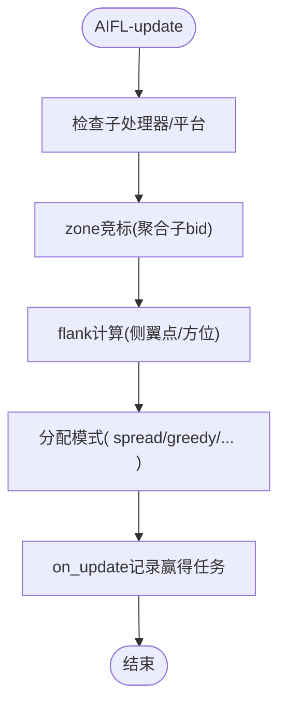
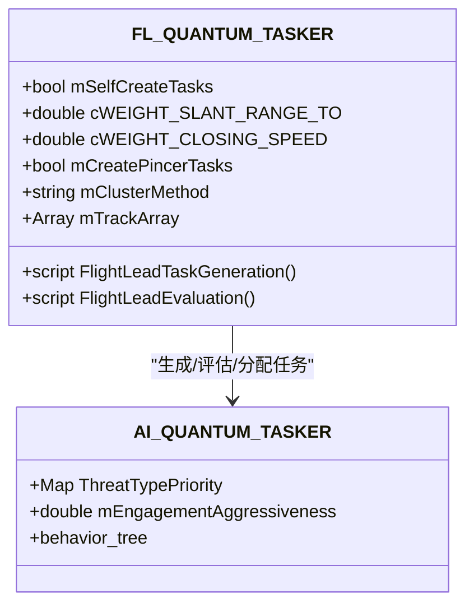
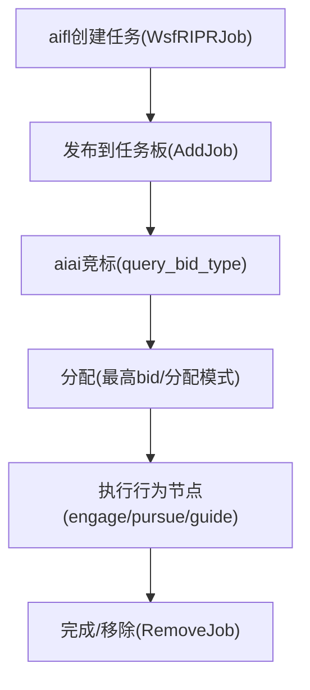
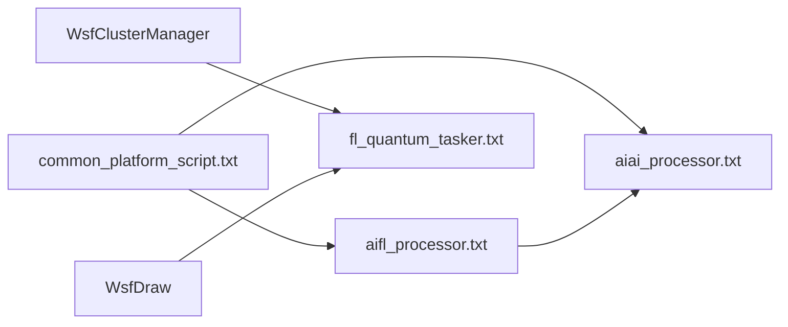
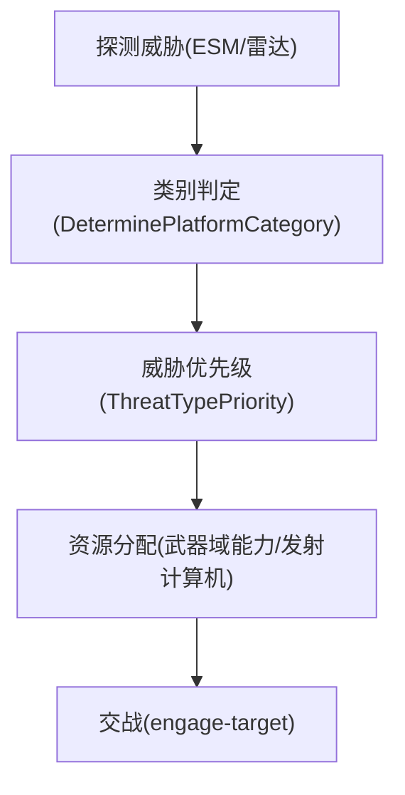

# 量子代理AI系统

<cite>
**本文引用的文件**   
- [aiai_processor.txt](file://demos/base_types/processors/ripr_agents/aiai/aiai_processor.txt)
- [aifl_processor.txt](file://demos/base_types/processors/ripr_agents/aifl/aifl_processor.txt)
- [ai_quantum_tasker.txt](file://demos/base_types/processors/quantum_agents/aiai/ai_quantum_tasker.txt)
- [fl_quantum_tasker.txt](file://demos/base_types/processors/quantum_agents/aifl/fl_quantum_tasker.txt)
- [common_platform_script.txt](file://demos/base_types/processors/quantum_agents/common/common_platform_script.txt)
- [behavior_engage-target.txt](file://demos/base_types/processors/quantum_agents/aiai/behavior_engage-target.txt)
- [behavior_manage-pincer.txt](file://demos/base_types/processors/quantum_agents/aifl/behavior_manage-pincer.txt)
</cite>

## 目录
1. [简介](#简介)
2. [项目结构](#项目结构)
3. [核心组件](#核心组件)
4. [架构总览](#架构总览)
5. [详细组件分析](#详细组件分析)
6. [依赖关系分析](#依赖关系分析)
7. [性能与调度](#性能与调度)
8. [调试与诊断](#调试与诊断)
9. [配置语法与行为定义](#配置语法与行为定义)
10. [战术设计模式](#战术设计模式)
11. [扩展与自定义开发指南](#扩展与自定义开发指南)
12. [故障排查](#故障排查)
13. [结论](#结论)

## 简介
本技术文档面向AFSIM的“量子代理AI系统”，聚焦两类代理：
- aiai（AI Agent Interface）：单平台智能体，负责感知、任务竞标、武器选择与发射、雷达控制等。
- aifl（AI Flight）：编队级智能体，负责任务生成、区域/侧翼任务解释、资源分配与协同管理。

同时说明黑板（Blackboard）机制在RIPR任务板中的信息共享方式，以及量子任务器（Quantum Tasker）的任务生成、评估与分配流程。文档涵盖任务调度算法、优先级管理、资源分配策略、行为树配置语法、复杂战术场景（编队作战、拦截攻击、电子战）的设计模式，并提供调试工具与扩展接口指南。

## 项目结构
AFSIM中相关AI能力以处理器（Processor）和行为（Behavior）脚本组织，位于demos/base_types/processors下：
- RIPR代理（传统RIPR）：aiai与aifl处理器，使用行为树驱动决策。
- 量子代理（Quantum Agents）：AI_QUANTUM_TASKER与FL_QUANTUM_TASKER，基于任务生成器、评估器与分配器的流水线。
- 公共脚本：common_platform_script.txt提供通用工具函数（类别判定、武器域能力、轨迹查询、飞行控制等）。

**图表来源**
- [aiai_processor.txt:34-134](file://demos/base_types/processors/ripr_agents/aiai/aiai_processor.txt#L34-L134)
- [aifl_processor.txt:26-66](file://demos/base_types/processors/ripr_agents/aifl/aifl_processor.txt#L26-L66)
- [ai_quantum_tasker.txt:22-72](file://demos/base_types/processors/quantum_agents/aiai/ai_quantum_tasker.txt#L22-L72)
- [fl_quantum_tasker.txt:14-72](file://demos/base_types/processors/quantum_agents/aifl/fl_quantum_tasker.txt#L14-L72)
- [common_platform_script.txt:19-101](file://demos/base_types/processors/quantum_agents/common/common_platform_script.txt#L19-L101)

**章节来源**
- [aiai_processor.txt:34-134](file://demos/base_types/processors/ripr_agents/aiai/aiai_processor.txt#L34-L134)
- [aifl_processor.txt:26-66](file://demos/base_types/processors/ripr_agents/aifl/aifl_processor.txt#L26-L66)
- [ai_quantum_tasker.txt:22-72](file://demos/base_types/processors/quantum_agents/aiai/ai_quantum_tasker.txt#L22-L72)
- [fl_quantum_tasker.txt:14-72](file://demos/base_types/processors/quantum_agents/aifl/fl_quantum_tasker.txt#L14-L72)
- [common_platform_script.txt:19-101](file://demos/base_types/processors/quantum_agents/common/common_platform_script.txt#L19-L101)

## 核心组件
- aiai处理器（AIAI-thinker）：实现竞标逻辑（pursue-target、cap-route、pincer、weapon_uplink）、行为树节点编排（evade/go_home/escort/cap-route/pincer/pursue-target/pursue-point/default-flight/guide_weapons/radar-control/engage-target），并维护威胁优先级与武器数组。
- aifl处理器（AIFL-thinker）：负责区域/侧翼任务解释、目标任务生成、航线创建、上链管理与钳形（pincer）协调；支持多种作业分配模式（spread/greedy/coverthengreedy/coverthenspread/strictpriority）。
- AI_QUANTUM_TASKER：轻量任务执行器，行为树聚焦于武器任务目标的追踪与交战。
- FL_QUANTUM_TASKER：编队任务生成与评估，包含聚类、钳形任务生成、资源评估与最优利润分配器。
- common_platform_script：提供类别判定、武器域能力检测、轨迹查询、最佳武器选择、发射封装等工具方法。

**章节来源**
- [aiai_processor.txt:34-134](file://demos/base_types/processors/ripr_agents/aiai/aiai_processor.txt#L34-L134)
- [aifl_processor.txt:26-66](file://demos/base_types/processors/ripr_agents/aifl/aifl_processor.txt#L26-L66)
- [ai_quantum_tasker.txt:22-72](file://demos/base_types/processors/quantum_agents/aiai/ai_quantum_tasker.txt#L22-L72)
- [fl_quantum_tasker.txt:14-72](file://demos/base_types/processors/quantum_agents/aifl/fl_quantum_tasker.txt#L14-L72)
- [common_platform_script.txt:19-101](file://demos/base_types/processors/quantum_agents/common/common_platform_script.txt#L19-L101)

## 架构总览
RIPR与量子代理两条路径并行存在：
- RIPR路径：aiai/aifl通过行为树与query_bid_type竞标机制在任务板上竞争任务，结合行为节点执行具体动作（规避、护航、追击、引导武器、雷达控制、交战）。
- 量子路径：FL_QUANTUM_TASKER作为generator/evaluator/allocator组合，产出WsfQuantumTask并由AI_QUANTUM_TASKER消费执行。

**图表来源**
- [aifl_processor.txt:86-162](file://demos/base_types/processors/ripr_agents/aifl/aifl_processor.txt#L86-L162)
- [aiai_processor.txt:180-502](file://demos/base_types/processors/ripr_agents/aiai/aiai_processor.txt#L180-L502)
- [fl_quantum_tasker.txt:123-355](file://demos/base_types/processors/quantum_agents/aifl/fl_quantum_tasker.txt#L123-L355)
- [fl_quantum_tasker.txt:358-441](file://demos/base_types/processors/quantum_agents/aifl/fl_quantum_tasker.txt#L358-L441)
- [ai_quantum_tasker.txt:52-72](file://demos/base_types/processors/quantum_agents/aiai/ai_quantum_tasker.txt#L52-L72)

## 详细组件分析

### aiai处理器（AIAI-thinker）
- 职责：
  - 维护威胁优先级映射与武器数组，计算竞标分数（slant range、closing speed、fuel、active weapons、others targeting、threat envelope、category priority）。
  - 行为树编排：高优先级规避/返航/护航/巡逻线/钳形，其次追击目标/点/默认飞行，最后引导武器与雷达控制，最终执行交战。
- 关键竞标类型：
  - pursue-target：过滤燃料/类别/武器域/区域限制，综合多维权重计算bid。
  - cap-route：依据到点距离与所需武器库存加权。
  - pincer：考虑子机位置、闭合速度、燃料、当前目标状态。
  - weapon_uplink：视场检查、协作约束、距离/速度权重。
- 交战行为（behavior_engage-target）：
  - 前置条件校验（姿态角、目标质量、合作交战规则）。
  - 武器选择（域能力、发射计算机Rmax/Rne/Rmin、角度/距离约束、最大并发数量）。
  - 发射封装（LaunchWeapon），记录并发与火力日志。

**图表来源**
- [behavior_engage-target.txt:418-465](file://demos/base_types/processors/quantum_agents/aiai/behavior_engage-target.txt#L418-L465)
- [behavior_engage-target.txt:202-411](file://demos/base_types/processors/quantum_agents/aiai/behavior_engage-target.txt#L202-L411)
- [common_platform_script.txt:452-470](file://demos/base_types/processors/quantum_agents/common/common_platform_script.txt#L452-L470)

**章节来源**
- [aiai_processor.txt:34-134](file://demos/base_types/processors/ripr_agents/aiai/aiai_processor.txt#L34-L134)
- [aiai_processor.txt:180-502](file://demos/base_types/processors/ripr_agents/aiai/aiai_processor.txt#L180-L502)
- [behavior_engage-target.txt:15-630](file://demos/base_types/processors/quantum_agents/aiai/behavior_engage-target.txt#L15-L630)

### aifl处理器（AIFL-thinker）
- 职责：
  - 解释区域/侧翼任务，生成自身目标任务，创建点任务与巡逻线，管理上链与钳形任务。
  - 设置作业分配模式与粘性，聚合子处理器竞标结果，决定集群任务归属。
- 关键竞标类型：
  - zone：根据威胁类别与区域约束，聚合子处理器最大bid。
  - flank：计算侧翼点与相对方位，确定左/右侧飞，生成bid值。
- 更新回调：
  - on_update打印赢得的新任务，便于调试与可视化。

**图表来源**
- [aifl_processor.txt:86-162](file://demos/base_types/processors/ripr_agents/aifl/aifl_processor.txt#L86-L162)
- [aifl_processor.txt:166-255](file://demos/base_types/processors/ripr_agents/aifl/aifl_processor.txt#L166-L255)
- [aifl_processor.txt:258-278](file://demos/base_types/processors/ripr_agents/aifl/aifl_processor.txt#L258-L278)

**章节来源**
- [aifl_processor.txt:26-66](file://demos/base_types/processors/ripr_agents/aifl/aifl_processor.txt#L26-L66)
- [aifl_processor.txt:86-162](file://demos/base_types/processors/ripr_agents/aifl/aifl_processor.txt#L86-L162)
- [aifl_processor.txt:166-255](file://demos/base_types/processors/ripr_agents/aifl/aifl_processor.txt#L166-L255)
- [aifl_processor.txt:258-278](file://demos/base_types/processors/ripr_agents/aifl/aifl_processor.txt#L258-L278)

### 量子代理任务器（AI_QUANTUM_TASKER / FL_QUANTUM_TASKER）
- AI_QUANTUM_TASKER：
  - 行为树聚焦于武器任务目标追踪与计划航线执行。
  - 维护威胁优先级与交战侵略性参数。
- FL_QUANTUM_TASKER：
  - generator：FlightLeadTaskGeneration，自动生成WEAPON或PINCER任务，或解析接收到的CLUSTER任务。
  - evaluator：FlightLeadEvaluation，按距离倒数与域能力匹配评分。
  - allocator：optimal_profit，动态再分配策略。
  - 聚类与钳形：使用WsfClusterManager进行威胁聚类，计算平均位置/方位，判断分离角阈值，生成左右侧翼角色。

**图表来源**
- [fl_quantum_tasker.txt:14-72](file://demos/base_types/processors/quantum_agents/aifl/fl_quantum_tasker.txt#L14-L72)
- [fl_quantum_tasker.txt:123-355](file://demos/base_types/processors/quantum_agents/aifl/fl_quantum_tasker.txt#L123-L355)
- [fl_quantum_tasker.txt:358-441](file://demos/base_types/processors/quantum_agents/aifl/fl_quantum_tasker.txt#L358-L441)
- [ai_quantum_tasker.txt:22-72](file://demos/base_types/processors/quantum_agents/aiai/ai_quantum_tasker.txt#L22-L72)

**章节来源**
- [ai_quantum_tasker.txt:22-72](file://demos/base_types/processors/quantum_agents/aiai/ai_quantum_tasker.txt#L22-L72)
- [fl_quantum_tasker.txt:14-72](file://demos/base_types/processors/quantum_agents/aifl/fl_quantum_tasker.txt#L14-L72)
- [fl_quantum_tasker.txt:123-355](file://demos/base_types/processors/quantum_agents/aifl/fl_quantum_tasker.txt#L123-L355)
- [fl_quantum_tasker.txt:358-441](file://demos/base_types/processors/quantum_agents/aifl/fl_quantum_tasker.txt#L358-L441)

### 黑板（Blackboard）机制与共享数据
- RIPR任务板：
  - 由aifl发布zone/flank/point任务，aiai通过query_bid_type竞标。
  - 任务数据结构包括名称、描述、优先级、最大获胜者数、辅助数据（ZonePoint、ZoneThreatNameArray、ZoneBearingValid、ZoneBearing等）。
- 访问控制与同步：
  - 通过PROCESSOR.QuerySubordinatesMaxBid聚合子处理器bid，避免冲突。
  - 通过GetJobFor/RemoveJob/AddJob进行任务生命周期管理。
- 数据模型：
  - WsfRIPRJob：任务对象，含GetData/SetData用于传递结构化信息。
  - WsfRIPRProcessor：处理器接口，提供命令链、子处理器、武器状态查询。

**图表来源**
- [aifl_processor.txt:86-162](file://demos/base_types/processors/ripr_agents/aifl/aifl_processor.txt#L86-L162)
- [aiai_processor.txt:180-502](file://demos/base_types/processors/ripr_agents/aiai/aiai_processor.txt#L180-L502)
- [behavior_manage-pincer.txt:292-335](file://demos/base_types/processors/quantum_agents/aifl/behavior_manage-pincer.txt#L292-L335)

**章节来源**
- [aifl_processor.txt:86-162](file://demos/base_types/processors/ripr_agents/aifl/aifl_processor.txt#L86-L162)
- [aiai_processor.txt:180-502](file://demos/base_types/processors/ripr_agents/aiai/aiai_processor.txt#L180-L502)
- [behavior_manage-pincer.txt:121-254](file://demos/base_types/processors/quantum_agents/aifl/behavior_manage-pincer.txt#L121-L254)
- [behavior_manage-pincer.txt:292-335](file://demos/base_types/processors/quantum_agents/aifl/behavior_manage-pincer.txt#L292-L335)

## 依赖关系分析
- aiai依赖common_platform_script的工具函数（类别判定、武器域能力、轨迹查询、发射封装）。
- aifl依赖common_platform_script与aiai的bid_on_jobs逻辑（include_once behavior_bid_on_jobs.txt）。
- 量子代理依赖WsfClusterManager进行威胁聚类，依赖WsfDraw进行可视化调试。
- 行为节点之间通过行为树顺序/选择器组合，形成层次化决策流。

**图表来源**
- [common_platform_script.txt:19-101](file://demos/base_types/processors/quantum_agents/common/common_platform_script.txt#L19-L101)
- [aifl_processor.txt:13-23](file://demos/base_types/processors/ripr_agents/aifl/aifl_processor.txt#L13-L23)
- [fl_quantum_tasker.txt:66-72](file://demos/base_types/processors/quantum_agents/aifl/fl_quantum_tasker.txt#L66-L72)

**章节来源**
- [common_platform_script.txt:19-101](file://demos/base_types/processors/quantum_agents/common/common_platform_script.txt#L19-L101)
- [aifl_processor.txt:13-23](file://demos/base_types/processors/ripr_agents/aifl/aifl_processor.txt#L13-L23)
- [fl_quantum_tasker.txt:66-72](file://demos/base_types/processors/quantum_agents/aifl/fl_quantum_tasker.txt#L66-L72)

## 性能与调度
- 任务调度算法：
  - RIPR：基于bid权重的竞标机制，支持多种分配模式（spread/greedy/coverthengreedy/coverthenspread/strictpriority），通过SetJobAllocationMode与SetJobStickiness控制。
  - 量子：generator/evaluator/allocator流水线，allocator采用optimal_profit最大化整体收益。
- 优先级管理：
  - aiai维护ThreatTypePriority，对fighter/missile等高威胁赋予更高优先级。
  - aifl为不同任务类型设定基础优先级（cPursueTargetPriority、cPincerPriority等）。
- 资源分配策略：
  - 武器域能力检查（IsWeaponDomainCapable），发射计算机Rmax/Rne/Rmin约束，最大并发数量限制。
  - 燃料过滤（HasEnoughFuelToTravel/Route），区域约束（WithinZone）。

**章节来源**
- [aifl_processor.txt:73-82](file://demos/base_types/processors/ripr_agents/aifl/aifl_processor.txt#L73-L82)
- [aiai_processor.txt:83-110](file://demos/base_types/processors/ripr_agents/aiai/aiai_processor.txt#L83-L110)
- [fl_quantum_tasker.txt:432-441](file://demos/base_types/processors/quantum_agents/aifl/fl_quantum_tasker.txt#L432-L441)
- [common_platform_script.txt:527-551](file://demos/base_types/processors/quantum_agents/common/common_platform_script.txt#L527-L551)

## 调试与诊断
- 行为调试：
  - script_debug_writes开关控制输出。
  - on_update/on_initialize钩子打印时间戳与平台名，便于跟踪执行时序。
- 可视化：
  - WsfDraw绘制聚类凸包与方向线，辅助观察威胁分组与侧翼几何。
- 日志与注释：
  - PLATFORM.Comment记录赢得任务、移除/添加任务等信息。
  - writeln_d输出bid计算过程、武器选择细节、发射结果。

**章节来源**
- [aiai_processor.txt:34-38](file://demos/base_types/processors/ripr_agents/aiai/aiai_processor.txt#L34-L38)
- [aifl_processor.txt:28-29](file://demos/base_types/processors/ripr_agents/aifl/aifl_processor.txt#L28-L29)
- [fl_quantum_tasker.txt:75-104](file://demos/base_types/processors/quantum_agents/aifl/fl_quantum_tasker.txt#L75-L104)
- [behavior_manage-pincer.txt:57-86](file://demos/base_types/processors/quantum_agents/aifl/behavior_manage-pincer.txt#L57-L86)

## 配置语法与行为定义
- 处理器定义：processor <name> WSF_RIPR_PROCESSOR / WSF_QUANTUM_TASKER_PROCESSOR
- 行为树：behavior_tree包含selector/sequence/behavior_node组合。
- 变量声明：script_variables定义常量、地图、数组、布尔标志。
- 竞标块：query_bid_type <job-name>实现竞标逻辑，返回bid值。
- 行为定义：behavior <name>包含precondition/execute/script方法。
- 外部接口：extern调用common_platform_script中的工具函数。

示例要点（不展示代码内容，仅列出路径）：
- 行为树与变量：[aiai_processor.txt:34-134](file://demos/base_types/processors/ripr_agents/aiai/aiai_processor.txt#L34-L134)
- 竞标逻辑：[aiai_processor.txt:180-502](file://demos/base_types/processors/ripr_agents/aiai/aiai_processor.txt#L180-L502)
- 行为定义：[behavior_engage-target.txt:15-630](file://demos/base_types/processors/quantum_agents/aiai/behavior_engage-target.txt#L15-L630)
- 量子任务器配置：[ai_quantum_tasker.txt:22-72](file://demos/base_types/processors/quantum_agents/aiai/ai_quantum_tasker.txt#L22-L72)

**章节来源**
- [aiai_processor.txt:34-134](file://demos/base_types/processors/ripr_agents/aiai/aiai_processor.txt#L34-L134)
- [aiai_processor.txt:180-502](file://demos/base_types/processors/ripr_agents/aiai/aiai_processor.txt#L180-L502)
- [behavior_engage-target.txt:15-630](file://demos/base_types/processors/quantum_agents/aiai/behavior_engage-target.txt#L15-L630)
- [ai_quantum_tasker.txt:22-72](file://demos/base_types/processors/quantum_agents/aiai/ai_quantum_tasker.txt#L22-L72)

## 战术设计模式
- 编队作战：
  - aifl解释zone/flank任务，聚合子bid，分配左右侧翼角色，维持分离角阈值。
  - 使用mPreferredFlank与relative bearing计算侧翼点。
- 拦截攻击：
  - aiai在engage-target中依据发射计算机Rmax/Rne/Rmin与角度约束选择武器并发射。
  - 支持合作交战（Coop Engage）与僚机贡献校验。
- 电子战：
  - 通过sensor类别判定与武器域能力，结合jammer类别优先级，调整威胁评估与资源分配。
  - 可结合ESM传感器与干扰机配置，调整ThreatTypePriority与WeaponThreatAngleMap。

**图表来源**
- [common_platform_script.txt:212-245](file://demos/base_types/processors/quantum_agents/common/common_platform_script.txt#L212-L245)
- [aiai_processor.txt:83-110](file://demos/base_types/processors/ripr_agents/aiai/aiai_processor.txt#L83-L110)
- [behavior_engage-target.txt:202-411](file://demos/base_types/processors/quantum_agents/aiai/behavior_engage-target.txt#L202-L411)

**章节来源**
- [aifl_processor.txt:166-255](file://demos/base_types/processors/ripr_agents/aifl/aifl_processor.txt#L166-L255)
- [behavior_engage-target.txt:202-411](file://demos/base_types/processors/quantum_agents/aiai/behavior_engage-target.txt#L202-L411)
- [common_platform_script.txt:212-245](file://demos/base_types/processors/quantum_agents/common/common_platform_script.txt#L212-L245)

## 扩展与自定义开发指南
- 新增行为节点：
  - 在aiai/aifl处理器中include新的behavior文件，并在behavior_tree中添加节点。
  - 实现precondition/execute逻辑，必要时调用common_platform_script工具函数。
- 自定义竞标逻辑：
  - 在query_bid_type中扩展bid计算公式，加入新权重（如燃料、武器库存、威胁包络）。
  - 使用FilterJobsOn*开关控制过滤条件（fuel/category/weapons/zone）。
- 量子任务扩展：
  - 重写FlightLeadTaskGeneration以生成自定义任务类型。
  - 扩展FlightLeadEvaluation以引入更多评估维度（如通信链路质量、电子战态势）。
  - 调整allocator策略（dynamic/optimal_profit）与reallocation_strategy。

**章节来源**
- [aiai_processor.txt:113-134](file://demos/base_types/processors/ripr_agents/aiai/aiai_processor.txt#L113-L134)
- [aifl_processor.txt:52-66](file://demos/base_types/processors/ripr_agents/aifl/aifl_processor.txt#L52-L66)
- [fl_quantum_tasker.txt:123-355](file://demos/base_types/processors/quantum_agents/aifl/fl_quantum_tasker.txt#L123-L355)
- [fl_quantum_tasker.txt:358-441](file://demos/base_types/processors/quantum_agents/aifl/fl_quantum_tasker.txt#L358-L441)

## 故障排查
- 常见错误：
  - 无效轨迹或平台：DetermineTrackCategory/DeterminePlatformCategory返回unknown，导致竞标被过滤。
  - 武器域不匹配：IsWeaponDomainCapable返回false，无法选择武器。
  - 发射计算机约束失败：Rmax/Rne/Rmin无效或超出范围，导致不发弹。
  - 子处理器不足：manage-pincer因SubordinateProcessors数量不足而失败。
- 诊断步骤：
  - 启用script_debug_writes，查看writeln_d输出。
  - 使用PLATFORM.Comment记录关键状态变化。
  - 通过WsfDraw可视化聚类与方向线，确认几何计算正确性。

**章节来源**
- [common_platform_script.txt:212-245](file://demos/base_types/processors/quantum_agents/common/common_platform_script.txt#L212-L245)
- [common_platform_script.txt:527-551](file://demos/base_types/processors/quantum_agents/common/common_platform_script.txt#L527-L551)
- [behavior_manage-pincer.txt:121-146](file://demos/base_types/processors/quantum_agents/aifl/behavior_manage-pincer.txt#L121-L146)
- [behavior_engage-target.txt:418-465](file://demos/base_types/processors/quantum_agents/aiai/behavior_engage-target.txt#L418-L465)

## 结论
AFSIM的量子代理AI系统通过RIPR与量子两条路径实现了从单平台智能到编队协同的完整能力链。aiai与aifl分别承担战术执行与任务编排职责，黑板机制保障信息共享与资源分配，量子任务器提供可扩展的任务生成与评估框架。通过行为树与脚本语法，用户可灵活定制AI行为，适配编队作战、拦截攻击、电子战等复杂场景。配合调试工具与可视化手段，系统具备良好的可观测性与可维护性，为军事仿真与战术研究提供了强大支撑。