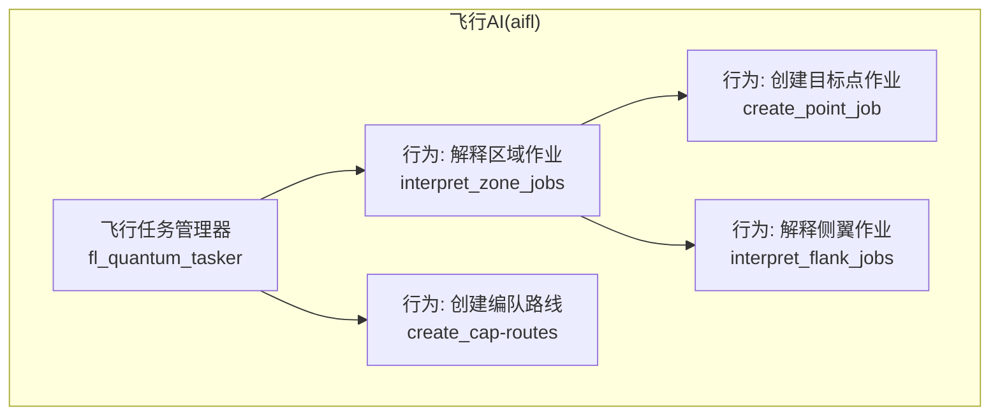
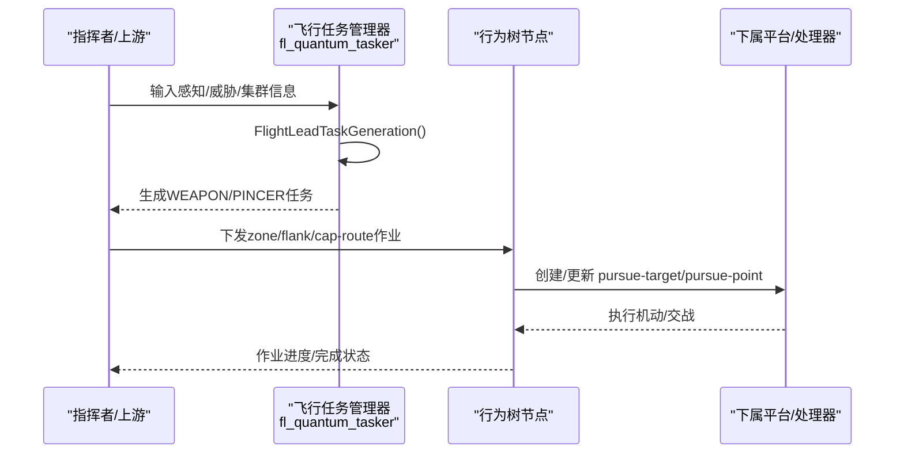
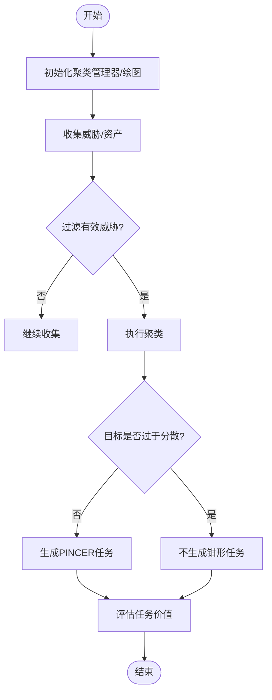
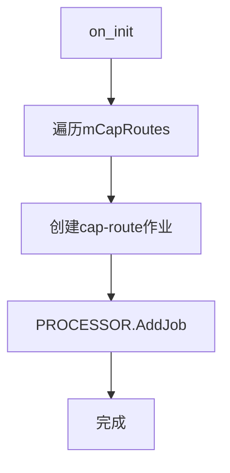
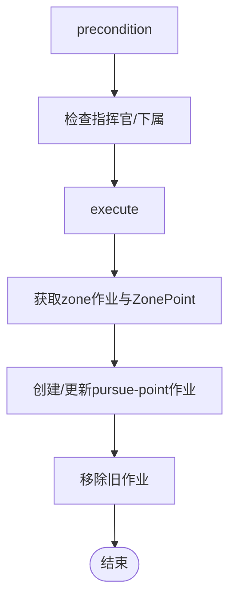
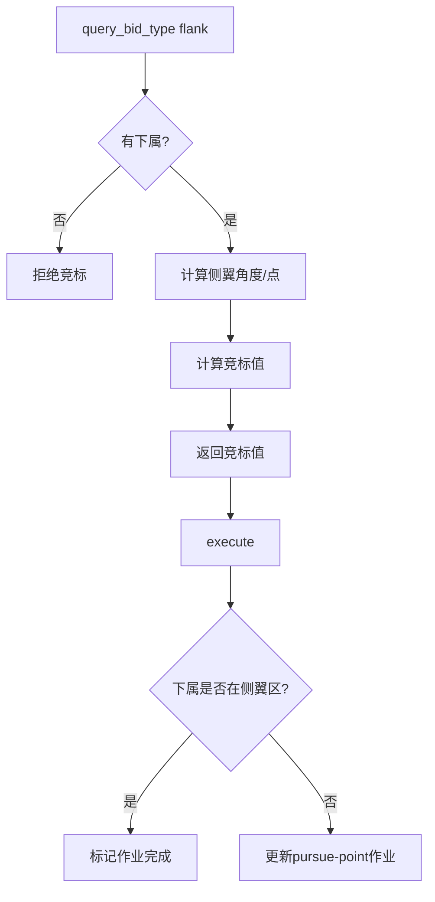
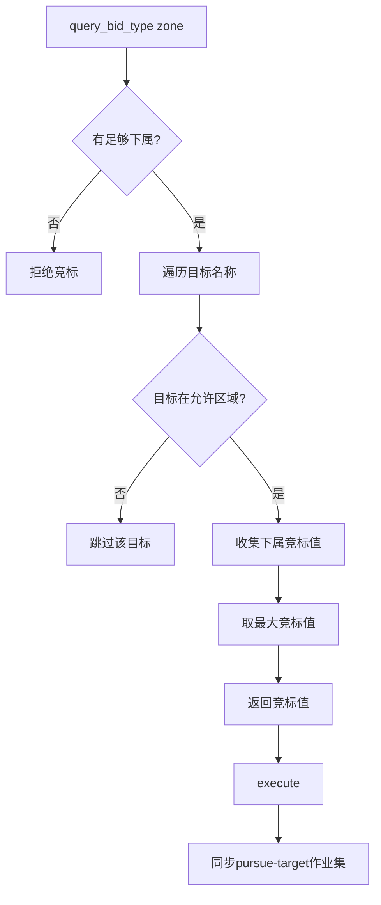
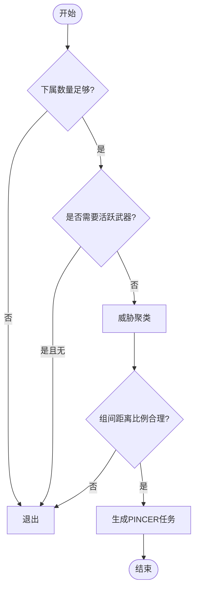
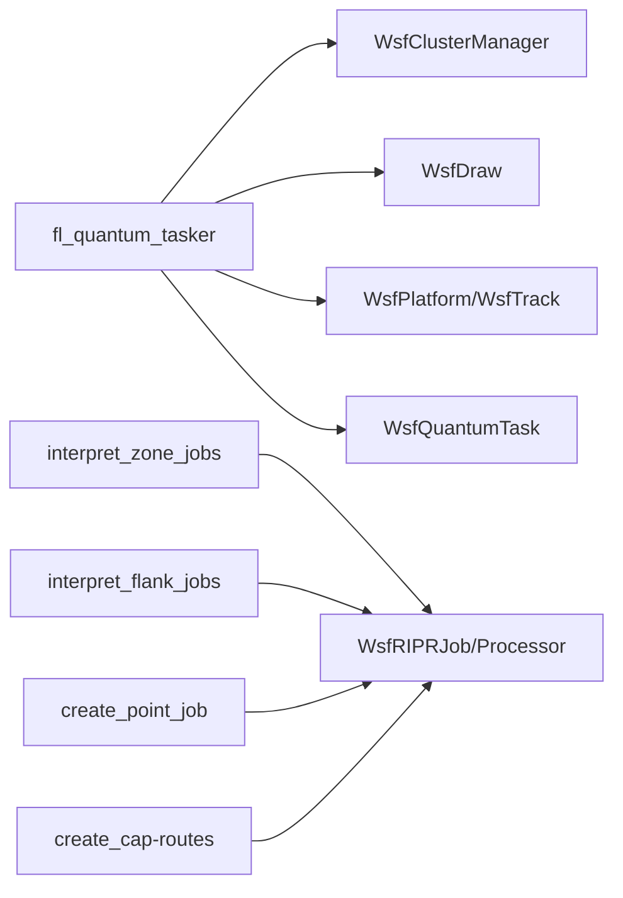

# 飞行AI(aifl)

<cite>
**本文引用的文件**   
- [fl_quantum_tasker.txt](file://demos/base_types/processors/quantum_agents/aifl/fl_quantum_tasker.txt)
- [fl_quantum_tasker_simple.txt](file://demos/behavior_tree/processors/quantum_agents/aifl/fl_quantum_tasker_simple.txt)
- [fl_quantum_tasker_super_simple.txt](file://demos/behavior_tree/processors/quantum_agents/aifl/fl_quantum_tasker_super_simple.txt)
- [fl_quantum_tasker_very_simple.txt](file://demos/behavior_tree/processors/quantum_agents/aifl/fl_quantum_tasker_very_simple.txt)
- [behavior_create_cap-routes.txt](file://demos/base_types/processors/quantum_agents/aifl/behavior_create_cap-routes.txt)
- [behavior_create_point_job.txt](file://demos/base_types/processors/quantum_agents/aifl/behavior_create_point_job.txt)
- [behavior_interpret_flank_jobs.txt](file://demos/base_types/processors/quantum_agents/aifl/behavior_interpret_flank_jobs.txt)
- [behavior_interpret_zone_jobs.txt](file://demos/base_types/processors/quantum_agents/aifl/behavior_interpret_zone_jobs.txt)
</cite>

## 目录
1. [简介](#简介)
2. [项目结构](#项目结构)
3. [核心组件](#核心组件)
4. [架构总览](#架构总览)
5. [详细组件分析](#详细组件分析)
6. [依赖关系分析](#依赖关系分析)
7. [性能考虑](#性能考虑)
8. [故障排查指南](#故障排查指南)
9. [结论](#结论)
10. [附录](#附录)

## 简介
本文件面向AFSIM的飞行AI子系统aifl，聚焦于“飞行平台优化”的任务生成、评估与执行机制。文档围绕以下目标展开：
- 解释aifl作为飞行任务管理器的设计理念与应用场景
- 梳理飞行任务管理器(fl_quantum_tasker)的多种实现版本(simple、super_simple、very_simple)的特点与适用场景
- 说明飞行行为的创建与管理机制，包括编队路线创建(cap-routes)、目标点作业创建(point_job)、侧翼作业解释(flank_jobs)等
- 阐述区域作业(zone_jobs)管理与钳形攻击(pincer)战术的实现原理
- 说明上行链路(uplinks)在协同作战中的作用（结合量子任务器矩阵可视化）
- 提供配置参数详解、性能优化建议、典型战术示例与调试方法

## 项目结构
aifl相关脚本与行为定义位于演示与行为树处理器目录下，主要包含：
- 飞行任务管理器脚本：fl_quantum_tasker.txt及其简化版
- 行为定义：cap-routes、point_job、flank_jobs、zone_jobs
这些文件共同构成“任务生成—评估—分配—执行”的闭环。

**图示来源**
- [fl_quantum_tasker.txt:14-72](file://demos/base_types/processors/quantum_agents/aifl/fl_quantum_tasker.txt#L14-L72)
- [behavior_create_cap-routes.txt:12-47](file://demos/base_types/processors/quantum_agents/aifl/behavior_create_cap-routes.txt#L12-L47)
- [behavior_create_point_job.txt:12-41](file://demos/base_types/processors/quantum_agents/aifl/behavior_create_point_job.txt#L12-L41)
- [behavior_interpret_flank_jobs.txt:12-28](file://demos/base_types/processors/quantum_agents/aifl/behavior_interpret_flank_jobs.txt#L12-L28)
- [behavior_interpret_zone_jobs.txt:17-32](file://demos/base_types/processors/quantum_agents/aifl/behavior_interpret_zone_jobs.txt#L17-L32)

**章节来源**
- [fl_quantum_tasker.txt:14-72](file://demos/base_types/processors/quantum_agents/aifl/fl_quantum_tasker.txt#L14-L72)
- [behavior_create_cap-routes.txt:12-47](file://demos/base_types/processors/quantum_agents/aifl/behavior_create_cap-routes.txt#L12-L47)
- [behavior_create_point_job.txt:12-41](file://demos/base_types/processors/quantum_agents/aifl/behavior_create_point_job.txt#L12-L41)
- [behavior_interpret_flank_jobs.txt:12-28](file://demos/base_types/processors/quantum_agents/aifl/behavior_interpret_flank_jobs.txt#L12-L28)
- [behavior_interpret_zone_jobs.txt:17-32](file://demos/base_types/processors/quantum_agents/aifl/behavior_interpret_zone_jobs.txt#L17-L32)

## 核心组件
- 飞行任务管理器(WSF_QUANTUM_TASKER_PROCESSOR)
  - 负责任务生成(generator)、评估(evaluator)、分配(allocator)
  - 支持自定义脚本函数进行任务生成与评估
  - 内置对武器任务与钳形任务的评估逻辑
- 行为节点(Behavior Tree)
  - create_cap-routes：批量创建“cap-route”作业
  - create_point_job：根据上级“zone”作业动态创建“pursue-point”作业
  - interpret_flank_jobs：解析并竞标“flank”作业，计算侧翼点并下发“pursue-point”
  - interpret_zone_jobs：竞标“zone”作业，维护“pursue-target”作业集

**章节来源**
- [fl_quantum_tasker.txt:14-72](file://demos/base_types/processors/quantum_agents/aifl/fl_quantum_tasker.txt#L14-L72)
- [behavior_create_cap-routes.txt:12-47](file://demos/base_types/processors/quantum_agents/aifl/behavior_create_cap-routes.txt#L12-L47)
- [behavior_create_point_job.txt:12-41](file://demos/base_types/processors/quantum_agents/aifl/behavior_create_point_job.txt#L12-L41)
- [behavior_interpret_flank_jobs.txt:12-28](file://demos/base_types/processors/quantum_agents/aifl/behavior_interpret_flank_jobs.txt#L12-L28)
- [behavior_interpret_zone_jobs.txt:17-32](file://demos/base_types/processors/quantum_agents/aifl/behavior_interpret_zone_jobs.txt#L17-L32)

## 架构总览
aifl采用“任务管理器+行为树”的分层架构：
- 上层：飞行任务管理器负责宏观任务生成与资源分配
- 中层：行为树将高层意图分解为可执行的RIPR作业
- 下层：子处理器/平台执行具体机动与交战动作

**图示来源**
- [fl_quantum_tasker.txt:123-355](file://demos/base_types/processors/quantum_agents/aifl/fl_quantum_tasker.txt#L123-L355)
- [behavior_interpret_zone_jobs.txt:117-199](file://demos/base_types/processors/quantum_agents/aifl/behavior_interpret_zone_jobs.txt#L117-L199)
- [behavior_interpret_flank_jobs.txt:127-263](file://demos/base_types/processors/quantum_agents/aifl/behavior_interpret_flank_jobs.txt#L127-L263)
- [behavior_create_point_job.txt:44-117](file://demos/base_types/processors/quantum_agents/aifl/behavior_create_point_job.txt#L44-L117)

## 详细组件分析

### 飞行任务管理器(fl_quantum_tasker)
- 功能要点
  - 任务生成：根据感知威胁与自身能力生成“WEAPON”或“PINCER”任务
  - 任务评估：按距离、武器域匹配、发射计算机类型等计算价值
  - 集群与钳形：使用聚类管理器对威胁分组，判断是否适合实施钳形战术
  - 可视化：可选绘制集群凸包与方向线
- 关键流程
  - 初始化聚类管理器与绘图对象
  - 遍历威胁，过滤友方/无效/过远/未知类别
  - 聚类后检查组间距离比例，避免分散目标
  - 若满足条件，生成PINCER任务，标注左右翼角色与辅助数据
  - 评估阶段区分WEAPON与PINCER两类任务的价值计算

**图示来源**
- [fl_quantum_tasker.txt:66-72](file://demos/base_types/processors/quantum_agents/aifl/fl_quantum_tasker.txt#L66-L72)
- [fl_quantum_tasker.txt:123-355](file://demos/base_types/processors/quantum_agents/aifl/fl_quantum_tasker.txt#L123-L355)
- [fl_quantum_tasker.txt:358-427](file://demos/base_types/processors/quantum_agents/aifl/fl_quantum_tasker.txt#L358-L427)

**章节来源**
- [fl_quantum_tasker.txt:14-72](file://demos/base_types/processors/quantum_agents/aifl/fl_quantum_tasker.txt#L14-L72)
- [fl_quantum_tasker.txt:123-355](file://demos/base_types/processors/quantum_agents/aifl/fl_quantum_tasker.txt#L123-L355)
- [fl_quantum_tasker.txt:358-427](file://demos/base_types/processors/quantum_agents/aifl/fl_quantum_tasker.txt#L358-L427)

### 飞行任务管理器简化版(simple/super_simple/very_simple)
- simple
  - 引入已知目标类型映射，仅对特定类型生成武器任务
  - 评估时考虑武器系统与发射计算机类型
- super_simple
  - 完全自生成任务，无接收外部任务处理
  - 评估仅基于斜距倒数
- very_simple
  - 同simple但更简洁的评估逻辑，保留武器域匹配

适用场景：
- simple：需要一定目标分类与武器域匹配的中等复杂度场景
- super_simple：快速验证任务生成与分配的基础流程
- very_simple：最小化评估开销，强调范围优先

**章节来源**
- [fl_quantum_tasker_simple.txt:15-173](file://demos/behavior_tree/processors/quantum_agents/aifl/fl_quantum_tasker_simple.txt#L15-L173)
- [fl_quantum_tasker_super_simple.txt:12-81](file://demos/behavior_tree/processors/quantum_agents/aifl/fl_quantum_tasker_super_simple.txt#L12-L81)
- [fl_quantum_tasker_very_simple.txt:13-125](file://demos/behavior_tree/processors/quantum_agents/aifl/fl_quantum_tasker_very_simple.txt#L13-L125)

### 编队路线创建(create_cap-routes)
- 作用：批量创建“cap-route”作业，用于空中巡逻/拦截航线
- 关键数据：route name、location、heading、priority、max winners、fez_zone
- 执行：on_init阶段遍历配置，调用WsfRIPRJob.Create添加作业

**图示来源**
- [behavior_create_cap-routes.txt:27-47](file://demos/base_types/processors/quantum_agents/aifl/behavior_create_cap-routes.txt#L27-L47)

**章节来源**
- [behavior_create_cap-routes.txt:12-47](file://demos/base_types/processors/quantum_agents/aifl/behavior_create_cap-routes.txt#L12-L47)

### 目标点作业创建(create_point_job)
- 作用：当存在“zone”作业时，动态创建“pursue-point”作业以引导编队进入区域
- 关键点：
  - 校验指挥官与下属数量
  - 从当前zone作业提取ZonePoint并创建/更新pursue-point作业
  - 清理旧作业，保持作业板整洁

**图示来源**
- [behavior_create_point_job.txt:27-41](file://demos/base_types/processors/quantum_agents/aifl/behavior_create_point_job.txt#L27-L41)
- [behavior_create_point_job.txt:44-117](file://demos/base_types/processors/quantum_agents/aifl/behavior_create_point_job.txt#L44-L117)

**章节来源**
- [behavior_create_point_job.txt:12-117](file://demos/base_types/processors/quantum_agents/aifl/behavior_create_point_job.txt#L12-L117)

### 侧翼作业解释(interpret_flank_jobs)
- 作用：解析“flank”作业，计算侧翼点并竞标；成功后创建“pursue-point”作业引导编队侧翼机动
- 关键逻辑：
  - 根据最近下属与集群航向确定左/右侧翼角度
  - 计算侧翼点位置，保存至映射表
  - 竞标值基于下属数量、侧翼距离与到侧翼点的距离
  - 执行阶段检查下属是否进入侧翼区，标记作业完成

**图示来源**
- [behavior_interpret_flank_jobs.txt:32-122](file://demos/base_types/processors/quantum_agents/aifl/behavior_interpret_flank_jobs.txt#L32-L122)
- [behavior_interpret_flank_jobs.txt:162-263](file://demos/base_types/processors/quantum_agents/aifl/behavior_interpret_flank_jobs.txt#L162-L263)

**章节来源**
- [behavior_interpret_flank_jobs.txt:12-263](file://demos/base_types/processors/quantum_agents/aifl/behavior_interpret_flank_jobs.txt#L12-L263)

### 区域作业解释(interpret_zone_jobs)
- 作用：竞标“zone”作业，维护“pursue-target”作业集，确保编队针对威胁群进行追踪
- 关键逻辑：
  - 竞标阶段聚合下属对每个目标的bid，考虑区域约束与威胁类别
  - 执行阶段根据当前zone作业增删“pursue-target”作业
  - 支持快速竞标模式与常规竞标模式

**图示来源**
- [behavior_interpret_zone_jobs.txt:36-113](file://demos/base_types/processors/quantum_agents/aifl/behavior_interpret_zone_jobs.txt#L36-L113)
- [behavior_interpret_zone_jobs.txt:132-199](file://demos/base_types/processors/quantum_agents/aifl/behavior_interpret_zone_jobs.txt#L132-L199)

**章节来源**
- [behavior_interpret_zone_jobs.txt:17-199](file://demos/base_types/processors/quantum_agents/aifl/behavior_interpret_zone_jobs.txt#L17-L199)

### 钳形攻击(pincer)战术
- 触发条件：
  - 至少指定数量的下属参与
  - 可选择要求有活跃武器
  - 威胁聚类后组间距离比例满足阈值
  - 下属相对平均方位的分离角未达到上限
- 输出：
  - 为每个参与组生成PINCER任务，附带ZoneThreatNameArray、ZonePoint、ZoneBearing等辅助数据
  - 标注每个资产的left/right角色

**图示来源**
- [fl_quantum_tasker.txt:182-355](file://demos/base_types/processors/quantum_agents/aifl/fl_quantum_tasker.txt#L182-L355)

**章节来源**
- [fl_quantum_tasker.txt:182-355](file://demos/base_types/processors/quantum_agents/aifl/fl_quantum_tasker.txt#L182-L355)

### 上行链路(uplinks)管理
- 在AFSIM中，量子任务器矩阵可视化可用于观察任务供应者与接收者的关系，从而理解上行链路在协同作战中的角色
- 通过“Show Quantum Tasker Matrix”菜单项可查看任务流与协作拓扑

**章节来源**
- [_rv_tools_menu_extension.txt:1-10](file://swdev/src/mystic/plugins/ResultQuantumTaskerData/doc/_rv_tools_menu_extension.txt#L1-L10)

## 依赖关系分析
- fl_quantum_tasker依赖：
  - WsfClusterManager：威胁聚类
  - WsfDraw：可视化
  - WsfPlatform/WsfTrack/WsfAssetPerception：平台/轨迹/资产感知
  - WsfQuantumTask/WsfTaskList：任务与任务列表
- 行为树依赖：
  - WsfRIPRJob/WsfRIPRProcessor：作业与处理器
  - WsfZone：区域判定
  - PROCESSOR接口：查询/设置任务、作业生命周期管理

**图示来源**
- [fl_quantum_tasker.txt:66-72](file://demos/base_types/processors/quantum_agents/aifl/fl_quantum_tasker.txt#L66-L72)
- [behavior_interpret_zone_jobs.txt:117-199](file://demos/base_types/processors/quantum_agents/aifl/behavior_interpret_zone_jobs.txt#L117-L199)
- [behavior_interpret_flank_jobs.txt:127-263](file://demos/base_types/processors/quantum_agents/aifl/behavior_interpret_flank_jobs.txt#L127-L263)
- [behavior_create_point_job.txt:44-117](file://demos/base_types/processors/quantum_agents/aifl/behavior_create_point_job.txt#L44-L117)
- [behavior_create_cap-routes.txt:27-47](file://demos/base_types/processors/quantum_agents/aifl/behavior_create_cap-routes.txt#L27-L47)

**章节来源**
- [fl_quantum_tasker.txt:66-72](file://demos/base_types/processors/quantum_agents/aifl/fl_quantum_tasker.txt#L66-L72)
- [behavior_interpret_zone_jobs.txt:117-199](file://demos/base_types/processors/quantum_agents/aifl/behavior_interpret_zone_jobs.txt#L117-L199)
- [behavior_interpret_flank_jobs.txt:127-263](file://demos/base_types/processors/quantum_agents/aifl/behavior_interpret_flank_jobs.txt#L127-L263)
- [behavior_create_point_job.txt:44-117](file://demos/base_types/processors/quantum_agents/aifl/behavior_create_point_job.txt#L44-L117)
- [behavior_create_cap-routes.txt:27-47](file://demos/base_types/processors/quantum_agents/aifl/behavior_create_cap-routes.txt#L27-L47)

## 性能考虑
- 任务生成与评估频率
  - update_interval控制刷新周期，建议根据仿真规模调整
- 聚类算法选择
  - mClusterMethod支持HTREEMAX/K_MEANS/H_TREE_MIN，不同方法在精度与性能上权衡
- 竞标策略
  - fastAndDirtyBidding可加速竞标，但可能牺牲准确性
- 可视化开销
  - mDrawClusters与行为内绘图会引入额外CPU/GPU负载，建议在调试时启用

[本节为通用指导，无需引用具体文件]

## 故障排查指南
- 常见错误与定位
  - “Agent does not have a commander to get jobs from!”：检查RIPR命令链是否正确建立
  - “Agent has no subordinates to send to a point!”：确认下属处理器已注册
  - “cluster bearing invalid”：检查集群航向有效性，必要时回退到几何推算
  - “no active weapons, no pincer yet”：如需钳形，确保有活跃武器或关闭该要求
- 调试手段
  - 启用script_debug_writes与writeln_d日志
  - 使用WsfDraw绘制集群凸包、侧翼线与区域边界
  - 通过量子任务器矩阵查看任务流向

**章节来源**
- [behavior_create_point_job.txt:27-41](file://demos/base_types/processors/quantum_agents/aifl/behavior_create_point_job.txt#L27-L41)
- [behavior_interpret_flank_jobs.txt:127-159](file://demos/base_types/processors/quantum_agents/aifl/behavior_interpret_flank_jobs.txt#L127-L159)
- [fl_quantum_tasker.txt:196-209](file://demos/base_types/processors/quantum_agents/aifl/fl_quantum_tasker.txt#L196-L209)

## 结论
aifl通过“任务管理器+行为树”的架构实现了灵活的飞行任务编排与执行。其优势在于：
- 可扩展的任务生成与评估逻辑
- 丰富的行为节点支持复杂战术（如钳形、侧翼、区域追踪）
- 可视化的调试与监控能力
在实际应用中，应根据仿真规模与战术需求选择合适的fl_quantum_tasker版本，并合理配置聚类方法与竞标策略，以获得最佳性能与效果。

[本节为总结性内容，无需引用具体文件]

## 附录
- 配置参数速查
  - fl_quantum_tasker
    - mSelfCreateTasks：是否自生成任务
    - cMAX_SLANT_RANGE：最大斜距
    - mCreatePincerTasks：是否生成钳形任务
    - mClusterMethod：聚类方法
    - mClusterDistanceLimit：聚类距离阈值
    - mMinDistanceRatio：组间距离比例阈值
  - behavior_interpret_zone_jobs
    - fastAndDirtyBidding：快速竞标开关
    - ThreatTypeEngageZone：威胁类别到区域的映射
  - behavior_interpret_flank_jobs
    - cPreferredFlank：首选侧翼方向
    - cFlankWeighting：侧翼竞标权重
- 典型战术场景
  - 编队巡逻：使用create_cap-routes创建多条巡逻航线
  - 区域压制：interpret_zone_jobs维护pursue-target作业集
  - 侧翼包抄：interpret_flank_jobs计算侧翼点并引导编队
  - 钳形突击：fl_quantum_tasker生成PINCER任务，左右翼协同

[本节为补充信息，无需引用具体文件]