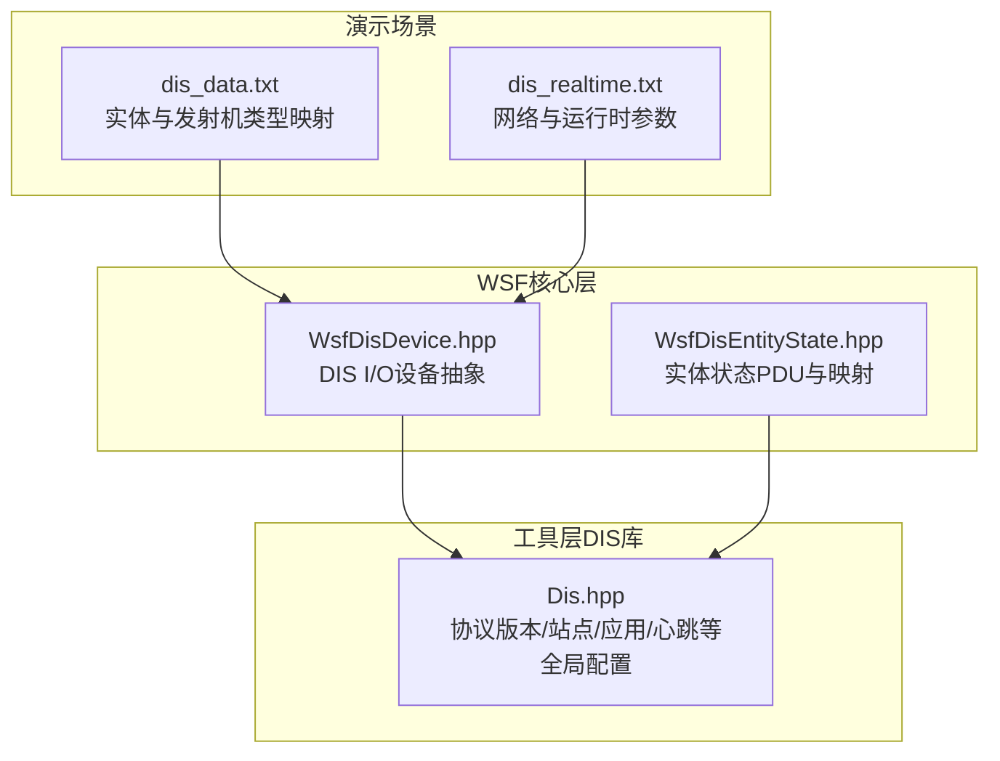
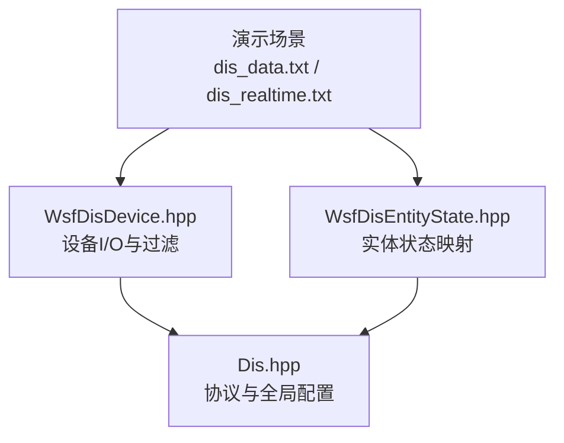
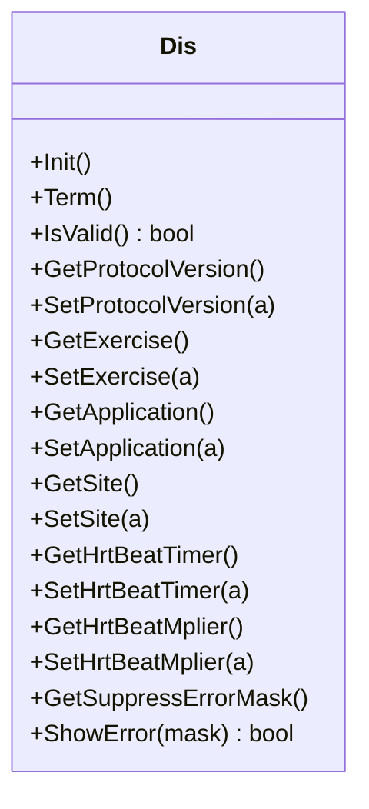
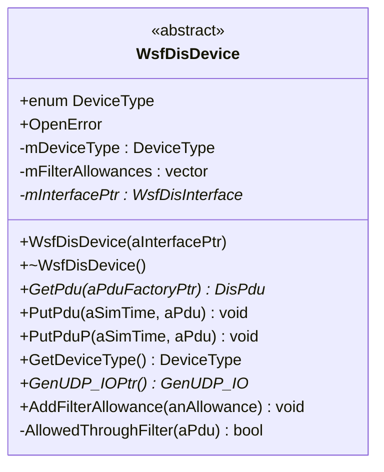
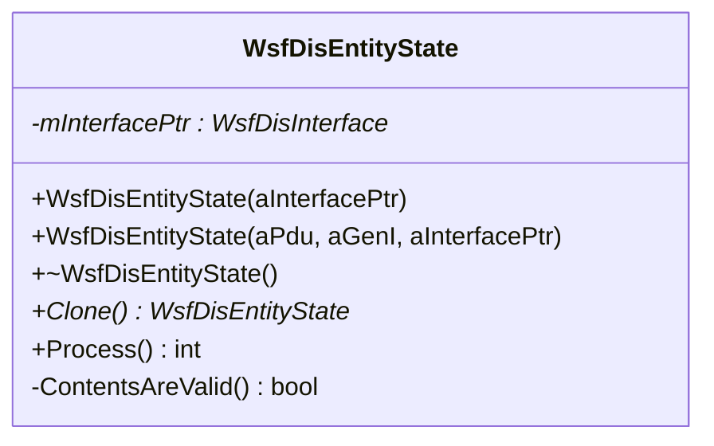
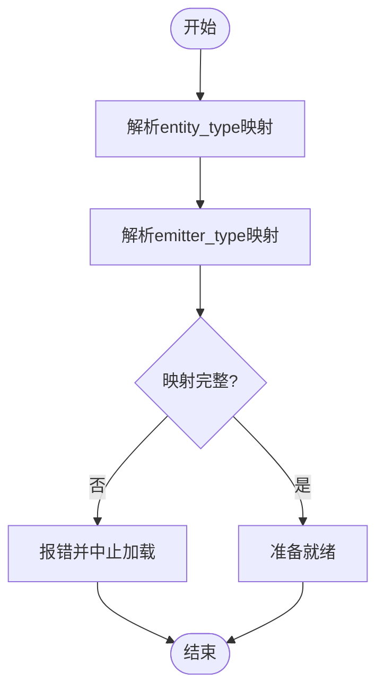
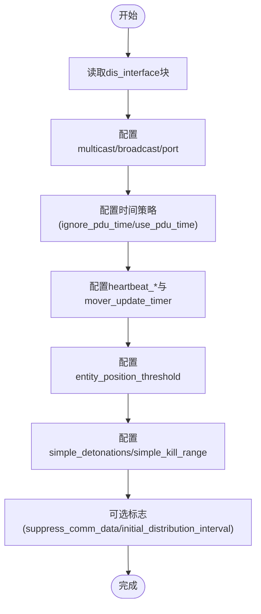
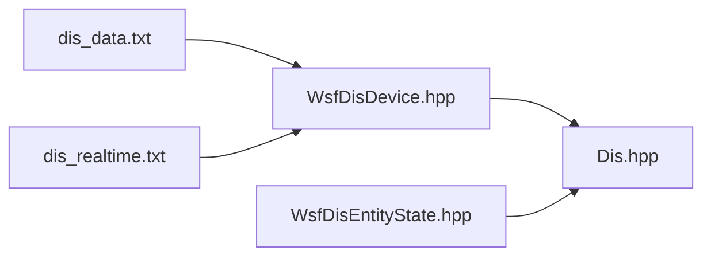

# DIS接口集成

<cite>
**本文引用的文件**   
- [dis_data.txt](file://demos/aea_iads/dis_data.txt)
- [dis_realtime.txt](file://demos/aea_iads/dis_realtime.txt)
- [WsfDisDevice.hpp](file://swdev/src/core/wsf/source/dis/WsfDisDevice.hpp)
- [WsfDisEntityState.hpp](file://swdev/src/core/wsf/source/dis/WsfDisEntityState.hpp)
- [Dis.hpp](file://swdev/src/tools/dis/source/Dis.hpp)
</cite>

## 目录
1. [引言](#引言)
2. [项目结构](#项目结构)
3. [核心组件](#核心组件)
4. [架构总览](#架构总览)
5. [详细组件分析](#详细组件分析)
6. [依赖关系分析](#依赖关系分析)
7. [性能与网络优化](#性能与网络优化)
8. [故障排除指南](#故障排除指南)
9. [结论](#结论)
10. [附录：配置与示例](#附录配置与示例)

## 引言
本文件面向AFSIM的DIS（Distributed Interactive Simulation）接口，系统性说明协议概念、架构、消息格式、实体状态更新与数据映射规则，并给出网络配置、同步策略、通信协议设置以及与其他仿真系统集成的实践方法。文档同时覆盖HLA（High Level Architecture）集成机制、实时仿真中的时间同步、实体管理与事件协调，并提供多节点分布式仿真的部署与配置建议、性能调优与故障排除最佳实践。

## 项目结构
AFSIM中与DIS相关的实现主要分布在以下位置：
- 工具层DIS库：提供PDU类型、协议常量与全局配置访问器
- WSF核心层DIS适配：封装设备I/O、实体状态映射与过滤等
- 演示场景：通过输入文件定义实体类型、发射机类型、网络参数与运行行为

**图表来源**
- [dis_data.txt:9-40](file://demos/aea_iads/dis_data.txt#L9-L40)
- [dis_realtime.txt:9-36](file://demos/aea_iads/dis_realtime.txt#L9-L36)
- [WsfDisDevice.hpp:28-72](file://swdev/src/core/wsf/source/dis/WsfDisDevice.hpp#L28-L72)
- [WsfDisEntityState.hpp:31-55](file://swdev/src/core/wsf/source/dis/WsfDisEntityState.hpp#L31-L55)
- [Dis.hpp:23-139](file://swdev/src/tools/dis/source/Dis.hpp#L23-L139)

**章节来源**
- [dis_data.txt:9-40](file://demos/aea_iads/dis_data.txt#L9-L40)
- [dis_realtime.txt:9-36](file://demos/aea_iads/dis_realtime.txt#L9-L36)
- [WsfDisDevice.hpp:28-72](file://swdev/src/core/wsf/source/dis/WsfDisDevice.hpp#L28-L72)
- [WsfDisEntityState.hpp:31-55](file://swdev/src/core/wsf/source/dis/WsfDisEntityState.hpp#L31-L55)
- [Dis.hpp:23-139](file://swdev/src/tools/dis/source/Dis.hpp#L23-L139)

## 核心组件
- DIS协议与全局配置（工具层）
  - 提供协议版本、演练号、站点与应用标识、心跳计时器、阈值与错误掩码等静态访问器/设置器，用于统一控制DIS交互行为。
- DIS I/O设备抽象（WSF核心层）
  - 抽象文件、网络（组播/广播/单播）、记录回放等设备的读写接口，支持过滤器允许列表与PDU发送/接收。
- 实体状态映射（WSF核心层）
  - 维护实体状态PDU，负责在AFSIM平台对象与DIS实体状态之间进行双向数据转换与处理。

**章节来源**
- [Dis.hpp:23-139](file://swdev/src/tools/dis/source/Dis.hpp#L23-L139)
- [WsfDisDevice.hpp:28-72](file://swdev/src/core/wsf/source/dis/WsfDisDevice.hpp#L28-L72)
- [WsfDisEntityState.hpp:31-55](file://swdev/src/core/wsf/source/dis/WsfDisEntityState.hpp#L31-L55)

## 架构总览
下图展示AFSIM中DIS接口的整体架构：演示场景通过输入文件配置实体/发射机类型与网络参数；WSF核心层将DIS PDU与内部平台模型进行映射；工具层DIS库提供协议常量与全局配置。

**图表来源**
- [dis_data.txt:9-40](file://demos/aea_iads/dis_data.txt#L9-L40)
- [dis_realtime.txt:9-36](file://demos/aea_iads/dis_realtime.txt#L9-L36)
- [WsfDisDevice.hpp:28-72](file://swdev/src/core/wsf/source/dis/WsfDisDevice.hpp#L28-L72)
- [WsfDisEntityState.hpp:31-55](file://swdev/src/core/wsf/source/dis/WsfDisEntityState.hpp#L31-L55)
- [Dis.hpp:23-139](file://swdev/src/tools/dis/source/Dis.hpp#L23-L139)

## 详细组件分析

### DIS协议与全局配置（Dis.hpp）
- 作用
  - 集中管理DIS协议版本、演练号、站点与应用ID、心跳相关计时器、各类阈值与最大PDU大小等全局参数。
- 关键能力
  - 初始化/终止、有效性检查
  - 获取/设置协议版本、演练、站点、应用、心跳计时器与乘数
  - 获取/设置各类阈值（如方位角/俯仰角/能量/频率/脉冲宽度等）
  - 错误抑制掩码与显示开关
- 使用要点
  - 在仿真启动前设置协议版本、演练号、站点与应用ID，确保与对端一致
  - 根据网络负载调整心跳计时器与阈值，平衡实时性与带宽占用

**图表来源**
- [Dis.hpp:23-139](file://swdev/src/tools/dis/source/Dis.hpp#L23-L139)

**章节来源**
- [Dis.hpp:23-139](file://swdev/src/tools/dis/source/Dis.hpp#L23-L139)

### DIS I/O设备抽象（WsfDisDevice.hpp）
- 作用
  - 为DIS I/O设备（文件、网络、CEI/CEE等）提供统一抽象，支持PDU读取与写入，内置过滤器允许列表。
- 关键能力
  - 设备类型枚举（无、记录、回放、组播、广播、单播、CEE）
  - 打开异常类
  - 获取/发送PDU
  - 添加过滤器允许项，判断是否放行
- 使用要点
  - 根据场景选择合适设备类型（例如组播用于多节点广播）
  - 通过过滤器限制特定实体或发射机的PDU流量，降低带宽压力

**图表来源**
- [WsfDisDevice.hpp:28-72](file://swdev/src/core/wsf/source/dis/WsfDisDevice.hpp#L28-L72)

**章节来源**
- [WsfDisDevice.hpp:28-72](file://swdev/src/core/wsf/source/dis/WsfDisDevice.hpp#L28-L72)

### 实体状态映射（WsfDisEntityState.hpp）
- 作用
  - 维护DIS实体状态PDU，并在AFSIM平台对象与DIS实体状态之间进行双向数据转换与处理。
- 关键能力
  - 构造与克隆
  - 处理流程（Process）
  - 内容有效性校验
- 使用要点
  - 在收到实体状态PDU后调用处理逻辑，更新内部平台状态
  - 在需要向外发送实体状态时，从平台对象生成对应的PDU

**图表来源**
- [WsfDisEntityState.hpp:31-55](file://swdev/src/core/wsf/source/dis/WsfDisEntityState.hpp#L31-L55)

**章节来源**
- [WsfDisEntityState.hpp:31-55](file://swdev/src/core/wsf/source/dis/WsfDisEntityState.hpp#L31-L55)

### 实体与发射机类型映射（dis_data.txt）
- 作用
  - 定义AFSIM实体到DIS实体类型的映射，以及发射机类型编号，便于在DIS PDU中正确表达实体外观与电子战信息。
- 关键内容
  - entity_type：将AFSIM实体名映射到DIS实体类型编码
  - emitter_type：将AFSIM发射机映射到DIS发射机编号

**图表来源**
- [dis_data.txt:9-40](file://demos/aea_iads/dis_data.txt#L9-L40)

**章节来源**
- [dis_data.txt:9-40](file://demos/aea_iads/dis_data.txt#L9-L40)

### 网络与运行时参数（dis_realtime.txt）
- 作用
  - 配置DIS的网络通信参数与运行时行为，包括演练/站点/应用、组播地址与端口、自动启动、时间策略、心跳与移动更新间隔、位置阈值、简单爆炸与杀伤范围等。
- 关键内容
  - exercise/site/application：演练与拓扑标识
  - multicast/broadcast/port：网络传输方式与端口
  - autostart：自动启动
  - ignore_pdu_time/use_pdu_time：时间戳策略
  - simple_detonations/simple_kill_range：简化爆炸与杀伤半径
  - heartbeat_timer/heartbeat_multiplier/mover_update_timer/entity_position_threshold：心跳与移动更新策略
  - suppress_comm_data：可选抑制通信数据
  - initial_distribution_interval：初始分布间隔

**图表来源**
- [dis_realtime.txt:9-36](file://demos/aea_iads/dis_realtime.txt#L9-L36)

**章节来源**
- [dis_realtime.txt:9-36](file://demos/aea_iads/dis_realtime.txt#L9-L36)

### HLA集成机制（概念性说明）
- AFSIM通常通过XIO或其他适配器与HLA RTI交互，将HLA联邦对象映射到内部平台与传感器模型，或将内部状态导出为HLA属性。
- 典型流程
  - 初始化XIO/RTI连接
  - 注册/订阅所需对象与属性
  - 在仿真步中同步时间与状态
  - 处理HLA事件（创建/销毁实体、属性更新）
- 注意
  - 本仓库未直接包含HLA RTI代码，但可通过XIO扩展点与外部HLA运行时集成
  - 建议在WSF扩展或插件中实现HLA适配层，以复用DIS的设备抽象与过滤机制

[本节为概念性说明，不直接分析具体文件]

## 依赖关系分析
- 组件耦合
  - 演示场景（dis_data.txt/dis_realtime.txt）驱动WSF核心层DIS适配（WsfDisDevice/WsfDisEntityState）
  - WSF核心层依赖工具层DIS库（Dis.hpp）提供的协议常量与全局配置
- 潜在循环依赖
  - 通过头文件前向声明避免循环引用（例如WsfDisDevice中前向声明DisPdu、DisPduFactory、WsfDisInterface等）
- 外部依赖
  - 网络栈（UDP组播/广播/单播）
  - 可能的HLA RTI（通过XIO或自定义适配器）

**图表来源**
- [dis_data.txt:9-40](file://demos/aea_iads/dis_data.txt#L9-L40)
- [dis_realtime.txt:9-36](file://demos/aea_iads/dis_realtime.txt#L9-L36)
- [WsfDisDevice.hpp:28-72](file://swdev/src/core/wsf/source/dis/WsfDisDevice.hpp#L28-L72)
- [WsfDisEntityState.hpp:31-55](file://swdev/src/core/wsf/source/dis/WsfDisEntityState.hpp#L31-L55)
- [Dis.hpp:23-139](file://swdev/src/tools/dis/source/Dis.hpp#L23-L139)

**章节来源**
- [dis_data.txt:9-40](file://demos/aea_iads/dis_data.txt#L9-L40)
- [dis_realtime.txt:9-36](file://demos/aea_iads/dis_realtime.txt#L9-L36)
- [WsfDisDevice.hpp:28-72](file://swdev/src/core/wsf/source/dis/WsfDisDevice.hpp#L28-L72)
- [WsfDisEntityState.hpp:31-55](file://swdev/src/core/wsf/source/dis/WsfDisEntityState.hpp#L31-L55)
- [Dis.hpp:23-139](file://swdev/src/tools/dis/source/Dis.hpp#L23-L139)

## 性能与网络优化
- 心跳与移动更新
  - 合理设置heartbeat_timer与heartbeat_multiplier，避免频繁心跳导致带宽饱和
  - mover_update_timer与entity_position_threshold配合，减少不必要的移动更新
- 过滤与选择性发送
  - 使用过滤器允许列表仅转发关键实体或发射机PDU，降低网络负载
- 时间策略
  - 根据对端能力选择ignore_pdu_time或use_pdu_time，确保时间同步一致性
- 组播与广播
  - 优先使用组播以减少重复数据包，广播仅在局域网内小规模场景使用
- 阈值调优
  - 调整方位角/俯仰角/能量/频率/脉冲宽度等阈值，平衡精度与带宽

[本节为通用指导，不直接分析具体文件]

## 故障排除指南
- 无法建立连接
  - 检查multicast/broadcast/port配置是否与对端一致
  - 确认防火墙与路由器组播路由已启用
- 实体状态不同步
  - 核对exercise/site/application标识
  - 检查ignore_pdu_time/use_pdu_time策略是否匹配
- 实体类型不识别
  - 确认dis_data.txt中entity_type映射是否正确
- 发射机数据缺失
  - 检查emitter_type映射与suppress_comm_data标志
- 心跳超时或抖动
  - 调整heartbeat_timer与heartbeat_multiplier
  - 检查网络拥塞与丢包情况

**章节来源**
- [dis_realtime.txt:9-36](file://demos/aea_iads/dis_realtime.txt#L9-L36)
- [dis_data.txt:9-40](file://demos/aea_iads/dis_data.txt#L9-L40)

## 结论
AFSIM的DIS接口通过工具层DIS库与WSF核心层适配，结合演示场景的配置，实现了与外部仿真系统的互操作。通过合理的实体/发射机类型映射、网络参数配置与时间同步策略，可在多节点分布式仿真中稳定运行。HLA集成可通过XIO或自定义适配器实现，建议复用现有设备抽象与过滤机制以提升可维护性与性能。

[本节为总结性内容，不直接分析具体文件]

## 附录：配置与示例
- 实体与发射机类型映射示例
  - 参考路径：[dis_data.txt:9-40](file://demos/aea_iads/dis_data.txt#L9-L40)
- 网络与运行时参数示例
  - 参考路径：[dis_realtime.txt:9-36](file://demos/aea_iads/dis_realtime.txt#L9-L36)
- 协议与全局配置API
  - 参考路径：[Dis.hpp:23-139](file://swdev/src/tools/dis/source/Dis.hpp#L23-L139)
- 设备I/O抽象API
  - 参考路径：[WsfDisDevice.hpp:28-72](file://swdev/src/core/wsf/source/dis/WsfDisDevice.hpp#L28-L72)
- 实体状态映射API
  - 参考路径：[WsfDisEntityState.hpp:31-55](file://swdev/src/core/wsf/source/dis/WsfDisEntityState.hpp#L31-L55)

[本节为指引性内容，不直接分析具体文件]