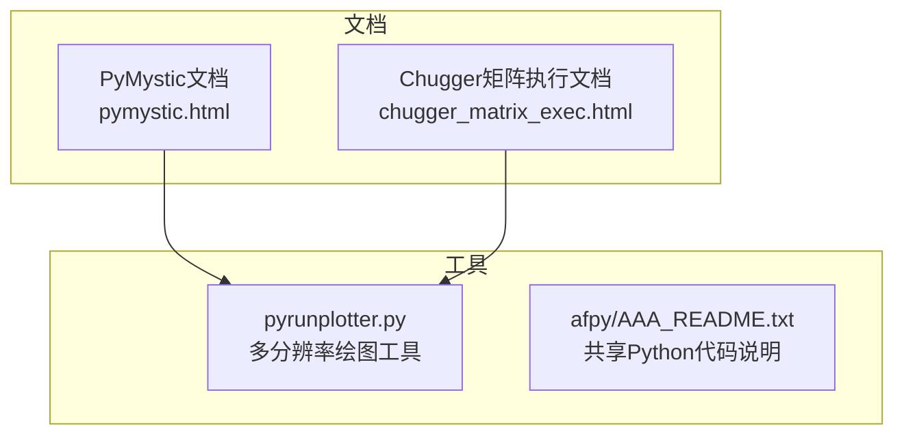
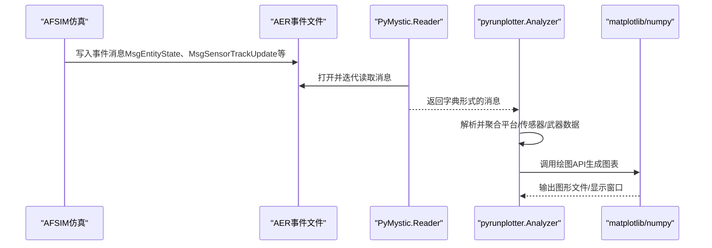
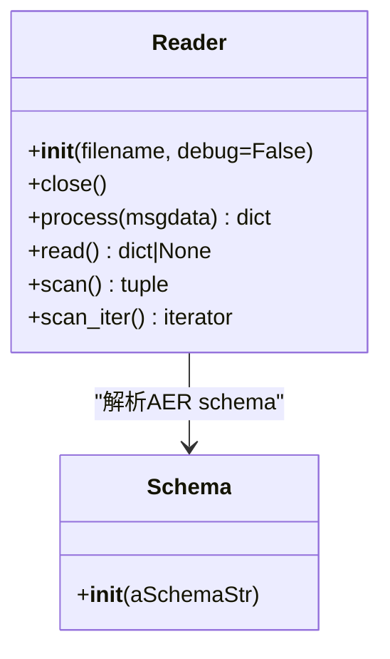
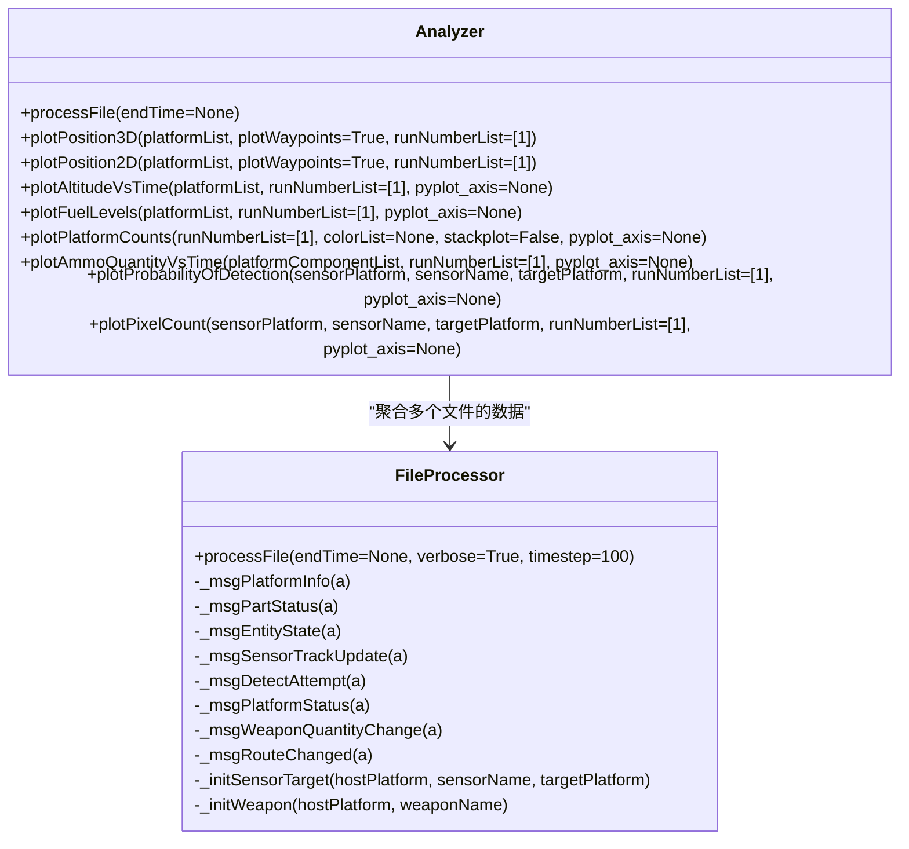
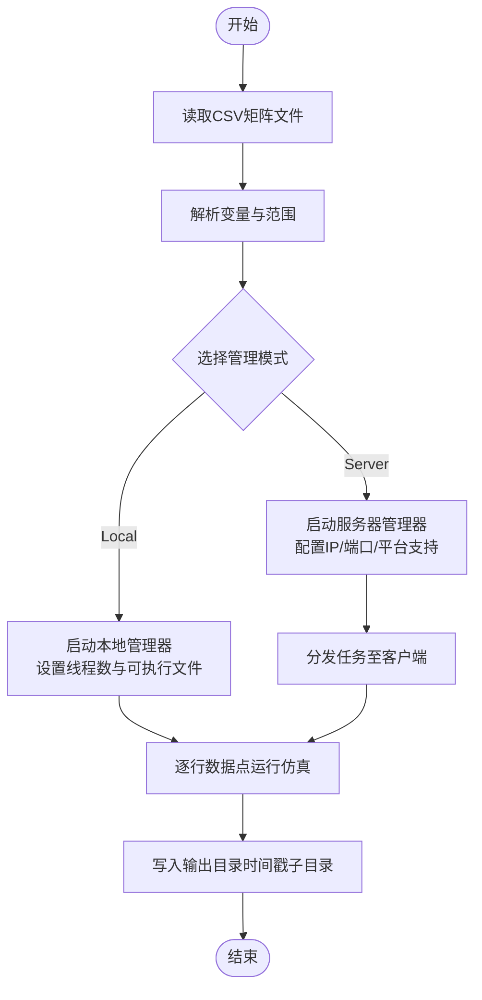
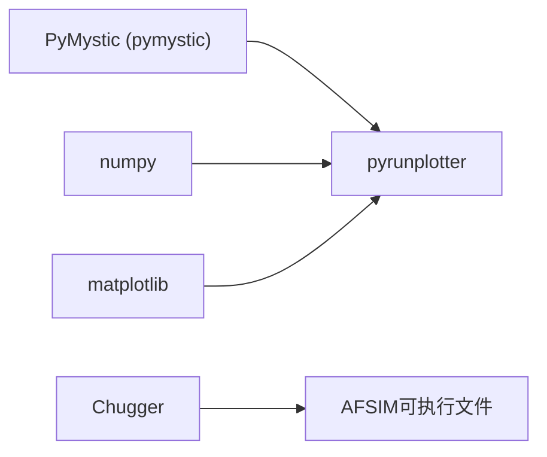

# Python脚本API

<cite>
**本文引用的文件**   
- [pymystic.html](file://documentation/html/docs/pymystic.html)
- [pyrunplotter.py](file://tools/pyrunplotter/pyrunplotter.py)
- [chugger_matrix_exec.html](file://documentation/html/docs/scripts/chugger_matrix_exec.html)
- [AAA_README.txt](file://tools/afpy/AAA_README.txt)
</cite>

## 目录
1. [简介](#简介)
2. [项目结构](#项目结构)
3. [核心组件](#核心组件)
4. [架构总览](#架构总览)
5. [详细组件分析](#详细组件分析)
6. [依赖关系分析](#依赖关系分析)
7. [性能与内存优化](#性能与内存优化)
8. [故障排查指南](#故障排查指南)
9. [结论](#结论)
10. [附录：常用工作流模板](#附录常用工作流模板)

## 简介
本手册面向使用AFSIM进行仿真建模与分析的工程师，聚焦Python脚本API的使用与实践。内容涵盖：
- Python接口设计理念与核心概念（对象模型、事件系统、数据处理流程）
- 主要Python类与函数说明（平台操作、传感器控制、武器发射、仿真管理）
- 自动化仿真执行示例（批量运行、参数扫描、结果分析）
- 后处理与数据分析（图表生成、统计计算、报告导出）
- 脚本编写最佳实践、性能优化与内存管理
- 与外部库集成及第三方工具链使用方法
- 实际项目中的Python应用案例与代码模板

## 项目结构
仓库中与Python脚本API相关的核心位置包括：
- documentation/html/docs/pymystic.html：PyMystic模块文档，提供AER事件文件读取与批处理能力
- tools/pyrunplotter/pyrunplotter.py：多分辨率运行结果的对比绘图工具，基于PyMystic与matplotlib/numpy
- documentation/html/docs/scripts/chugger_matrix_exec.html：Chugger矩阵执行脚本文档，支持DOE批量运行
- tools/afpy/AAA_README.txt：AFSIM工具中共享Python代码的说明

**图示来源**  
- [pymystic.html:72-95](file://documentation/html/docs/pymystic.html#L72-L95)
- [chugger_matrix_exec.html:73-110](file://documentation/html/docs/scripts/chugger_matrix_exec.html#L73-L110)
- [pyrunplotter.py:14-39](file://tools/pyrunplotter/pyrunplotter.py#L14-L39)
- [AAA_README.txt:9-11](file://tools/afpy/AAA_README.txt#L9-L11)

**章节来源**  
- [pymystic.html:72-95](file://documentation/html/docs/pymystic.html#L72-L95)
- [chugger_matrix_exec.html:73-110](file://documentation/html/docs/scripts/chugger_matrix_exec.html#L73-L110)
- [pyrunplotter.py:14-39](file://tools/pyrunplotter/pyrunplotter.py#L14-L39)
- [AAA_README.txt:9-11](file://tools/afpy/AAA_README.txt#L9-L11)

## 核心组件
- PyMystic（pymystic.Reader、pymystic.Schema）
  - 用于读取AER事件文件，解析消息并转换为Python字典；支持上下文管理器与迭代器模式
  - 通过嵌入在AER文件头部的schema实现跨版本兼容（同版本规则不变）
- pyrunplotter（FileProcessor、Analyzer）
  - 对多个AER文件进行单遍解析，提取平台状态、传感器跟踪、探测概率、弹药数量等数据
  - 提供多种绘图方法（3D/2D轨迹、高度时间序列、燃料消耗、平台计数、探测概率、像素计数等）
- Chugger矩阵执行脚本
  - 基于CSV矩阵驱动的多场景批量运行，支持本地管理与服务器管理两种模式
  - 提供GUI与命令行前端，便于参数扫描与蒙特卡洛迭代

**章节来源**  
- [pymystic.html:72-95](file://documentation/html/docs/pymystic.html#L72-L95)
- [pyrunplotter.py:254-465](file://tools/pyrunplotter/pyrunplotter.py#L254-L465)
- [chugger_matrix_exec.html:73-110](file://documentation/html/docs/scripts/chugger_matrix_exec.html#L73-L110)

## 架构总览
下图展示从“仿真运行”到“Python后处理”的整体数据流与组件交互：

**图示来源**  
- [pymystic.html:82-95](file://documentation/html/docs/pymystic.html#L82-L95)
- [pyrunplotter.py:270-299](file://tools/pyrunplotter/pyrunplotter.py#L270-L299)
- [pyrunplotter.py:573-800](file://tools/pyrunplotter/pyrunplotter.py#L573-L800)

## 详细组件分析

### PyMystic模块（Reader与Schema）
- Reader
  - 以上下文管理器或迭代器方式遍历AER文件中的消息
  - process()将MessageData转为字典；scan()/scan_iter()可先按类型过滤再解析
- Schema
  - 消费schema字符串，构建消息结构的定义与映射

**图示来源**  
- [pymystic.html:99-189](file://documentation/html/docs/pymystic.html#L99-L189)

**章节来源**  
- [pymystic.html:72-95](file://documentation/html/docs/pymystic.html#L72-L95)
- [pymystic.html:99-189](file://documentation/html/docs/pymystic.html#L99-L189)

### pyrunplotter工具（FileProcessor与Analyzer）
- FileProcessor
  - 单文件处理器：解析AER消息，维护平台信息、传感器跟踪、探测概率、武器弹药量等数据结构
  - 关键消息处理：
    - MsgPlatformInfo：初始化平台并记录创建时间
    - MsgPartStatus：记录部件名称与类型
    - MsgEntityState：记录位置、速度、燃料
    - MsgSensorTrackUpdate：记录信噪比/像素计数
    - MsgDetectAttempt：记录探测概率PD
    - MsgPlatformStatus：记录平台损坏/移除时间
    - MsgWeaponQuantityChange：记录弹药数量变化
    - MsgRouteChanged：记录航路点
- Analyzer
  - 多文件分析器：支持通配模式匹配多个AER文件，聚合多次运行的结果
  - 绘图方法：
    - plotPosition3D / plotPosition2D：轨迹可视化
    - plotAltitudeVsTime：高度随时间变化
    - plotFuelLevels：燃料消耗曲线
    - plotPlatformCounts：各阵营平台数量统计
    - plotAmmoQuantityVsTime：弹药数量变化
    - plotProbabilityOfDetection / plotPixelCount：传感器探测性能

**图示来源**  
- [pyrunplotter.py:254-465](file://tools/pyrunplotter/pyrunplotter.py#L254-L465)
- [pyrunplotter.py:466-800](file://tools/pyrunplotter/pyrunplotter.py#L466-L800)

**章节来源**  
- [pyrunplotter.py:254-465](file://tools/pyrunplotter/pyrunplotter.py#L254-L465)
- [pyrunplotter.py:466-800](file://tools/pyrunplotter/pyrunplotter.py#L466-L800)

### Chugger矩阵执行脚本（批量运行与参数扫描）
- 功能概述
  - 基于CSV矩阵文件驱动仿真运行，支持Local Manager与Server Manager两种模式
  - 提供GUI与CMD前端，便于配置与管理批量任务
- 关键要点
  - 要求Python环境（文档指明Python 3.6.2）
  - 支持多线程并发执行（Local Threads）
  - 变量注入与随机种子（run_seed）控制蒙特卡洛迭代
  - 输出目录组织（时间戳子目录）

**图示来源**  
- [chugger_matrix_exec.html:73-110](file://documentation/html/docs/scripts/chugger_matrix_exec.html#L73-L110)
- [chugger_matrix_exec.html:142-255](file://documentation/html/docs/scripts/chugger_matrix_exec.html#L142-L255)
- [chugger_matrix_exec.html:486-584](file://documentation/html/docs/scripts/chugger_matrix_exec.html#L486-L584)

**章节来源**  
- [chugger_matrix_exec.html:73-110](file://documentation/html/docs/scripts/chugger_matrix_exec.html#L73-L110)
- [chugger_matrix_exec.html:142-255](file://documentation/html/docs/scripts/chugger_matrix_exec.html#L142-L255)
- [chugger_matrix_exec.html:486-584](file://documentation/html/docs/scripts/chugger_matrix_exec.html#L486-L584)

## 依赖关系分析
- PyMystic
  - 纯Python实现，无额外依赖；读取AER文件并解析为字典
- pyrunplotter
  - 依赖pymystic、numpy、matplotlib；条件导入并在运行时检查可用性
- Chugger
  - 依赖Python环境与Tkinter（GUI），以及AFSIM的可执行文件路径

**图示来源**  
- [pymystic.html:72-95](file://documentation/html/docs/pymystic.html#L72-L95)
- [pyrunplotter.py:17-39](file://tools/pyrunplotter/pyrunplotter.py#L17-L39)
- [chugger_matrix_exec.html:95-110](file://documentation/html/docs/scripts/chugger_matrix_exec.html#L95-L110)

**章节来源**  
- [pymystic.html:72-95](file://documentation/html/docs/pymystic.html#L72-L95)
- [pyrunplotter.py:17-39](file://tools/pyrunplotter/pyrunplotter.py#L17-L39)
- [chugger_matrix_exec.html:95-110](file://documentation/html/docs/scripts/chugger_matrix_exec.html#L95-L110)

## 性能与内存优化
- 单遍解析与增量聚合
  - FileProcessor.processFile设计为一次遍历完成数据收集，避免重复IO
- 按需解析与过滤
  - 使用PyMystic的scan()/scan_iter()可按消息类型过滤，减少不必要的解析开销
- 插值与比较算法
  - interpolate()与makeDeltaArray()采用线性插值与增量计算，适合大规模时间序列对比
- 并行与并发
  - Chugger支持Local Manager多线程；Server Manager可分布式调度任务
- 资源释放
  - Reader.close()显式关闭文件句柄，避免长时间运行时的资源泄漏

**章节来源**  
- [pyrunplotter.py:150-252](file://tools/pyrunplotter/pyrunplotter.py#L150-L252)
- [pyrunplotter.py:270-299](file://tools/pyrunplotter/pyrunplotter.py#L270-L299)
- [pymystic.html:126-189](file://documentation/html/docs/pymystic.html#L126-L189)
- [chugger_matrix_exec.html:285-317](file://documentation/html/docs/scripts/chugger_matrix_exec.html#L285-L317)

## 故障排查指南
- 依赖缺失
  - numpy/matplotlib未安装时，pyrunplotter会抛出ImportError
- 文件匹配失败
  - Analyzer在通配模式下若找不到匹配文件，抛出FileNotFoundError
- 数据键缺失
  - 访问平台名、传感器名、目标平台名等键不存在时，打印有效键列表以便定位
- 随机种子与变量注入
  - Chugger默认使用run_seed变量注入随机种子；如需自定义，可通过-run_variable指定
- 进程终止清理
  - 使用Kill Processes需谨慎，确保远程客户端与服务器的清理逻辑正确执行

**章节来源**  
- [pyrunplotter.py:476-509](file://tools/pyrunplotter/pyrunplotter.py#L476-L509)
- [pyrunplotter.py:520-572](file://tools/pyrunplotter/pyrunplotter.py#L520-L572)
- [chugger_matrix_exec.html:206-214](file://documentation/html/docs/scripts/chugger_matrix_exec.html#L206-L214)
- [chugger_matrix_exec.html:234-255](file://documentation/html/docs/scripts/chugger_matrix_exec.html#L234-L255)

## 结论
AFSIM的Python脚本API围绕PyMystic与pyrunplotter构建了强大的事件解析与可视化能力，并通过Chugger实现了高效的批量仿真与参数扫描。结合这些工具，用户可以在不深入底层C++的情况下，完成从仿真配置、批量运行到结果分析与报告生成的完整工作流。遵循本文的最佳实践与优化建议，可显著提升脚本的可维护性与运行效率。

## 附录：常用工作流模板
- 批量运行与参数扫描
  - 准备CSV矩阵文件，定义变量与取值范围
  - 使用Chugger GUI或CMD前端配置Local/Server Manager
  - 指定AFSIM可执行文件与输出目录，启动批量任务
- 结果分析与可视化
  - 使用PyMystic.Reader读取AER文件，迭代消息并筛选所需类型
  - 使用pyrunplotter.Analyzer聚合多运行数据，调用绘图方法生成图表
  - 根据需要导出PNG/PDF或进一步进行统计分析

**章节来源**  
- [chugger_matrix_exec.html:486-584](file://documentation/html/docs/scripts/chugger_matrix_exec.html#L486-L584)
- [pymystic.html:82-95](file://documentation/html/docs/pymystic.html#L82-L95)
- [pyrunplotter.py:573-800](file://tools/pyrunplotter/pyrunplotter.py#L573-L800)