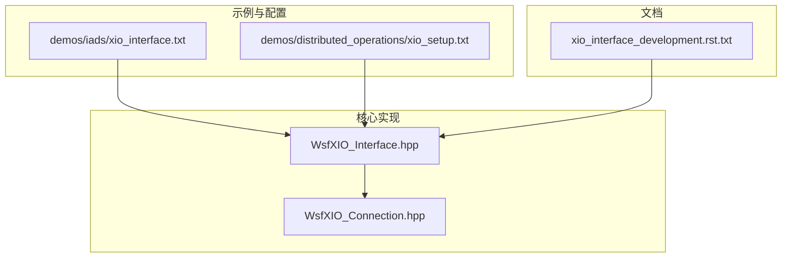
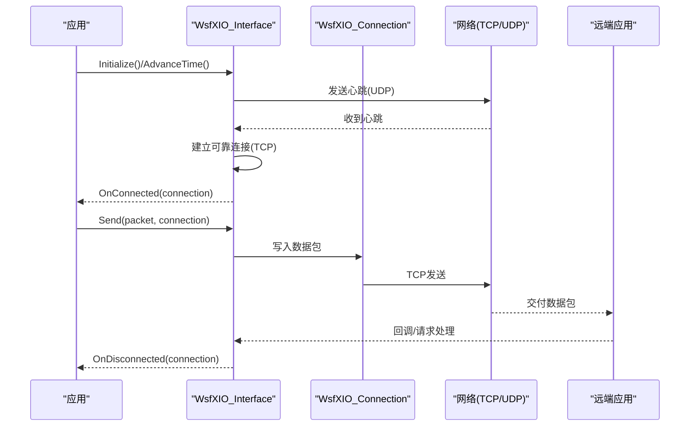
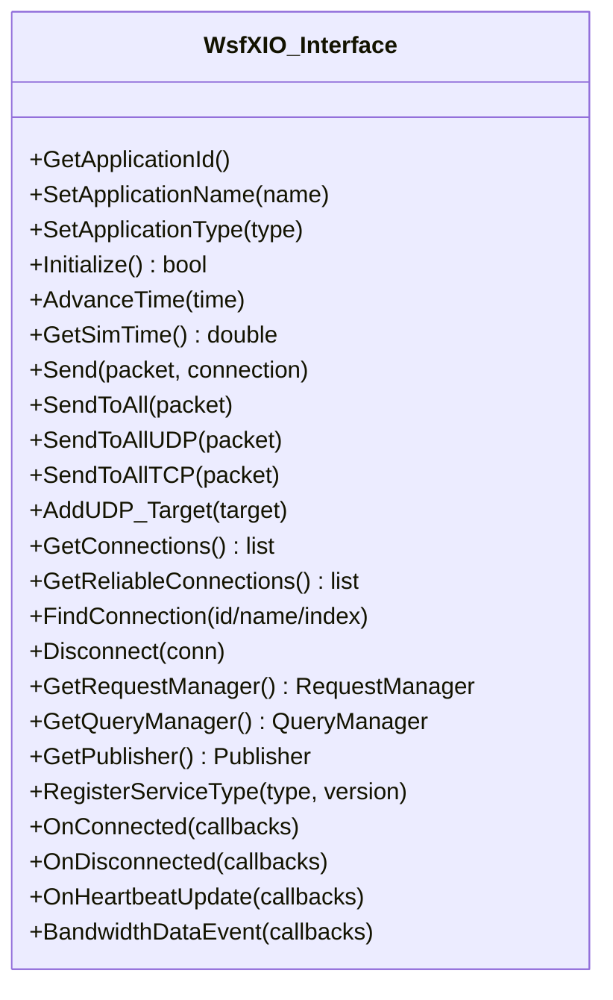
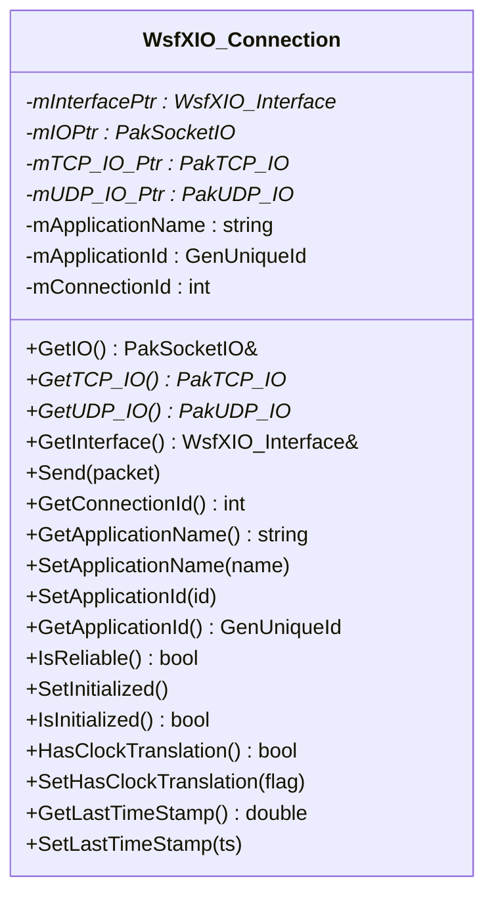
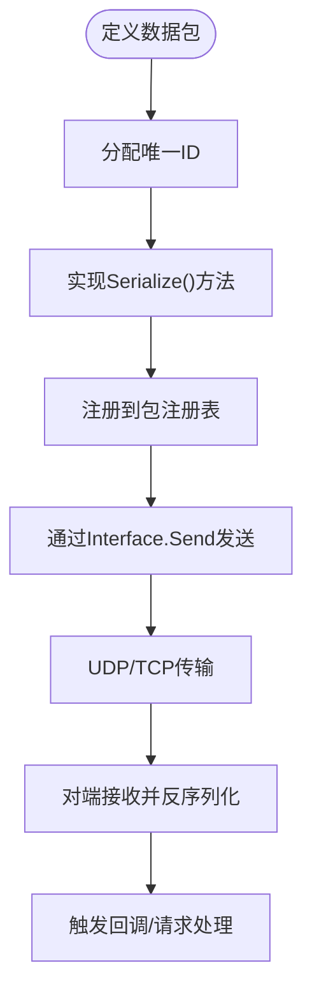
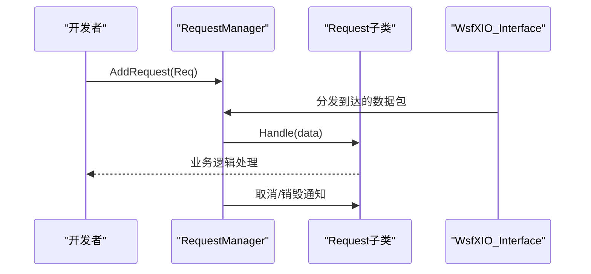
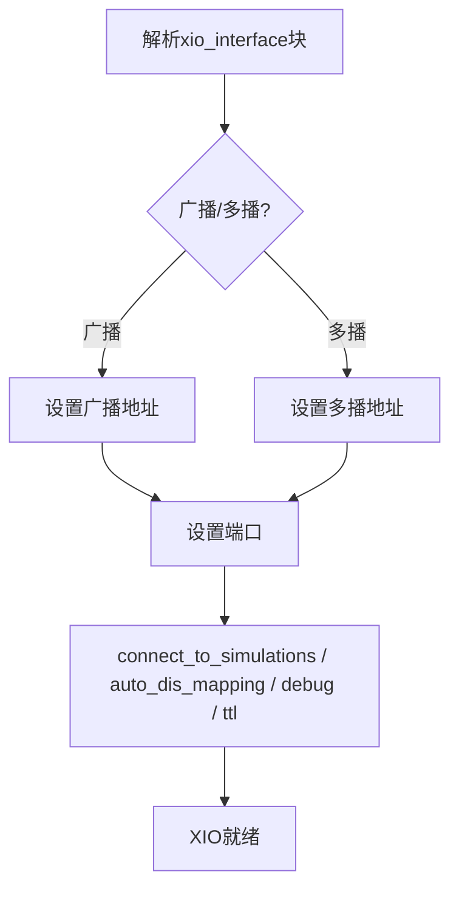
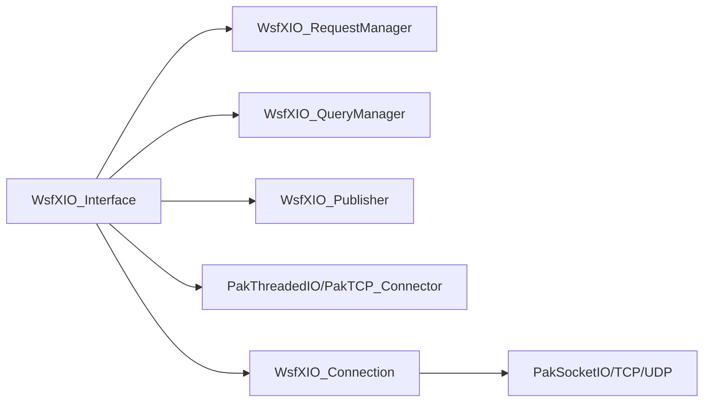

# XIO接口开发

<cite>
**本文引用的文件**   
- [WsfXIO_Interface.hpp](file://swdev/src/core/wsf/source/xio/WsfXIO_Interface.hpp)
- [WsfXIO_Connection.hpp](file://swdev/src/core/wsf/source/xio/WsfXIO_Connection.hpp)
- [xio_interface_development.rst.txt](file://documentation/html/_sources/docs/xio_interface_development.rst.txt)
- [xio_interface.txt](file://demos/iads/xio_interface.txt)
- [xio_setup.txt](file://demos/distributed_operations/xio_setup.txt)
</cite>

## 目录
1. [简介](#简介)
2. [项目结构](#项目结构)
3. [核心组件](#核心组件)
4. [架构总览](#架构总览)
5. [详细组件分析](#详细组件分析)
6. [依赖关系分析](#依赖关系分析)
7. [性能考虑](#性能考虑)
8. [故障排查指南](#故障排查指南)
9. [结论](#结论)
10. [附录](#附录)

## 简介
本指南面向WSF应用开发者，系统性阐述AFSIM的扩展I/O（XIO）接口框架。内容涵盖：
- 架构设计与工作原理：数据流管道、事件驱动模型、可靠/不可靠连接机制
- 编程API与用法：初始化、连接管理、数据包发送与接收、请求与服务
- 自定义处理器开发：数据转换、格式适配与业务逻辑
- 实时数据交换示例：传感器输入与仿真结果输出
- 配置语法与参数：xio_interface命令、广播/多播、端口、TTL等
- 调试与诊断：日志、带宽统计、连接状态回调
- 工业级集成模式与最佳实践

## 项目结构
XIO相关代码位于WSF核心库中，脚本与示例位于demos目录，文档在documentation/html下。关键路径如下：
- 核心实现：swdev/src/core/wsf/source/xio/*
- 示例配置：demos/iads/xio_interface.txt、demos/distributed_operations/xio_setup.txt
- 官方文档：documentation/html/_sources/docs/xio_interface_development.rst.txt

图表来源
- [WsfXIO_Interface.hpp:47-104](file://swdev/src/core/wsf/source/xio/WsfXIO_Interface.hpp#L47-L104)
- [WsfXIO_Connection.hpp:33-68](file://swdev/src/core/wsf/source/xio/WsfXIO_Connection.hpp#L33-L68)
- [xio_interface_development.rst.txt:27-46](file://documentation/html/_sources/docs/xio_interface_development.rst.txt#L27-L46)

章节来源
- [WsfXIO_Interface.hpp:47-104](file://swdev/src/core/wsf/source/xio/WsfXIO_Interface.hpp#L47-L104)
- [WsfXIO_Connection.hpp:33-68](file://swdev/src/core/wsf/source/xio/WsfXIO_Connection.hpp#L33-L68)
- [xio_interface_development.rst.txt:27-46](file://documentation/html/_sources/docs/xio_interface_development.rst.txt#L27-L46)

## 核心组件
- WsfXIO_Interface：XIO通信接口，负责连接管理、心跳、数据包收发、请求/查询/发布服务协调
- WsfXIO_Connection：单条连接的抽象，封装TCP/UDP IO、应用标识、可靠性语义、时钟偏移同步
- 数据包与序列化：通过Serialize()方法定义数据结构在网络上的传输格式
- 请求与服务：以Request/Service模式屏蔽底层消息细节，提供统一访问接口

章节来源
- [WsfXIO_Interface.hpp:47-144](file://swdev/src/core/wsf/source/xio/WsfXIO_Interface.hpp#L47-L144)
- [WsfXIO_Connection.hpp:33-110](file://swdev/src/core/wsf/source/xio/WsfXIO_Connection.hpp#L33-L110)
- [xio_interface_development.rst.txt:38-46](file://documentation/html/_sources/docs/xio_interface_development.rst.txt#L38-L46)

## 架构总览
XIO采用“UDP发现+TCP可靠传输”的混合架构：
- UDP广播/多播用于心跳与发现，建立可靠的TCP连接
- TCP连接保证消息有序且可靠送达
- 事件驱动：OnConnected/OnDisconnected回调、心跳更新、带宽统计事件
- 数据流：Send->PakThreadedIO->网络->对端处理->回调/请求分发

图表来源
- [WsfXIO_Interface.hpp:80-104](file://swdev/src/core/wsf/source/xio/WsfXIO_Interface.hpp#L80-L104)
- [WsfXIO_Interface.hpp:110-134](file://swdev/src/core/wsf/source/xio/WsfXIO_Interface.hpp#L110-L134)
- [WsfXIO_Connection.hpp:67-87](file://swdev/src/core/wsf/source/xio/WsfXIO_Connection.hpp#L67-L87)

## 详细组件分析

### 组件A：WsfXIO_Interface（通信接口）
职责与能力：
- 应用标识与类型设置
- 时间推进与仿真时钟源接入
- 数据包发送（单播/组播/全发）、UDP/TCP广播
- 连接管理（添加/查找/断开）、可靠连接列表
- 回调系统（连接建立/断开、心跳、应用落后、带宽事件）
- 请求管理器、查询管理器、发布者访问入口
- 服务注册与可用性查询

图表来源
- [WsfXIO_Interface.hpp:72-144](file://swdev/src/core/wsf/source/xio/WsfXIO_Interface.hpp#L72-L144)
- [WsfXIO_Interface.hpp:151-181](file://swdev/src/core/wsf/source/xio/WsfXIO_Interface.hpp#L151-L181)

章节来源
- [WsfXIO_Interface.hpp:72-181](file://swdev/src/core/wsf/source/xio/WsfXIO_Interface.hpp#L72-L181)

### 组件B：WsfXIO_Connection（连接对象）
职责与能力：
- 封装底层PakSocketIO/TCP/UDP IO
- 获取关联Interface、应用名/ID、连接ID
- 发送数据包、可靠性判断、初始化状态
- 时钟偏移与同步开关、最后时间戳记录
- 脚本类创建（供脚本层使用）

图表来源
- [WsfXIO_Connection.hpp:49-110](file://swdev/src/core/wsf/source/xio/WsfXIO_Connection.hpp#L49-L110)

章节来源
- [WsfXIO_Connection.hpp:49-110](file://swdev/src/core/wsf/source/xio/WsfXIO_Connection.hpp#L49-L110)

### 组件C：数据包与序列化
- 所有跨网络消息必须定义为“数据包”，包含唯一ID与序列化函数
- 通过Serialize()方法将C++数据结构序列化为字节流
- 默认包集合由WsfXIO_PacketRegistry维护，支持扩展新包类型

图表来源
- [xio_interface_development.rst.txt:38-46](file://documentation/html/_sources/docs/xio_interface_development.rst.txt#L38-L46)

章节来源
- [xio_interface_development.rst.txt:38-46](file://documentation/html/_sources/docs/xio_interface_development.rst.txt#L38-L46)

### 组件D：请求与服务（Requests & Services）
- Service发布信息或功能接口；Request是访问服务的标准方式
- 典型步骤：
  1) 继承所需Request基类（如WsfXIO_TrackRequest）
  2) 将Request加入RequestManager（通常通过WsfXIO::GetInstance()->GetRequestManager().AddRequest(...)）
  3) 使用Request（重写Handle等方法处理数据）
  4) 处理取消与销毁（RequestManager会销毁已取消的Request）

图表来源
- [xio_interface_development.rst.txt:48-68](file://documentation/html/_sources/docs/xio_interface_development.rst.txt#L48-L68)

章节来源
- [xio_interface_development.rst.txt:48-68](file://documentation/html/_sources/docs/xio_interface_development.rst.txt#L48-L68)

### 组件E：配置与脚本（xio_interface）
- xio_interface块用于配置XIO基础参数：广播/多播地址、端口、是否自动映射DIS、TTL、调试开关等
- 示例：
  - demos/iads/xio_interface.txt：多播地址、端口、connect_to_simulations、auto_dis_mapping、time_to_live
  - demos/distributed_operations/xio_setup.txt：广播地址、端口、debug、connect_to_simulations、auto_dis_mapping

图表来源
- [xio_interface.txt:10-20](file://demos/iads/xio_interface.txt#L10-L20)
- [xio_setup.txt:9-15](file://demos/distributed_operations/xio_setup.txt#L9-L15)

章节来源
- [xio_interface.txt:10-20](file://demos/iads/xio_interface.txt#L10-L20)
- [xio_setup.txt:9-15](file://demos/distributed_operations/xio_setup.txt#L9-L15)

## 依赖关系分析
- WsfXIO_Interface依赖：
  - 底层网络：PakThreadedIO、PakTCP_Connector、GenInternetSocketAddress
  - 内部模块：WsfXIO_RequestManager、WsfXIO_QueryManager、WsfXIO_Publisher
  - 回调与计时：UtCallbackListN、UtWallClock
- WsfXIO_Connection依赖：
  - 底层IO：PakSocketIO、PakTCP_IO、PakUDP_IO
  - 标识与类型：GenUniqueId、wsf::xio::ApplicationType
  - 生命周期：与WsfXIO_Interface协作创建/销毁

图表来源
- [WsfXIO_Interface.hpp:23-44](file://swdev/src/core/wsf/source/xio/WsfXIO_Interface.hpp#L23-L44)
- [WsfXIO_Connection.hpp:20-31](file://swdev/src/core/wsf/source/xio/WsfXIO_Connection.hpp#L20-L31)

章节来源
- [WsfXIO_Interface.hpp:23-44](file://swdev/src/core/wsf/source/xio/WsfXIO_Interface.hpp#L23-L44)
- [WsfXIO_Connection.hpp:20-31](file://swdev/src/core/wsf/source/xio/WsfXIO_Connection.hpp#L20-L31)

## 性能考虑
- 使用可靠连接（TCP）进行关键数据，避免丢包与乱序
- 使用不可靠连接（UDP）进行高频心跳与轻量广播
- 批量发送与缓冲：利用SendToAllUDP/SendToAllTCP减少系统调用开销
- 合理设置TTL与广播域，控制网络风暴
- 启用调试与带宽统计，监控吞吐与时延
- 使用专用RequestManager优化高吞吐场景（如轨迹跟踪）

[本节为通用指导，不直接分析具体文件]

## 故障排查指南
常见问题与定位要点：
- 无法建立可靠连接：检查广播/多播地址与端口一致性、防火墙策略、connect_to_simulations配置
- 消息未到达：确认数据包已注册、序列化正确、目标连接存在且已初始化
- 时序错乱：检查时钟偏移与同步开关、仿真时间推进与AdvanceTime调用
- 性能瓶颈：观察带宽事件回调、调整发送频率与批量化策略
- 调试信息：启用debug开关，查看连接状态与心跳更新回调

章节来源
- [WsfXIO_Interface.hpp:110-134](file://swdev/src/core/wsf/source/xio/WsfXIO_Interface.hpp#L110-L134)
- [WsfXIO_Interface.hpp:172-181](file://swdev/src/core/wsf/source/xio/WsfXIO_Interface.hpp#L172-L181)
- [xio_setup.txt:9-15](file://demos/distributed_operations/xio_setup.txt#L9-L15)

## 结论
XIO为AFSIM提供了强大的跨应用通信能力，结合UDP发现与TCP可靠传输，形成稳定高效的数据管道。通过清晰的接口设计（Interface/Connection）、可扩展的包与序列化机制、以及请求/服务模式，开发者可以便捷地构建分布式仿真系统与实时数据交换方案。配合合理的配置与性能调优，XIO可支撑工业级复杂场景的集成需求。

[本节为总结性内容，不直接分析具体文件]

## 附录
- 快速上手清单：
  - 初始化XIO：调用WsfXIO::Create()，指定选项与应用类型
  - 配置xio_interface：设置广播/多播、端口、TTL、调试开关
  - 发送数据：构造数据包并调用Interface.Send
  - 订阅事件：注册OnConnected/OnDisconnected、心跳与带宽回调
  - 使用请求：继承Request、加入RequestManager、实现Handle
- 参考示例：
  - IADS示例：demos/iads/xio_interface.txt
  - 分布式操作示例：demos/distributed_operations/xio_setup.txt
  - 开发文档：documentation/html/_sources/docs/xio_interface_development.rst.txt

章节来源
- [xio_interface_development.rst.txt:27-46](file://documentation/html/_sources/docs/xio_interface_development.rst.txt#L27-L46)
- [xio_interface.txt:10-20](file://demos/iads/xio_interface.txt#L10-L20)
- [xio_setup.txt:9-15](file://demos/distributed_operations/xio_setup.txt#L9-L15)