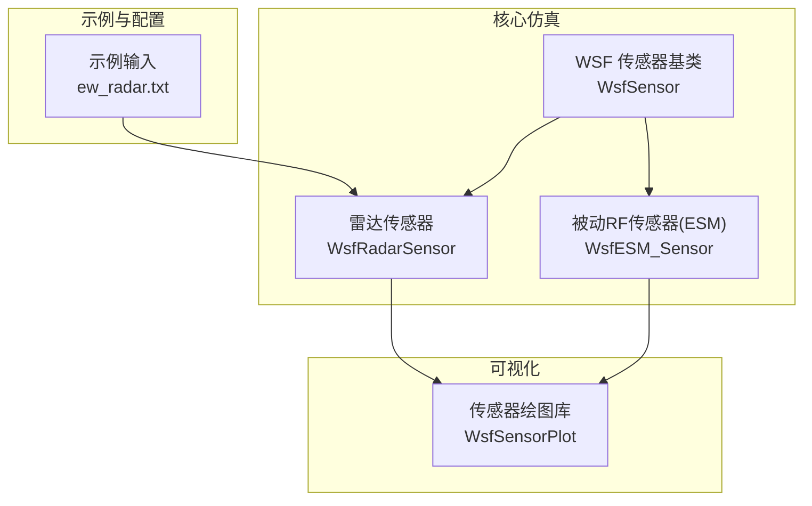
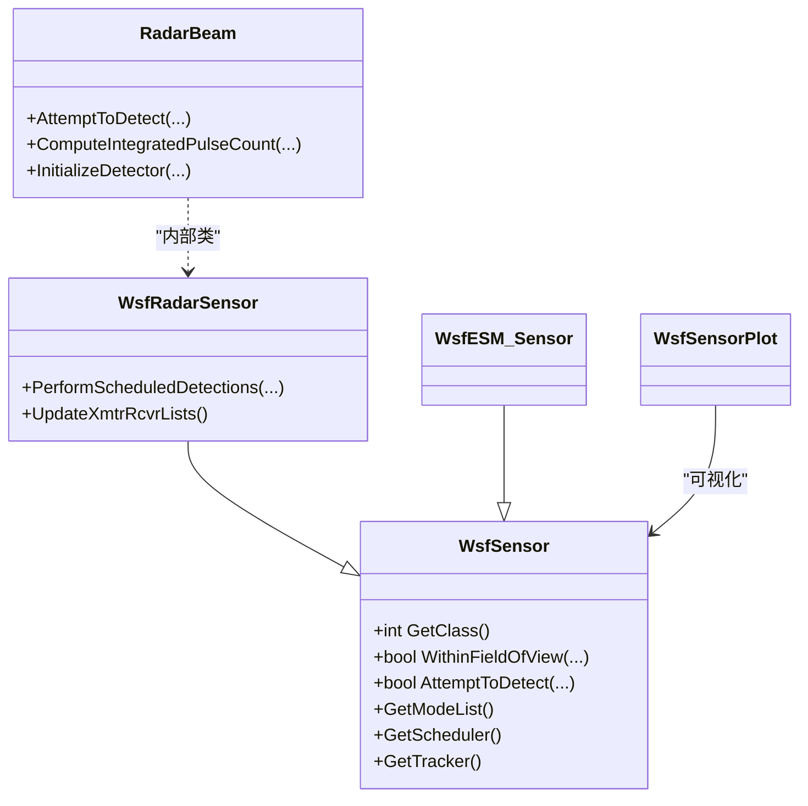
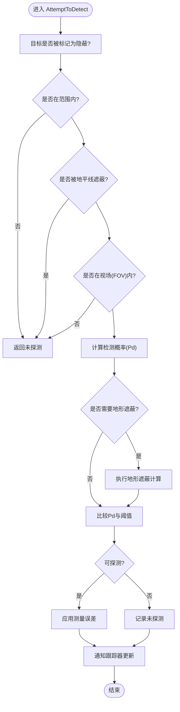
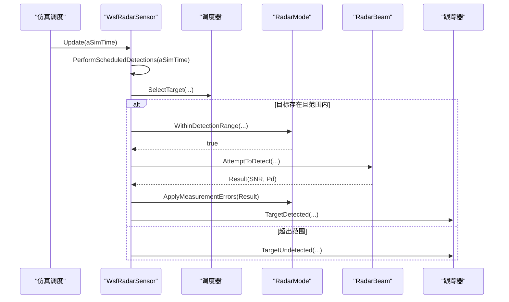
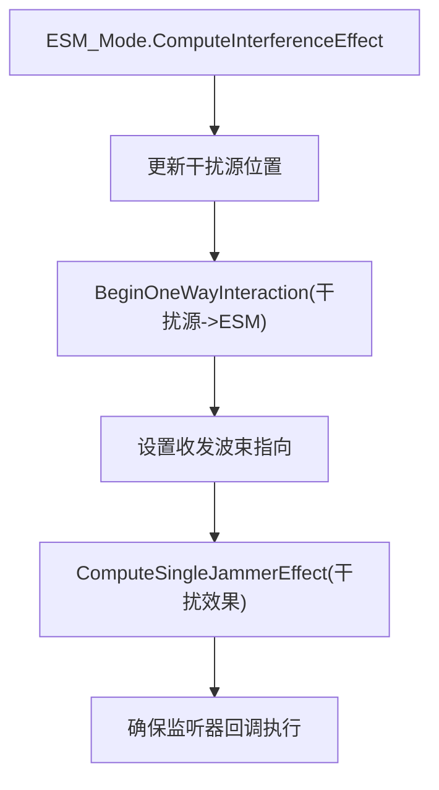
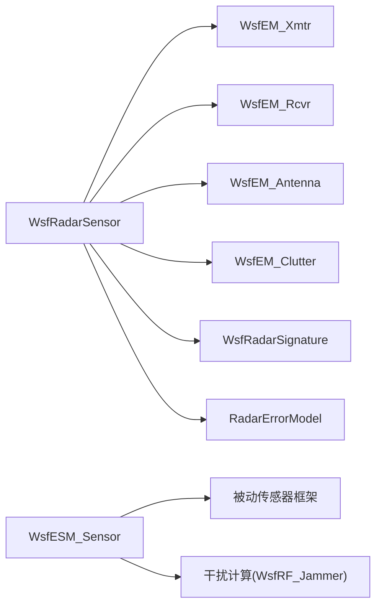
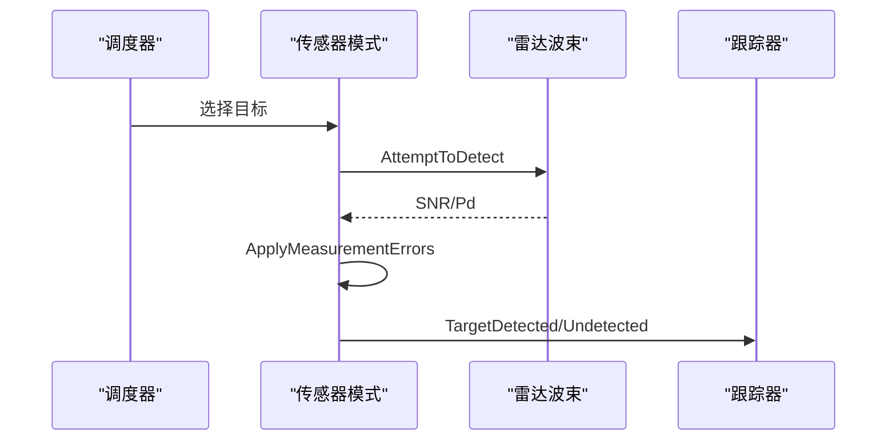

# 传感器插件开发

<cite>
**本文引用的文件**   
- [WsfSensor.hpp](file://swdev/src/core/wsf/source/sensor/WsfSensor.hpp)
- [WsfSensor.cpp](file://swdev/src/core/wsf/source/sensor/WsfSensor.cpp)
- [WsfRadarSensor.hpp](file://swdev/src/core/wsf/source/sensor/WsfRadarSensor.hpp)
- [WsfRadarSensor.cpp](file://swdev/src/core/wsf/source/sensor/WsfRadarSensor.cpp)
- [WsfESM_Sensor.hpp](file://swdev/src/core/wsf_mil/source/sensor/WsfESM_Sensor.hpp)
- [WsfESM_Sensor.cpp](file://swdev/src/core/wsf_mil/source/sensor/WsfESM_Sensor.cpp)
- [sensor_plot_lib WsfSensorPlot.hpp](file://swdev/src/core/sensor_plot_lib/source/WsfSensorPlot.hpp)
- [sensor_plot_lib WsfSensorPlot.cpp](file://swdev/src/core/sensor_plot_lib/source/WsfSensorPlot.cpp)
- [示例输入 ew_radar.txt](file://demos/suppressor/README.md)
</cite>

## 目录
1. [引言](#引言)
2. [项目结构](#项目结构)
3. [核心组件](#核心组件)
4. [架构总览](#架构总览)
5. [详细组件分析](#详细组件分析)
6. [依赖关系分析](#依赖关系分析)
7. [性能与复杂度](#性能与复杂度)
8. [故障排查指南](#故障排查指南)
9. [结论](#结论)
10. [附录：开发流程与示例](#附录开发流程与示例)

## 引言
本技术文档面向AFSIM传感器插件开发者，系统阐述基于WsfSensor基类的传感器建模框架、探测算法流程、数据格式与可视化支持。文档覆盖雷达、红外、电子支援措施（ESM）等典型传感器的实现要点，说明信号传播、噪声模型与检测概率的数学建模方法，并给出从原始探测到目标跟踪的完整数据链路。同时提供传感器插件的开发步骤、参数配置与结果验证建议，以及多传感器融合的技术要点。

## 项目结构
AFSIM中传感器相关代码主要位于core/wsf与core/wsf_mil模块，可视化支持在core/sensor_plot_lib模块，示例场景与输入定义在demos目录。

图表来源
- [WsfSensor.hpp:45-90](file://swdev/src/core/wsf/source/sensor/WsfSensor.hpp#L45-L90)
- [WsfRadarSensor.hpp:32-67](file://swdev/src/core/wsf/source/sensor/WsfRadarSensor.hpp#L32-L67)
- [WsfESM_Sensor.hpp:21-30](file://swdev/src/core/wsf_mil/source/sensor/WsfESM_Sensor.hpp#L21-L30)
- [sensor_plot_lib WsfSensorPlot.hpp:24](file://swdev/src/core/sensor_plot_lib/source/WsfSensorPlot.hpp#L24)

章节来源
- [WsfSensor.hpp:45-90](file://swdev/src/core/wsf/source/sensor/WsfSensor.hpp#L45-L90)
- [WsfRadarSensor.hpp:32-67](file://swdev/src/core/wsf/source/sensor/WsfRadarSensor.hpp#L32-L67)
- [WsfESM_Sensor.hpp:21-30](file://swdev/src/core/wsf_mil/source/sensor/WsfESM_Sensor.hpp#L21-L30)
- [sensor_plot_lib WsfSensorPlot.hpp:24](file://swdev/src/core/sensor_plot_lib/source/WsfSensorPlot.hpp#L24)

## 核心组件
- WsfSensor：所有传感器的抽象基类，定义分类（主动/半主动/被动）、频谱（射频/红外/可见光/声学）、成像能力、模式管理、调度器/跟踪器接口、FOV判断、消息参数、线程安全标记、随机数流、脚本扩展点等。
- WsfRadarSensor：雷达传感器专用实现，封装发射机/接收机、波束、杂波、脉冲压缩、Marcum-Swerling检测器、检测概率表、误差模型等。
- WsfESM_Sensor：被动RF传感器（RWR/ELINT/COMINT），继承自被动传感器基类，提供干扰交互与监听机制。
- WsfSensorPlot：传感器可视化库，提供对传感器状态、包络、轨迹等的绘图接口。

章节来源
- [WsfSensor.hpp:98-128](file://swdev/src/core/wsf/source/sensor/WsfSensor.hpp#L98-L128)
- [WsfRadarSensor.hpp:64-198](file://swdev/src/core/wsf/source/sensor/WsfRadarSensor.hpp#L64-L198)
- [WsfESM_Sensor.hpp:21-30](file://swdev/src/core/wsf_mil/source/sensor/WsfESM_Sensor.hpp#L21-L30)
- [sensor_plot_lib WsfSensorPlot.hpp:24](file://swdev/src/core/sensor_plot_lib/source/WsfSensorPlot.hpp#L24)

## 架构总览
WsfSensor作为平台部件，通过“模式列表”组织不同工作模式；每个模式实现具体的探测逻辑。调度器决定何时对哪些目标进行探测尝试，跟踪器根据探测结果创建/更新/删除航迹。雷达传感器将探测过程细化为波束级计算，包含收发链路、杂波、信号处理链路与检测概率评估。

图表来源
- [WsfSensor.hpp:192-213](file://swdev/src/core/wsf/source/sensor/WsfSensor.hpp#L192-L213)
- [WsfRadarSensor.hpp:64-198](file://swdev/src/core/wsf/source/sensor/WsfRadarSensor.hpp#L64-L198)
- [WsfESM_Sensor.hpp:21-30](file://swdev/src/core/wsf_mil/source/sensor/WsfESM_Sensor.hpp#L21-L30)
- [sensor_plot_lib WsfSensorPlot.hpp:24](file://swdev/src/core/sensor_plot_lib/source/WsfSensorPlot.hpp#L24)

## 详细组件分析

### WsfSensor基类架构
- 探测算法框架
  - 统一入口：AttemptToDetect调用当前模式的AttemptToDetect。
  - 标准探测流程：先做低成本检查（遮蔽、范围、FOV），再计算检测概率，最后进行地形遮蔽等高成本操作。
  - 可选优化：Settings.mRequiredPd用于提前剪枝（若所需Pd不满足则跳过昂贵计算）。
- 数据格式与结果
  - WsfSensorResult承载几何、RCS、信噪比、检测概率、失败/检查标志等。
  - 测量误差由模式层ApplyMeasurementErrors注入。
- 可视化支持
  - 通过观察者与脚本上下文触发事件，便于外部工具（如WsfSensorPlot）订阅与渲染。
- 调度与跟踪
  - 默认使用WsfDefaultSensorScheduler与WsfDefaultSensorTracker，分别负责探测时机选择与航迹生命周期管理。
- 分类与特性
  - 枚举cACTIVE/cSEMI_ACTIVE/cPASSIVE与cRADIO/cINFRARED/cVISUAL/cACOUSTIC/cIMAGING标识传感器类型与能力。

图表来源
- [WsfSensor.hpp:71-84](file://swdev/src/core/wsf/source/sensor/WsfSensor.hpp#L71-L84)
- [WsfSensor.cpp:224-235](file://swdev/src/core/wsf/source/sensor/WsfSensor.cpp#L224-L235)

章节来源
- [WsfSensor.hpp:45-90](file://swdev/src/core/wsf/source/sensor/WsfSensor.hpp#L45-L90)
- [WsfSensor.hpp:130-171](file://swdev/src/core/wsf/source/sensor/WsfSensor.hpp#L130-L171)
- [WsfSensor.cpp:224-235](file://swdev/src/core/wsf/source/sensor/WsfSensor.cpp#L224-L235)

### 雷达传感器（WsfRadarSensor）
- 架构要点
  - 继承WsfSensor，设置分类为主动射频传感器，并提供默认调度器与跟踪器。
  - 内部RadarMode与RadarBeam：模式管理波束集合；波束封装天线、发射机、接收机、杂波、检测器等。
  - 支持单/多波束、频率捷变、脉冲压缩、积分增益、后锁定检测阈值调整。
- 探测流程
  - PerformScheduledDetections按调度器选择目标，调用AttemptToDetect，应用误差并交由跟踪器处理。
  - RadarBeam::AttemptToDetect完成双向链路计算：RCS获取、两向功率计算、杂波、信号处理、信噪比、检测概率（表格或Marcum-Swerling）。
- 数据与误差
  - 支持DetectionProbabilityTable与MarcumSwerling两种检测概率模型。
  - 误差模型通过模式层ApplyMeasurementErrors注入（具体实现见误差模型类）。
- 可视化和输出
  - 可通过WsfSensorPlot绘制包络、轨迹、灵敏度曲线等。

图表来源
- [WsfRadarSensor.cpp:299-308](file://swdev/src/core/wsf/source/sensor/WsfRadarSensor.cpp#L299-L308)
- [WsfRadarSensor.cpp:318-428](file://swdev/src/core/wsf/source/sensor/WsfRadarSensor.cpp#L318-L428)
- [WsfRadarSensor.cpp:561-756](file://swdev/src/core/wsf/source/sensor/WsfRadarSensor.cpp#L561-L756)

章节来源
- [WsfRadarSensor.hpp:32-67](file://swdev/src/core/wsf/source/sensor/WsfRadarSensor.hpp#L32-L67)
- [WsfRadarSensor.hpp:64-198](file://swdev/src/core/wsf/source/sensor/WsfRadarSensor.hpp#L64-L198)
- [WsfRadarSensor.cpp:54-70](file://swdev/src/core/wsf/source/sensor/WsfRadarSensor.cpp#L54-L70)
- [WsfRadarSensor.cpp:299-308](file://swdev/src/core/wsf/source/sensor/WsfRadarSensor.cpp#L299-L308)
- [WsfRadarSensor.cpp:318-428](file://swdev/src/core/wsf/source/sensor/WsfRadarSensor.cpp#L318-L428)
- [WsfRadarSensor.cpp:561-756](file://swdev/src/core/wsf/source/sensor/WsfRadarSensor.cpp#L561-L756)

### 电子支援措施（WsfESM_Sensor）
- 定位与用途
  - 被动RF传感器，适用于RWR、ELINT、COMINT功能建模。
  - 继承被动传感器基类，提供侦听与干扰交互能力。
- 关键行为
  - ESM_Mode::ComputeInterferenceEffect强制对干扰源进行一次单向交互，确保监听器回调被执行，从而在雷达探测帧率低于ESM帧率时仍能感知干扰。
  - UseListenerForInterferer针对武器载具的可动波束采用监听方式检测干扰。

图表来源
- [WsfESM_Sensor.cpp:51-71](file://swdev/src/core/wsf_mil/source/sensor/WsfESM_Sensor.cpp#L51-L71)

章节来源
- [WsfESM_Sensor.hpp:21-30](file://swdev/src/core/wsf_mil/source/sensor/WsfESM_Sensor.hpp#L21-L30)
- [WsfESM_Sensor.cpp:24-36](file://swdev/src/core/wsf_mil/source/sensor/WsfESM_Sensor.cpp#L24-L36)
- [WsfESM_Sensor.cpp:51-71](file://swdev/src/core/wsf_mil/source/sensor/WsfESM_Sensor.cpp#L51-L71)
- [WsfESM_Sensor.cpp:76-89](file://swdev/src/core/wsf_mil/source/sensor/WsfESM_Sensor.cpp#L76-L89)

### 可视化支持（WsfSensorPlot）
- 作用
  - 提供传感器相关的绘图函数与扩展点，用于可视化传感器包络、轨迹、灵敏度等。
- 集成
  - 通过ApplicationExtension注册，与传感器对象交互以获取绘图变量。

章节来源
- [sensor_plot_lib WsfSensorPlot.hpp:24](file://swdev/src/core/sensor_plot_lib/source/WsfSensorPlot.hpp#L24)
- [sensor_plot_lib WsfSensorPlot.cpp:54](file://swdev/src/core/sensor_plot_lib/source/WsfSensorPlot.cpp#L54)

## 依赖关系分析
- 组件耦合
  - WsfRadarSensor依赖WsfEM_Xmtr/WsfEM_Rcvr/WsfEM_Antenna/WsfEM_Clutter等电磁组件，以及WsfRadarSignature/RadarErrorModel等签名与误差模型。
  - WsfESM_Sensor依赖被动传感器框架与干扰计算模块。
- 外部接口
  - 通过WsfObserver与脚本上下文暴露事件，供外部工具（如WsfSensorPlot）订阅。
- 潜在循环依赖
  - 传感器与调度器/跟踪器之间通过指针协作，但无直接头文件循环引用。

图表来源
- [WsfRadarSensor.hpp:20-30](file://swdev/src/core/wsf/source/sensor/WsfRadarSensor.hpp#L20-L30)
- [WsfRadarSensor.cpp:32-45](file://swdev/src/core/wsf/source/sensor/WsfRadarSensor.cpp#L32-L45)
- [WsfESM_Sensor.cpp:17-21](file://swdev/src/core/wsf_mil/source/sensor/WsfESM_Sensor.cpp#L17-L21)

章节来源
- [WsfRadarSensor.hpp:20-30](file://swdev/src/core/wsf/source/sensor/WsfRadarSensor.hpp#L20-L30)
- [WsfRadarSensor.cpp:32-45](file://swdev/src/core/wsf/source/sensor/WsfRadarSensor.cpp#L32-L45)
- [WsfESM_Sensor.cpp:17-21](file://swdev/src/core/wsf_mil/source/sensor/WsfESM_Sensor.cpp#L17-L21)

## 性能与复杂度
- 探测流程优化
  - 低成本检查优先（隐蔽、范围、地平线遮蔽、FOV），地形遮蔽等高成本操作延后，减少不必要计算。
  - Settings.mRequiredPd用于提前剪枝，避免昂贵的地形遮蔽计算。
- 雷达链路计算
  - 两向功率计算、杂波功率、信号处理链、信噪比与检测概率评估构成主要开销；多波束与多目标情况下需关注调度粒度。
- 跟踪与调度
  - 默认调度器与跟踪器提供通用扫描/跟踪策略；可根据场景调整update_interval与调度策略以降低负载。

章节来源
- [WsfSensor.hpp:71-84](file://swdev/src/core/wsf/source/sensor/WsfSensor.hpp#L71-L84)
- [WsfRadarSensor.cpp:561-756](file://swdev/src/core/wsf/source/sensor/WsfRadarSensor.cpp#L561-L756)

## 故障排查指南
- 常见问题
  - 传感器未产生探测机会：检查TurnOn/TurnOff状态、update_interval设置、调度器是否启用。
  - 探测结果为空：确认目标类别/侧别/域是否被忽略（ignore_category/ignore_side/ignore_domain）。
  - 雷达检测概率异常：核查发射/接收参数、天线增益、带宽、噪声功率、杂波模型、检测器配置（表格或Marcum-Swerling）。
  - ESM未检测到干扰：确认ComputeInterferenceEffect是否执行，监听器回调是否生效。
- 调试手段
  - 启用show_calibration_data输出校准信息。
  - 使用debug_scheduler查看调度细节。
  - 通过WsfSensorPlot可视化包络与轨迹辅助定位问题。

章节来源
- [WsfSensor.cpp:380-489](file://swdev/src/core/wsf/source/sensor/WsfSensor.cpp#L380-L489)
- [WsfRadarSensor.cpp:760-800](file://swdev/src/core/wsf/source/sensor/WsfRadarSensor.cpp#L760-L800)
- [WsfESM_Sensor.cpp:51-71](file://swdev/src/core/wsf_mil/source/sensor/WsfESM_Sensor.cpp#L51-L71)

## 结论
WsfSensor提供了统一的传感器抽象与探测框架，结合调度器与跟踪器形成完整的探测-跟踪闭环。WsfRadarSensor实现了雷达探测的完整链路，涵盖收发链路、杂波、信号处理与检测概率评估；WsfESM_Sensor提供被动RF侦听与干扰交互能力。借助WsfSensorPlot可实现传感器结果的可视化与分析。通过合理配置参数与优化探测流程，可在保证精度的前提下提升仿真效率。

## 附录：开发流程与示例

### 传感器方程与数学建模要点
- 信号传播
  - 两向链路：发射功率、天线增益、路径损耗、目标RCS、接收天线增益、系统损耗。
  - 脉冲压缩与积分增益：提升有效信噪比。
- 噪声与杂波
  - 接收机噪声功率、环境噪声、杂波功率（由WsfEM_Clutter计算）。
- 检测概率
  - 固定阈值二元检测、检测概率表插值、Marcum-Swerling模型。
- 误差模型
  - 方位/俯仰波束宽度、脉冲宽度、多普勒分辨率等误差注入。

章节来源
- [WsfRadarSensor.cpp:617-756](file://swdev/src/core/wsf/source/sensor/WsfRadarSensor.cpp#L617-L756)

### 传感器数据生成与处理链路
- 原始探测
  - 调度器选择目标，传感器模式执行AttemptToDetect，得到SNR与Pd。
- 误差注入
  - 模式层ApplyMeasurementErrors添加测量误差。
- 跟踪管理
  - 跟踪器根据检测结果创建/更新/删除航迹，发送TrackUpdate/TrackDrop消息。

图表来源
- [WsfRadarSensor.cpp:318-428](file://swdev/src/core/wsf/source/sensor/WsfRadarSensor.cpp#L318-L428)

### 传感器插件开发示例（雷达）
- 步骤
  - 定义传感器类型与模式：继承WsfSensor，设置分类与模式列表。
  - 实现模式探测：重写AttemptToDetect，遵循低成本检查优先原则。
  - 配置收发与波束：设置天线、发射机、接收机、杂波与检测器。
  - 接入调度与跟踪：使用默认调度器与跟踪器，或自定义策略。
  - 可视化与验证：使用WsfSensorPlot绘制包络与轨迹，对比理论曲线。
- 参数配置参考
  - 示例输入文件展示雷达传感器基本参数（天线、发射/接收、检测概率、跟踪参数等）。

章节来源
- [示例输入 ew_radar.txt](file://demos/suppressor/README.md)

### 多传感器融合要点
- 数据对齐
  - 时间同步、坐标系统一、航迹ID关联。
- 置信度融合
  - 基于Pd/SNR加权、质量因子（track_quality）融合。
- 冲突消解
  - 多源航迹去重、优先级规则、一致性检验。
- 可视化
  - 使用WsfSensorPlot对不同传感器结果进行叠加显示，辅助分析融合效果。

[本节为概念性内容，不直接分析具体文件]