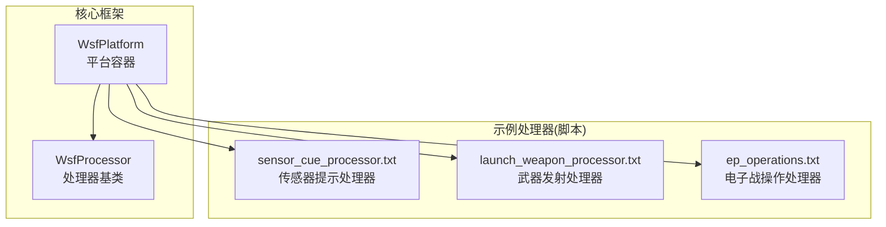
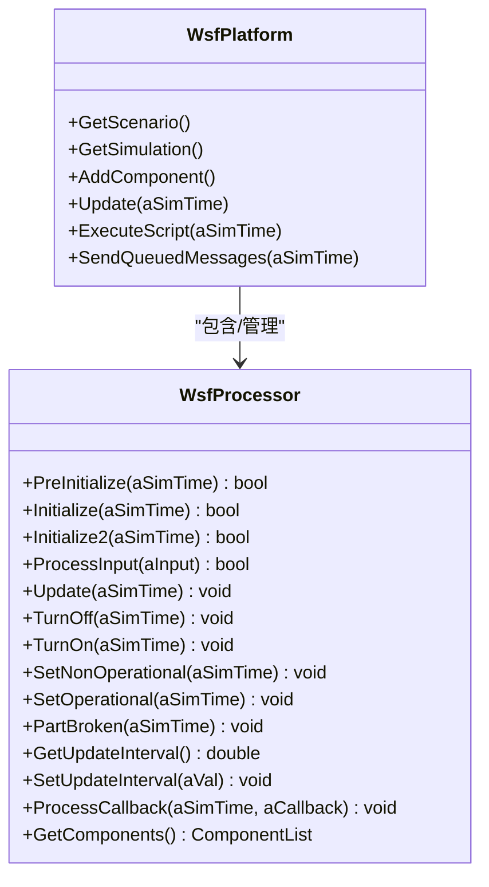
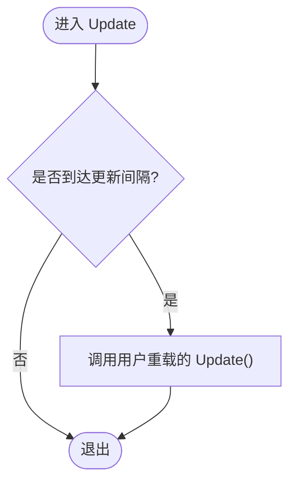
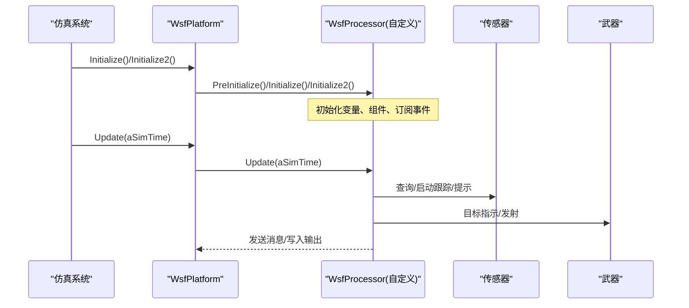
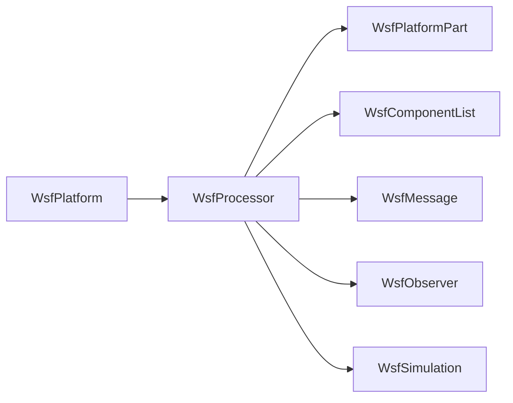
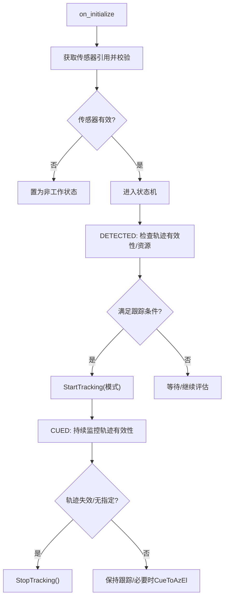
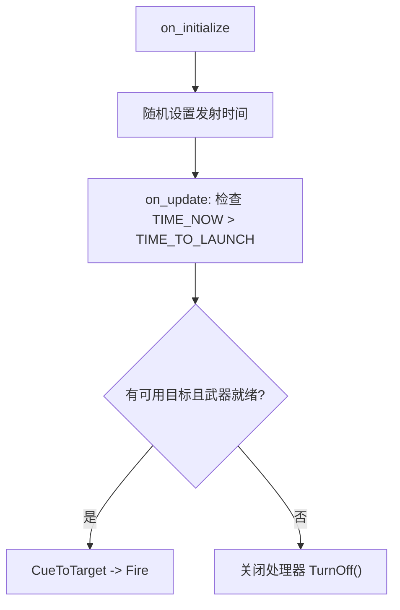
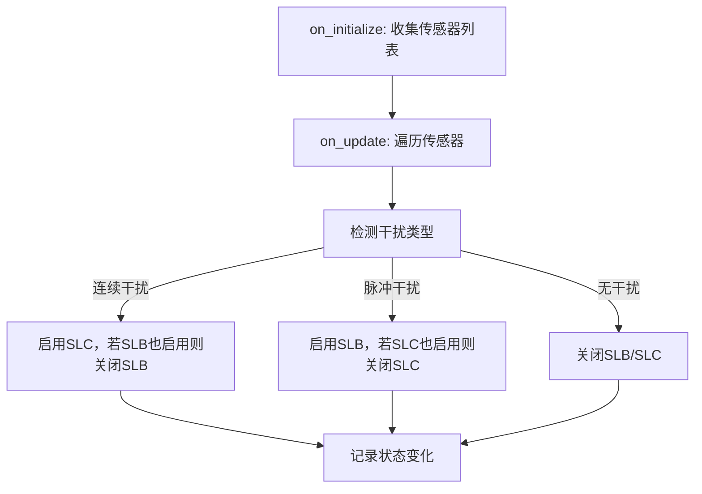
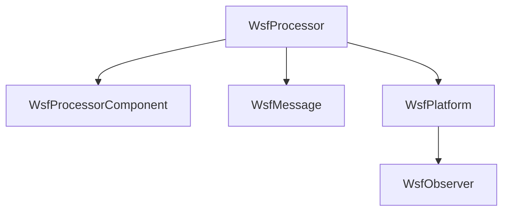

# 处理器开发指南

<cite>
**本文引用的文件**   
- [WsfProcessor.hpp](file://swdev/src/core/wsf/source/processor/WsfProcessor.hpp)
- [WsfProcessor.cpp](file://swdev/src/core/wsf/source/processor/WsfProcessor.cpp)
- [WsfPlatform.hpp](file://swdev/src/core/wsf/source/WsfPlatform.hpp)
- [sensor_cue_processor.txt](file://demos/air_to_air/processors/sensor_cue_processor.txt)
- [launch_weapon_processor.txt](file://demos/ballistic/processors/launch_weapon_processor.txt)
- [ep_operations.txt](file://demos/base_types/processors/ep_operations.txt)
</cite>

## 目录
1. [简介](#简介)
2. [项目结构](#项目结构)
3. [核心组件](#核心组件)
4. [架构总览](#架构总览)
5. [详细组件分析](#详细组件分析)
6. [依赖关系分析](#依赖关系分析)
7. [性能与线程安全](#性能与线程安全)
8. [配置语法与参数定义](#配置语法与参数定义)
9. [处理器类型与示例](#处理器类型与示例)
10. [调试与排错](#调试与排错)
11. [结论](#结论)

## 简介
本指南面向AFSIM中“处理器（Processor）”的开发，围绕WsfProcessor基类的架构设计、事件处理接口、状态管理、线程安全机制展开，并给出从类继承到方法实现的完整流程。文档同时说明处理器与平台对象的交互模式（属性访问、事件订阅、消息传递），解释处理器配置语法与参数定义，并提供传感器、武器、行为三类处理器的开发示例，最后总结性能优化技巧与错误处理最佳实践。

## 项目结构
- WsfProcessor位于核心WSF框架的处理器子系统，提供处理器生命周期、更新调度、组件容器、状态切换等基础能力。
- 平台对象WsfPlatform作为容器，承载处理器、传感器、通信、武器等系统部件。
- 示例处理器脚本位于demos目录，展示基于脚本的处理器实现方式。

**图示来源** 
- [WsfPlatform.hpp:66-114](file://swdev/src/core/wsf/source/WsfPlatform.hpp#L66-L114)
- [WsfProcessor.hpp:27-38](file://swdev/src/core/wsf/source/processor/WsfProcessor.hpp#L27-L38)
- [sensor_cue_processor.txt:24-52](file://demos/air_to_air/processors/sensor_cue_processor.txt#L24-L52)
- [launch_weapon_processor.txt:17-33](file://demos/ballistic/processors/launch_weapon_processor.txt#L17-L33)
- [ep_operations.txt:23-38](file://demos/base_types/processors/ep_operations.txt#L23-L38)

**章节来源**
- [WsfPlatform.hpp:66-114](file://swdev/src/core/wsf/source/WsfPlatform.hpp#L66-L114)
- [WsfProcessor.hpp:27-38](file://swdev/src/core/wsf/source/processor/WsfProcessor.hpp#L27-L38)

## 核心组件
- WsfProcessor：处理器基类，封装了处理器在平台中的生命周期、周期性更新、输入命令处理、组件列表、状态切换（开/关/非作战/可工作/损坏）以及回调处理。
- WsfPlatform：平台对象，作为容器持有处理器、传感器、通信、武器等部件，并提供统一的初始化、更新、脚本执行、消息发送等接口。

关键职责划分：
- WsfProcessor负责“行为逻辑”的执行入口和扩展点（如Update、ProcessInput、ProcessCallback）。
- WsfPlatform负责“系统编排”，按序调用各部件的初始化与更新，并维护平台级上下文（场景、仿真时间、脚本上下文等）。

**章节来源**
- [WsfProcessor.hpp:27-38](file://swdev/src/core/wsf/source/processor/WsfProcessor.hpp#L27-L38)
- [WsfPlatform.hpp:66-114](file://swdev/src/core/wsf/source/WsfPlatform.hpp#L66-L114)

## 架构总览
下图展示了处理器在平台中的位置及其与仿真系统的交互关系。

**图示来源**
- [WsfPlatform.hpp:148-206](file://swdev/src/core/wsf/source/WsfPlatform.hpp#L148-L206)
- [WsfProcessor.hpp:60-92](file://swdev/src/core/wsf/source/processor/WsfProcessor.hpp#L60-L92)

## 详细组件分析

### WsfProcessor基类分析
- 生命周期钩子：PreInitialize/Initialize/Initialize2，用于分阶段初始化；其中Initialize会绑定update_interval变量并初始化组件。
- 输入处理：ProcessInput支持update_interval指令，并委托给已附加组件或动态工厂创建新组件。
- 状态管理：TurnOff/TurnOn/SetNonOperational/SetOperational/PartBroken，统一触发观察者通知。
- 更新调度：Update为虚函数，默认空实现；通过SetUpdateInterval控制周期性调用。
- 组件容器：GetComponents返回处理器内嵌的组件列表，支持组件工厂注入。
- 回调处理：ProcessCallback用于平台执行回调时的通知。

**图示来源**
- [WsfProcessor.cpp:115-121](file://swdev/src/core/wsf/source/processor/WsfProcessor.cpp#L115-L121)
- [WsfProcessor.cpp:223-233](file://swdev/src/core/wsf/source/processor/WsfProcessor.cpp#L223-L233)

**章节来源**
- [WsfProcessor.hpp:60-92](file://swdev/src/core/wsf/source/processor/WsfProcessor.hpp#L60-L92)
- [WsfProcessor.cpp:70-121](file://swdev/src/core/wsf/source/processor/WsfProcessor.cpp#L70-L121)
- [WsfProcessor.cpp:125-159](file://swdev/src/core/wsf/source/processor/WsfProcessor.cpp#L125-L159)
- [WsfProcessor.cpp:169-241](file://swdev/src/core/wsf/source/processor/WsfProcessor.cpp#L169-L241)

### 处理器与平台的交互模式
- 属性访问：处理器可通过平台提供的API访问自身所属平台（例如获取传感器、武器、跟踪列表等）。
- 事件订阅：处理器可订阅平台相关事件（如轨道新增/删除、平台添加/删除等），在回调中执行业务逻辑。
- 消息传递：处理器可通过平台的消息队列发送消息到其他处理器或平台。

**图示来源**
- [WsfPlatform.hpp:148-206](file://swdev/src/core/wsf/source/WsfPlatform.hpp#L148-L206)
- [WsfProcessor.cpp:70-121](file://swdev/src/core/wsf/source/processor/WsfProcessor.cpp#L70-L121)

**章节来源**
- [WsfPlatform.hpp:148-206](file://swdev/src/core/wsf/source/WsfPlatform.hpp#L148-L206)
- [WsfProcessor.cpp:70-121](file://swdev/src/core/wsf/source/processor/WsfProcessor.cpp#L70-L121)

## 依赖关系分析
- WsfProcessor依赖WsfPlatformPart（平台部件基类）、WsfComponentList（组件列表）、WsfMessage（消息）、WsfObserver（观察者）、WsfSimulation（仿真上下文）。
- WsfPlatform作为容器，聚合多个组件（包括处理器），并在仿真主循环中协调其生命周期与更新顺序。

**图示来源**
- [WsfProcessor.hpp:17-25](file://swdev/src/core/wsf/source/processor/WsfProcessor.hpp#L17-L25)
- [WsfProcessor.cpp:12-22](file://swdev/src/core/wsf/source/processor/WsfProcessor.cpp#L12-L22)
- [WsfPlatform.hpp:108-114](file://swdev/src/core/wsf/source/WsfPlatform.hpp#L108-L114)

**章节来源**
- [WsfProcessor.hpp:17-25](file://swdev/src/core/wsf/source/processor/WsfProcessor.hpp#L17-L25)
- [WsfProcessor.cpp:12-22](file://swdev/src/core/wsf/source/processor/WsfProcessor.cpp#L12-L22)
- [WsfPlatform.hpp:108-114](file://swdev/src/core/wsf/source/WsfPlatform.hpp#L108-L114)

## 性能与线程安全
- 更新间隔控制：通过SetUpdateInterval控制周期性Update调用频率，避免高频计算造成性能瓶颈。
- 多核并行：WsfPlatform提供UpdateMultiThread接口以支持多线程环境下的更新，注意避免在Update中执行阻塞I/O或长时间计算。
- 锁与并发：平台内部使用更新锁标志位（mUpdateLocked）防止并发更新冲突；处理器应避免直接修改共享状态而不加保护。
- 组件解耦：将复杂逻辑下沉到组件（WsfProcessorComponent）中，减少主处理器Update的负担。

[本节为通用指导，不直接分析具体文件]

## 配置语法与参数定义
- update_interval：处理器周期性更新的间隔时间，单位通常为秒；小于等于零表示禁用周期性更新。
- script_variables：在脚本处理器中声明变量，用于存储配置与运行时状态。
- on_initialize/on_update：脚本处理器常用钩子，分别用于初始化与周期性逻辑。
- state机：在任务处理器中可使用state/next_state构建有限状态机，结合evaluation_interval控制评估频率。

参考示例：
- 传感器提示处理器：使用on_initialize获取传感器引用，on_track_drop停止跟踪，state机在DETECTED/CUED之间切换，并通过StartTracking/StopTracking控制传感器跟踪。
- 武器发射处理器：在on_initialize根据随机策略设置发射时间，on_update检查条件后对目标进行CueToTarget/Fire。
- 电子战操作处理器：在on_initialize自动收集平台上的传感器名称，on_update根据感知到的干扰类型选择/取消SLB/SLC技术。

**章节来源**
- [sensor_cue_processor.txt:24-52](file://demos/air_to_air/processors/sensor_cue_processor.txt#L24-L52)
- [sensor_cue_processor.txt:54-97](file://demos/air_to_air/processors/sensor_cue_processor.txt#L54-L97)
- [launch_weapon_processor.txt:17-33](file://demos/ballistic/processors/launch_weapon_processor.txt#L17-L33)
- [launch_weapon_processor.txt:33-55](file://demos/ballistic/processors/launch_weapon_processor.txt#L33-L55)
- [ep_operations.txt:23-38](file://demos/base_types/processors/ep_operations.txt#L23-L38)
- [ep_operations.txt:38-62](file://demos/base_types/processors/ep_operations.txt#L38-L62)
- [ep_operations.txt:64-130](file://demos/base_types/processors/ep_operations.txt#L64-L130)

## 处理器类型与示例

### 传感器处理器（示例：传感器提示处理器）
- 目标：根据其他传感器的轨迹信息，提示并控制某雷达传感器开始/停止跟踪。
- 关键点：
  - 在on_initialize中获取目标传感器引用并校验有效性。
  - 在on_track_drop中停止跟踪并复位天线指向。
  - 使用state机在DETECTED/CUED之间切换，依据轨迹有效性与资源限制决定是否StartTracking。

**图示来源**
- [sensor_cue_processor.txt:45-52](file://demos/air_to_air/processors/sensor_cue_processor.txt#L45-L52)
- [sensor_cue_processor.txt:54-97](file://demos/air_to_air/processors/sensor_cue_processor.txt#L54-L97)
- [sensor_cue_processor.txt:99-125](file://demos/air_to_air/processors/sensor_cue_processor.txt#L99-L125)

**章节来源**
- [sensor_cue_processor.txt:24-52](file://demos/air_to_air/processors/sensor_cue_processor.txt#L24-L52)
- [sensor_cue_processor.txt:54-125](file://demos/air_to_air/processors/sensor_cue_processor.txt#L54-L125)

### 武器处理器（示例：武器发射处理器）
- 目标：在满足条件时向目标发射武器。
- 关键点：
  - 在on_initialize中根据随机策略确定发射时间。
  - 在on_update中检查剩余武器数量与可用目标，执行CueToTarget与Fire。
  - 当无武器或目标时关闭处理器以避免无效计算。

**图示来源**
- [launch_weapon_processor.txt:27-33](file://demos/ballistic/processors/launch_weapon_processor.txt#L27-L33)
- [launch_weapon_processor.txt:33-55](file://demos/ballistic/processors/launch_weapon_processor.txt#L33-L55)

**章节来源**
- [launch_weapon_processor.txt:17-33](file://demos/ballistic/processors/launch_weapon_processor.txt#L17-L33)
- [launch_weapon_processor.txt:33-55](file://demos/ballistic/processors/launch_weapon_processor.txt#L33-L55)

### 行为处理器（示例：电子战操作处理器）
- 目标：根据感知到的干扰类型，自动选择/取消电子战技术（SLB/SLC）。
- 关键点：
  - 在on_initialize中自动收集平台上的传感器名称，或接受手动配置。
  - 在on_update中遍历传感器，检测连续干扰/脉冲干扰/无干扰，相应地SelectEP_Technique/DeselectEP_Technique。
  - 记录状态变化并输出日志以便调试。

**图示来源**
- [ep_operations.txt:38-62](file://demos/base_types/processors/ep_operations.txt#L38-L62)
- [ep_operations.txt:64-130](file://demos/base_types/processors/ep_operations.txt#L64-L130)

**章节来源**
- [ep_operations.txt:23-38](file://demos/base_types/processors/ep_operations.txt#L23-L38)
- [ep_operations.txt:38-62](file://demos/base_types/processors/ep_operations.txt#L38-L62)
- [ep_operations.txt:64-130](file://demos/base_types/processors/ep_operations.txt#L64-L130)

## 依赖关系分析
- 处理器与平台：处理器通过平台API访问传感器、武器、跟踪列表等；平台负责调度与上下文提供。
- 处理器与组件：处理器可包含多个组件（WsfProcessorComponent），由组件工厂动态注入或静态附加。
- 处理器与消息：处理器可通过平台消息队列发送消息，实现跨处理器/平台通信。

**图示来源**
- [WsfProcessor.hpp:44-58](file://swdev/src/core/wsf/source/processor/WsfProcessor.hpp#L44-L58)
- [WsfProcessor.cpp:12-22](file://swdev/src/core/wsf/source/processor/WsfProcessor.cpp#L12-L22)

**章节来源**
- [WsfProcessor.hpp:44-58](file://swdev/src/core/wsf/source/processor/WsfProcessor.hpp#L44-L58)
- [WsfProcessor.cpp:12-22](file://swdev/src/core/wsf/source/processor/WsfProcessor.cpp#L12-L22)

## 性能与线程安全
- 合理设置update_interval，避免过度频繁的计算。
- 在Update中避免阻塞操作，尽量将耗时逻辑拆分到组件或后台任务。
- 使用平台的多线程更新接口（UpdateMultiThread）时需确保数据访问的线程安全。
- 谨慎修改共享状态，必要时使用互斥量或原子操作。

[本节为通用指导，不直接分析具体文件]

## 调试与排错
- 日志输出：在处理器中使用writeln/writeln_d输出调试信息，便于定位问题。
- 状态观察：通过日志记录状态机转换、传感器技术选择、武器发射时机等关键节点。
- 错误处理：在on_initialize中校验外部依赖（如传感器是否存在），不存在时及时置为非工作状态。
- 性能剖析：结合仿真统计与日志，识别热点路径与瓶颈。

**章节来源**
- [sensor_cue_processor.txt:45-52](file://demos/air_to_air/processors/sensor_cue_processor.txt#L45-L52)
- [ep_operations.txt:38-62](file://demos/base_types/processors/ep_operations.txt#L38-L62)

## 结论
WsfProcessor为AFSIM中处理器开发的基石，提供了完整的生命周期管理、更新调度、状态切换与组件容器能力。开发者应基于此基类或脚本处理器模板，结合平台API完成传感器、武器、行为等类型的处理器实现。通过合理的配置语法、状态机设计与日志输出，可实现高内聚、低耦合的可扩展处理器体系。在性能方面，应充分利用update_interval与多线程更新接口，并注意线程安全与资源管理。

[本节为总结性内容，不直接分析具体文件]