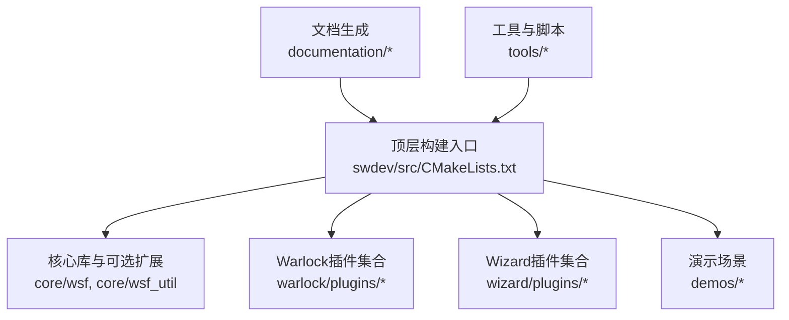
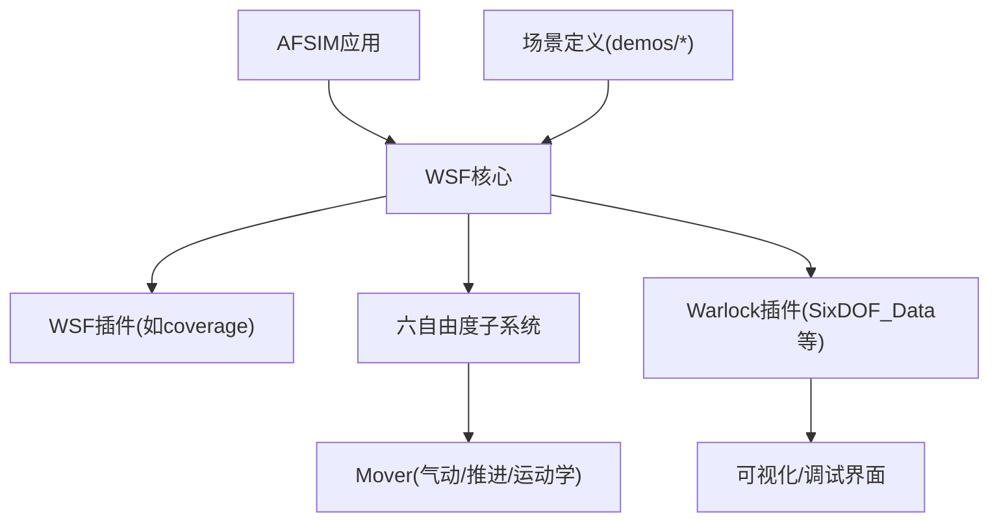
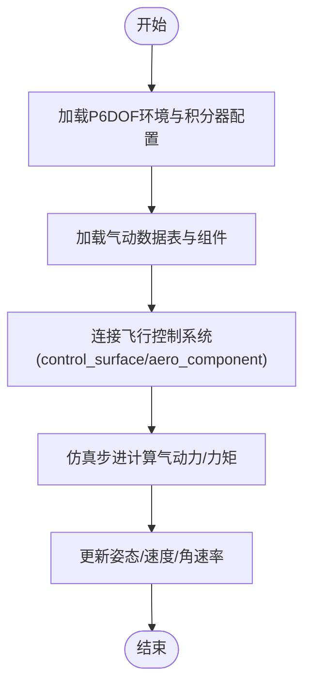
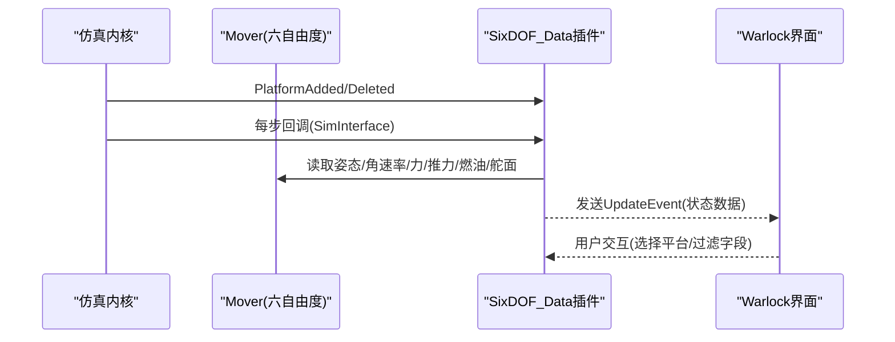
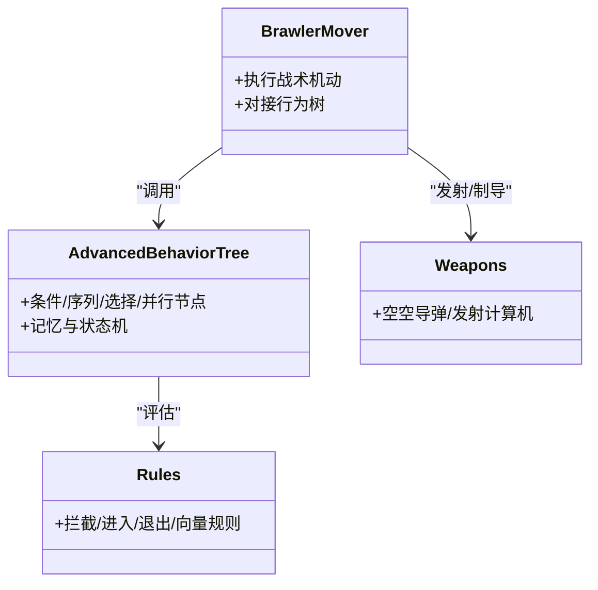
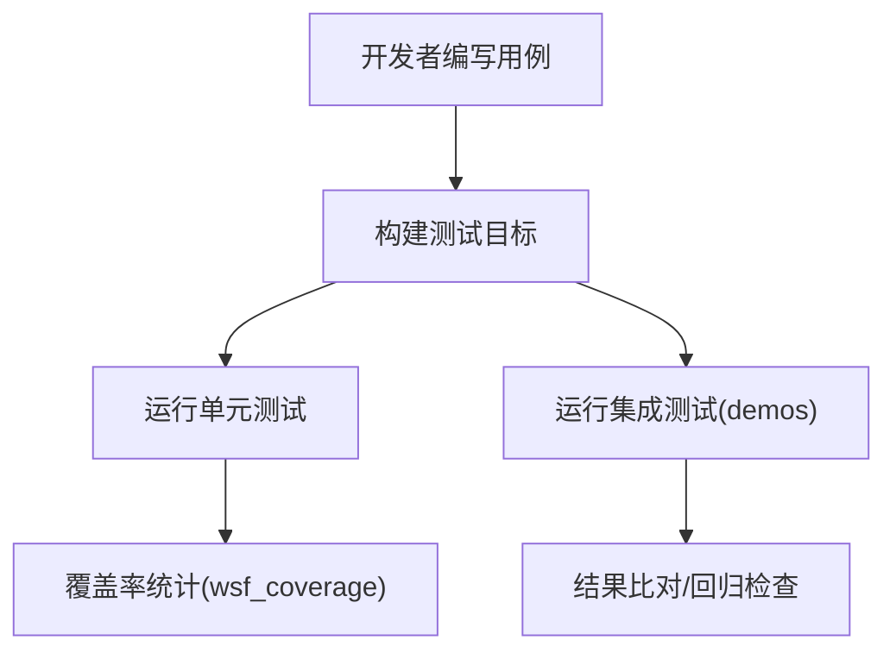
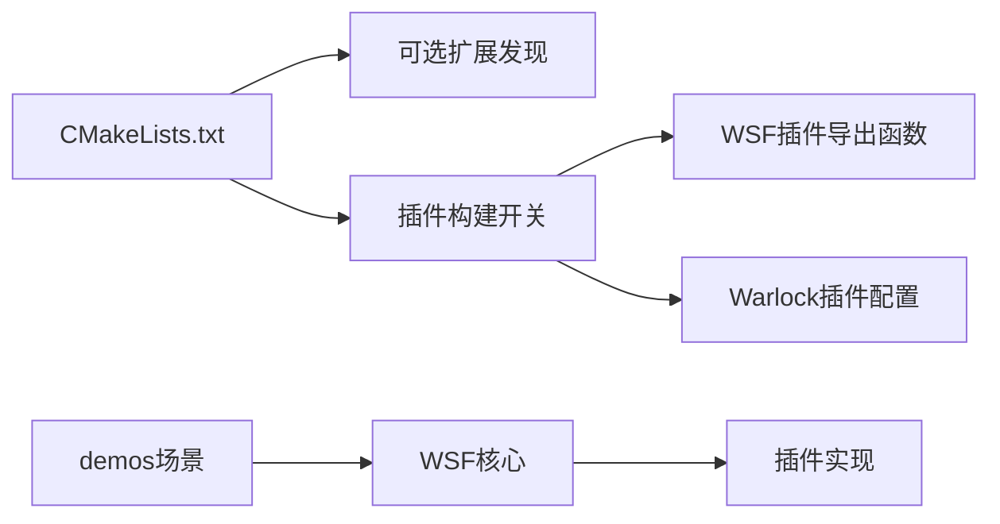

# 插件开发完整示例

<cite>
**本文引用的文件**   
- [CMakeLists.txt](file://swdev/src/CMakeLists.txt)
- [README.md](file://demos/air_to_air/README.md)
- [README.md](file://demos/six_dof/README.md)
- [six_dof_waypoint.txt](file://demos/six_dof/six_dof_waypoint.txt)
- [p6dof_integrators_file_definition.html](file://documentation/html/docs/p6dof_integrators_file_definition.html)
- [SixDOF_DataSimInterface.cpp](file://swdev/src/warlock/plugins/SixDOF_Data/source/SixDOF_DataSimInterface.cpp)
- [warlock_plugin.cmake](file://swdev/src/warlock/plugins/SixDOF_Data/warlock_plugin.cmake)
- [WsfCoverageRegistration.cpp](file://swdev/src/wsf_plugins/wsf_coverage/source/WsfCoverageRegistration.cpp)
- [wizard_plugin.cmake](file://swdev/src/wizard/plugins/CommandChainBrowser/wizard_plugin.cmake)
</cite>

## 目录
1. [简介](#简介)
2. [项目结构](#项目结构)
3. [核心组件](#核心组件)
4. [架构总览](#架构总览)
5. [详细组件分析](#详细组件分析)
6. [依赖关系分析](#依赖关系分析)
7. [性能考虑](#性能考虑)
8. [故障排查指南](#故障排查指南)
9. [结论](#结论)
10. [附录](#附录)

## 简介
本文件面向AFSIM插件开发者，提供从工程搭建、CMake配置、源代码组织到编译部署的完整实战指导。围绕三类典型插件展开：空气动力学插件（基于六自由度P6DOF）、六自由度仿真插件（含数据可视化与控制器）、战斗行为插件（基于Brawler与高级行为树）。文档同时覆盖单元测试、集成测试策略、性能基准测试方法，以及打包分发与版本管理最佳实践，并给出常见问题的定位与排错路径。

## 项目结构
仓库采用“核心库 + 可选扩展 + 演示场景 + 工具链”的分层组织方式：
- swdev/src：核心代码与插件实现（WSF核心、Warlock插件、Wizard插件等）
- demos：丰富的可运行示例（包含air_to_air、six_dof等）
- documentation：HTML文档与参考手册
- tools：辅助脚本与工具
- resources：资源数据（地形、模型、着色器等）

图表来源
- [CMakeLists.txt:13-26](file://swdev/src/CMakeLists.txt#L13-L26)
- [CMakeLists.txt:360-395](file://swdev/src/CMakeLists.txt#L360-L395)

章节来源
- [CMakeLists.txt:13-26](file://swdev/src/CMakeLists.txt#L13-L26)
- [CMakeLists.txt:360-395](file://swdev/src/CMakeLists.txt#L360-L395)

## 核心组件
- 构建系统与插件开关
  - WSF_PLUGIN_BUILD：启用共享库/插件构建模式
  - WSF_ADD_EXTENSION_PATH：扩展搜索路径
  - 安装路径与运行时组件控制（INSTALL_*选项）
- 插件注册机制
  - Warlock插件通过warlock_plugin.cmake声明名称与源码路径
  - Wizard插件通过wizard_plugin.cmake声明名称与源码路径
  - WSF插件通过导出函数WsfPluginVersion/WsfPluginSetup进行能力注册
- 六自由度（P6DOF）相关
  - 六自由度环境、积分器配置文件
  - 平台Mover与气动/推进数据表
  - Warlock SixDOF_Data插件用于采集与展示六自由度状态

章节来源
- [CMakeLists.txt:44-59](file://swdev/src/CMakeLists.txt#L44-L59)
- [CMakeLists.txt:272-302](file://swdev/src/CMakeLists.txt#L272-L302)
- [warlock_plugin.cmake:9-11](file://swdev/src/warlock/plugins/SixDOF_Data/warlock_plugin.cmake#L9-L11)
- [wizard_plugin.cmake:10-12](file://swdev/src/wizard/plugins/CommandChainBrowser/wizard_plugin.cmake#L10-L12)
- [WsfCoverageRegistration.cpp:40-59](file://swdev/src/wsf_plugins/wsf_coverage/source/WsfCoverageRegistration.cpp#L40-L59)

## 架构总览
下图展示了AFSIM在插件视角下的整体交互：应用启动后加载插件，插件向框架注册功能；场景运行时，六自由度仿真模块驱动Mover，Warlock插件订阅事件以获取状态并渲染。

图表来源
- [CMakeLists.txt:360-395](file://swdev/src/CMakeLists.txt#L360-L395)
- [SixDOF_DataSimInterface.cpp:64-128](file://swdev/src/warlock/plugins/SixDOF_Data/source/SixDOF_DataSimInterface.cpp#L64-L128)

## 详细组件分析

### 空气动力学插件（基于P6DOF）
- 目标
  - 为特定飞行器或武器提供高精度气动特性与飞行控制逻辑
  - 通过aero_component与flight_controls装配气动面与舵面
- 关键要点
  - 使用P6DOF环境配置与积分器配置文件
  - 通过气动数据表（cL/cD/cY等随alpha/beta/Mach变化）描述气动力/力矩
  - 将control_surface与aero_component类型严格匹配
- 扩展方法
  - 新增aero_component类型并接入现有flight_controls
  - 引入新的插值表或频率相关项（use_reduced_frequency_）
  - 结合推进系统（prop/jet_engines）完成推力建模

图表来源
- [p6dof_integrators_file_definition.html:72-84](file://documentation/html/docs/p6dof_integrators_file_definition.html#L72-L84)
- [p6dof_aerodynamics_data.rst:454-494](file://swdev/src/wsf_plugins/wsf_p6dof/doc/p6dof_aerodynamics_data.rst#L454-L494)

章节来源
- [p6dof_integrators_file_definition.html:72-84](file://documentation/html/docs/p6dof_integrators_file_definition.html#L72-L84)
- [p6dof_aerodynamics_data.rst:454-494](file://swdev/src/wsf_plugins/wsf_p6dof/doc/p6dof_aerodynamics_data.rst#L454-L494)

### 六自由度仿真插件（SixDOF_Data）
- 目标
  - 在Warlock中实时采集并展示六自由度仿真状态（姿态、角速率、升阻力、燃油、舵面偏度等）
- 关键实现
  - 通过SimInterface回调获取Mover对象，提取各类物理量
  - 将状态封装为UpdateEvent并推送至UI
  - 处理平台添加/删除生命周期事件
- 插件注册
  - warlock_plugin.cmake声明插件名与源码路径

图表来源
- [SixDOF_DataSimInterface.cpp:64-128](file://swdev/src/warlock/plugins/SixDOF_Data/source/SixDOF_DataSimInterface.cpp#L64-L128)
- [warlock_plugin.cmake:9-11](file://swdev/src/warlock/plugins/SixDOF_Data/warlock_plugin.cmake#L9-L11)

章节来源
- [SixDOF_DataSimInterface.cpp:64-128](file://swdev/src/warlock/plugins/SixDOF_Data/source/SixDOF_DataSimInterface.cpp#L64-L128)
- [warlock_plugin.cmake:9-11](file://swdev/src/warlock/plugins/SixDOF_Data/warlock_plugin.cmake#L9-L11)

### 战斗行为插件（Brawler + 高级行为树）
- 目标
  - 通过Brawler Mover与高级行为树（ABT）实现空战战术决策与编队协同
- 关键要点
  - 场景使用WSF_BRAWLER_MOVER，行为树与处理器集中管理
  - 导弹与飞机分类约定（missile/aircraft），指挥链（command_chain）组织编队
  - 多类空战演示（1v1、2v2、HVAA/P-DCA、护航等）
- 扩展方法
  - 新增规则文件（rules/*.txt）与脚本（processors/*.txt）
  - 复用LTE_FIGHTER等平台模板，扩展行为树节点与战术流程

图表来源
- [README.md:1-101](file://demos/air_to_air/README.md#L1-L101)

章节来源
- [README.md:1-101](file://demos/air_to_air/README.md#L1-L101)

### 单元测试与集成测试
- 单元测试
  - 通过CMake集成的单元测试框架（ConfigureUnitTests）
  - 针对核心算法与工具函数编写用例，验证边界条件与数值稳定性
- 集成测试
  - 基于demos场景运行端到端验证（如six_dof_waypoint.txt）
  - 回归测试：对比输出日志/轨迹/事件，确保行为一致
- 覆盖率
  - wsf_coverage插件提供覆盖率收集与报告能力

图表来源
- [CMakeLists.txt:360-362](file://swdev/src/CMakeLists.txt#L360-L362)
- [WsfCoverageRegistration.cpp:40-59](file://swdev/src/wsf_plugins/wsf_coverage/source/WsfCoverageRegistration.cpp#L40-L59)

章节来源
- [CMakeLists.txt:360-362](file://swdev/src/CMakeLists.txt#L360-L362)
- [WsfCoverageRegistration.cpp:40-59](file://swdev/src/wsf_plugins/wsf_coverage/source/WsfCoverageRegistration.cpp#L40-L59)

### 性能基准测试
- 指标建议
  - 单步耗时、CPU占用率、内存峰值、I/O吞吐
  - 不同规模场景（平台数量、传感器数量、弹道数量）
- 方法
  - 使用内置profiling工具与外部性能分析器
  - 对P6DOF步进、传感器探测、行为树评估热点进行采样
  - 对比不同优化等级（-O2/-O3）与Unity Build效果

[本节为通用指导，不直接分析具体文件]

## 依赖关系分析
- 构建期依赖
  - CMake版本要求与策略
  - 可选扩展发现机制（wsf_module + wsf_cmake_extension.cmake）
  - 插件构建开关（WSF_PLUGIN_BUILD）
- 运行期依赖
  - 插件通过导出函数注册能力（WsfPluginVersion/WsfPluginSetup）
  - Warlock插件通过warlock_plugin.cmake声明
  - 场景依赖demos中的平台/传感器/武器/规则定义

图表来源
- [CMakeLists.txt:135-165](file://swdev/src/CMakeLists.txt#L135-L165)
- [CMakeLists.txt:272-302](file://swdev/src/CMakeLists.txt#L272-L302)
- [WsfCoverageRegistration.cpp:40-59](file://swdev/src/wsf_plugins/wsf_coverage/source/WsfCoverageRegistration.cpp#L40-L59)
- [warlock_plugin.cmake:9-11](file://swdev/src/warlock/plugins/SixDOF_Data/warlock_plugin.cmake#L9-L11)

章节来源
- [CMakeLists.txt:135-165](file://swdev/src/CMakeLists.txt#L135-L165)
- [CMakeLists.txt:272-302](file://swdev/src/CMakeLists.txt#L272-L302)
- [WsfCoverageRegistration.cpp:40-59](file://swdev/src/wsf_plugins/wsf_coverage/source/WsfCoverageRegistration.cpp#L40-L59)
- [warlock_plugin.cmake:9-11](file://swdev/src/warlock/plugins/SixDOF_Data/warlock_plugin.cmake#L9-L11)

## 性能考虑
- 构建优化
  - 非Windows平台Release默认-O3
  - Unity Build批量编译减少链接开销
  - MSVC下/bigobj避免符号数限制
- 运行优化
  - 合理设置P6DOF积分器与步长
  - 传感器探测范围与刷新频率调优
  - 行为树节点复杂度控制与缓存命中优化

[本节为通用指导，不直接分析具体文件]

## 故障排查指南
- 编译错误
  - 32位构建已弃用：需切换至64位
  - 插件未正确注册：检查WsfPluginVersion/WsfPluginSetup导出
  - Warlock插件未加载：确认warlock_plugin.cmake中名称与路径
- 运行时异常
  - 六自由度状态为空：检查Mover是否被正确创建与附加
  - 气动数据缺失：核对aero_component与control_surface命名一致性
  - 行为树未生效：检查规则文件与命令链组织是否符合约定
- 性能瓶颈
  - P6DOF步进过频：调整积分器与时间步
  - 传感器过多：合并扫描策略或降低刷新率
  - 行为树复杂度过高：拆分子树、减少分支判断

章节来源
- [CMakeLists.txt:28-30](file://swdev/src/CMakeLists.txt#L28-L30)
- [WsfCoverageRegistration.cpp:40-59](file://swdev/src/wsf_plugins/wsf_coverage/source/WsfCoverageRegistration.cpp#L40-L59)
- [warlock_plugin.cmake:9-11](file://swdev/src/warlock/plugins/SixDOF_Data/warlock_plugin.cmake#L9-L11)

## 结论
通过本指南，读者可以掌握AFSIM插件从工程搭建、CMake配置、源代码组织到编译部署的全流程，理解空气动力学、六自由度仿真与战斗行为三类插件的实现思路与关键技术点，并具备编写单元/集成测试、开展性能基准测试的能力。同时，借助打包分发与版本管理的最佳实践，可提升插件的可维护性与可交付性。

## 附录
- 快速上手示例
  - 六自由度航点飞行：参考[demos/six_dof/six_dof_waypoint.txt:1-31](file://demos/six_dof/six_dof_waypoint.txt#L1-L31)
  - 空战行为演示：参考[demos/air_to_air/README.md:1-101](file://demos/air_to_air/README.md#L1-L101)
  - 六自由度演示说明：参考[demos/six_dof/README.md:1-45](file://demos/six_dof/README.md#L1-L45)

章节来源
- [six_dof_waypoint.txt:1-31](file://demos/six_dof/six_dof_waypoint.txt#L1-L31)
- [README.md:1-101](file://demos/air_to_air/README.md#L1-L101)
- [README.md:1-45](file://demos/six_dof/README.md#L1-L45)