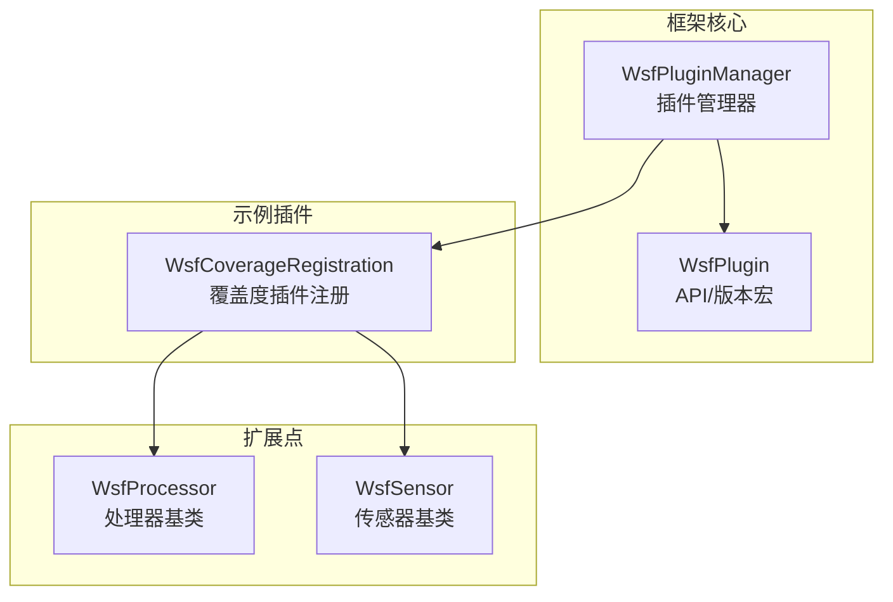
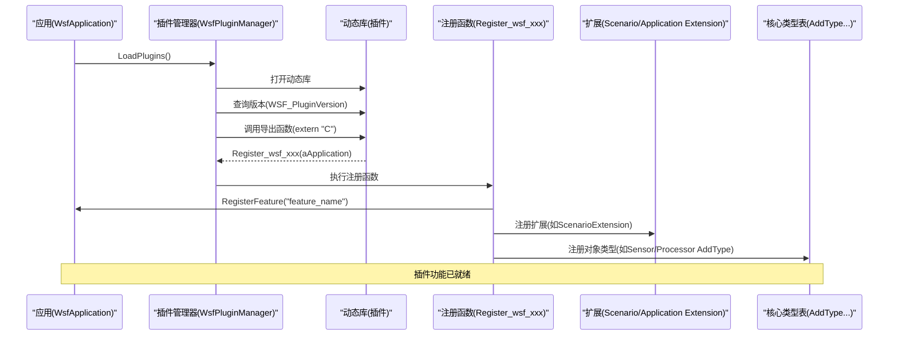
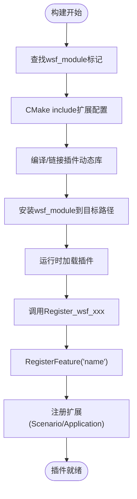
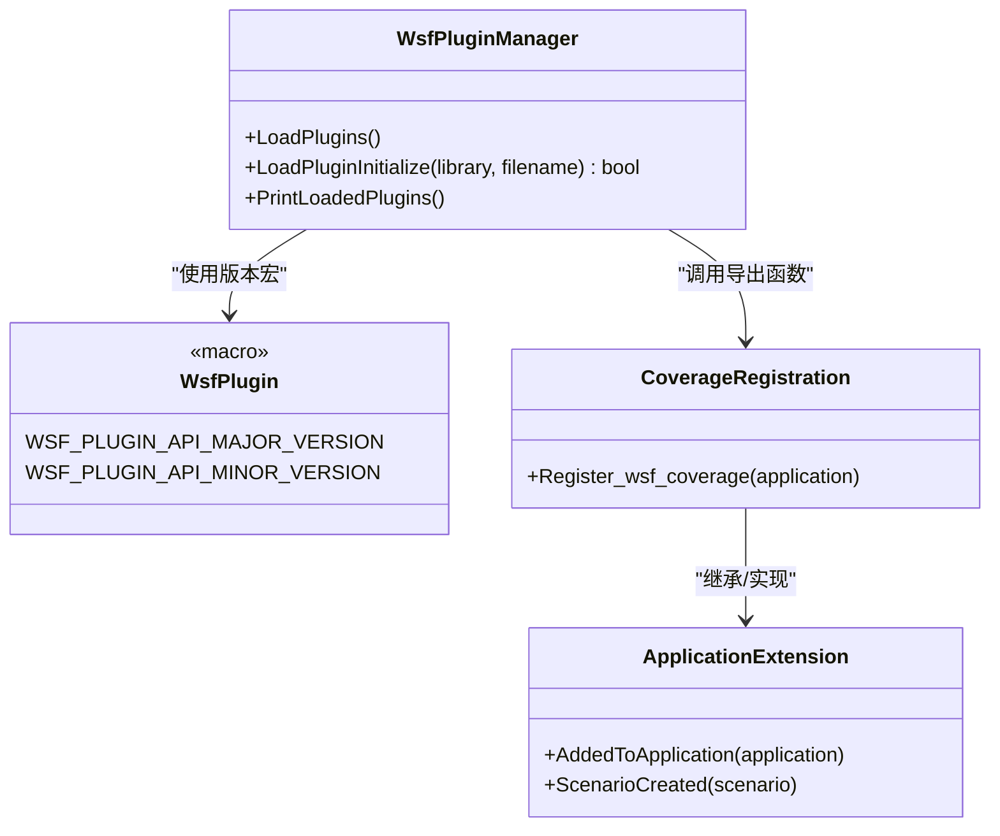
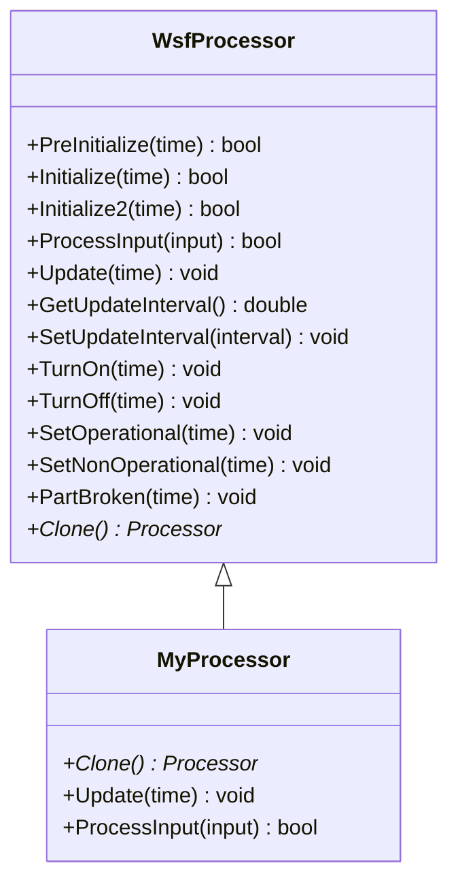
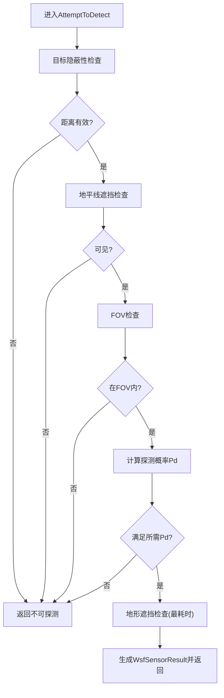
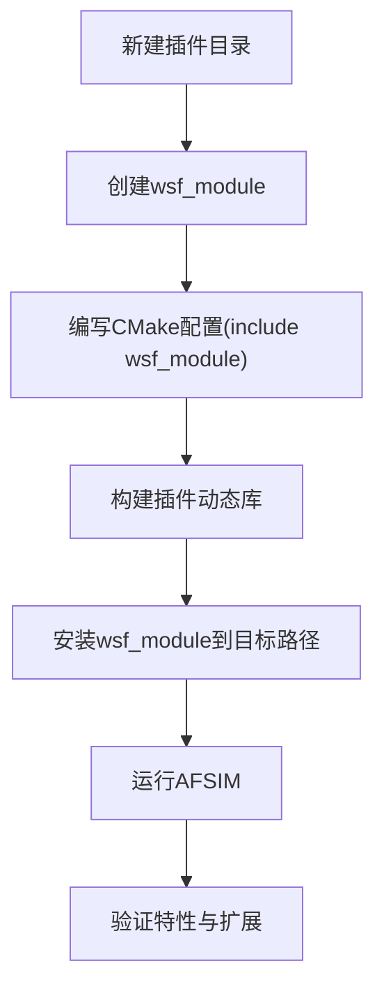
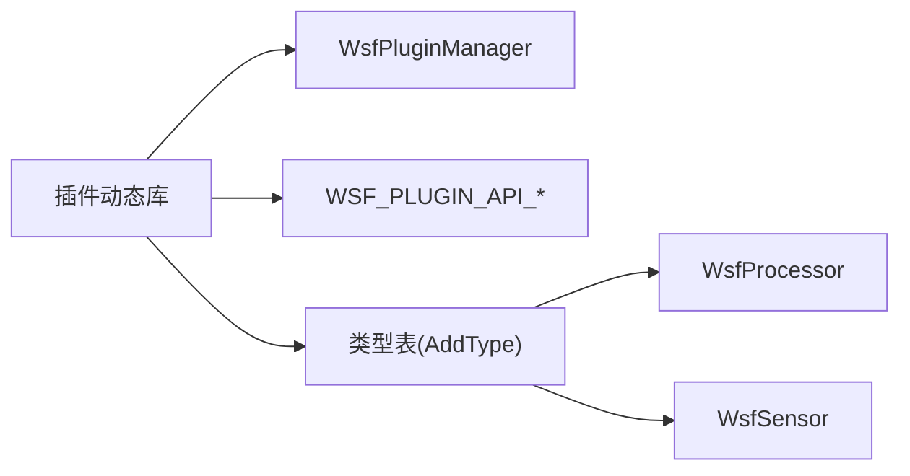

# 插件架构开发

<cite>
**本文引用的文件**   
- [WsfPlugin.hpp](file://swdev/src/core/wsf/source/WsfPlugin.hpp)
- [WsfPluginManager.hpp](file://swdev/src/core/wsf/source/WsfPluginManager.hpp)
- [WsfProcessor.hpp](file://swdev/src/core/wsf/source/processor/WsfProcessor.hpp)
- [WsfSensor.hpp](file://swdev/src/core/wsf/source/sensor/WsfSensor.hpp)
- [WsfCoverageRegistration.cpp](file://swdev/src/wsf_plugins/wsf_coverage/source/WsfCoverageRegistration.cpp)
- [integration_guide.rst](file://swdev/src/doc/developer/integration_guide.rst)
</cite>

## 目录
1. [引言](#引言)
2. [项目结构](#项目结构)
3. [核心组件](#核心组件)
4. [架构总览](#架构总览)
5. [详细组件分析](#详细组件分析)
6. [依赖关系分析](#依赖关系分析)
7. [性能考虑](#性能考虑)
8. [故障排查指南](#故障排查指南)
9. [结论](#结论)
10. [附录](#附录)

## 引言
本指南面向AFSIM插件开发者，系统阐述插件系统的整体设计、模块注册机制、接口规范与生命周期管理；详解wsf_module标识符、依赖关系与版本兼容性；给出处理器（Processor）与传感器（Sensor）插件的开发流程；并提供武器类型插件的创建思路、完整示例路径与编译部署、测试调试与分发的最佳实践。文档以源码为依据，辅以可视化图示，帮助读者从概念到实现逐步掌握AFSIM插件体系。

## 项目结构
AFSIM的插件生态围绕WSF（Warfare Simulation Framework）构建，核心能力包括：
- 插件加载与版本管理：通过WsfPluginManager统一加载动态库，并调用导出函数完成初始化与资源注册。
- 扩展点与对象模型：平台部件（PlatformPart）、处理器（Processor）、传感器（Sensor）等作为可扩展对象类型。
- 插件入口约定：每个插件需暴露统一的注册函数，供框架在启动阶段发现与调用。
- 构建集成：通过wsf_module标记目录为扩展，配合CMake将插件纳入构建与安装流程。

**图表来源**
- [WsfPluginManager.hpp:35-68](file://swdev/src/core/wsf/source/WsfPluginManager.hpp#L35-L68)
- [WsfPlugin.hpp:15-22](file://swdev/src/core/wsf/source/WsfPlugin.hpp#L15-L22)
- [WsfCoverageRegistration.cpp:21-44](file://swdev/src/wsf_plugins/wsf_coverage/source/WsfCoverageRegistration.cpp#L21-L44)
- [WsfProcessor.hpp:27-38](file://swdev/src/core/wsf/source/processor/WsfProcessor.hpp#L27-L38)
- [WsfSensor.hpp:45-91](file://swdev/src/core/wsf/source/sensor/WsfSensor.hpp#L45-L91)

**章节来源**
- [WsfPluginManager.hpp:35-68](file://swdev/src/core/wsf/source/WsfPluginManager.hpp#L35-L68)
- [WsfPlugin.hpp:15-22](file://swdev/src/core/wsf/source/WsfPlugin.hpp#L15-L22)
- [WsfCoverageRegistration.cpp:21-44](file://swdev/src/wsf_plugins/wsf_coverage/source/WsfCoverageRegistration.cpp#L21-L44)

## 核心组件
- 插件API与版本
  - WSF_PLUGIN_API_MAJOR_VERSION / WSF_PLUGIN_API_MINOR_VERSION 由框架版本宏定义，确保插件与核心ABI兼容。
- 插件管理器
  - WsfPluginManager负责搜索、加载动态库，调用插件导出的版本查询与初始化函数，并将可用对象类型注册到框架的类型表中。
- 扩展点
  - WsfProcessor：处理器基类，承载平台“行为”逻辑，支持周期性Update与消息驱动。
  - WsfSensor：传感器基类，提供多模式探测、调度与跟踪能力，抽象出AttemptToDetect检测流程。

**章节来源**
- [WsfPlugin.hpp:15-22](file://swdev/src/core/wsf/source/WsfPlugin.hpp#L15-L22)
- [WsfPluginManager.hpp:35-68](file://swdev/src/core/wsf/source/WsfPluginManager.hpp#L35-L68)
- [WsfProcessor.hpp:27-38](file://swdev/src/core/wsf/source/processor/WsfProcessor.hpp#L27-L38)
- [WsfSensor.hpp:45-91](file://swdev/src/core/wsf/source/sensor/WsfSensor.hpp#L45-L91)

## 架构总览
下图展示插件从加载到注册的端到端流程，以及处理器/传感器在仿真中的角色。

**图表来源**
- [WsfPluginManager.hpp:49-55](file://swdev/src/core/wsf/source/WsfPluginManager.hpp#L49-L55)
- [WsfPluginManager.hpp:26-33](file://swdev/src/core/wsf/source/WsfPluginManager.hpp#L26-L33)
- [WsfCoverageRegistration.cpp:40-44](file://swdev/src/wsf_plugins/wsf_coverage/source/WsfCoverageRegistration.cpp#L40-L44)

## 详细组件分析

### 插件系统与模块注册机制
- 模块标识 ws f_module
  - 在扩展根目录放置无扩展名的wsf_module文件，用于CMake识别该目录为扩展，参与构建与安装。
- 构建集成
  - 主CMakeLists中通过include wsf_module将扩展纳入构建；安装时将wsf_module复制到目标路径。
- 插件导出函数
  - 插件需提供extern "C"的Register_wsf_xxx(WsfApplication&)函数，由插件管理器在加载后调用。
- 特性与扩展
  - 插件通过aApplication.RegisterFeature("name")声明特性，并在场景创建时注册扩展（如ScenarioExtension），从而注入自定义类型或行为。

**图表来源**
- [integration_guide.rst:375-380](file://swdev/src/doc/developer/integration_guide.rst#L375-L380)
- [integration_guide.rst:426-432](file://swdev/src/doc/developer/integration_guide.rst#L426-L432)
- [WsfCoverageRegistration.cpp:40-44](file://swdev/src/wsf_plugins/wsf_coverage/source/WsfCoverageRegistration.cpp#L40-L44)

**章节来源**
- [integration_guide.rst:375-380](file://swdev/src/doc/developer/integration_guide.rst#L375-L380)
- [integration_guide.rst:426-432](file://swdev/src/doc/developer/integration_guide.rst#L426-L432)
- [WsfCoverageRegistration.cpp:21-44](file://swdev/src/wsf_plugins/wsf_coverage/source/WsfCoverageRegistration.cpp#L21-L44)

### 接口规范与生命周期管理
- 插件API版本
  - 使用WSF_PLUGIN_API_*宏对齐核心版本，避免ABI不兼容。
- 插件生命周期
  - 加载阶段：查询版本、调用导出函数。
  - 初始化阶段：注册特性、注册扩展、注册对象类型。
  - 运行阶段：扩展回调（如ScenarioCreated）中注入行为。
  - 卸载阶段：清理资源（由框架或插件自行管理）。

**图表来源**
- [WsfPluginManager.hpp:35-68](file://swdev/src/core/wsf/source/WsfPluginManager.hpp#L35-L68)
- [WsfPlugin.hpp:15-22](file://swdev/src/core/wsf/source/WsfPlugin.hpp#L15-L22)
- [WsfCoverageRegistration.cpp:21-44](file://swdev/src/wsf_plugins/wsf_coverage/source/WsfCoverageRegistration.cpp#L21-L44)

**章节来源**
- [WsfPlugin.hpp:15-22](file://swdev/src/core/wsf/source/WsfPlugin.hpp#L15-L22)
- [WsfPluginManager.hpp:35-68](file://swdev/src/core/wsf/source/WsfPluginManager.hpp#L35-L68)
- [WsfCoverageRegistration.cpp:21-44](file://swdev/src/wsf_plugins/wsf_coverage/source/WsfCoverageRegistration.cpp#L21-L44)

### 处理器（Processor）插件开发
- 继承基类
  - 继承WsfProcessor，实现Clone()等必要方法。
- 生命周期钩子
  - PreInitialize/Initialize/Initialize2：准备数据、建立连接。
  - Update：周期性处理逻辑（间隔由SetUpdateInterval控制）。
  - ProcessInput/ReceiveMessage：消息驱动的处理入口。
- 状态与组件
  - 支持TurnOn/TurnOff/SetOperational等状态切换。
  - 可包含多个ProcessorComponent，统一管理子组件。

**图表来源**
- [WsfProcessor.hpp:27-38](file://swdev/src/core/wsf/source/processor/WsfProcessor.hpp#L27-L38)
- [WsfProcessor.hpp:60-87](file://swdev/src/core/wsf/source/processor/WsfProcessor.hpp#L60-L87)

**章节来源**
- [WsfProcessor.hpp:27-38](file://swdev/src/core/wsf/source/processor/WsfProcessor.hpp#L27-L38)
- [WsfProcessor.hpp:60-87](file://swdev/src/core/wsf/source/processor/WsfProcessor.hpp#L60-L87)

### 传感器（Sensor）插件开发
- 设计要点
  - 传感器是平台的“感官”，通常由多模式（Mode）组成，每种模式实现具体的探测算法。
  - 典型流程：Ensure concealed -> range check -> horizon mask -> FOV check -> compute Pd -> terrain mask。
- 关键接口
  - AttemptToDetect：核心探测入口，返回WsfSensorResult。
  - WithinFieldOfView：视场判断。
  - GetEM_Rcvr/GetEM_Xmtr：收发器访问。
  - Mode选择：SelectMode/DeselectMode/ScheduleModeChange。
  - 调度与跟踪：Scheduler/Tracker（可选）。
- 线程安全
  - ThreadSafe/SetThreadSafe控制是否允许多线程更新。

**图表来源**
- [WsfSensor.hpp:71-89](file://swdev/src/core/wsf/source/sensor/WsfSensor.hpp#L71-L89)
- [WsfSensor.hpp:192-213](file://swdev/src/core/wsf/source/sensor/WsfSensor.hpp#L192-L213)
- [WsfSensor.hpp:305-334](file://swdev/src/core/wsf/source/sensor/WsfSensor.hpp#L305-L334)

**章节来源**
- [WsfSensor.hpp:71-89](file://swdev/src/core/wsf/source/sensor/WsfSensor.hpp#L71-L89)
- [WsfSensor.hpp:192-213](file://swdev/src/core/wsf/source/sensor/WsfSensor.hpp#L192-L213)
- [WsfSensor.hpp:305-334](file://swdev/src/core/wsf/source/sensor/WsfSensor.hpp#L305-L334)

### 武器类型插件（概念与流程）
- 弹道计算
  - 在武器类型中实现六自由度或简化弹道模型，结合推进段、中段制导与末段机动。
- 效果评估
  - 命中判定、毁伤模型、附带效应与多目标影响。
- 可视化支持
  - 通过事件输出或可视化接口绘制轨迹、爆炸云与毁伤区域。
- 参考示例
  - 可在demos与swdev/src目录下寻找导弹/炸弹/火箭等武器类型的实现与用例，例如air_to_air、six_dof、missile_comparison等。

[本节为概念性说明，未直接分析具体文件]

### 完整插件开发示例（从项目结构到编译部署）
- 项目结构
  - 在扩展根目录放置wsf_module文件，组织源文件、头文件与CMake配置。
- 构建集成
  - 在主CMakeLists中包含wsf_module，使CMake识别并构建插件。
  - 安装时将wsf_module复制到目标路径，便于运行时发现。
- 插件导出函数
  - 实现extern "C"的Register_wsf_xxx(WsfApplication&)，在其中注册特性与扩展。
- 运行与验证
  - 启动AFSIM，确认插件被加载，特性可用，扩展回调触发。

**图表来源**
- [integration_guide.rst:375-380](file://swdev/src/doc/developer/integration_guide.rst#L375-L380)
- [integration_guide.rst:426-432](file://swdev/src/doc/developer/integration_guide.rst#L426-L432)

**章节来源**
- [integration_guide.rst:375-380](file://swdev/src/doc/developer/integration_guide.rst#L375-L380)
- [integration_guide.rst:426-432](file://swdev/src/doc/developer/integration_guide.rst#L426-L432)

## 依赖关系分析
- 组件耦合
  - 插件通过WsfPluginManager与框架解耦，仅依赖导出函数与API宏。
  - 处理器/传感器作为扩展点，插件通过注册扩展与类型表接入。
- 外部依赖
  - 插件可能依赖其他WSF子系统（如通信、网络、地形等），需在注册扩展时按需启用。
- 循环依赖
  - 建议插件内部保持低耦合，避免与核心或其他插件形成强循环依赖。

**图表来源**
- [WsfPluginManager.hpp:35-68](file://swdev/src/core/wsf/source/WsfPluginManager.hpp#L35-L68)
- [WsfPlugin.hpp:15-22](file://swdev/src/core/wsf/source/WsfPlugin.hpp#L15-L22)
- [WsfProcessor.hpp:27-38](file://swdev/src/core/wsf/source/processor/WsfProcessor.hpp#L27-L38)
- [WsfSensor.hpp:45-91](file://swdev/src/core/wsf/source/sensor/WsfSensor.hpp#L45-L91)

**章节来源**
- [WsfPluginManager.hpp:35-68](file://swdev/src/core/wsf/source/WsfPluginManager.hpp#L35-L68)
- [WsfPlugin.hpp:15-22](file://swdev/src/core/wsf/source/WsfPlugin.hpp#L15-L22)

## 性能考虑
- 传感器探测优化
  - 遵循“先易后难”的检测顺序，尽早跳过无效目标，避免昂贵的地形遮挡计算。
  - 合理使用RequiredPd阈值，减少不必要的复杂计算。
- 更新频率
  - 合理设置UpdateInterval，避免过高频率导致CPU占用。
- 线程安全
  - 对多线程环境下的传感器更新，显式设置ThreadSafe，避免竞态条件。
- 事件驱动
  - 利用事件与回调机制，降低轮询开销。

[本节为通用指导，未直接分析具体文件]

## 故障排查指南
- 插件未加载
  - 检查wsf_module是否存在且位于扩展根目录。
  - 确认CMake已include wsf_module并完成安装。
- 注册失败
  - 检查Register_wsf_xxx是否正确导出（extern "C"）。
  - 确认RegisterFeature名称唯一且未被其他插件占用。
- 运行时崩溃
  - 检查处理器/传感器的生命周期钩子实现是否完备（Clone、Initialize等）。
  - 验证传感器AttemptToDetect的实现是否符合既定流程。
- 日志与调试
  - 启用AFSIM日志输出，定位插件加载与注册阶段错误。
  - 使用单元测试与最小化场景复现问题。

**章节来源**
- [WsfCoverageRegistration.cpp:21-44](file://swdev/src/wsf_plugins/wsf_coverage/source/WsfCoverageRegistration.cpp#L21-L44)
- [WsfProcessor.hpp:60-87](file://swdev/src/core/wsf/source/processor/WsfProcessor.hpp#L60-L87)
- [WsfSensor.hpp:71-89](file://swdev/src/core/wsf/source/sensor/WsfSensor.hpp#L71-L89)

## 结论
AFSIM插件体系以WsfPluginManager为核心，通过wsf_module与导出函数实现松耦合扩展。处理器与传感器提供了强大的扩展点，开发者可基于这些基类实现复杂的行为与探测逻辑。遵循本文的流程与最佳实践，可高效完成插件开发、测试与分发，并确保与框架版本的兼容性与稳定性。

[本节为总结性内容，未直接分析具体文件]

## 附录
- 术语
  - ws f_module：CMake扩展标记文件。
  - Register_wsf_xxx：插件导出注册函数。
  - WsfProcessor/WsfSensor：处理器与传感器基类。
- 参考路径
  - 处理器示例：参考demos与swdev/src下各示例中的处理器实现。
  - 传感器示例：参考sensor_demos与swdev/src/core/wsf/test_mission中的传感器用例。
  - 武器类型示例：参考air_to_air、six_dof、missile_comparison等演示。

[本节为补充信息，未直接分析具体文件]