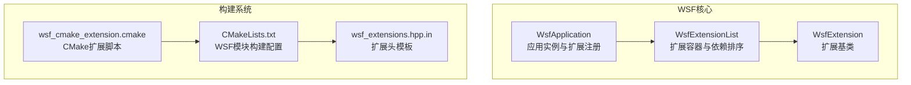
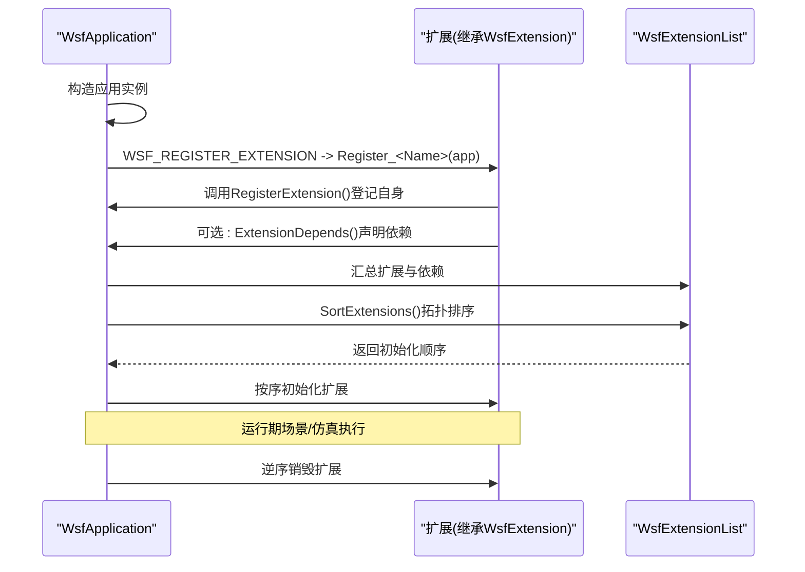
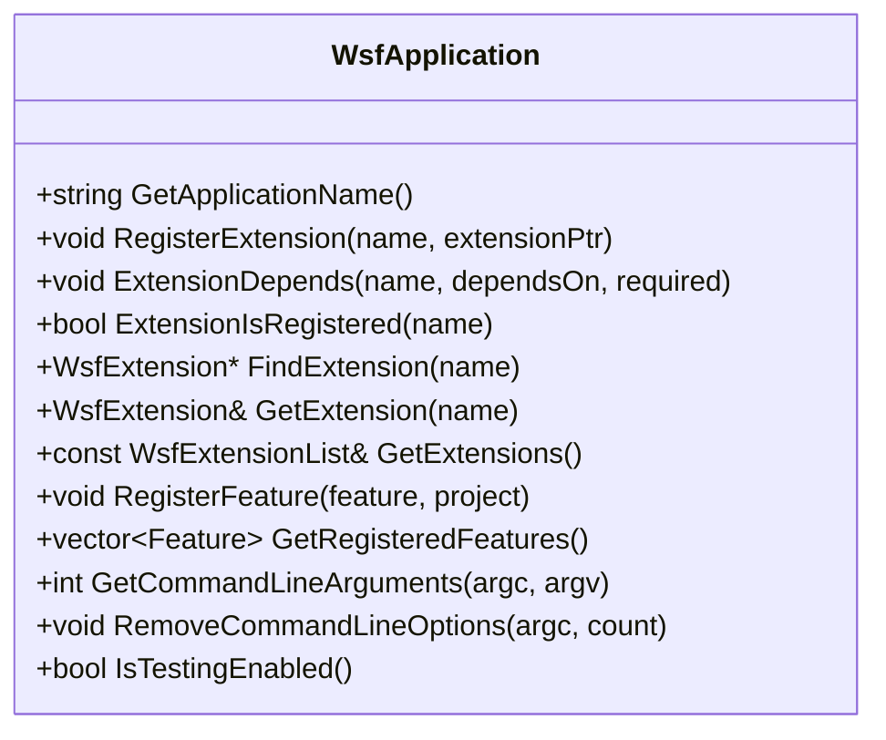
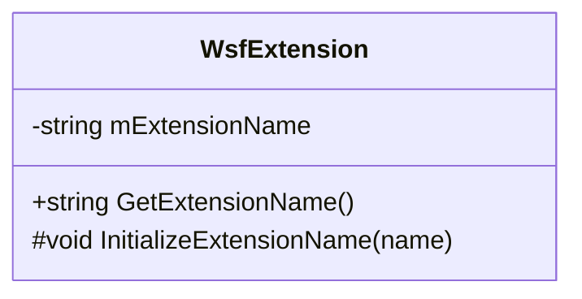
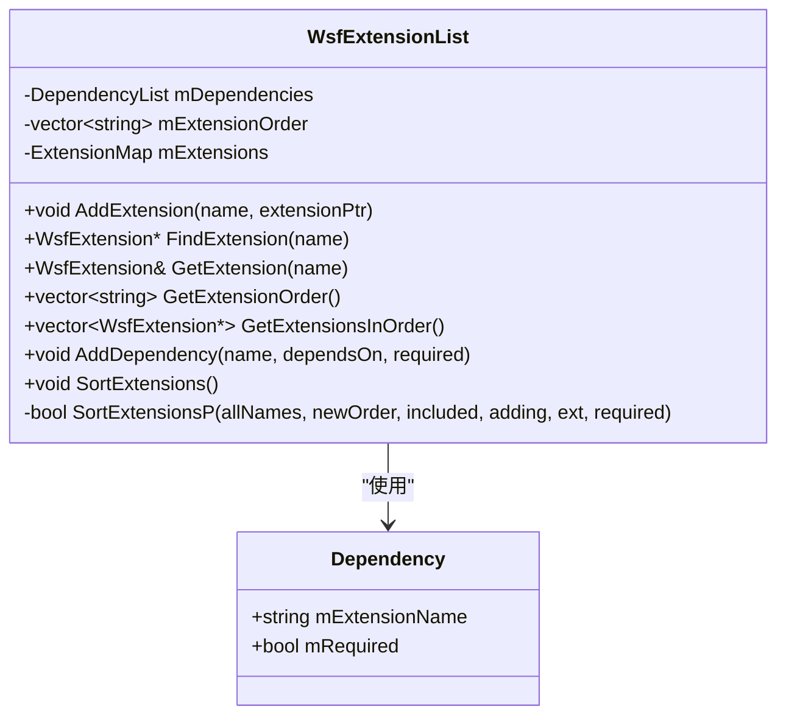
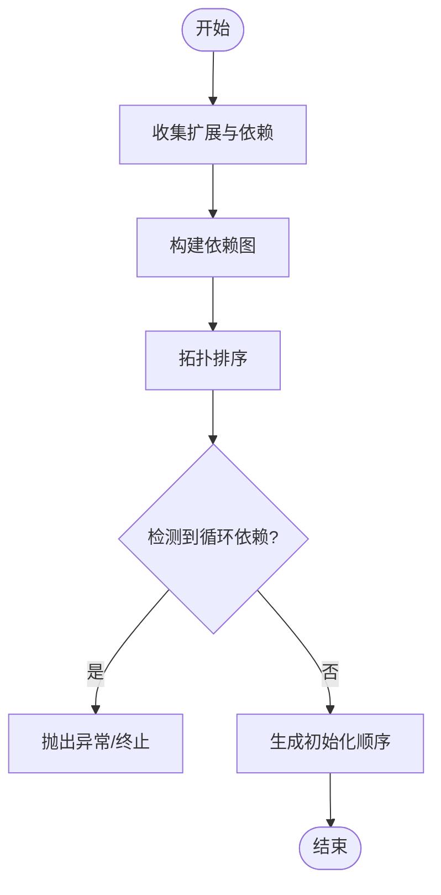
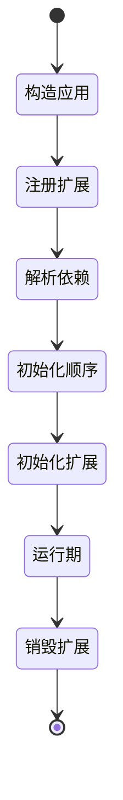
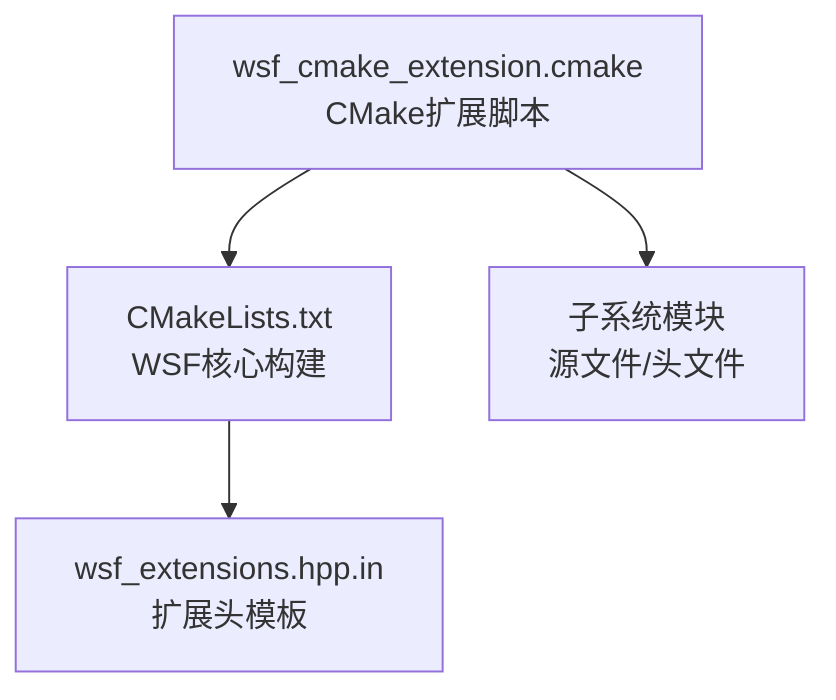
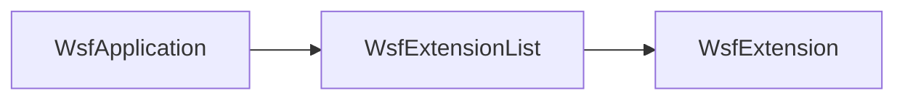

# 模块注册机制

<cite>
**本文引用的文件**   
- [WsfApplication.hpp](file://swdev/src/core/wsf/source/WsfApplication.hpp)
- [WsfExtension.hpp](file://swdev/src/core/wsf/source/WsfExtension.hpp)
- [WsfExtensionList.hpp](file://swdev/src/core/wsf/source/WsfExtensionList.hpp)
- [CMakeLists.txt](file://swdev/src/core/wsf/CMakeLists.txt)
- [wsf_extensions.hpp.in](file://swdev/src/core/wsf/wsf_extensions.hpp.in)
- [wsf_cmake_extension.cmake](file://swdev/src/engage/wsf_cmake_extension.cmake)
</cite>

## 目录
1. [简介](#简介)
2. [项目结构](#项目结构)
3. [核心组件](#核心组件)
4. [架构总览](#架构总览)
5. [详细组件分析](#详细组件分析)
6. [依赖关系分析](#依赖关系分析)
7. [性能考量](#性能考量)
8. [故障排查指南](#故障排查指南)
9. [结论](#结论)
10. [附录](#附录)

## 简介
本文面向AFSIM的WSF（Simulation Framework）模块注册机制，系统性阐述以下主题：
- wsf_module标识符系统的工作原理与声明语法
- 模块依赖解析与初始化顺序计算
- 版本兼容性检查策略
- 模块加载生命周期管理（从初始化到销毁）
- CMake集成配置与wsf_cmake_extension.cmake的使用方式
- 模块间通信与数据共享机制
- 模块注册的完整示例路径与最佳实践
- 常见问题诊断与解决方案（循环依赖、内存泄漏防护等）

本说明以源码为依据，重点围绕WsfApplication、WsfExtension、WsfExtensionList以及CMake扩展脚本展开。

## 项目结构
WSF模块注册相关代码位于core/wsf子系统中，关键头文件包括应用入口、扩展基类与扩展列表容器；构建系统集成通过CMake扩展脚本完成。

图示来源
- [WsfApplication.hpp:44-105](file://swdev/src/core/wsf/source/WsfApplication.hpp#L44-L105)
- [WsfExtension.hpp:23-38](file://swdev/src/core/wsf/source/WsfExtension.hpp#L23-L38)
- [WsfExtensionList.hpp:45-110](file://swdev/src/core/wsf/source/WsfExtensionList.hpp#L45-L110)
- [CMakeLists.txt](file://swdev/src/core/wsf/CMakeLists.txt)
- [wsf_extensions.hpp.in](file://swdev/src/core/wsf/wsf_extensions.hpp.in)
- [wsf_cmake_extension.cmake](file://swdev/src/engage/wsf_cmake_extension.cmake)

章节来源
- [WsfApplication.hpp:44-105](file://swdev/src/core/wsf/source/WsfApplication.hpp#L44-L105)
- [WsfExtension.hpp:23-38](file://swdev/src/core/wsf/source/WsfExtension.hpp#L23-L38)
- [WsfExtensionList.hpp:45-110](file://swdev/src/core/wsf/source/WsfExtensionList.hpp#L45-L110)
- [CMakeLists.txt](file://swdev/src/core/wsf/CMakeLists.txt)
- [wsf_extensions.hpp.in](file://swdev/src/core/wsf/wsf_extensions.hpp.in)
- [wsf_cmake_extension.cmake](file://swdev/src/engage/wsf_cmake_extension.cmake)

## 核心组件
- WsfApplication：应用级单例，负责扩展（插件）注册、特性（Feature）注册、命令行参数处理、测试环境初始化，并提供WSF_REGISTER_EXTENSION宏用于便捷注册扩展。
- WsfExtension：扩展基类，提供扩展名称获取能力，所有扩展均继承自该类。
- WsfExtensionList：扩展容器，维护扩展映射、依赖关系，并通过拓扑排序计算初始化顺序，支持可选/必需依赖。

章节来源
- [WsfApplication.hpp:44-105](file://swdev/src/core/wsf/source/WsfApplication.hpp#L44-L105)
- [WsfExtension.hpp:23-38](file://swdev/src/core/wsf/source/WsfExtension.hpp#L23-L38)
- [WsfExtensionList.hpp:45-110](file://swdev/src/core/wsf/source/WsfExtensionList.hpp#L45-L110)

## 架构总览
WSF模块注册的整体流程如下：
- 应用启动时创建WsfApplication实例
- 通过WSF_REGISTER_EXTENSION宏调用各扩展的Register_<Name>(WsfApplication&)函数进行扩展注册
- 扩展在注册过程中可声明与其他扩展的依赖关系（必需或可选）
- 应用收集所有扩展后，由WsfExtensionList进行依赖解析与拓扑排序，得到初始化顺序
- 按序初始化扩展，随后进入场景与仿真阶段
- 应用退出时按逆序销毁扩展资源

图示来源
- [WsfApplication.hpp:192-214](file://swdev/src/core/wsf/source/WsfApplication.hpp#L192-L214)
- [WsfExtensionList.hpp:70-97](file://swdev/src/core/wsf/source/WsfExtensionList.hpp#L70-L97)

## 详细组件分析

### WsfApplication：应用与扩展注册中心
- 职责
  - 维护应用名称、命令行参数、系统日志、脚本类型对象
  - 注册扩展（RegisterExtension）、查询扩展（FindExtension/GetExtension）
  - 声明扩展依赖（ExtensionDepends），并暴露扩展列表（GetExtensions）
  - 注册特性（RegisterFeature），供条件编译或运行时检测使用
  - 提供WSF_REGISTER_EXTENSION宏，简化扩展注册调用
- 关键点
  - 扩展注册接口与依赖声明接口为扩展作者提供统一入口
  - 通过互斥锁保护扩展列表并发安全操作
  - 提供Feature机制用于平台/构建特征检测

图示来源
- [WsfApplication.hpp:44-105](file://swdev/src/core/wsf/source/WsfApplication.hpp#L44-L105)
- [WsfApplication.hpp:120-133](file://swdev/src/core/wsf/source/WsfApplication.hpp#L120-L133)
- [WsfApplication.hpp:192-214](file://swdev/src/core/wsf/source/WsfApplication.hpp#L192-L214)

章节来源
- [WsfApplication.hpp:44-105](file://swdev/src/core/wsf/source/WsfApplication.hpp#L44-L105)
- [WsfApplication.hpp:120-133](file://swdev/src/core/wsf/source/WsfApplication.hpp#L120-L133)
- [WsfApplication.hpp:192-214](file://swdev/src/core/wsf/source/WsfApplication.hpp#L192-L214)

### WsfExtension：扩展基类
- 职责
  - 提供扩展名称访问接口（GetExtensionName）
  - 内部维护扩展名，由父类或注册过程设置
- 设计要点
  - 虚析构确保多态销毁安全
  - 作为所有扩展的统一基类，便于容器管理与类型推断

图示来源
- [WsfExtension.hpp:23-38](file://swdev/src/core/wsf/source/WsfExtension.hpp#L23-L38)

章节来源
- [WsfExtension.hpp:23-38](file://swdev/src/core/wsf/source/WsfExtension.hpp#L23-L38)

### WsfExtensionList：扩展容器与依赖排序
- 职责
  - 存储扩展映射（名称到扩展指针）
  - 维护依赖列表（扩展名、依赖扩展名、是否必需）
  - 计算扩展初始化顺序（拓扑排序）
  - 提供查找、遍历、排序等工具方法
- 数据结构
  - Dependency：包含依赖扩展名与是否必需标志
  - ExtensionMap：名称到扩展对象的映射
  - mExtensionOrder：排序后的扩展名序列
- 算法要点
  - SortExtensionsP递归实现拓扑排序，支持可选/必需依赖
  - 对循环依赖进行检测与报错（见“故障排查”）

图示来源
- [WsfExtensionList.hpp:45-110](file://swdev/src/core/wsf/source/WsfExtensionList.hpp#L45-L110)

章节来源
- [WsfExtensionList.hpp:45-110](file://swdev/src/core/wsf/source/WsfExtensionList.hpp#L45-L110)

### 模块声明语法与wsf_module标识符
- 模块声明语法
  - 扩展需实现一个全局函数：Register_<ExtensionName>(WsfApplication&)
  - 在应用启动处通过WSF_REGISTER_EXTENSION(app, <ExtensionName>)宏调用该函数
  - 扩展可在Register函数中调用ExtensionDepends声明依赖
- wsf_module标识符
  - 在WSF框架内，模块通常以“扩展名”作为唯一标识符，用于查找与依赖声明
  - 扩展名与扩展对象一一对应，存储在WsfExtensionList::mExtensions中
  - 可通过WsfApplication::ExtensionIsRegistered与FindExtension进行存在性检查与获取

章节来源
- [WsfApplication.hpp:192-214](file://swdev/src/core/wsf/source/WsfApplication.hpp#L192-L214)
- [WsfExtensionList.hpp:65-80](file://swdev/src/core/wsf/source/WsfExtensionList.hpp#L65-L80)

### 依赖关系解析与版本兼容性检查
- 依赖解析
  - 通过ExtensionDepends声明依赖，支持必需（required=true）与可选（required=false）
  - WsfExtensionList::SortExtensions基于依赖图进行拓扑排序，保证依赖先于被依赖者初始化
- 版本兼容性
  - 框架未直接提供“模块版本字段”，但可通过WsfApplication::RegisterFeature注册“特性”字符串（如“feature:moduleX:v2”）
  - 消费者可在运行时通过GetRegisteredFeatures检查特性是否存在，从而间接实现版本兼容判断

图示来源
- [WsfExtensionList.hpp:96-105](file://swdev/src/core/wsf/source/WsfExtensionList.hpp#L96-L105)

章节来源
- [WsfApplication.hpp:92-105](file://swdev/src/core/wsf/source/WsfApplication.hpp#L92-L105)
- [WsfExtensionList.hpp:70-105](file://swdev/src/core/wsf/source/WsfExtensionList.hpp#L70-L105)

### 模块加载生命周期管理
- 初始化阶段
  - 应用构造后，依次调用各扩展的Register_<Name>函数完成扩展注册
  - 扩展在注册时可声明依赖
  - 应用调用SortExtensions计算初始化顺序
  - 按序初始化扩展（扩展内部可在此阶段建立连接、订阅事件等）
- 运行阶段
  - 场景与仿真对象创建与执行
- 销毁阶段
  - 应用析构时按逆序释放扩展资源，避免悬空引用

图示来源
- [WsfApplication.hpp:76-80](file://swdev/src/core/wsf/source/WsfApplication.hpp#L76-L80)
- [WsfApplication.hpp:192-214](file://swdev/src/core/wsf/source/WsfApplication.hpp#L192-L214)
- [WsfExtensionList.hpp:96-105](file://swdev/src/core/wsf/source/WsfExtensionList.hpp#L96-L105)

章节来源
- [WsfApplication.hpp:76-80](file://swdev/src/core/wsf/source/WsfApplication.hpp#L76-L80)
- [WsfApplication.hpp:192-214](file://swdev/src/core/wsf/source/WsfApplication.hpp#L192-L214)
- [WsfExtensionList.hpp:96-105](file://swdev/src/core/wsf/source/WsfExtensionList.hpp#L96-L105)

### CMake集成配置与wsf_cmake_extension.cmake
- CMake扩展脚本位置
  - 各子系统根目录提供wsf_cmake_extension.cmake，用于扩展构建规则与目标定义
  - core/wsf/CMakeLists.txt组织WSF核心库与扩展头模板生成
- wsf_extensions.hpp.in
  - 作为扩展头模板，配合CMake生成具体扩展头文件，集中声明各扩展的Register函数原型
- 使用方法
  - 在子系统CMakeLists.txt中包含wsf_cmake_extension.cmake，定义模块源文件、依赖与导出符号
  - 通过模板生成扩展头，使应用侧能统一包含并调用WSF_REGISTER_EXTENSION

图示来源
- [CMakeLists.txt](file://swdev/src/core/wsf/CMakeLists.txt)
- [wsf_extensions.hpp.in](file://swdev/src/core/wsf/wsf_extensions.hpp.in)
- [wsf_cmake_extension.cmake](file://swdev/src/engage/wsf_cmake_extension.cmake)

章节来源
- [CMakeLists.txt](file://swdev/src/core/wsf/CMakeLists.txt)
- [wsf_extensions.hpp.in](file://swdev/src/core/wsf/wsf_extensions.hpp.in)
- [wsf_cmake_extension.cmake](file://swdev/src/engage/wsf_cmake_extension.cmake)

### 模块间通信与数据共享
- 通信机制
  - 扩展之间通过WsfApplication提供的扩展查找接口进行弱耦合交互
  - 典型模式：扩展A在初始化时查找扩展B，并订阅其事件或回调
- 数据共享
  - 通过扩展持有的上下文对象（如场景、仿真、消息表、事件管等）共享数据
  - 建议使用不可变数据或拷贝语义以避免竞态条件
- 建议
  - 优先使用事件驱动而非直接状态轮询
  - 对共享数据加锁或使用线程安全容器

章节来源
- [WsfApplication.hpp:92-105](file://swdev/src/core/wsf/source/WsfApplication.hpp#L92-L105)

### 模块注册完整示例（路径指引）
- 必要头文件包含
  - 引入扩展基类与应用头文件
- 类继承与接口实现
  - 自定义扩展类继承WsfExtension
  - 实现Register_<YourExtension>(WsfApplication&)函数
  - 在Register函数中调用RegisterExtension与ExtensionDepends
- 应用侧注册
  - 在应用启动处调用WSF_REGISTER_EXTENSION(app, YourExtension)
- 参考路径
  - 扩展基类定义：[WsfExtension.hpp:23-38](file://swdev/src/core/wsf/source/WsfExtension.hpp#L23-L38)
  - 应用注册宏定义：[WsfApplication.hpp:192-214](file://swdev/src/core/wsf/source/WsfApplication.hpp#L192-L214)
  - 扩展列表与依赖：[WsfExtensionList.hpp:70-97](file://swdev/src/core/wsf/source/WsfExtensionList.hpp#L70-L97)

章节来源
- [WsfExtension.hpp:23-38](file://swdev/src/core/wsf/source/WsfExtension.hpp#L23-L38)
- [WsfApplication.hpp:192-214](file://swdev/src/core/wsf/source/WsfApplication.hpp#L192-L214)
- [WsfExtensionList.hpp:70-97](file://swdev/src/core/wsf/source/WsfExtensionList.hpp#L70-L97)

## 依赖关系分析
- 组件耦合
  - WsfApplication依赖WsfExtensionList进行扩展管理
  - WsfExtensionList依赖WsfExtension作为元素类型
- 外部依赖
  - 构建系统通过CMake扩展脚本生成扩展头，降低头文件包含复杂度
- 潜在循环依赖
  - 若扩展A依赖B且B依赖A，将触发拓扑排序失败，需在注册阶段避免

图示来源
- [WsfApplication.hpp:92-105](file://swdev/src/core/wsf/source/WsfApplication.hpp#L92-L105)
- [WsfExtensionList.hpp:45-80](file://swdev/src/core/wsf/source/WsfExtensionList.hpp#L45-L80)
- [WsfExtension.hpp:23-38](file://swdev/src/core/wsf/source/WsfExtension.hpp#L23-L38)

章节来源
- [WsfApplication.hpp:92-105](file://swdev/src/core/wsf/source/WsfApplication.hpp#L92-L105)
- [WsfExtensionList.hpp:45-80](file://swdev/src/core/wsf/source/WsfExtensionList.hpp#L45-L80)
- [WsfExtension.hpp:23-38](file://swdev/src/core/wsf/source/WsfExtension.hpp#L23-L38)

## 性能考量
- 扩展注册开销
  - 注册阶段主要为哈希/映射插入与依赖图构建，时间复杂度近似O(n+m)（n为扩展数，m为依赖边数）
- 拓扑排序
  - 使用深度优先搜索实现，整体复杂度O(V+E)，V为节点数，E为依赖边数
- 查找与访问
  - 通过名称查找扩展的时间复杂度近似O(log n)（std::map）
- 优化建议
  - 减少不必要的依赖声明
  - 批量注册扩展以减少多次容器操作
  - 避免在扩展初始化中进行重型I/O或网络请求

## 故障排查指南
- 循环依赖检测
  - 现象：扩展初始化顺序无法确定，程序抛出异常或崩溃
  - 原因：扩展A依赖B，同时B依赖A
  - 解决：重构依赖关系，引入中间抽象或服务总线解耦
  - 参考实现：[WsfExtensionList.hpp:96-105](file://swdev/src/core/wsf/source/WsfExtensionList.hpp#L96-L105)
- 重复注册扩展
  - 现象：抛出重复扩展异常
  - 原因：同一扩展名被多次RegisterExtension
  - 解决：确保扩展名唯一，或在应用层去重
  - 参考异常：[WsfExtensionList.hpp:34-40](file://swdev/src/core/wsf/source/WsfExtensionList.hpp#L34-L40)
- 未知扩展访问
  - 现象：访问不存在的扩展抛出异常
  - 原因：扩展未注册或名称拼写错误
  - 解决：确认WSF_REGISTER_EXTENSION已调用，检查扩展名一致性
  - 参考异常：[WsfExtensionList.hpp:26-32](file://swdev/src/core/wsf/source/WsfExtensionList.hpp#L26-L32)
- 内存泄漏防护
  - 使用智能指针管理扩展对象（std::unique_ptr）
  - 在扩展析构中释放资源，遵循RAII原则
  - 避免持有长生命周期全局指针指向扩展成员

章节来源
- [WsfExtensionList.hpp:26-40](file://swdev/src/core/wsf/source/WsfExtensionList.hpp#L26-L40)
- [WsfExtensionList.hpp:96-105](file://swdev/src/core/wsf/source/WsfExtensionList.hpp#L96-L105)

## 结论
WSF模块注册机制通过WsfApplication、WsfExtension与WsfExtensionList构建了清晰的扩展体系：
- 统一的扩展基类与注册宏简化了扩展开发
- 依赖声明与拓扑排序保障了初始化顺序的正确性
- CMake扩展脚本与模板生成降低了集成成本
- 通过特性注册可实现轻量级的版本兼容性检查
在实际工程中，建议严格遵循依赖最小化、事件驱动通信与RAII资源管理的原则，以获得稳定高效的模块化架构。

## 附录
- 术语
  - 扩展（Extension）：可插拔的功能模块，继承WsfExtension
  - 特性（Feature）：用于描述运行环境或能力的字符串标记
  - 依赖（Dependency）：扩展之间的初始化顺序约束
- 参考路径
  - 应用注册宏：[WsfApplication.hpp:192-214](file://swdev/src/core/wsf/source/WsfApplication.hpp#L192-L214)
  - 扩展基类：[WsfExtension.hpp:23-38](file://swdev/src/core/wsf/source/WsfExtension.hpp#L23-L38)
  - 扩展容器与依赖：[WsfExtensionList.hpp:45-110](file://swdev/src/core/wsf/source/WsfExtensionList.hpp#L45-L110)
  - CMake扩展脚本：[wsf_cmake_extension.cmake](file://swdev/src/engage/wsf_cmake_extension.cmake)
  - 扩展头模板：[wsf_extensions.hpp.in](file://swdev/src/core/wsf/wsf_extensions.hpp.in)
  - 核心构建配置：[CMakeLists.txt](file://swdev/src/core/wsf/CMakeLists.txt)