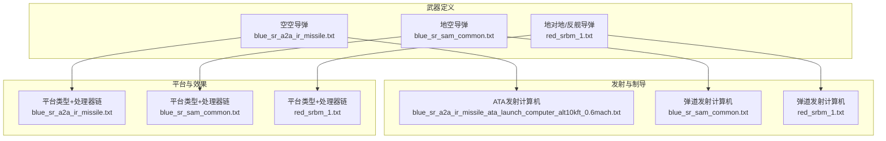
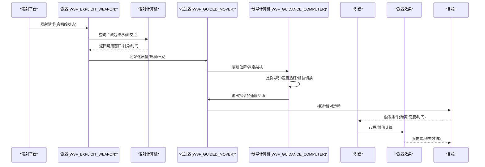
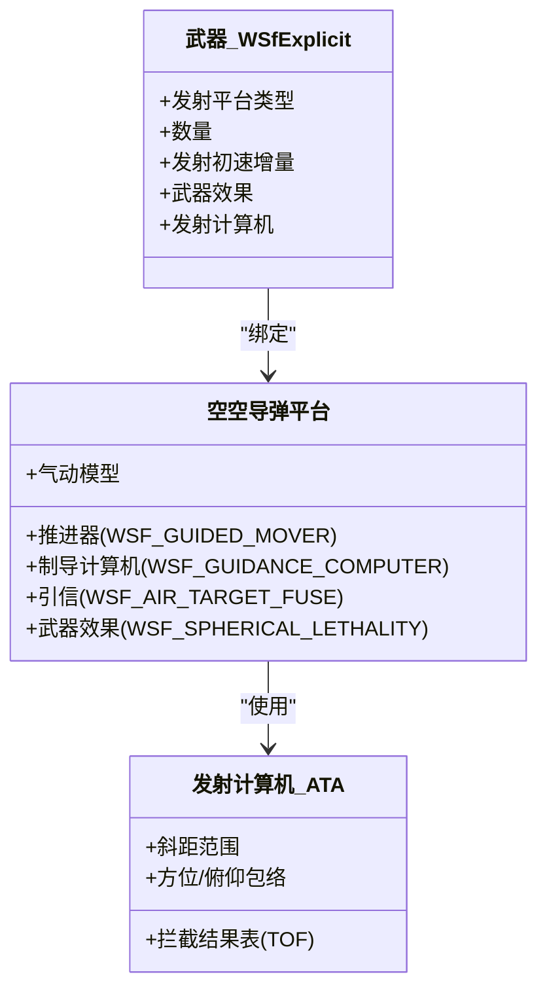
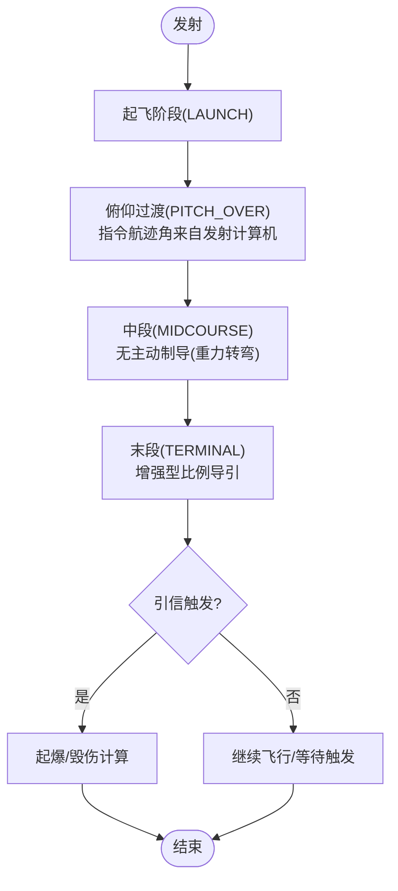
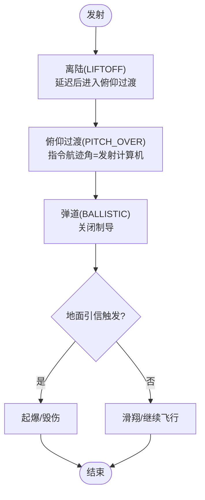
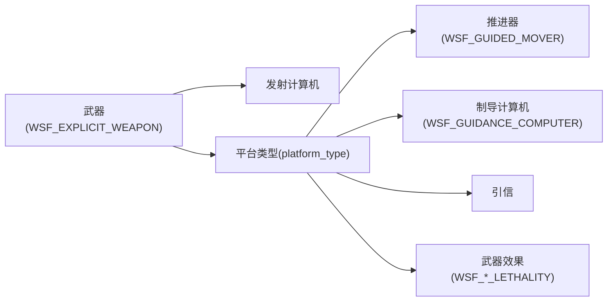

# 武器类型插件开发

<cite>
**本文引用的文件**   
- [blue_sr_a2a_ir_missile.txt](file://demos/base_types/weapons/aam/blue_sr_a2a_ir_missile.txt)
- [simple_a2a_missile.txt](file://demos/base_types/weapons/aam/simple_a2a_missile.txt)
- [blue_sr_a2a_ir_missile_ata_launch_computer_alt10kft_0.6mach.txt](file://demos/base_types/weapons/aam/blue_sr_a2a_ir_missile_ata_launch_computer_alt10kft_0.6mach.txt)
- [blue_sr_sam_common.txt](file://demos/base_types/weapons/sam/blue_sr_sam_common.txt)
- [blue_sr_sam_simple.txt](file://demos/base_types/weapons/sam/blue_sr_sam_simple.txt)
- [red_srbm_1.txt](file://demos/base_types/weapons/ssm/red_srbm_1.txt)
</cite>

## 目录
1. [引言](#引言)
2. [项目结构](#项目结构)
3. [核心组件](#核心组件)
4. [架构总览](#架构总览)
5. [详细组件分析](#详细组件分析)
6. [依赖关系分析](#依赖关系分析)
7. [性能与仿真要点](#性能与仿真要点)
8. [故障排查指南](#故障排查指南)
9. [结论](#结论)
10. [附录：开发清单与示例路径](#附录开发清单与示例路径)

## 引言
本技术文档面向AFSIM武器类型插件开发者，围绕WsfWeapon基类的设计模式，系统阐述弹道计算框架、效果评估机制与可视化接口；并给出空空导弹（AAM）、地空导弹（SAM）、反舰/地对地导弹（SSM/TBM）与精确制导武器的完整开发流程。文档同时覆盖推进系统建模、制导算法配置、战斗部毁伤模型、发射到命中的仿真链路，以及多武器协同作战的仿真技巧与测试分析方法。

## 项目结构
AFSIM通过脚本定义平台、传感器、处理器、武器与效果等要素。武器相关示例集中在demos/base_types/weapons目录下，按武器类型分目录组织：
- aam：空空导弹（红外/雷达导引头、自动导航计算机、引信、毁伤模型）
- sam：地空导弹（弹道式发射、中段/末段制导、引信与毁伤）
- ssm：地对地/反舰导弹（多级推进、弹道发射计算机、地面目标引信）

图表来源
- [blue_sr_a2a_ir_missile.txt:29-102](file://demos/base_types/weapons/aam/blue_sr_a2a_ir_missile.txt#L29-L102)
- [blue_sr_a2a_ir_missile_ata_launch_computer_alt10kft_0.6mach.txt:11-78](file://demos/base_types/weapons/aam/blue_sr_a2a_ir_missile_ata_launch_computer_alt10kft_0.6mach.txt#L11-L78)
- [blue_sr_sam_common.txt:87-236](file://demos/base_types/weapons/sam/blue_sr_sam_common.txt#L87-L236)
- [red_srbm_1.txt:57-197](file://demos/base_types/weapons/ssm/red_srbm_1.txt#L57-L197)

章节来源
- [blue_sr_a2a_ir_missile.txt:29-102](file://demos/base_types/weapons/aam/blue_sr_a2a_ir_missile.txt#L29-L102)
- [blue_sr_sam_common.txt:87-236](file://demos/base_types/weapons/sam/blue_sr_sam_common.txt#L87-L236)
- [red_srbm_1.txt:57-197](file://demos/base_types/weapons/ssm/red_srbm_1.txt#L57-L197)

## 核心组件
- WsfWeapon（显式武器）：在脚本中以weapon声明，绑定发射平台类型、数量、发射初速增量、武器效果与发射计算机等。
- WSF_EXPLICIT_WEAPON：AFSIM提供的通用武器基类，支持显式参数化配置。
- 推进器WSF_GUIDED_MOVER：描述质量、燃料、推力、比冲、气动外形、阶段等，驱动弹道积分。
- 制导处理器WSF_GUIDANCE_COMPUTER：实现比例导引、速度追踪、相位切换、指令G限等。
- 引信WSF_AIR_TARGET_FUSE / WSF_GROUND_TARGET_FUSE：决定起爆条件、飞行时间上限、失目标后滑翔时间等。
- 武器效果WSF_SPHERICAL_LETHALITY / WSF_GRADUATED_LETHALITY：球形或分级毁伤模型，可结合脚本调整杀伤概率。
- 发射计算机WSF_ATA_LAUNCH_COMPUTER / WSF_BALLISTIC_MISSILE_LAUNCH_COMPUTER：提供拦截包络、发射约束、预测交点与射角等。

章节来源
- [blue_sr_a2a_ir_missile.txt:50-102](file://demos/base_types/weapons/aam/blue_sr_a2a_ir_missile.txt#L50-L102)
- [blue_sr_sam_common.txt:101-236](file://demos/base_types/weapons/sam/blue_sr_sam_common.txt#L101-L236)
- [red_srbm_1.txt:67-197](file://demos/base_types/weapons/ssm/red_srbm_1.txt#L67-L197)

## 架构总览
下图展示从“发射平台”到“命中判定”的端到端数据流与控制流。

图表来源
- [blue_sr_a2a_ir_missile.txt:50-102](file://demos/base_types/weapons/aam/blue_sr_a2a_ir_missile.txt#L50-L102)
- [blue_sr_sam_common.txt:126-236](file://demos/base_types/weapons/sam/blue_sr_sam_common.txt#L126-L236)
- [red_srbm_1.txt:83-197](file://demos/base_types/weapons/ssm/red_srbm_1.txt#L83-L197)

## 详细组件分析

### 空空导弹（AAM）开发流程
- 气动与推进：定义WSF_AERO与WSF_GUIDED_MOVER，设置质量、燃料、推力、比冲、推力持续时间与气动参考面积、升阻特性。
- 制导：使用WSF_GUIDANCE_COMPUTER，配置比例导引增益、速度追踪增益、指令G限与更新间隔；可选配完美跟踪器作为导引头替代。
- 引信：WSF_AIR_TARGET_FUSE，设置最大飞行时间、低马赫起爆限制等。
- 毁伤：WSF_SPHERICAL_LETHALITY，定义最小/最大半径、阈值伤害、指数衰减等。
- 武器与发射计算机：以WSF_EXPLICIT_WEAPON声明武器，绑定launch_computer为WSF_ATA_LAUNCH_COMPUTER，提供斜距、方位/俯仰包络与拦截结果表。

图表来源
- [blue_sr_a2a_ir_missile.txt:29-102](file://demos/base_types/weapons/aam/blue_sr_a2a_ir_missile.txt#L29-L102)
- [blue_sr_a2a_ir_missile_ata_launch_computer_alt10kft_0.6mach.txt:11-78](file://demos/base_types/weapons/aam/blue_sr_a2a_ir_missile_ata_launch_computer_alt10kft_0.6mach.txt#L11-L78)

章节来源
- [blue_sr_a2a_ir_missile.txt:29-102](file://demos/base_types/weapons/aam/blue_sr_a2a_ir_missile.txt#L29-L102)
- [blue_sr_a2a_ir_missile_ata_launch_computer_alt10kft_0.6mach.txt:11-78](file://demos/base_types/weapons/aam/blue_sr_a2a_ir_missile_ata_launch_computer_alt10kft_0.6mach.txt#L11-L78)
- [simple_a2a_missile.txt:14-28](file://demos/base_types/weapons/aam/simple_a2a_missile.txt#L14-L28)

### 地空导弹（SAM）开发流程
- 气动与推进：WSF_AERO与WSF_GUIDED_MOVER，典型固体火箭发动机参数。
- 制导：WSF_GUIDANCE_COMPUTER，包含LAUNCH/PITCH_OVER/MIDCOURSE/TERMINAL等相位，终端采用增强型比例导引，禁用速度追踪与G偏置以避免对下落目标的误补偿。
- 引信：WSF_AIR_TARGET_FUSE，设置低马赫起爆、最大飞行时间与高海拔自毁。
- 毁伤：WSF_GRADUATED_LETHALITY，可结合脚本根据命中几何修正杀伤概率。
- 发射计算机：WSF_BALLISTIC_MISSILE_LAUNCH_COMPUTER，基于表面到空中表格生成射角/时间等。

图表来源
- [blue_sr_sam_common.txt:126-194](file://demos/base_types/weapons/sam/blue_sr_sam_common.txt#L126-L194)

章节来源
- [blue_sr_sam_common.txt:87-236](file://demos/base_types/weapons/sam/blue_sr_sam_common.txt#L87-L236)
- [blue_sr_sam_simple.txt:28-33](file://demos/base_types/weapons/sam/blue_sr_sam_simple.txt#L28-L33)

### 地对地/反舰导弹（SSM/TBM）开发流程
- 气动与推进：WSF_AERO与WSF_GUIDED_MOVER，多级推进（单级示例），质量、燃料、推力、比冲与燃烧时间。
- 制导：WSF_GUIDANCE_COMPUTER，LIFTOFF→PITCH_OVER→BALLISTIC三阶段，末端关闭制导以节省计算资源。
- 引信：WSF_GROUND_TARGET_FUSE，设置失目标后滑翔时间。
- 发射计算机：WSF_BALLISTIC_MISSILE_LAUNCH_COMPUTER，基于surface_to_surface_table生成弹道参数，要求loft_angle。
- 武器：WSF_EXPLICIT_WEAPON，设置发射偏移、倾角、预测交点指示、方位 slew 限制与数量。

图表来源
- [red_srbm_1.txt:67-197](file://demos/base_types/weapons/ssm/red_srbm_1.txt#L67-L197)

章节来源
- [red_srbm_1.txt:57-197](file://demos/base_types/weapons/ssm/red_srbm_1.txt#L57-L197)

### 精确制导武器（AGM/巡航导弹）要点
- 推进：WSF_GUIDED_MOVER，通常长续航、低阻力气动外形。
- 制导：WSF_GUIDANCE_COMPUTER，常采用航路点/地形匹配/景象匹配等策略（具体由处理器逻辑控制）。
- 引信：依据目标类型选择空中/地面引信。
- 发射计算机：根据任务剖面生成航迹角/速度/能量管理策略。

（本节为概念性说明，不直接分析具体文件）

## 依赖关系分析
- 武器与平台：weapon声明中通过launched_platform_type绑定具体平台类型，确保发射时平台具备所需子系统（传感器、通信、武器挂架等）。
- 武器与发射计算机：weapon通过launch_computer引用WSF_ATA_LAUNCH_COMPUTER或WSF_BALLISTIC_MISSILE_LAUNCH_COMPUTER，提供拦截包络与预测交点。
- 平台与处理器链：platform_type内串联mover、processor（制导/寻的/引信）与weapon_effects，形成完整的仿真链路。
- 效果与脚本：WSF_GRADUATED_LETHALITY可通过script回调修改杀伤概率，耦合目标速度与命中几何。

图表来源
- [blue_sr_a2a_ir_missile.txt:50-102](file://demos/base_types/weapons/aam/blue_sr_a2a_ir_missile.txt#L50-L102)
- [blue_sr_sam_common.txt:166-236](file://demos/base_types/weapons/sam/blue_sr_sam_common.txt#L166-L236)
- [red_srbm_1.txt:123-197](file://demos/base_types/weapons/ssm/red_srbm_1.txt#L123-L197)

章节来源
- [blue_sr_a2a_ir_missile.txt:50-102](file://demos/base_types/weapons/aam/blue_sr_a2a_ir_missile.txt#L50-L102)
- [blue_sr_sam_common.txt:166-236](file://demos/base_types/weapons/sam/blue_sr_sam_common.txt#L166-L236)
- [red_srbm_1.txt:123-197](file://demos/base_types/weapons/ssm/red_srbm_1.txt#L123-L197)

## 性能与仿真要点
- 推进器时间步长与更新间隔：更小的integration_timestep提高精度但增加计算量；update_interval影响处理器调用频率。
- 制导更新间隔：过高的更新频率会放大数值噪声，需与传感器/寻的器更新周期匹配。
- 引信与终止条件：合理设置max_time_of_flight_to_detonate与detonate_above_height_msl，避免无效飞行消耗算力。
- 发射计算机查表维度：ATA/LC表的bin数与范围应覆盖典型交战包络，避免频繁插值与越界。
- 毁伤脚本开销：在高频命中事件中谨慎使用复杂脚本逻辑，必要时简化或缓存中间结果。

（本节为通用指导，不直接分析具体文件）

## 故障排查指南
- 发射被拒绝：检查require_loft_angle是否满足、发射计算机是否返回有效射角/时间；确认azimuth_slew_limits与tilt设置合理。
- 未命中或过早自毁：核查引信参数（detonate_below_mach、detonate_above_height_msl、max_time_of_flight_to_detonate）与末段制导增益。
- 轨迹异常：检查mover的质量/燃料/推力/比冲与aero的cl_max/cd曲线是否匹配；核对stage定义与燃烧时间。
- 毁伤不符合预期：确认weapon_effects类型与参数；若使用WSF_GRADUATED_LETHALITY，检查脚本中对命中几何的处理逻辑。
- 发射计算机包络过小：扩大intercept_results的bin范围与limit值，或重新生成表数据。

章节来源
- [blue_sr_sam_common.txt:185-194](file://demos/base_types/weapons/sam/blue_sr_sam_common.txt#L185-L194)
- [red_srbm_1.txt:141-145](file://demos/base_types/weapons/ssm/red_srbm_1.txt#L141-L145)
- [blue_sr_a2a_ir_missile_ata_launch_computer_alt10kft_0.6mach.txt:18-38](file://demos/base_types/weapons/aam/blue_sr_a2a_ir_missile_ata_launch_computer_alt10kft_0.6mach.txt#L18-L38)

## 结论
AFSIM的武器类型插件以WSF_EXPLICIT_WEAPON为核心，通过组合推进器、制导计算机、引信与武器效果，构建从发射到命中的完整仿真链路。不同武器类型的差异主要体现在推进阶段划分、制导策略与引信逻辑上。借助发射计算机提供的包络与预测交点，可在保证物理一致性的前提下高效完成多场景、多武器协同的仿真与分析。

## 附录：开发清单与示例路径
- 空空导弹（AAM）
  - 基础定义与处理器链：[blue_sr_a2a_ir_missile.txt](file://demos/base_types/weapons/aam/blue_sr_a2a_ir_missile.txt)
  - ATA发射计算机示例：[blue_sr_a2a_ir_missile_ata_launch_computer_alt10kft_0.6mach.txt](file://demos/base_types/weapons/aam/blue_sr_a2a_ir_missile_ata_launch_computer_alt10kft_0.6mach.txt)
  - 简单武器封装示例：[simple_a2a_missile.txt](file://demos/base_types/weapons/aam/simple_a2a_missile.txt)
- 地空导弹（SAM）
  - 公共定义与处理器链：[blue_sr_sam_common.txt](file://demos/base_types/weapons/sam/blue_sr_sam_common.txt)
  - 简化平台继承示例：[blue_sr_sam_simple.txt](file://demos/base_types/weapons/sam/blue_sr_sam_simple.txt)
- 地对地/反舰导弹（SSM/TBM）
  - 短程弹道导弹示例：[red_srbm_1.txt](file://demos/base_types/weapons/ssm/red_srbm_1.txt)

章节来源
- [blue_sr_a2a_ir_missile.txt:29-102](file://demos/base_types/weapons/aam/blue_sr_a2a_ir_missile.txt#L29-L102)
- [blue_sr_a2a_ir_missile_ata_launch_computer_alt10kft_0.6mach.txt:11-78](file://demos/base_types/weapons/aam/blue_sr_a2a_ir_missile_ata_launch_computer_alt10kft_0.6mach.txt#L11-L78)
- [simple_a2a_missile.txt:14-28](file://demos/base_types/weapons/aam/simple_a2a_missile.txt#L14-L28)
- [blue_sr_sam_common.txt:87-236](file://demos/base_types/weapons/sam/blue_sr_sam_common.txt#L87-L236)
- [blue_sr_sam_simple.txt:28-33](file://demos/base_types/weapons/sam/blue_sr_sam_simple.txt#L28-L33)
- [red_srbm_1.txt:57-197](file://demos/base_types/weapons/ssm/red_srbm_1.txt#L57-L197)