# 第三方系统集成

<cite>
**本文引用的文件**   
- [tools/README.md](file://tools/README.md)
- [documentation/html/_sources/docs/xio_interface_development.rst.txt](file://documentation/html/_sources/docs/xio_interface_development.rst.txt)
- [training/developer/core/labs/solution/observer/receiver.py](file://training/developer/core/labs/solution/observer/receiver.py)
- [swdev/src/core/wsf_mil/test_mission/xio/run.bat](file://swdev/src/core/wsf_mil/test_mission/xio/run.bat)
- [training/developer/core/labs/solution/xio/source/FlightControlPkt.hpp](file://training/developer/core/labs/solution/xio/source/FlightControlPkt.hpp)
- [demos/air_to_air/signatures/signature_conversion/Brawler_to_SOSM.m](file://demos/air_to_air/signatures/signature_conversion/Brawler_to_SOSM.m)
- [demos/air_to_air/signatures/signature_conversion/import_fxw.m](file://demos/air_to_air/signatures/signature_conversion/import_fxw.m)
- [swdev/src/core/wsf_parser/source/WsfPM_Comm.cpp](file://swdev/src/core/wsf_parser/source/WsfPM_Comm.cpp)
- [swdev/src/core/wsf_parser/source/WsfPM_Sensor.hpp](file://swdev/src/core/wsf_parser/source/WsfPM_Sensor.hpp)
- [swdev/src/core/sensor_plot_lib/source/VerticalCoverageFunction.hpp](file://swdev/src/core/sensor_plot_lib/source/VerticalCoverageFunction.hpp)
- [swdev/src/core/wsf_nx/source/ew/WsfEW_NX_SLB_Effect.cpp](file://swdev/src/core/wsf_nx/source/ew/WsfEW_NX_SLB_Effect.cpp)
- [swdev/src/warlock/plugins/P6DOF_Data/source/P6DOF_DataSimInterface.hpp](file://swdev/src/warlock/plugins/P6DOF_Data/source/P6DOF_DataSimInterface.hpp)
- [swdev/src/warlock/plugins/P6DOF_Controller/source/P6DOF_ControllerDataContainer.cpp](file://swdev/src/warlock/plugins/P6DOF_Controller/source/P6DOF_ControllerDataContainer.cpp)
- [swdev/src/wsf_plugins/wsf_oms_uci/source/WsfUCI_Component.cpp](file://swdev/src/wsf_plugins/wsf_oms_uci/source/WsfUCI_Component.cpp)
- [swdev/src/wsf_plugins/wsf_coverage/source/WsfCoverageRegistration.cpp](file://swdev/src/wsf_plugins/wsf_coverage/source/WsfCoverageRegistration.cpp)
- [swdev/src/tools/util_script/source/UtScriptFunction.cpp](file://swdev/src/tools/util_script/source/UtScriptFunction.cpp)
- [swdev/src/mystic/plugins/ResultQuantumTaskerData/doc/_rv_tools_menu_extension.txt](file://swdev/src/mystic/plugins/ResultQuantumTaskerData/doc/_rv_tools_menu_extension.txt)
- [documentation/html/docs/multiresolution_processor.html](file://documentation/html/docs/multiresolution_processor.html)
</cite>

## 目录
1. [简介](#简介)
2. [项目结构](#项目结构)
3. [核心组件](#核心组件)
4. [架构总览](#架构总览)
5. [详细组件分析](#详细组件分析)
6. [依赖关系分析](#依赖关系分析)
7. [性能考虑](#性能考虑)
8. [故障排查指南](#故障排查指南)
9. [结论](#结论)
10. [附录](#附录)

## 简介
本指南面向需要将 AFSIM 与第三方系统集成的工程团队，覆盖以下主题：
- 与 MATLAB、Python 数据分析工具的集成（数据交换格式、接口协议、自动化流程）
- 与 GIS 系统的集成（地理数据导入、地形处理、空间分析）
- 与专业仿真工具的互操作（模型转换、联合仿真、结果对比）
- 与数据库系统的集成（数据存储、查询优化、批量处理）
- 与可视化工具的集成（图表生成、三维渲染、交互式界面）
- 云平台与分布式计算（任务调度、资源管理、并行处理）
- 企业级集成模式（性能监控、日志记录、故障恢复）

## 项目结构
AFSIM 仓库以“示例场景 + 工具脚本 + 核心源码 + 文档”组织。与第三方集成相关的关键位置包括：
- tools：提供数据处理与后处理脚本（Python/Perl），便于扩展为更强大的分析工具
- documentation：包含 XIO 接口开发等文档
- demos：大量可运行示例，涵盖传感器、电子战、六自由度、通信、网络等
- swdev：核心框架与插件实现，包含 WSF、Warlock、Mystic 等子系统

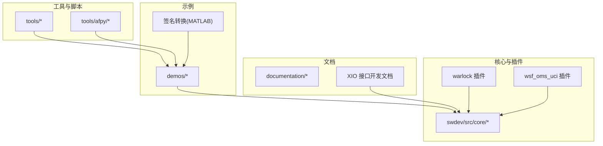

图示来源
- [tools/README.md:1-51](file://tools/README.md#L1-L51)
- [documentation/html/_sources/docs/xio_interface_development.rst.txt:12-30](file://documentation/html/_sources/docs/xio_interface_development.rst.txt#L12-L30)
- [demos/air_to_air/signatures/signature_conversion/Brawler_to_SOSM.m](file://demos/air_to_air/signatures/signature_conversion/Brawler_to_SOSM.m)
- [demos/air_to_air/signatures/signature_conversion/import_fxw.m](file://demos/air_to_air/signatures/signature_conversion/import_fxw.m)

章节来源
- [tools/README.md:1-51](file://tools/README.md#L1-L51)

## 核心组件
- XIO 接口：用于 AFSIM 与其他仿真或外部程序之间的实时数据交换（UDP/TCP、自定义包）
- Python 接收端示例：演示通过 UDP 接收 AFSIM 输出数据
- MATLAB 签名转换脚本：在 AFSIM 与 SOSM 之间进行签名数据转换
- Warlock P6DOF 数据接口：在可视化与控制侧与仿真线程交互
- UCI 组件：支持 OMS/UCI 标准消息的写入与订阅
- 覆盖率与多分辨率处理器：运行时选择处理器，支持可扩展的分析管线

章节来源
- [documentation/html/_sources/docs/xio_interface_development.rst.txt:12-30](file://documentation/html/_sources/docs/xio_interface_development.rst.txt#L12-L30)
- [training/developer/core/labs/solution/observer/receiver.py:1-24](file://training/developer/core/labs/solution/observer/receiver.py#L1-L24)
- [demos/air_to_air/signatures/signature_conversion/Brawler_to_SOSM.m](file://demos/air_to_air/signatures/signature_conversion/Brawler_to_SOSM.m)
- [demos/air_to_air/signatures/signature_conversion/import_fxw.m](file://demos/air_to_air/signatures/signature_conversion/import_fxw.m)
- [swdev/src/warlock/plugins/P6DOF_Data/source/P6DOF_DataSimInterface.hpp:1-44](file://swdev/src/warlock/plugins/P6DOF_Data/source/P6DOF_DataSimInterface.hpp#L1-L44)
- [swdev/src/wsf_plugins/wsf_oms_uci/source/WsfUCI_Component.cpp:1-52](file://swdev/src/wsf_plugins/wsf_oms_uci/source/WsfUCI_Component.cpp#L1-L52)
- [documentation/html/docs/multiresolution_processor.html:113-129](file://documentation/html/docs/multiresolution_processor.html#L113-L129)

## 架构总览
下图展示 AFSIM 与第三方系统的主要集成路径：
- 数据交换：XIO 包（如 FlightControlPkt）通过 UDP 传输
- 控制流：外部控制器发送飞行控制指令到 AFSIM
- 可视化：Warlock P6DOF 数据接口在仿真线程中读取平台状态并推送至 UI
- 模型转换：MATLAB 脚本将 Brawler/SOSM 签名数据进行转换
- 通信建模：WSF PM 通信抽象封装网络名称与链路访问

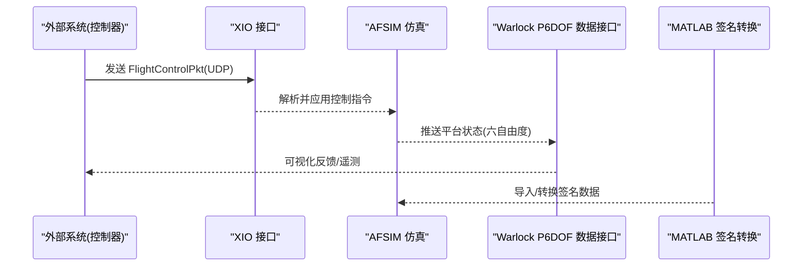

图示来源
- [training/developer/core/labs/solution/xio/source/FlightControlPkt.hpp:24-43](file://training/developer/core/labs/solution/xio/source/FlightControlPkt.hpp#L24-L43)
- [swdev/src/warlock/plugins/P6DOF_Data/source/P6DOF_DataSimInterface.hpp:25-41](file://swdev/src/warlock/plugins/P6DOF_Data/source/P6DOF_DataSimInterface.hpp#L25-L41)
- [demos/air_to_air/signatures/signature_conversion/Brawler_to_SOSM.m](file://demos/air_to_air/signatures/signature_conversion/Brawler_to_SOSM.m)

## 详细组件分析

### XIO 接口与 UDP 数据交换
- 初始化：通过 WsfXIO::Create() 初始化，指定选项与应用类型（cAPP_SIMULATION/cAPP_USER）
- 连接策略：默认不主动连接其他应用；可通过 AddConnectType() 配置自动连接
- 数据包：FlightControlPkt 定义平台索引、俯仰/滚转/偏航速率、油门等字段，使用序列化宏注册
- 外部接收：Python 示例监听 UDP 端口，打印收到的文本数据

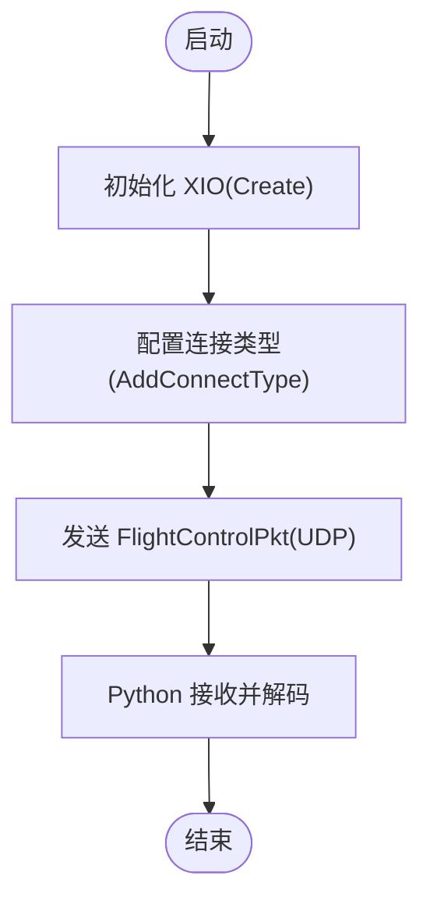

图示来源
- [documentation/html/_sources/docs/xio_interface_development.rst.txt:24-30](file://documentation/html/_sources/docs/xio_interface_development.rst.txt#L24-L30)
- [training/developer/core/labs/solution/xio/source/FlightControlPkt.hpp:24-43](file://training/developer/core/labs/solution/xio/source/FlightControlPkt.hpp#L24-L43)
- [training/developer/core/labs/solution/observer/receiver.py:10-24](file://training/developer/core/labs/solution/observer/receiver.py#L10-L24)

章节来源
- [documentation/html/_sources/docs/xio_interface_development.rst.txt:12-30](file://documentation/html/_sources/docs/xio_interface_development.rst.txt#L12-L30)
- [training/developer/core/labs/solution/xio/source/FlightControlPkt.hpp:24-43](file://training/developer/core/labs/solution/xio/source/FlightControlPkt.hpp#L24-L43)
- [training/developer/core/labs/solution/observer/receiver.py:1-24](file://training/developer/core/labs/solution/observer/receiver.py#L1-L24)

### MATLAB 与 AFSIM 的签名数据转换
- 目的：在 Brawler 与 SOSM 之间进行雷达/红外等签名数据的格式转换
- 入口：Brawler_to_SOSM.m、import_fxw.m 作为转换脚本
- 集成方式：在 AFSIM 场景中调用或离线批处理，将转换后的签名数据供传感器/武器模型使用

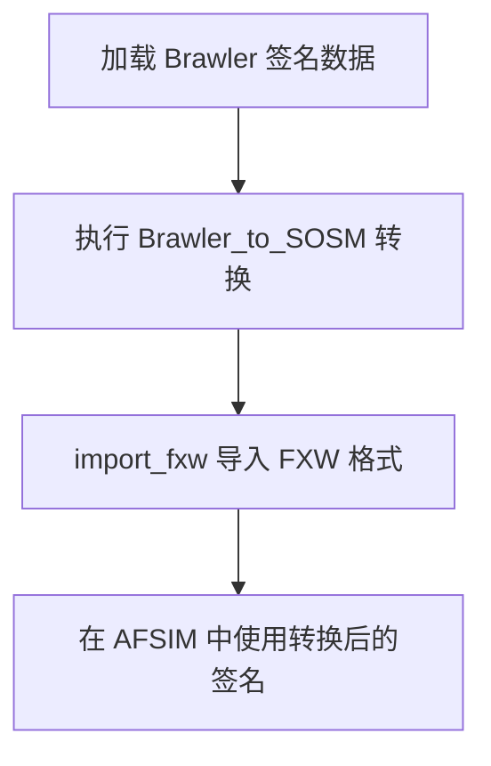

图示来源
- [demos/air_to_air/signatures/signature_conversion/Brawler_to_SOSM.m](file://demos/air_to_air/signatures/signature_conversion/Brawler_to_SOSM.m)
- [demos/air_to_air/signatures/signature_conversion/import_fxw.m](file://demos/air_to_air/signatures/signature_conversion/import_fxw.m)

章节来源
- [demos/air_to_air/signatures/signature_conversion/Brawler_to_SOSM.m](file://demos/air_to_air/signatures/signature_conversion/Brawler_to_SOSM.m)
- [demos/air_to_air/signatures/signature_conversion/import_fxw.m](file://demos/air_to_air/signatures/signature_conversion/import_fxw.m)

### Warlock P6DOF 数据接口（可视化与控制）
- 角色：SimInterface 在仿真线程中读取平台状态，触发事件并更新 UI
- 生命周期：WallClockRead 周期性读取；SimulationComplete 收尾；PlatformAdded/Deleted 管理实体
- 数据容器：P6DOF_ControllerDataContainer 维护已连接平台、仿真初始化标志、平台数据集合

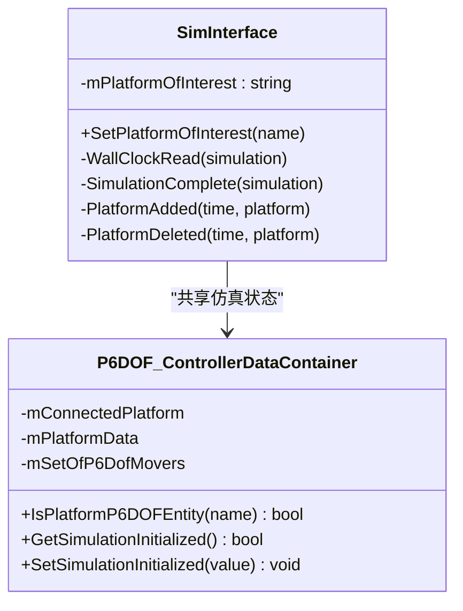

图示来源
- [swdev/src/warlock/plugins/P6DOF_Data/source/P6DOF_DataSimInterface.hpp:25-41](file://swdev/src/warlock/plugins/P6DOF_Data/source/P6DOF_DataSimInterface.hpp#L25-L41)
- [swdev/src/warlock/plugins/P6DOF_Controller/source/P6DOF_ControllerDataContainer.cpp:17-37](file://swdev/src/warlock/plugins/P6DOF_Controller/source/P6DOF_ControllerDataContainer.cpp#L17-L37)

章节来源
- [swdev/src/warlock/plugins/P6DOF_Data/source/P6DOF_DataSimInterface.hpp:1-44](file://swdev/src/warlock/plugins/P6DOF_Data/source/P6DOF_DataSimInterface.hpp#L1-L44)
- [swdev/src/warlock/plugins/P6DOF_Controller/source/P6DOF_ControllerDataContainer.cpp:1-37](file://swdev/src/warlock/plugins/P6DOF_Controller/source/P6DOF_ControllerDataContainer.cpp#L1-L37)

### UCI/OMS 组件（标准消息）
- 组件：UCI_Component 继承自平台部件，负责与 UCI 接口注册/注销
- 更新间隔：返回极大值表示按需更新
- 用途：支持 OMS/UCI 标准消息的写入与订阅，便于与上层 C2 系统集成

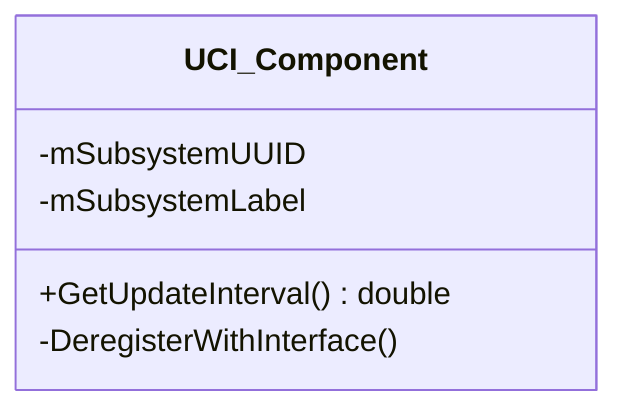

图示来源
- [swdev/src/wsf_plugins/wsf_oms_uci/source/WsfUCI_Component.cpp:28-51](file://swdev/src/wsf_plugins/wsf_oms_uci/source/WsfUCI_Component.cpp#L28-L51)

章节来源
- [swdev/src/wsf_plugins/wsf_oms_uci/source/WsfUCI_Component.cpp:1-52](file://swdev/src/wsf_plugins/wsf_oms_uci/source/WsfUCI_Component.cpp#L1-L52)

### 通信与传感器建模（WSF PM）
- 通信抽象：WsfPM_Comm 提供网络名称与链路访问方法
- 传感器抽象：WsfPM_Sensor 作为平台部件的传感器子对象
- 用途：在场景构建阶段定义通信拓扑与传感器参数，供仿真运行时使用

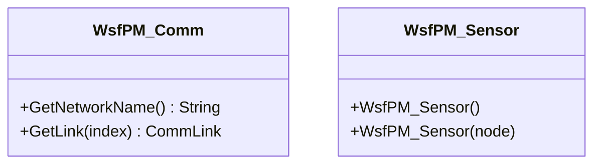

图示来源
- [swdev/src/core/wsf_parser/source/WsfPM_Comm.cpp:18-36](file://swdev/src/core/wsf_parser/source/WsfPM_Comm.cpp#L18-L36)
- [swdev/src/core/wsf_parser/source/WsfPM_Sensor.hpp:23-30](file://swdev/src/core/wsf_parser/source/WsfPM_Sensor.hpp#L23-L30)

章节来源
- [swdev/src/core/wsf_parser/source/WsfPM_Comm.cpp:1-36](file://swdev/src/core/wsf_parser/source/WsfPM_Comm.cpp#L1-L36)
- [swdev/src/core/wsf_parser/source/WsfPM_Sensor.hpp:1-32](file://swdev/src/core/wsf_parser/source/WsfPM_Sensor.hpp#L1-L32)

### 电子战效果（SLB 空域遮蔽）
- 组件：WsfEW_NX_SLB_Effect 继承 SLB 效果基类，设置相干性掩码与行为
- 用途：在电子战仿真中实现空域遮蔽（Space/Lobe Blanket）效果，影响雷达探测与跟踪

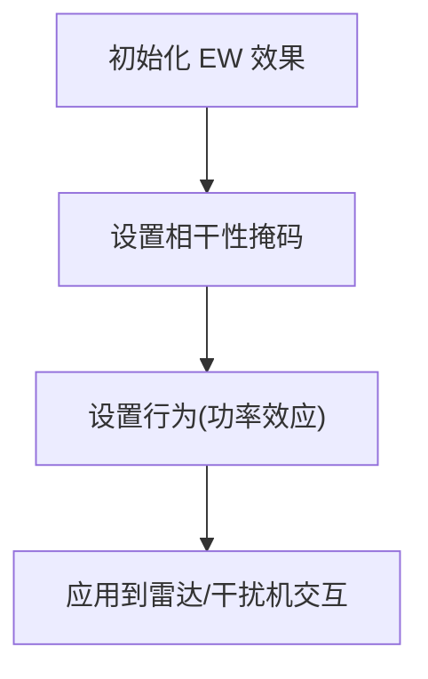

图示来源
- [swdev/src/core/wsf_nx/source/ew/WsfEW_NX_SLB_Effect.cpp:35-45](file://swdev/src/core/wsf_nx/source/ew/WsfEW_NX_SLB_Effect.cpp#L35-L45)

章节来源
- [swdev/src/core/wsf_nx/source/ew/WsfEW_NX_SLB_Effect.cpp:1-45](file://swdev/src/core/wsf_nx/source/ew/WsfEW_NX_SLB_Effect.cpp#L1-L45)

### 垂直覆盖函数（传感器绘图与分析）
- 组件：VerticalCoverageFunction 实现 Execute/ProcessInput，输出最大高度/范围等指标
- 用途：用于传感器覆盖分析与绘图，辅助评估探测能力

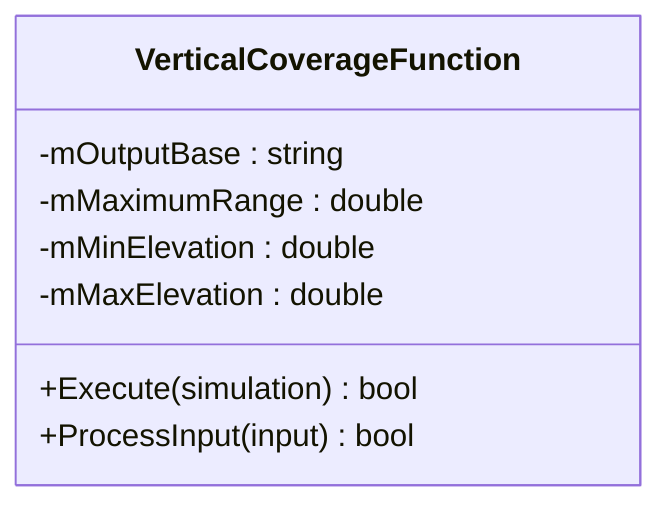

图示来源
- [swdev/src/core/sensor_plot_lib/source/VerticalCoverageFunction.hpp:21-51](file://swdev/src/core/sensor_plot_lib/source/VerticalCoverageFunction.hpp#L21-L51)

章节来源
- [swdev/src/core/sensor_plot_lib/source/VerticalCoverageFunction.hpp:1-53](file://swdev/src/core/sensor_plot_lib/source/VerticalCoverageFunction.hpp#L1-L53)

### 多分辨率处理器（运行时选择）
- 功能：multiresolution_processor 作为容器，在运行时选择具体处理器
- 用法：在平台定义中添加/编辑多分辨率处理器，动态切换不同精度/粒度的处理逻辑

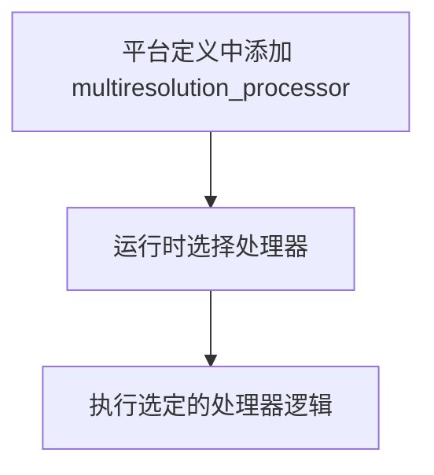

图示来源
- [documentation/html/docs/multiresolution_processor.html:113-129](file://documentation/html/docs/multiresolution_processor.html#L113-L129)

章节来源
- [documentation/html/docs/multiresolution_processor.html:113-129](file://documentation/html/docs/multiresolution_processor.html#L113-L129)

## 依赖关系分析
- XIO 与外部系统：通过 UDP 传输 FlightControlPkt，Python 接收端监听端口
- Warlock 与仿真：SimInterface 在仿真线程中读取平台状态，驱动可视化
- 通信与传感器：WSF PM 抽象提供网络与传感器建模接口
- 电子战效果：SLB 效果依赖 EM 交互与雷达/干扰机模型
- 多分辨率处理器：依赖场景与运行时环境，动态选择处理器

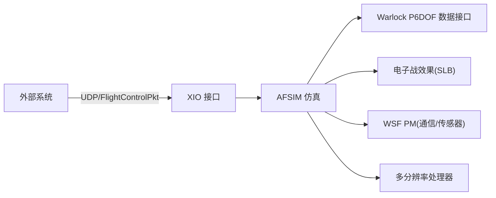

图示来源
- [training/developer/core/labs/solution/xio/source/FlightControlPkt.hpp:24-43](file://training/developer/core/labs/solution/xio/source/FlightControlPkt.hpp#L24-L43)
- [swdev/src/warlock/plugins/P6DOF_Data/source/P6DOF_DataSimInterface.hpp:25-41](file://swdev/src/warlock/plugins/P6DOF_Data/source/P6DOF_DataSimInterface.hpp#L25-L41)
- [swdev/src/core/wsf_parser/source/WsfPM_Comm.cpp:18-36](file://swdev/src/core/wsf_parser/source/WsfPM_Comm.cpp#L18-L36)
- [swdev/src/core/wsf_nx/source/ew/WsfEW_NX_SLB_Effect.cpp:35-45](file://swdev/src/core/wsf_nx/source/ew/WsfEW_NX_SLB_Effect.cpp#L35-L45)
- [documentation/html/docs/multiresolution_processor.html:113-129](file://documentation/html/docs/multiresolution_processor.html#L113-L129)

章节来源
- [training/developer/core/labs/solution/xio/source/FlightControlPkt.hpp:24-43](file://training/developer/core/labs/solution/xio/source/FlightControlPkt.hpp#L24-L43)
- [swdev/src/warlock/plugins/P6DOF_Data/source/P6DOF_DataSimInterface.hpp:25-41](file://swdev/src/warlock/plugins/P6DOF_Data/source/P6DOF_DataSimInterface.hpp#L25-L41)
- [swdev/src/core/wsf_parser/source/WsfPM_Comm.cpp:18-36](file://swdev/src/core/wsf_parser/source/WsfPM_Comm.cpp#L18-L36)
- [swdev/src/core/wsf_nx/source/ew/WsfEW_NX_SLB_Effect.cpp:35-45](file://swdev/src/core/wsf_nx/source/ew/WsfEW_NX_SLB_Effect.cpp#L35-L45)
- [documentation/html/docs/multiresolution_processor.html:113-129](file://documentation/html/docs/multiresolution_processor.html#L113-L129)

## 性能考虑
- 更新频率：UCI 组件返回极大更新间隔，适合按需更新，避免高频同步开销
- 线程安全：Warlock SimInterface 在仿真线程中读取数据，减少跨线程竞争
- 批处理：tools 目录下的脚本可用于批量处理输出数据，降低在线分析压力
- 多分辨率：运行时选择处理器，可在精度与性能间权衡

章节来源
- [swdev/src/wsf_plugins/wsf_oms_uci/source/WsfUCI_Component.cpp:48-51](file://swdev/src/wsf_plugins/wsf_oms_uci/source/WsfUCI_Component.cpp#L48-L51)
- [swdev/src/warlock/plugins/P6DOF_Data/source/P6DOF_DataSimInterface.hpp:33-38](file://swdev/src/warlock/plugins/P6DOF_Data/source/P6DOF_DataSimInterface.hpp#L33-L38)
- [tools/README.md:1-51](file://tools/README.md#L1-L51)
- [documentation/html/docs/multiresolution_processor.html:113-129](file://documentation/html/docs/multiresolution_processor.html#L113-L129)

## 故障排查指南
- XIO 初始化失败：检查是否先调用 WsfXIO::Create()，并正确设置应用类型与连接类型
- UDP 端口冲突：确认 Python 接收端端口与 AFSIM 配置一致
- 控制指令未生效：验证 FlightControlPkt 字段范围（速率 -1~1，油门 0~1）
- 可视化无数据：检查 Warlock SimInterface 是否正确订阅平台事件
- 通信/传感器建模错误：核对 WSF PM 的网络名称与链路索引

章节来源
- [documentation/html/_sources/docs/xio_interface_development.rst.txt:24-30](file://documentation/html/_sources/docs/xio_interface_development.rst.txt#L24-L30)
- [training/developer/core/labs/solution/observer/receiver.py:15-24](file://training/developer/core/labs/solution/observer/receiver.py#L15-L24)
- [training/developer/core/labs/solution/xio/source/FlightControlPkt.hpp:38-43](file://training/developer/core/labs/solution/xio/source/FlightControlPkt.hpp#L38-L43)
- [swdev/src/warlock/plugins/P6DOF_Data/source/P6DOF_DataSimInterface.hpp:33-38](file://swdev/src/warlock/plugins/P6DOF_Data/source/P6DOF_DataSimInterface.hpp#L33-L38)
- [swdev/src/core/wsf_parser/source/WsfPM_Comm.cpp:18-36](file://swdev/src/core/wsf_parser/source/WsfPM_Comm.cpp#L18-L36)

## 结论
AFSIM 提供了丰富的第三方集成能力：
- 通过 XIO 与外部系统进行实时数据交换
- 借助 MATLAB/Python 脚本完成数据转换与分析
- 利用 Warlock 与 WSF PM 扩展可视化与建模能力
- 采用多分辨率处理器与按需更新机制平衡性能与精度
建议在实际工程中结合场景需求选择合适的集成路径，并通过工具链与文档完善自动化与运维流程。

## 附录
- 运行脚本参考：swdev/src/core/wsf_mil/test_mission/xio/run.bat 用于启动 mission 测试
- 覆盖率插件：wsf_coverage 在应用创建时注册扩展，支持覆盖率分析
- 脚本函数：UtScriptFunction 提供脚本函数排序与比较能力，便于工具链扩展

章节来源
- [swdev/src/core/wsf_mil/test_mission/xio/run.bat:1-13](file://swdev/src/core/wsf_mil/test_mission/xio/run.bat#L1-L13)
- [swdev/src/wsf_plugins/wsf_coverage/source/WsfCoverageRegistration.cpp:24-44](file://swdev/src/wsf_plugins/wsf_coverage/source/WsfCoverageRegistration.cpp#L24-L44)
- [swdev/src/tools/util_script/source/UtScriptFunction.cpp:16-49](file://swdev/src/tools/util_script/source/UtScriptFunction.cpp#L16-L49)
- [swdev/src/mystic/plugins/ResultQuantumTaskerData/doc/_rv_tools_menu_extension.txt:1-10](file://swdev/src/mystic/plugins/ResultQuantumTaskerData/doc/_rv_tools_menu_extension.txt#L1-L10)