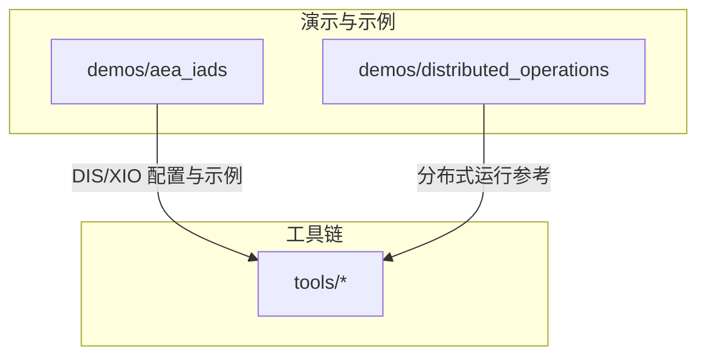
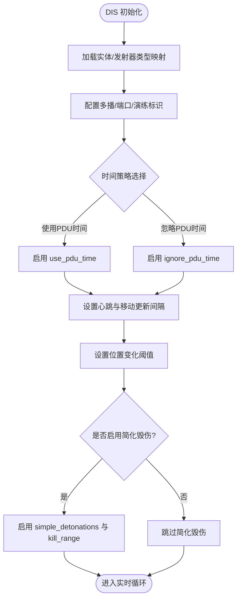
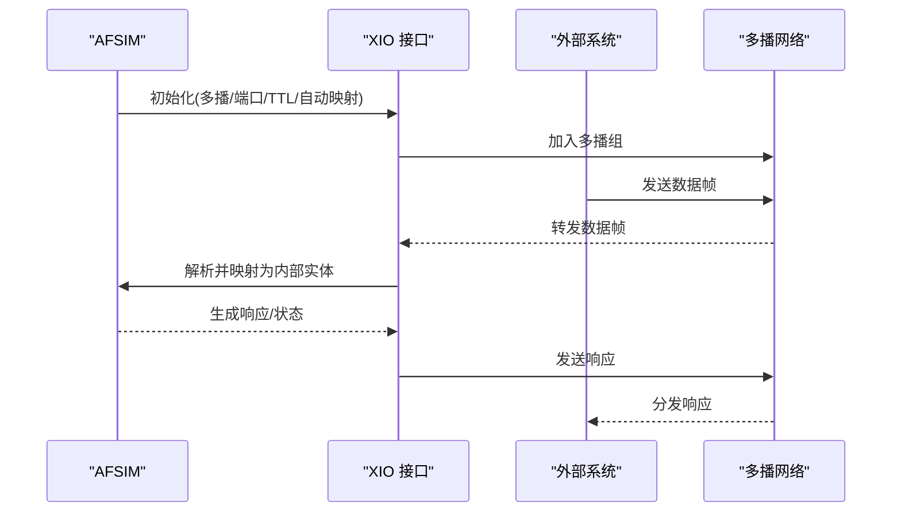
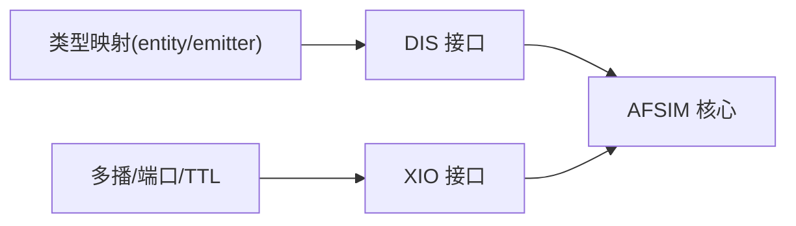

# 集成与扩展

<cite>
**本文引用的文件**   
- [aea_iads/README.md](file://demos/aea_iads/README.md)
- [distributed_operations/README.md](file://demos/distributed_operations/README.md)
- [dis_data.txt](file://demos/aea_iads/dis_data.txt)
- [dis_realtime.txt](file://demos/aea_iads/dis_realtime.txt)
- [xio_interface.txt](file://demos/aea_iads/xio_interface.txt)
</cite>

## 目录
1. [简介](#简介)
2. [项目结构](#项目结构)
3. [核心组件](#核心组件)
4. [架构总览](#架构总览)
5. [详细组件分析](#详细组件分析)
6. [依赖关系分析](#依赖关系分析)
7. [性能考虑](#性能考虑)
8. [故障排查指南](#故障排查指南)
9. [结论](#结论)
10. [附录](#附录)

## 简介
本指南面向AFSIM的集成与扩展，重点覆盖以下主题：
- DIS（分布式交互仿真）接口：实体/发射器类型映射、实时网络参数、同步与心跳机制。
- HLA集成：在AFSIM中的定位与使用建议（概念性说明）。
- XIO（扩展I/O）接口：多播组、端口、自动DIS映射、TTL等配置要点。
- Python脚本API：自动化仿真、数据处理与后分析的实践路径（概念性说明）。
- 插件架构：模块注册、接口规范与生命周期管理（概念性说明）。
- 自定义处理器、传感器与武器类型：开发思路与最佳实践（概念性说明）。
- 第三方系统集成：协议适配、数据流与常见问题。
- 性能优化与资源管理：网络、线程、I/O与内存方面的原则。
- 完整扩展案例与调试技巧：基于仓库示例的分步指导。

## 项目结构
本仓库包含大量演示场景与工具链，其中与本指南直接相关的集成与扩展内容集中在：
- demos/aea_iads：展示DIS与XIO接口的典型用法，包括实体/发射器枚举映射与实时运行配置。
- demos/distributed_operations：分布式操作相关示例与说明。
- tools：提供脚本与辅助工具，便于自动化与数据处理。



图表来源
- [aea_iads/README.md:1-66](file://demos/aea_iads/README.md#L1-L66)
- [distributed_operations/README.md:1-45](file://demos/distributed_operations/README.md#L1-L45)

章节来源
- [aea_iads/README.md:1-66](file://demos/aea_iads/README.md#L1-L66)
- [distributed_operations/README.md:1-45](file://demos/distributed_operations/README.md#L1-L45)

## 核心组件
本节聚焦DIS与XIO两个关键集成点，结合仓库中的配置文件进行说明。

- DIS接口
  - 实体与发射器类型映射：通过dis_interface块定义entity_type与emitter_type到DIS枚举的对应关系，确保不同仿真系统间语义一致。
  - 实时运行参数：包括exercise/site/application标识、多播地址与端口、自动启动、时间策略、心跳与移动更新间隔、位置阈值等。
  - 简单毁伤模型：可启用simple_detonations并设置kill_range以简化毁伤判定。

- XIO接口
  - 多播通信：指定多播组与端口，支持connect_to_simulations与auto_dis_mapping以自动发现与映射外部仿真实体。
  - TTL与调试开关：time_to_live控制多播传播范围；verbose/debug用于诊断。

章节来源
- [dis_data.txt:9-40](file://demos/aea_iads/dis_data.txt#L9-L40)
- [dis_realtime.txt:9-36](file://demos/aea_iads/dis_realtime.txt#L9-L36)
- [xio_interface.txt:10-20](file://demos/aea_iads/xio_interface.txt#L10-L20)

## 架构总览
下图展示了AFSIM在分布式仿真环境中的角色与数据流向：AFSIM作为参与者之一，通过DIS与XIO与其他仿真节点或外部系统进行双向数据交换。

```mermaid
graph TB
AFSIM["AFSIM 仿真引擎"]
DIS["DIS 接口<br/>实体/发射器映射 + 实时参数"]
XIO["XIO 接口<br/>多播/TTL/自动映射"]
EXT1["外部仿真系统 A"]
EXT2["外部仿真系统 B"]
OBS["可视化/监控(如 Warlock)"]
AFSIM --> DIS
AFSIM --> XIO
DIS < --> EXT1
XIO < --> EXT2
OBS -.->|监听多播| AFSIM
```

图表来源
- [dis_data.txt:9-40](file://demos/aea_iads/dis_data.txt#L9-L40)
- [dis_realtime.txt:9-36](file://demos/aea_iads/dis_realtime.txt#L9-L36)
- [xio_interface.txt:10-20](file://demos/aea_iads/xio_interface.txt#L10-L20)
- [aea_iads/README.md:15-24](file://demos/aea_iads/README.md#L15-L24)

## 详细组件分析

### DIS接口详解
- 类型映射
  - entity_type：将AFSIM内部实体类别映射为DIS标准枚举值，保证跨系统一致性。
  - emitter_type：将雷达/干扰机等发射器类型映射为DIS发射器枚举，支撑电子战与频谱相关交互。
- 实时参数
  - exercise/site/application：区分演练、站点与应用实例，避免ID冲突。
  - multicast/port：指定多播地址与端口，实现局域网内广播式通信。
  - autostart：启动时自动加入DIS联邦。
  - time策略：use_pdu_time/ignore_pdu_time决定是否采用PDU时间或仿真时间。
  - heartbeat/mover_update/entity_position_threshold：心跳周期、移动更新频率与位置变化阈值，平衡带宽与精度。
  - simple_detonations/simple_kill_range：启用简化爆炸与杀伤半径，降低复杂毁伤计算开销。
- 同步机制
  - 心跳与位置阈值共同作用，确保各参与方状态收敛且不过度占用网络带宽。



图表来源
- [dis_data.txt:9-40](file://demos/aea_iads/dis_data.txt#L9-L40)
- [dis_realtime.txt:9-36](file://demos/aea_iads/dis_realtime.txt#L9-L36)

章节来源
- [dis_data.txt:9-40](file://demos/aea_iads/dis_data.txt#L9-L40)
- [dis_realtime.txt:9-36](file://demos/aea_iads/dis_realtime.txt#L9-L36)

### XIO接口详解
- 多播通信
  - multicast/port：指定多播组与端口，供外部系统订阅/发布数据。
  - connect_to_simulations：允许AFSIM主动连接其他仿真。
  - auto_dis_mapping：自动将外部实体映射为AFSIM内部实体，减少手工配置。
  - time_to_live：限制多播包在网络中的跳数，防止跨网段扩散。
- 调试与日志
  - verbose/debug：输出详细日志，便于定位网络与映射问题。



图表来源
- [xio_interface.txt:10-20](file://demos/aea_iads/xio_interface.txt#L10-L20)

章节来源
- [xio_interface.txt:10-20](file://demos/aea_iads/xio_interface.txt#L10-L20)

### HLA集成（概念性说明）
- 在AFSIM中，HLA通常作为更高层的联邦协调层，与DIS并列存在。HLA适合需要严格时序、全局时钟与联邦管理的场景。
- 使用建议：
  - 明确联邦成员职责与数据交换契约（RTI Federate接口）。
  - 设计合适的交互类与属性集，避免过度耦合。
  - 利用HLA的时间管理与对象所有权机制，确保一致性。
- 与DIS对比：
  - DIS偏向轻量、低延迟的点对点/多播数据交换；HLA强调联邦级协调与时序一致性。
  - 在混合环境中，可将HLA作为联邦协调层，DIS作为底层数据通道。

[本节为概念性说明，不直接分析具体文件]

### Python脚本API（概念性说明）
- 自动化仿真：通过脚本批量启动/停止仿真、切换场景参数、收集输出。
- 数据处理：读取事件/轨迹/观测数据，进行统计分析与可视化。
- 后分析：对仿真结果进行指标计算、报告生成与回归测试。
- 实践建议：
  - 将常用流程封装为函数/类，提高复用性。
  - 使用配置文件驱动参数，便于版本管理与复现实验。
  - 结合CI/CD进行自动化回归与性能基准测试。

[本节为概念性说明，不直接分析具体文件]

### 插件架构（概念性说明）
- 模块注册：通过统一的注册表机制，动态加载处理器、传感器、武器类型等扩展模块。
- 接口规范：定义清晰的抽象接口，确保扩展与核心解耦。
- 生命周期管理：从加载、初始化、运行到销毁的全生命周期钩子，便于资源管理与错误恢复。
- 最佳实践：
  - 保持接口稳定，向后兼容。
  - 提供默认实现与最小可用示例。
  - 使用配置驱动行为，避免硬编码。

[本节为概念性说明，不直接分析具体文件]

### 自定义处理器、传感器与武器类型（概念性说明）
- 处理器：实现特定业务逻辑（如态势评估、任务分配），接入AFSIM的事件管道。
- 传感器：实现探测、跟踪、噪声与杂波建模，输出检测与跟踪数据。
- 武器类型：实现制导、飞行、毁伤逻辑，支持多种战斗部与引信模式。
- 开发步骤：
  - 定义数据模型与接口。
  - 实现核心算法与边界条件处理。
  - 编写单元测试与集成测试。
  - 提供文档与示例场景。

[本节为概念性说明，不直接分析具体文件]

## 依赖关系分析
DIS与XIO在AFSIM中的依赖关系如下：
- DIS依赖类型映射与实时参数配置，确保与外部系统的语义与时间同步一致。
- XIO依赖多播网络与自动映射能力，负责与外部系统的数据桥接。
- 两者可并行工作，分别承担不同的集成职责。



图表来源
- [dis_data.txt:9-40](file://demos/aea_iads/dis_data.txt#L9-L40)
- [dis_realtime.txt:9-36](file://demos/aea_iads/dis_realtime.txt#L9-L36)
- [xio_interface.txt:10-20](file://demos/aea_iads/xio_interface.txt#L10-L20)

章节来源
- [dis_data.txt:9-40](file://demos/aea_iads/dis_data.txt#L9-L40)
- [dis_realtime.txt:9-36](file://demos/aea_iads/dis_realtime.txt#L9-L36)
- [xio_interface.txt:10-20](file://demos/aea_iads/xio_interface.txt#L10-L20)

## 性能考虑
- 网络带宽与延迟
  - 合理设置heartbeat与mover_update_timer，避免频繁更新导致拥塞。
  - 使用entity_position_threshold过滤微小位移，减少冗余数据。
- 多播与TTL
  - 调整time_to_live限制传播范围，避免不必要的跨网段流量。
- 简化毁伤
  - 在大规模场景中启用simple_detonations与合适kill_range，降低计算复杂度。
- 线程与I/O
  - 避免在实时循环中进行阻塞I/O操作，必要时异步化。
  - 批量写入输出文件，减少磁盘I/O次数。
- 内存管理
  - 及时释放不再使用的对象，避免内存泄漏。
  - 使用对象池复用高频创建的对象。

[本节为通用指导，不直接分析具体文件]

## 故障排查指南
- DIS相关问题
  - 检查entity_type与emitter_type映射是否与外部系统一致。
  - 确认exercise/site/application标识无冲突。
  - 验证multicast/port是否正确，防火墙是否放行。
  - 观察heartbeat与mover_update_timer是否导致丢包或延迟。
- XIO相关问题
  - 检查multicast/port与connect_to_simulations配置。
  - 确认auto_dis_mapping是否生效，外部实体是否被正确映射。
  - 使用verbose/debug输出定位网络与解析问题。
- 可视化与监控
  - 使用Warlock等多播监听工具，确认数据流是否正常。
  - 结合事件输出与管道日志，逐步缩小问题范围。

章节来源
- [dis_data.txt:9-40](file://demos/aea_iads/dis_data.txt#L9-L40)
- [dis_realtime.txt:9-36](file://demos/aea_iads/dis_realtime.txt#L9-L36)
- [xio_interface.txt:10-20](file://demos/aea_iads/xio_interface.txt#L10-L20)
- [aea_iads/README.md:15-24](file://demos/aea_iads/README.md#L15-L24)

## 结论
AFSIM提供了强大的集成与扩展能力，DIS与XIO分别承担分布式交互与扩展I/O的职责。通过合理的类型映射、网络参数与同步机制，可实现与外部系统的高效互联。结合Python脚本API与插件架构，用户可构建高度定制化的仿真流程。在实际工程中，应重视性能优化、资源管理与故障排查，确保系统在大规模、高并发场景下的稳定性与可扩展性。

[本节为总结性内容，不直接分析具体文件]

## 附录
- 快速开始
  - 在AEA IADS示例中，启用dis_interface与xio_interface，配置多播与端口，启动AFSIM并与外部系统联调。
  - 使用Warlock监听多播地址与端口，验证数据流。
- 参考文件
  - [dis_data.txt](file://demos/aea_iads/dis_data.txt)
  - [dis_realtime.txt](file://demos/aea_iads/dis_realtime.txt)
  - [xio_interface.txt](file://demos/aea_iads/xio_interface.txt)
  - [aea_iads/README.md](file://demos/aea_iads/README.md)
  - [distributed_operations/README.md](file://demos/distributed_operations/README.md)

章节来源
- [dis_data.txt:9-40](file://demos/aea_iads/dis_data.txt#L9-L40)
- [dis_realtime.txt:9-36](file://demos/aea_iads/dis_realtime.txt#L9-L36)
- [xio_interface.txt:10-20](file://demos/aea_iads/xio_interface.txt#L10-L20)
- [aea_iads/README.md:1-66](file://demos/aea_iads/README.md#L1-L66)
- [distributed_operations/README.md:1-45](file://demos/distributed_operations/README.md#L1-L45)