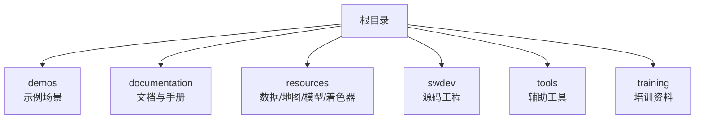
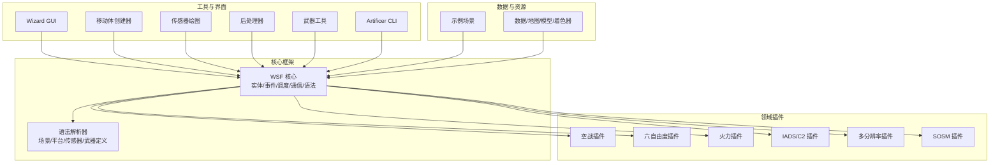
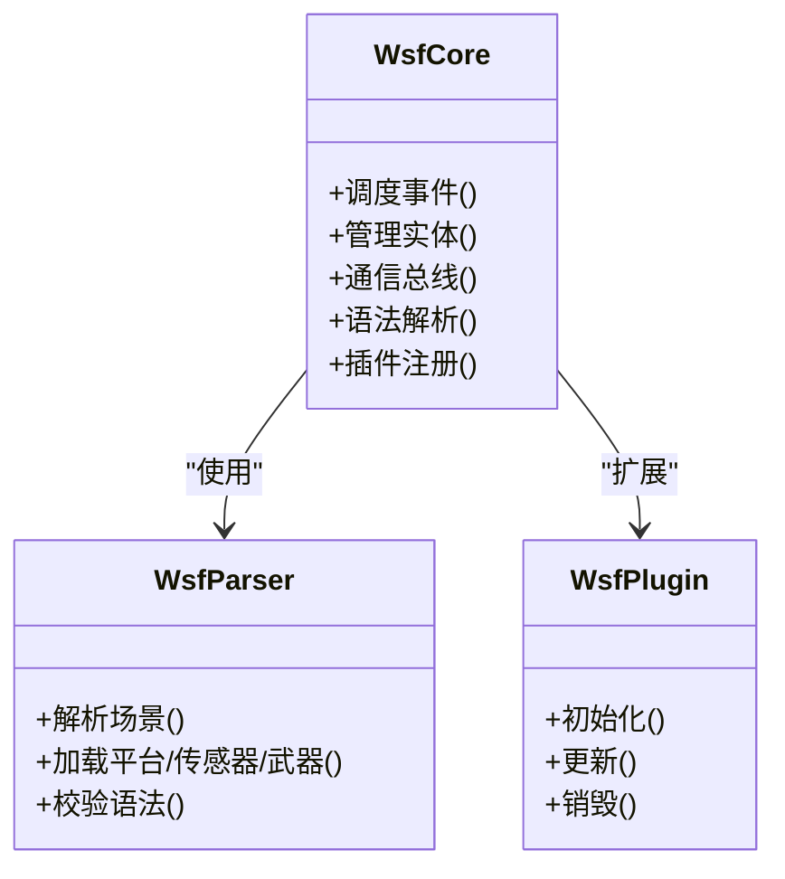
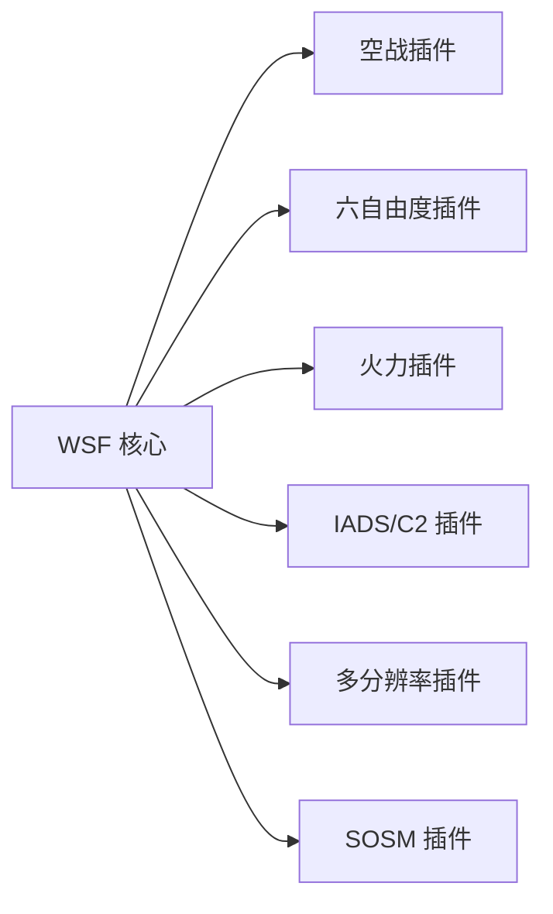
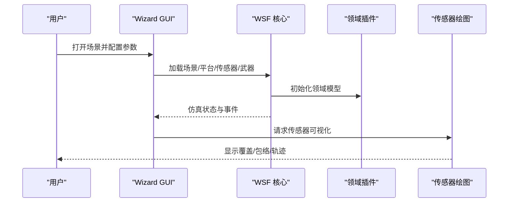
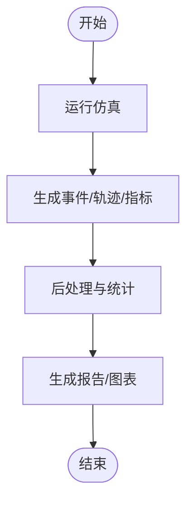
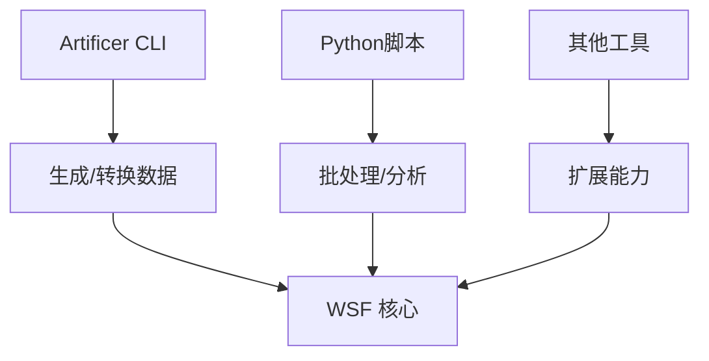
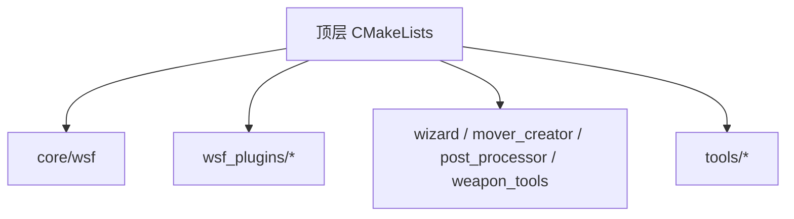

# 项目概述

<cite>
**本文引用的文件**   
- [swdev/src/core/wsf/README.md](file://swdev/src/core/wsf/README.md)
- [demos/simple_scenario/README.md](file://demos/simple_scenario/README.md)
- [demos/base_types/README.md](file://demos/base_types/README.md)
- [swdev/src/CMakeLists.txt](file://swdev/src/CMakeLists.txt)
- [swdev/src/core/sensor_plot_lib/README.md](file://swdev/src/core/sensor_plot_lib/README.md)
- [swdev/src/mover_creator/README.md](file://swdev/src/mover_creator/README.md)
- [swdev/src/warlock/README.md](file://swdev/src/warlock/README.md)
- [swdev/src/wizard/README.md](file://swdev/src/wizard/README.md)
- [swdev/src/post_processor/README.md](file://swdev/src/post_processor/README.md)
- [swdev/src/weapon_tools/README.md](file://swdev/src/weapon_tools/README.md)
- [swdev/src/tools/artificer/source/cli/main.cpp](file://swdev/src/tools/artificer/source/cli/main.cpp)
- [swdev/src/wizard/main/source/main.cpp](file://swdev/src/wizard/main/source/main.cpp)
</cite>

## 目录
1. [简介](#简介)
2. [项目结构](#项目结构)
3. [核心组件](#核心组件)
4. [架构总览](#架构总览)
5. [详细组件分析](#详细组件分析)
6. [依赖关系分析](#依赖关系分析)
7. [性能考虑](#性能考虑)
8. [故障排查指南](#故障排查指南)
9. [结论](#结论)
10. [附录](#附录)

## 简介
AFSIM（Advanced Framework for Simulation, Integration, and Modeling）是一个面向军事仿真的综合框架，提供从平台建模、传感器与武器仿真、电子战与网络战、到任务级推演与可视化的完整能力。其设计强调模块化、可扩展性与事件驱动机制，支持通过插件体系扩展领域能力，并通过脚本与工具链提升场景构建与分析效率。典型应用场景包括空中对抗、防空系统、太空作战、多分辨率联合仿真等。

本概述旨在帮助初学者快速理解AFSIM的概念与使用方式，同时为有经验的开发者提供足够的技术深度，涵盖架构、组件、数据流与集成点。

## 项目结构
仓库采用“演示+文档+资源+源码+工具+培训”的分层组织：
- demos：丰富的示例场景，覆盖空对空、防空、太空、电子战、行为树、轨迹规划等主题
- documentation：用户手册、变更日志与在线文档入口
- resources：仿真所需的数据、地图、模型与着色器
- swdev：C++核心引擎与各类应用/插件的源码
- tools：辅助脚本与命令行工具
- training：面向用户与开发者的培训材料

[本节不直接分析具体源文件，故无“章节来源”]

## 核心组件
AFSIM的核心由以下层次构成：
- 核心仿真框架（WSF）：提供实体、事件、调度、通信、语法解析、类型系统等基础能力
- 领域插件库：如空战、六自由度、火力、IADS/C2、多分辨率、SOSM等
- 可视化与交互：GUI（Wizard）、移动体创建器（Mover Creator）、传感器绘图（Sensor Plot）
- 分析与后处理：任务执行、武器工具、后处理器
- 工具链：Artificer、Python脚本、批处理与数据处理工具

这些组件通过统一的语法与事件管道进行耦合，形成高内聚、低耦合的可插拔架构。

**章节来源**
- [swdev/src/core/wsf/README.md:1-44](file://swdev/src/core/wsf/README.md#L1-L44)

## 架构总览
AFSIM采用“核心框架 + 领域插件 + 工具链”的分层架构。核心框架负责仿真时间推进、事件调度、实体生命周期管理与跨模块通信；领域插件在核心之上实现具体物理、战术与传感器模型；工具链提供场景构建、可视化、数据分析与自动化能力。

**图表来源**
- [swdev/src/core/wsf/README.md:1-44](file://swdev/src/core/wsf/README.md#L1-L44)
- [swdev/src/core/sensor_plot_lib/README.md](file://swdev/src/core/sensor_plot_lib/README.md)
- [swdev/src/mover_creator/README.md](file://swdev/src/mover_creator/README.md)
- [swdev/src/warlock/README.md](file://swdev/src/warlock/README.md)
- [swdev/src/wizard/README.md](file://swdev/src/wizard/README.md)
- [swdev/src/post_processor/README.md](file://swdev/src/post_processor/README.md)
- [swdev/src/weapon_tools/README.md](file://swdev/src/weapon_tools/README.md)

## 详细组件分析

### 核心仿真框架（WSF）
WSF是AFSIM的基础设施，提供：
- 实体与类型系统：平台、传感器、武器、处理器等的统一抽象
- 事件驱动调度：基于时间推进的事件队列与回调机制
- 通信与消息：实体间通信、事件管道、外部接口
- 语法与配置：场景、平台、传感器、武器的声明式定义与校验
- 扩展点：插件注册、类型扩展、处理器钩子

WSF的说明文档位于核心目录中，明确了其作为基础库的定位与安全分级。

**图表来源**
- [swdev/src/core/wsf/README.md:1-44](file://swdev/src/core/wsf/README.md#L1-L44)

**章节来源**
- [swdev/src/core/wsf/README.md:1-44](file://swdev/src/core/wsf/README.md#L1-L44)

### 领域插件集合
- 空战（wsf_air_combat）：提供空战态势感知、编组、评估与观察者接口
- 六自由度（wsf_six_dof / wsf_p6dof）：高精度动力学与机动建模
- 火力（wsf_fires）：火力打击、目标分配与效果评估
- IADS/C2（wsf_iads_c2_lib）：防空指挥控制、任务编排与协同
- 多分辨率（wsf_multiresolution）：不同保真度模型的联合仿真
- SOSM（wsf_sosm）：空间光学与相关效应建模

这些插件以独立模块形式存在，遵循统一的插件接口，便于按需启用与组合。

**图表来源**
- [swdev/src/wsf_plugins/wsf_air_combat/README.md](file://swdev/src/wsf_plugins/wsf_air_combat/README.md)
- [swdev/src/wsf_plugins/wsf_six_dof/README.md](file://swdev/src/wsf_plugins/wsf_six_dof/README.md)
- [swdev/src/wsf_plugins/wsf_p6dof/README.md](file://swdev/src/wsf_plugins/wsf_p6dof/README.md)
- [swdev/src/wsf_plugins/wsf_fires/README.md](file://swdev/src/wsf_plugins/wsf_fires/README.md)
- [swdev/src/wsf_plugins/wsf_iads_c2_lib/README.md](file://swdev/src/wsf_plugins/wsf_iads_c2_lib/README.md)
- [swdev/src/wsf_plugins/wsf_multiresolution/README.md](file://swdev/src/wsf_plugins/wsf_multiresolution/README.md)
- [swdev/src/wsf_plugins/wsf_sosm/README.md](file://swdev/src/wsf_plugins/wsf_sosm/README.md)

**章节来源**
- [swdev/src/wsf_plugins/wsf_air_combat/README.md](file://swdev/src/wsf_plugins/wsf_air_combat/README.md)
- [swdev/src/wsf_plugins/wsf_six_dof/README.md](file://swdev/src/wsf_plugins/wsf_six_dof/README.md)
- [swdev/src/wsf_plugins/wsf_p6dof/README.md](file://swdev/src/wsf_plugins/wsf_p6dof/README.md)
- [swdev/src/wsf_plugins/wsf_fires/README.md](file://swdev/src/wsf_plugins/wsf_fires/README.md)
- [swdev/src/wsf_plugins/wsf_iads_c2_lib/README.md](file://swdev/src/wsf_plugins/wsf_iads_c2_lib/README.md)
- [swdev/src/wsf_plugins/wsf_multiresolution/README.md](file://swdev/src/wsf_plugins/wsf_multiresolution/README.md)
- [swdev/src/wsf_plugins/wsf_sosm/README.md](file://swdev/src/wsf_plugins/wsf_sosm/README.md)

### 可视化与交互
- Wizard GUI：图形化场景编辑、运行控制与结果查看
- Mover Creator：移动体路径与运动学参数生成
- Sensor Plot：雷达/通信/EOIR等传感器的覆盖与包络可视化

**图表来源**
- [swdev/src/wizard/README.md](file://swdev/src/wizard/README.md)
- [swdev/src/mover_creator/README.md](file://swdev/src/mover_creator/README.md)
- [swdev/src/core/sensor_plot_lib/README.md](file://swdev/src/core/sensor_plot_lib/README.md)

**章节来源**
- [swdev/src/wizard/README.md](file://swdev/src/wizard/README.md)
- [swdev/src/mover_creator/README.md](file://swdev/src/mover_creator/README.md)
- [swdev/src/core/sensor_plot_lib/README.md](file://swdev/src/core/sensor_plot_lib/README.md)

### 分析与后处理
- Post Processor：对仿真输出进行统计、聚合与报告生成
- Weapon Tools：武器弹道、制导与毁伤效果的离线分析
- Warlock：任务级分析与优化（含插件生态）

**图表来源**
- [swdev/src/post_processor/README.md](file://swdev/src/post_processor/README.md)
- [swdev/src/weapon_tools/README.md](file://swdev/src/weapon_tools/README.md)
- [swdev/src/warlock/README.md](file://swdev/src/warlock/README.md)

**章节来源**
- [swdev/src/post_processor/README.md](file://swdev/src/post_processor/README.md)
- [swdev/src/weapon_tools/README.md](file://swdev/src/weapon_tools/README.md)
- [swdev/src/warlock/README.md](file://swdev/src/warlock/README.md)

### 工具链与脚本
- Artificer CLI：命令行工具，用于场景/平台/传感器/武器的批量生成与转换
- Python脚本：数据清洗、批处理、可视化与自动化流程
- 其他工具：DIS接口、地理数据处理、跟踪滤波等

**图表来源**
- [swdev/src/tools/artificer/source/cli/main.cpp](file://swdev/src/tools/artificer/source/cli/main.cpp)

**章节来源**
- [swdev/src/tools/artificer/source/cli/main.cpp](file://swdev/src/tools/artificer/source/cli/main.cpp)

## 依赖关系分析
AFSIM的构建与依赖通过CMake统一管理，核心模块与插件之间通过明确的接口解耦。顶层CMakeLists协调各子模块的编译与打包。

**图表来源**
- [swdev/src/CMakeLists.txt](file://swdev/src/CMakeLists.txt)

**章节来源**
- [swdev/src/CMakeLists.txt](file://swdev/src/CMakeLists.txt)

## 性能考虑
- 事件驱动调度：合理划分事件粒度，避免过多细粒度事件导致调度开销
- 插件选择：根据需求启用必要插件，减少不必要的计算
- 可视化与IO：在大规模仿真中谨慎开启实时可视化与高频输出
- 并行与多线程：利用多核资源，注意线程安全与锁竞争
- 数据与资源：预加载常用数据，减少运行时I/O瓶颈

[本节为通用指导，不涉及具体文件分析]

## 故障排查指南
常见问题与定位思路：
- 场景无法加载：检查语法与引用路径，确认平台/传感器/武器定义完整
- 仿真无输出：确认事件管道与处理器已正确注册与连接
- 可视化异常：检查传感器绘图配置与渲染资源路径
- 插件未生效：确认插件已编译并正确加载，版本兼容

建议步骤：
- 使用最小可复现场景（参考demos中的simple_scenario）逐步验证
- 启用日志与调试输出，定位错误来源
- 使用Artificer或Python脚本生成/校验输入数据
- 借助Post Processor与Sensor Plot进行结果验证

**章节来源**
- [demos/simple_scenario/README.md:1-45](file://demos/simple_scenario/README.md#L1-L45)
- [demos/base_types/README.md:1-45](file://demos/base_types/README.md#L1-L45)

## 结论
AFSIM以WSF为核心，结合丰富的领域插件与工具链，构建了覆盖空天海陆多域、多分辨率、多保真度的军事仿真平台。其模块化与事件驱动的设计使得系统具备高度的可扩展性与灵活性，既能满足快速原型验证，也能支撑复杂任务级的推演与分析。通过Wizard、Mover Creator、Sensor Plot与Post Processor等工具，用户能够高效完成从场景构建到结果分析的闭环工作流。

[本节为总结性内容，不涉及具体文件分析]

## 附录
- 快速开始
  - 安装与构建：参考顶层CMake配置与依赖说明
  - 运行示例：进入demos/simple_scenario，按README指引执行
  - 扩展插件：在wsf_plugins中添加自定义插件并注册到核心
  - 可视化：启动Wizard GUI，加载场景并观察传感器覆盖与轨迹
  - 数据分析：使用Post Processor与Sensor Plot导出报告与图表

[本节为操作指引，不涉及具体文件分析]