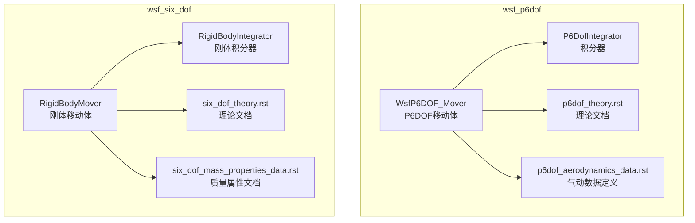
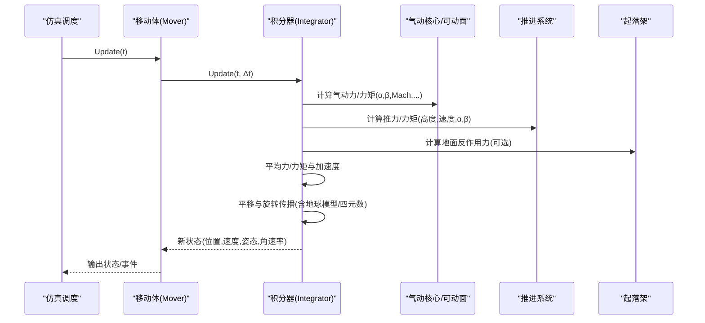
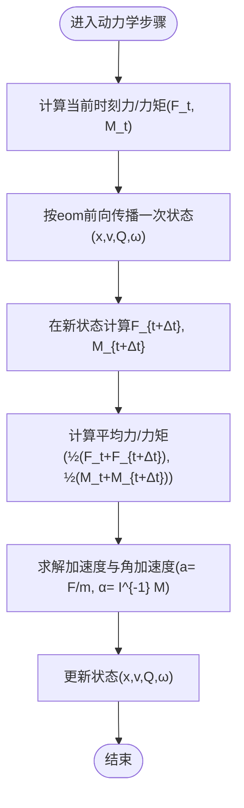
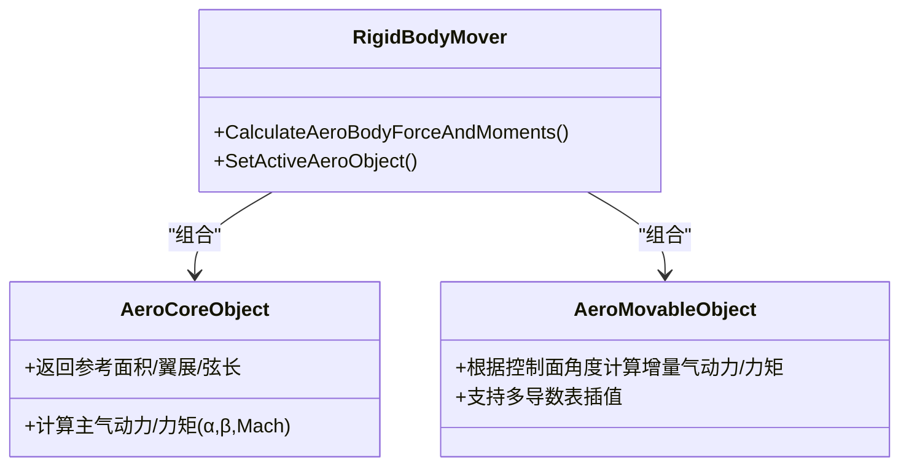
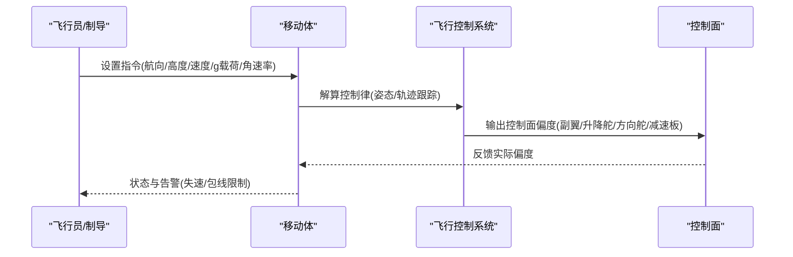
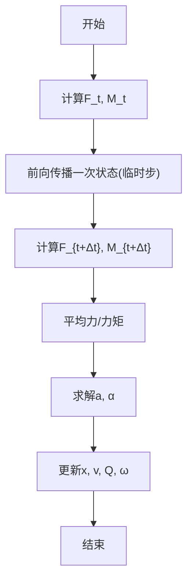
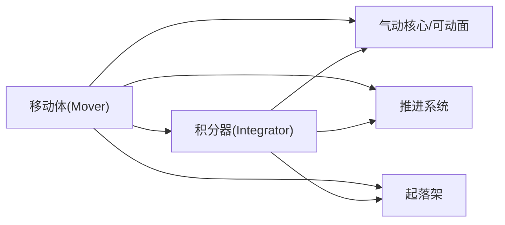

# 六自由度飞行仿真

<cite>
**本文引用的文件**   
- [p6dof_theory.rst](file://swdev/src/wsf_plugins/wsf_p6dof/doc/p6dof_theory.rst)
- [six_dof_theory.rst](file://swdev/src/wsf_plugins/wsf_six_dof/doc/six_dof_theory.rst)
- [p6dof_aerodynamics_data.rst](file://swdev/src/wsf_plugins/wsf_p6dof/doc/p6dof_aerodynamics_data.rst)
- [six_dof_mass_properties_data.rst](file://swdev/src/wsf_plugins/wsf_six_dof/doc/six_dof_mass_properties_data.rst)
- [WsfP6DOF_Mover.hpp](file://swdev/src/wsf_plugins/wsf_p6dof/source/WsfP6DOF_Mover.hpp)
- [WsfRigidBodySixDOF_Mover.hpp](file://swdev/src/wsf_plugins/wsf_six_dof/source/WsfRigidBodySixDOF_Mover.hpp)
- [P6DofIntegrator.hpp](file://swdev/src/wsf_plugins/wsf_p6dof/p6dof/source/P6DofIntegrator.hpp)
- [WsfRigidBodySixDOF_Integrator.hpp](file://swdev/src/wsf_plugins/wsf_six_dof/source/WsfRigidBodySixDOF_Integrator.hpp)
</cite>

## 目录
1. [引言](#引言)
2. [项目结构](#项目结构)
3. [核心组件](#核心组件)
4. [架构总览](#架构总览)
5. [详细组件分析](#详细组件分析)
6. [依赖关系分析](#依赖关系分析)
7. [性能考虑](#性能考虑)
8. [故障排查指南](#故障排查指南)
9. [结论](#结论)
10. [附录](#附录)

## 引言
本技术文档面向AFSIM的六自由度（6-DOF）飞行仿真系统，聚焦刚体动力学建模、气动建模与导数表、控制系统实现、数值积分算法、飞行器参数配置、复杂机动场景以及扩展方法。文档基于仓库中的理论文档与头文件接口进行系统化梳理，力求在保持工程严谨性的同时，为不同背景的读者提供循序渐进的理解路径。

## 项目结构
AFSIM的6-DOF能力由两套主要插件体系支撑：
- wsf_p6dof：伪六自由度（P6DOF）模型，侧重易用性与数据需求较低，但仍具备完整的6自由度运动学/动力学框架与丰富的稳定性导数建模能力。
- wsf_six_dof：刚体六自由度（RB6DOF）模型，继承并演进自P6DOF，提供更贴近真实惯性与力矩耦合的建模方式，同时保留对角惯性张量简化以提升可配置性。

图示来源
- [WsfP6DOF_Mover.hpp:45-74](file://swdev/src/wsf_plugins/wsf_p6dof/source/WsfP6DOF_Mover.hpp#L45-L74)
- [P6DofIntegrator.hpp:26-36](file://swdev/src/wsf_plugins/wsf_p6dof/p6dof/source/P6DofIntegrator.hpp#L26-L36)
- [WsfRigidBodySixDOF_Mover.hpp:35-50](file://swdev/src/wsf_plugins/wsf_six_dof/source/WsfRigidBodySixDOF_Mover.hpp#L35-L50)
- [WsfRigidBodySixDOF_Integrator.hpp:24-37](file://swdev/src/wsf_plugins/wsf_six_dof/source/WsfRigidBodySixDOF_Integrator.hpp#L24-L37)

章节来源
- [WsfP6DOF_Mover.hpp:45-74](file://swdev/src/wsf_plugins/wsf_p6dof/source/WsfP6DOF_Mover.hpp#L45-L74)
- [WsfRigidBodySixDOF_Mover.hpp:35-50](file://swdev/src/wsf_plugins/wsf_six_dof/source/WsfRigidBodySixDOF_Mover.hpp#L35-L50)

## 核心组件
- 移动体（Mover）
  - WsfP6DOF_Mover：提供P6DOF移动体接口，包含姿态访问、控制输入、引导/自动驾驶、状态查询等。
  - RigidBodyMover：刚体6DOF移动体，封装气动核心对象、可动面、推进系统、起落架、飞行员管理器等子系统。
- 积分器（Integrator）
  - P6DofIntegrator：负责P6DOF对象的力/力矩计算、燃料消耗更新、平移与旋转传播、地球模型选择等。
  - RigidBodyIntegrator：刚体积分器，支持简单偏航阻尼、中间步传播与完整更新流程。
- 理论与数据
  - p6dof_theory.rst：P6DOF运动方程、坐标系转换、气动力/力矩构建、减缩频率等。
  - six_dof_theory.rst：点质量6DOF（PM6DOF）与刚体6DOF的理论差异与控制响应建模。
  - p6dof_aerodynamics_data.rst：气动数据块（aero_data/aero_component）、稳定性导数表、可动面气动建模。
  - six_dof_mass_properties_data.rst：质量属性（质量、惯性主轴、质心）配置命令。

章节来源
- [WsfP6DOF_Mover.hpp:45-74](file://swdev/src/wsf_plugins/wsf_p6dof/source/WsfP6DOF_Mover.hpp#L45-L74)
- [WsfRigidBodySixDOF_Mover.hpp:35-50](file://swdev/src/wsf_plugins/wsf_six_dof/source/WsfRigidBodySixDOF_Mover.hpp#L35-L50)
- [P6DofIntegrator.hpp:26-36](file://swdev/src/wsf_plugins/wsf_p6dof/p6dof/source/P6DofIntegrator.hpp#L26-L36)
- [WsfRigidBodySixDOF_Integrator.hpp:24-37](file://swdev/src/wsf_plugins/wsf_six_dof/source/WsfRigidBodySixDOF_Integrator.hpp#L24-L37)
- [p6dof_theory.rst:13-26](file://swdev/src/wsf_plugins/wsf_p6dof/doc/p6dof_theory.rst#L13-L26)
- [six_dof_theory.rst:13-29](file://swdev/src/wsf_plugins/wsf_six_dof/doc/six_dof_theory.rst#L13-L29)
- [p6dof_aerodynamics_data.rst:15-40](file://swdev/src/wsf_plugins/wsf_p6dof/doc/p6dof_aerodynamics_data.rst#L15-L40)
- [six_dof_mass_properties_data.rst:15-33](file://swdev/src/wsf_plugins/wsf_six_dof/doc/six_dof_mass_properties_data.rst#L15-L33)

## 架构总览
下图展示P6DOF与RB6DOF两条主线及其关键交互：移动体负责状态与子系统协调；积分器在每个时间步内完成力/力矩计算、状态传播与二次数据更新；理论与数据文档定义了数学基础与配置语法。

图示来源
- [WsfP6DOF_Mover.hpp:64-66](file://swdev/src/wsf_plugins/wsf_p6dof/source/WsfP6DOF_Mover.hpp#L64-L66)
- [P6DofIntegrator.hpp:36-47](file://swdev/src/wsf_plugins/wsf_p6dof/p6dof/source/P6DofIntegrator.hpp#L36-L47)
- [WsfRigidBodySixDOF_Integrator.hpp:37-52](file://swdev/src/wsf_plugins/wsf_six_dof/source/WsfRigidBodySixDOF_Integrator.hpp#L37-L52)

## 详细组件分析

### 刚体动力学建模（欧拉角、惯性张量、力矩平衡）
- 姿态表示
  - P6DOF使用四元数Q与方向余弦矩阵R进行姿态传播，并通过3-2-1（偏航-俯仰-滚转）旋转顺序将体坐标与惯性坐标互转。
  - 角速度与四元数导数的关系通过标准矩阵形式表达，确保数值稳定与无奇异。
- 惯性张量
  - P6DOF/RB6DOF均采用对角惯性张量简化（Ix、Iy、Iz），降低交叉耦合复杂度，同时满足大多数飞行器建模需求。
- 力矩平衡
  - 总力矩包括气动力矩与因参考点偏移产生的附加力矩项（质心相对气动参考点的叉乘）。
  - 线性与角加速度通过平均力/力矩与惯性张量求逆得到，随后用于状态更新。

图示来源
- [p6dof_theory.rst:284-331](file://swdev/src/wsf_plugins/wsf_p6dof/doc/p6dof_theory.rst#L284-L331)
- [p6dof_theory.rst:332-370](file://swdev/src/wsf_plugins/wsf_p6dof/doc/p6dof_theory.rst#L332-L370)
- [p6dof_theory.rst:393-400](file://swdev/src/wsf_plugins/wsf_p6dof/doc/p6dof_theory.rst#L393-L400)

章节来源
- [p6dof_theory.rst:284-331](file://swdev/src/wsf_plugins/wsf_p6dof/doc/p6dof_theory.rst#L284-L331)
- [p6dof_theory.rst:332-370](file://swdev/src/wsf_plugins/wsf_p6dof/doc/p6dof_theory.rst#L332-L370)
- [p6dof_theory.rst:393-400](file://swdev/src/wsf_plugins/wsf_p6dof/doc/p6dof_theory.rst#L393-L400)

### 气动建模系统（升力、阻力、侧向力与导数表）
- 气动力分解
  - 升力、阻力、侧向力单位向量在体坐标系中由速度方向与机体轴构造，系数C_L、C_Y、C_D分别对应。
- 稳定性导数
  - 主系数C_L/C_Y/C_D随迎角α、侧滑角β、马赫数M变化；速率相关项（如q、r、ṗ、ṙ、ḃ、ṡ）通过减缩频率k或角速率加权。
  - 力矩系数C_l/C_m/C_n同样包含静态与速率相关项，覆盖滚转、俯仰、偏航三轴。
- 气动数据组织
  - aero_data定义主体气动特性与稳定性导数表；aero_component定义可动面（襟翼、副翼、方向舵、减速板、起落架等）的气动贡献。
  - 可通过“aero_mode”切换不同构型（如干净/高阻模式）。

图示来源
- [WsfRigidBodySixDOF_Mover.hpp:309-386](file://swdev/src/wsf_plugins/wsf_six_dof/source/WsfRigidBodySixDOF_Mover.hpp#L309-L386)
- [p6dof_aerodynamics_data.rst:15-40](file://swdev/src/wsf_plugins/wsf_p6dof/doc/p6dof_aerodynamics_data.rst#L15-L40)
- [p6dof_aerodynamics_data.rst:441-494](file://swdev/src/wsf_plugins/wsf_p6dof/doc/p6dof_aerodynamics_data.rst#L441-L494)

章节来源
- [p6dof_theory.rst:371-441](file://swdev/src/wsf_plugins/wsf_p6dof/doc/p6dof_theory.rst#L371-L441)
- [p6dof_aerodynamics_data.rst:15-40](file://swdev/src/wsf_plugins/wsf_p6dof/doc/p6dof_aerodynamics_data.rst#L15-L40)
- [p6dof_aerodynamics_data.rst:441-494](file://swdev/src/wsf_plugins/wsf_p6dof/doc/p6dof_aerodynamics_data.rst#L441-L494)

### 控制系统实现（姿态控制、轨迹跟踪、机动动作库）
- 姿态控制
  - P6DOF提供直接控制输入接口（摇杆/脚蹬/油门映射），以及自动驾驶/合成飞行员/制导计算机集成。
  - RB6DOF通过飞行员管理器与飞行控制系统协调控制面指令，支持偏航阻尼等辅助功能。
- 轨迹跟踪
  - 支持GoToLocation/TurnToHeading/GoToAltitude/GoToSpeed等高层指令，结合路线与航点管理实现轨迹跟踪。
- 机动动作库
  - 通过脚本化机动（maneuver）与序列（sequence）驱动姿态/速度/高度目标，配合导引律生成g载荷或角速率指令。

图示来源
- [WsfP6DOF_Mover.hpp:152-198](file://swdev/src/wsf_plugins/wsf_p6dof/source/WsfP6DOF_Mover.hpp#L152-L198)
- [WsfRigidBodySixDOF_Mover.hpp:450-484](file://swdev/src/wsf_plugins/wsf_six_dof/source/WsfRigidBodySixDOF_Mover.hpp#L450-L484)

章节来源
- [WsfP6DOF_Mover.hpp:152-198](file://swdev/src/wsf_plugins/wsf_p6dof/source/WsfP6DOF_Mover.hpp#L152-L198)
- [WsfRigidBodySixDOF_Mover.hpp:450-484](file://swdev/src/wsf_plugins/wsf_six_dof/source/WsfRigidBodySixDOF_Mover.hpp#L450-L484)

### 数值积分算法（Runge-Kutta与自适应步长）
- 积分流程
  - 在每步Δt内，先计算当前力/力矩，进行一次状态前向传播以估算下一时刻力/力矩，再取平均以改进精度。
  - 平移传播支持球面地球与WGS地球模型；旋转传播采用四元数导数与方向余弦矩阵转换。
- 算法特征
  - 文档未显式声明具体RK阶数，但通过“平均力/力矩”与“中间步传播”体现二阶精度的思想；RB6DOF积分器还提供简单偏航阻尼与中间步计算函数，便于扩展自适应步长策略。

图示来源
- [p6dof_theory.rst:284-331](file://swdev/src/wsf_plugins/wsf_p6dof/doc/p6dof_theory.rst#L284-L331)
- [P6DofIntegrator.hpp:76-96](file://swdev/src/wsf_plugins/wsf_p6dof/p6dof/source/P6DofIntegrator.hpp#L76-L96)
- [WsfRigidBodySixDOF_Integrator.hpp:54-72](file://swdev/src/wsf_plugins/wsf_six_dof/source/WsfRigidBodySixDOF_Integrator.hpp#L54-L72)

章节来源
- [p6dof_theory.rst:284-331](file://swdev/src/wsf_plugins/wsf_p6dof/doc/p6dof_theory.rst#L284-L331)
- [P6DofIntegrator.hpp:76-96](file://swdev/src/wsf_plugins/wsf_p6dof/p6dof/source/P6DofIntegrator.hpp#L76-L96)
- [WsfRigidBodySixDOF_Integrator.hpp:54-72](file://swdev/src/wsf_plugins/wsf_six_dof/source/WsfRigidBodySixDOF_Integrator.hpp#L54-L72)

### 飞行器参数配置（质量分布、气动外形、控制面特性）
- 质量属性
  - 空机质量、惯性主轴（Ix/Iy/Iz）、质心相对参考点坐标（X/Y/Z）通过mass_properties块配置。
- 气动外形
  - 参考面积、翼展/弦长、气动中心位置、导数表（cL_alpha_mach_table、cd_alpha_beta_mach_table等）在aero_data中定义。
- 控制面特性
  - 每个可动面（type_）定义其参考面积与导数表族（cL_angle_*、cm_angle_*等），并通过flight_controls连接至控制律。

章节来源
- [six_dof_mass_properties_data.rst:15-61](file://swdev/src/wsf_plugins/wsf_six_dof/doc/six_dof_mass_properties_data.rst#L15-L61)
- [p6dof_aerodynamics_data.rst:24-94](file://swdev/src/wsf_plugins/wsf_p6dof/doc/p6dof_aerodynamics_data.rst#L24-L94)
- [p6dof_aerodynamics_data.rst:441-494](file://swdev/src/wsf_plugins/wsf_p6dof/doc/p6dof_aerodynamics_data.rst#L441-L494)

### 复杂机动场景（空战机动、着陆程序、故障恢复）
- 空战机动
  - 通过制导计算机与自动驾驶组合，生成g载荷或角速率指令，配合控制面与推进系统实现高过载转弯、桶滚、眼镜蛇等机动。
- 着陆程序
  - 起落架与刹车/转向（NWS）控制、襟翼/减速板展开、下滑道跟踪与接地保护逻辑。
- 故障恢复
  - 平台损坏事件触发部件禁用，移动体仍可继续运动；控制系统需具备降级模式与告警提示。

章节来源
- [WsfP6DOF_Mover.hpp:145-148](file://swdev/src/wsf_plugins/wsf_p6dof/source/WsfP6DOF_Mover.hpp#L145-L148)
- [WsfRigidBodySixDOF_Mover.hpp:487-508](file://swdev/src/wsf_plugins/wsf_six_dof/source/WsfRigidBodySixDOF_Mover.hpp#L487-L508)

### 扩展自定义气动模型与控制律
- 气动模型扩展
  - 新增aero_component类型并在flight_controls中绑定同名控制面，即可注入新的可动面气动贡献。
  - 通过aero_mode切换不同气动构型，适配外挂物、舱门开闭等状态。
- 控制律扩展
  - 在移动体中接入自定义控制器（飞行员/制导），通过SetDirectControlInputs或API设置g载荷/角速率指令，实现个性化控制策略。

章节来源
- [p6dof_aerodynamics_data.rst:441-494](file://swdev/src/wsf_plugins/wsf_p6dof/doc/p6dof_aerodynamics_data.rst#L441-L494)
- [WsfP6DOF_Mover.hpp:152-168](file://swdev/src/wsf_plugins/wsf_p6dof/source/WsfP6DOF_Mover.hpp#L152-L168)

## 依赖关系分析
- 组件耦合
  - 移动体聚合气动核心对象、可动面对象、推进系统、起落架、积分器与飞行员管理器，形成高内聚的移动体单元。
  - 积分器依赖移动体提供的质量属性与状态，调用气动/推进/重力模块计算力/力矩，并执行状态传播。
- 外部依赖
  - 地球模型（球面/WGS）影响平移传播；大气模型影响动态压力、静压与马赫数计算。
- 潜在循环依赖
  - 移动体与积分器之间通过接口解耦，避免直接循环引用；气动/推进模块仅被积分器调用，不反向依赖积分器。

图示来源
- [WsfRigidBodySixDOF_Mover.hpp:622-635](file://swdev/src/wsf_plugins/wsf_six_dof/source/WsfRigidBodySixDOF_Mover.hpp#L622-L635)
- [WsfRigidBodySixDOF_Integrator.hpp:44-52](file://swdev/src/wsf_plugins/wsf_six_dof/source/WsfRigidBodySixDOF_Integrator.hpp#L44-L52)

章节来源
- [WsfRigidBodySixDOF_Mover.hpp:622-635](file://swdev/src/wsf_plugins/wsf_six_dof/source/WsfRigidBodySixDOF_Mover.hpp#L622-L635)
- [WsfRigidBodySixDOF_Integrator.hpp:44-52](file://swdev/src/wsf_plugins/wsf_six_dof/source/WsfRigidBodySixDOF_Integrator.hpp#L44-L52)

## 性能考虑
- 惯性张量简化：对角惯性张量减少矩阵求逆开销，提升实时性。
- 导数表插值：合理设计表格分辨率与插值算法，避免高频采样带来的计算负担。
- 积分步长：在高速/高机动段适当减小Δt，在平稳段增大Δt，结合误差估计实现自适应步长。
- 子对象合并：将频繁更新的子对象（如燃油转移）批量处理，减少重复计算。

## 故障排查指南
- 姿态发散
  - 检查四元数归一化与方向余弦矩阵一致性；确认角速率与姿态导数关系正确。
- 气动力异常
  - 核对导数表范围与插值边界；验证参考面积与几何参数是否匹配。
- 控制面无效
  - 确认flight_controls中control_surface名称与aero_component type_完全一致且区分大小写。
- 起落架问题
  - 检查重量检测与地面接触条件；确认刹车/NWS控制逻辑未被外部强制覆盖。

章节来源
- [p6dof_aerodynamics_data.rst:484-494](file://swdev/src/wsf_plugins/wsf_p6dof/doc/p6dof_aerodynamics_data.rst#L484-L494)
- [WsfRigidBodySixDOF_Mover.hpp:487-508](file://swdev/src/wsf_plugins/wsf_six_dof/source/WsfRigidBodySixDOF_Mover.hpp#L487-L508)

## 结论
AFSIM的6-DOF仿真体系通过P6DOF与RB6DOF两条路径，兼顾了建模精度与易用性。P6DOF以四元数与方向余弦矩阵为基础，提供稳定的姿态传播与丰富的稳定性导数建模；RB6DOF在此基础上引入更贴近真实的力矩与推进耦合，同时保持对角惯性张量的工程实用性。通过模块化气动数据、可动面扩展与灵活的控制系统接口，用户可高效构建从常规飞行到复杂机动的多样化场景。

## 附录
- 符号与命令对照
  - 迎角α、侧滑角β、马赫数M、角速率p/q/r、四元数Q、方向余弦矩阵R等均在理论文档中明确定义，并与脚本方法与命令存在对应关系。
- 参考
  - Jenkins, J. “Dynamic Stability Derivatives”, AFRL-RQ-WP-TR-2015-0141, 2015.

章节来源
- [p6dof_theory.rst:31-279](file://swdev/src/wsf_plugins/wsf_p6dof/doc/p6dof_theory.rst#L31-L279)
- [p6dof_theory.rst:482-485](file://swdev/src/wsf_plugins/wsf_p6dof/doc/p6dof_theory.rst#L482-L485)