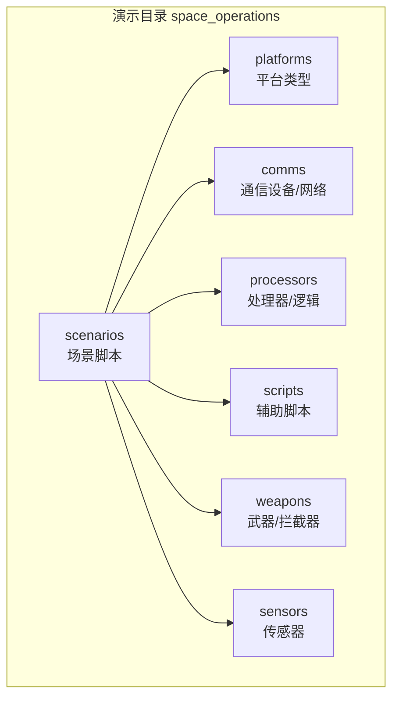
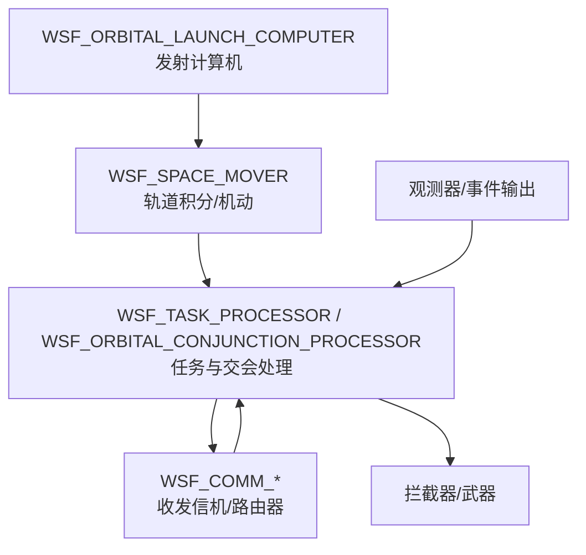
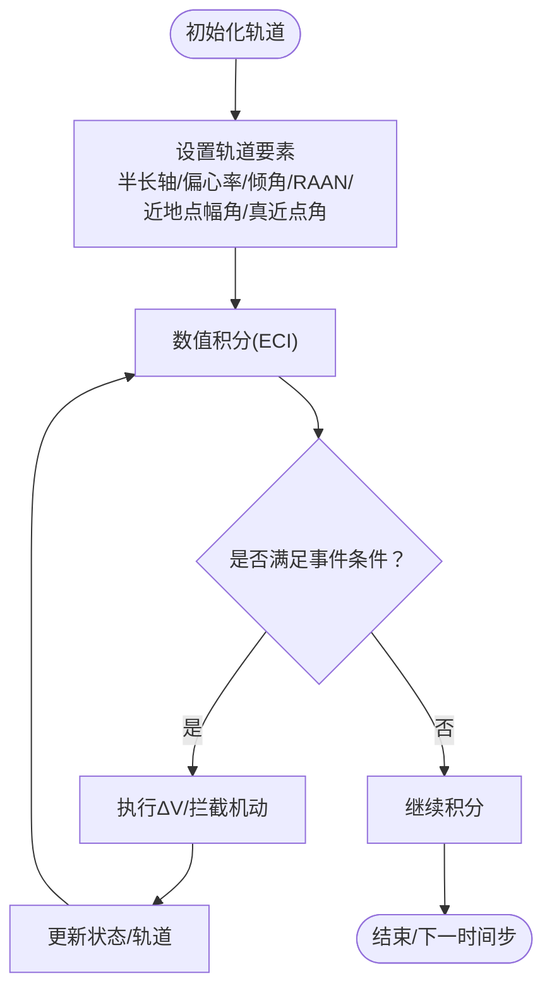
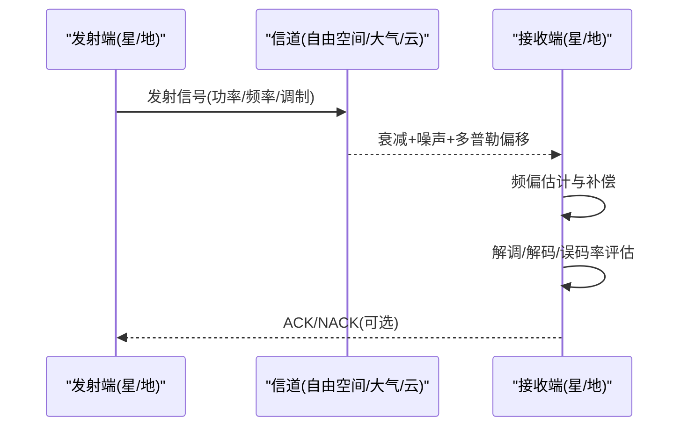
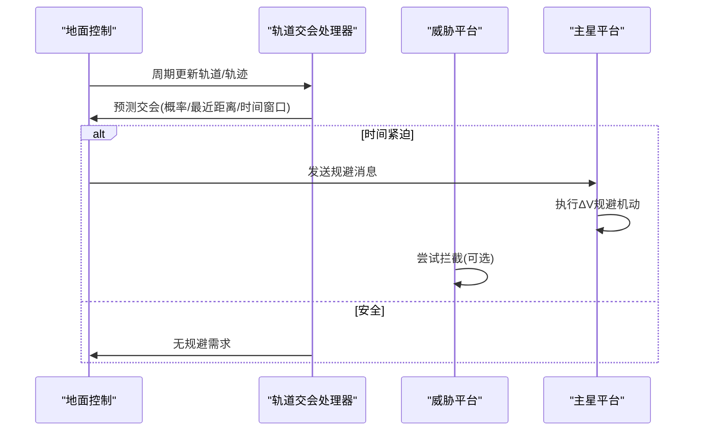
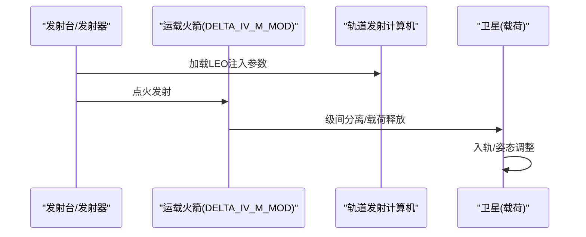
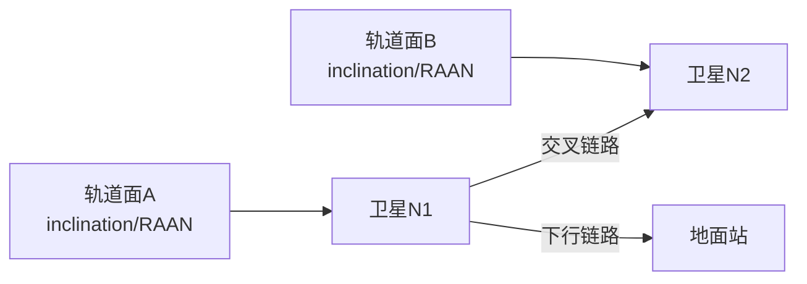
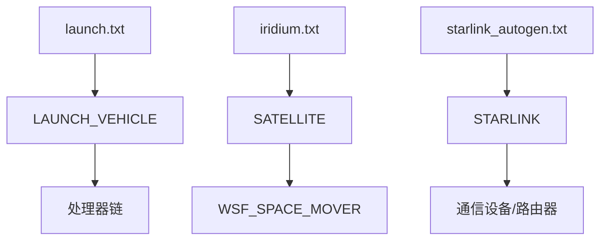

# 太空作战仿真

<cite>
**本文引用的文件**   
- [README.md](file://demos/space_operations/README.md)
- [conjunction_avoidance.txt](file://demos/space_operations/conjunction_avoidance.txt)
- [launch.txt](file://demos/space_operations/scenarios/launch.txt)
- [satellite.txt](file://demos/space_operations/platforms/satellite.txt)
- [launch_vehicle.txt](file://demos/space_operations/platforms/launch_vehicle.txt)
- [starlink.txt](file://demos/space_operations/platforms/starlink.txt)
- [iridium.txt](file://demos/space_operations/scenarios/iridium.txt)
- [starlink_autogen.txt](file://demos/space_operations/scenarios/starlink_autogen.txt)
</cite>

## 目录
1. [引言](#引言)
2. [项目结构](#项目结构)
3. [核心组件](#核心组件)
4. [架构总览](#架构总览)
5. [详细组件分析](#详细组件分析)
6. [依赖关系分析](#依赖关系分析)
7. [性能与精度考量](#性能与精度考量)
8. [故障排查指南](#故障排查指南)
9. [结论](#结论)
10. [附录](#附录)

## 引言
本技术文档面向AFSIM的太空作战仿真体系，围绕轨道力学、卫星通信、空间态势感知、发射载具与星座配置等主题展开。基于仓库中的space_operations演示集，我们系统梳理了：
- 轨道力学基础与摄动建模（开普勒轨道要素、轨道转换、近圆轨道与多星编队）
- 卫星通信链路预算、多普勒频移补偿思路与信号衰减模型（含星间链路与星地下行）
- 空间态势感知（目标跟踪、碰撞规避、碎片监测）
- 发射载具仿真（多级分离、推进建模、轨道注入）
- 星座配置（轨道参数、通信拓扑、任务规划）
- 太空作战场景（反卫星测试、拦截、救援）
- 轨道计算精度分析与性能调优策略
- 扩展新轨道力学模型与通信协议的方法

## 项目结构
space_operations演示目录组织清晰，按“平台/传感器/处理器/武器/通信/场景/脚本”分层，便于复用与扩展。关键子目录与文件包括：
- platforms：平台类型定义（卫星、发射载具、Starlink等）
- scenarios：典型场景（发射、Iridium/Starlink星座、对抗与规避）
- comms：通信设备与网络定义（星间交叉链路、星地下行）
- processors：处理逻辑（任务调度、轨道交会、链路建立等）
- scripts：辅助脚本（轨道发射、TLE/TSP导入、轨道要素打印等）

图表来源
- [README.md:1-47](file://demos/space_operations/README.md#L1-L47)

章节来源
- [README.md:1-47](file://demos/space_operations/README.md#L1-L47)

## 核心组件
- 轨道运动器（WSF_SPACE_MOVER）：用于在ECI坐标系下积分轨道，支持半长轴、偏心率、倾角、升交点赤经、近地点幅角、真近点角等要素；可执行ΔV机动、拦截机动、事件触发条件控制。
- 发射载具平台（LAUNCH_VEHICLE）：封装光学/红外特征、处理器链与类别标签，配合发射计算机完成轨道注入。
- 卫星平台（SATELLITE）：以WSF_SPACE_MOVER为运动器，承载通信、雷达签名、姿态控制等载荷。
- Starlink平台（STARLINK）：集成多向星间天线（前后左右）、下行天线、路由器与自动链路管理，形成自组网拓扑。
- Iridium星座（IRIDIUM_SATELLITE）：通过RAAN与真近点角分布构建多轨道面星座，并启用星间交叉链路。

章节来源
- [satellite.txt:12-30](file://demos/space_operations/platforms/satellite.txt#L12-L30)
- [launch_vehicle.txt:10-19](file://demos/space_operations/platforms/launch_vehicle.txt#L10-L19)
- [starlink.txt:28-108](file://demos/space_operations/platforms/starlink.txt#L28-L108)
- [iridium.txt:13-31](file://demos/space_operations/scenarios/iridium.txt#L13-L31)

## 架构总览
太空作战仿真由“轨道动力学—通信网络—态势感知—任务控制—武器/拦截”五层构成，数据流从传感器/轨道器到处理器再到通信与控制指令，最终驱动平台行为与武器发射。

图表来源
- [conjunction_avoidance.txt:54-61](file://demos/space_operations/conjunction_avoidance.txt#L54-L61)
- [conjunction_avoidance.txt:143-196](file://demos/space_operations/conjunction_avoidance.txt#L143-L196)
- [launch.txt:37-42](file://demos/space_operations/scenarios/launch.txt#L37-L42)

## 详细组件分析

### 轨道力学与摄动建模
- 开普勒轨道要素：通过半长轴、偏心率、倾角、RAAN、近地点幅角、真近点角描述二体轨道；示例中采用近圆轨道（偏心率≈0.001）简化摄动影响。
- 轨道要素转换：可在脚本中读取/设置轨道要素，结合事件条件（如时间、位置阈值）触发机动。
- 摄动效应建模：演示使用近圆轨道与简单ΔV机动体现摄动对轨道的影响；更复杂的地球非球形引力、大气阻力、日月摄动可通过扩展运动器或外部力模型实现。

图表来源
- [conjunction_avoidance.txt:54-61](file://demos/space_operations/conjunction_avoidance.txt#L54-L61)
- [conjunction_avoidance.txt:27-52](file://demos/space_operations/conjunction_avoidance.txt#L27-L52)

章节来源
- [conjunction_avoidance.txt:54-61](file://demos/space_operations/conjunction_avoidance.txt#L54-L61)
- [conjunction_avoidance.txt:27-52](file://demos/space_operations/conjunction_avoidance.txt#L27-L52)

### 卫星通信系统仿真
- 链路预算：通过收发信机功率、天线增益、路径损耗与接收噪声评估链路质量；Starlink平台定义了多个定向天线（前后左右）与下行天线，支持自动化链路建立。
- 多普勒频移补偿：在高相对速度环境下，需根据相对速度与频率估算频移并进行补偿；可在收发信机或上层协议栈中实现。
- 信号衰减模型：自由空间路径损耗、云雨衰减、大气吸收、指向误差与极化失配等；演示包含云衰减示例文件（cloud_attenuation.txt）。

图表来源
- [starlink.txt:46-106](file://demos/space_operations/platforms/starlink.txt#L46-L106)
- [iridium.txt:19-31](file://demos/space_operations/scenarios/iridium.txt#L19-L31)

章节来源
- [starlink.txt:46-106](file://demos/space_operations/platforms/starlink.txt#L46-L106)
- [iridium.txt:19-31](file://demos/space_operations/scenarios/iridium.txt#L19-L31)

### 空间态势感知（目标跟踪、碰撞规避、碎片监测）
- 目标跟踪：通过轨道器MakeTrack生成轨迹报告，供处理器进行关联与滤波。
- 碰撞规避：地面控制中心使用轨道交会处理器预测潜在交会，若时间紧迫则下发规避指令，目标卫星执行ΔV机动。
- 碎片监测：可扩展轨道交会处理器参数（搜索间隔、过滤距离、方差、对象尺寸）以模拟碎片云与高密集区。

图表来源
- [conjunction_avoidance.txt:143-196](file://demos/space_operations/conjunction_avoidance.txt#L143-L196)
- [conjunction_avoidance.txt:83-127](file://demos/space_operations/conjunction_avoidance.txt#L83-L127)

章节来源
- [conjunction_avoidance.txt:143-196](file://demos/space_operations/conjunction_avoidance.txt#L143-L196)
- [conjunction_avoidance.txt:83-127](file://demos/space_operations/conjunction_avoidance.txt#L83-L127)

### 发射载具仿真（多级分离、推进建模、轨道注入）
- 发射流程：发射台位置设定，发射计算机加载LEO注入参数，发射后进入轨道阶段。
- 多级分离：通过平台类型扩展与脚本变量标识载荷级号，分离后释放卫星平台。
- 推进建模：结合六自由度或空间运动器，考虑推力曲线、比冲、质量变化与姿态控制。

图表来源
- [launch.txt:30-46](file://demos/space_operations/scenarios/launch.txt#L30-L46)
- [launch.txt:19-26](file://demos/space_operations/scenarios/launch.txt#L19-L26)

章节来源
- [launch.txt:30-46](file://demos/space_operations/scenarios/launch.txt#L30-L46)
- [launch.txt:19-26](file://demos/space_operations/scenarios/launch.txt#L19-L26)

### 星座配置（轨道参数、通信拓扑、任务规划）
- 轨道参数：Starlink/Iridium通过inclination、revs_per_day、RAAN、true_anomaly等参数定义轨道面与相位。
- 通信拓扑：Starlink使用路由器与多向天线形成环状/网格状星间链路；Iridium通过crosslink与handheld链路连接终端。
- 任务规划：通过脚本与处理器编排任务序列（如定时切换链路、路由选择、任务优先级）。

图表来源
- [starlink_autogen.txt:13-45](file://demos/space_operations/scenarios/starlink_autogen.txt#L13-L45)
- [iridium.txt:13-31](file://demos/space_operations/scenarios/iridium.txt#L13-L31)

章节来源
- [starlink_autogen.txt:13-45](file://demos/space_operations/scenarios/starlink_autogen.txt#L13-L45)
- [iridium.txt:13-31](file://demos/space_operations/scenarios/iridium.txt#L13-L31)

### 太空作战场景案例
- 反卫星武器测试：通过拦截器平台与轨道发射计算机组合，验证拦截弹道与命中判定。
- 卫星拦截：威胁平台计算拦截解并执行拦截机动，主星收到预警后进行规避。
- 太空救援任务：通过任务处理器与通信链路协调救援平台与被救平台，完成对接或轨道转移。

章节来源
- [conjunction_avoidance.txt:83-127](file://demos/space_operations/conjunction_avoidance.txt#L83-L127)
- [launch.txt:30-46](file://demos/space_operations/scenarios/launch.txt#L30-L46)

## 依赖关系分析
- 平台类型依赖：SATELLITE依赖WSF_SPACE_MOVER；LAUNCH_VEHICLE依赖处理器链与特征库；STARLINK依赖通信设备与路由器。
- 场景脚本依赖：launch.txt依赖发射计算机与平台类型扩展；iridium.txt与starlink_autogen.txt依赖平台类型与通信网络。
- 处理器依赖：轨道交会处理器依赖轨迹管理器与平台定位信息；任务处理器依赖通信消息与轨道器接口。

图表来源
- [satellite.txt:12-30](file://demos/space_operations/platforms/satellite.txt#L12-L30)
- [launch_vehicle.txt:10-19](file://demos/space_operations/platforms/launch_vehicle.txt#L10-L19)
- [starlink.txt:28-108](file://demos/space_operations/platforms/starlink.txt#L28-L108)
- [launch.txt:30-46](file://demos/space_operations/scenarios/launch.txt#L30-L46)
- [iridium.txt:13-31](file://demos/space_operations/scenarios/iridium.txt#L13-L31)
- [starlink_autogen.txt:13-45](file://demos/space_operations/scenarios/starlink_autogen.txt#L13-L45)

章节来源
- [satellite.txt:12-30](file://demos/space_operations/platforms/satellite.txt#L12-L30)
- [launch_vehicle.txt:10-19](file://demos/space_operations/platforms/launch_vehicle.txt#L10-L19)
- [starlink.txt:28-108](file://demos/space_operations/platforms/starlink.txt#L28-L108)
- [launch.txt:30-46](file://demos/space_operations/scenarios/launch.txt#L30-L46)
- [iridium.txt:13-31](file://demos/space_operations/scenarios/iridium.txt#L13-L31)
- [starlink_autogen.txt:13-45](file://demos/space_operations/scenarios/starlink_autogen.txt#L13-L45)

## 性能与精度考量
- 轨道积分精度：
  - 时间步长：减小integration_timestep提高精度但增加计算量。
  - 积分器选择：高阶Runge-Kutta适用于强非线性摄动；低阶方法适合快速扫描。
  - 参考系：ECI避免旋转坐标引入的科氏项，利于轨道一致性。
- 通信仿真性能：
  - 链路数量：大规模星间链路需启用自动链路管理与分组路由，减少全连接开销。
  - 频偏补偿：批量预计算相对速度表，降低实时计算压力。
  - 衰减模型：按需启用云雨/大气衰减，避免不必要的复杂计算。
- 态势感知性能：
  - 交会检测：增大search_step_size与exclusion_factor以降低计算复杂度。
  - 轨迹更新：合理设置update_interval与reports_interval，平衡实时性与精度。

[本节为通用指导，不直接分析具体文件]

## 故障排查指南
- 发射失败/级间分离异常：
  - 检查发射计算机LEO注入参数与平台类型扩展是否正确。
  - 确认脚本变量mPayloadStage与mPayloadType匹配实际载荷。
- 规避机动未触发：
  - 核查轨道交会处理器参数（search_interval、filter_cut_distance、default_variance）。
  - 确认消息传递链路（command_chain、network_name）正确。
- 星间链路无法建立：
  - 检查路由器automated_interface_linking开关与天线方向角。
  - 确认group_join与network_name一致。

章节来源
- [launch.txt:19-26](file://demos/space_operations/scenarios/launch.txt#L19-L26)
- [conjunction_avoidance.txt:143-196](file://demos/space_operations/conjunction_avoidance.txt#L143-L196)
- [starlink.txt:46-106](file://demos/space_operations/platforms/starlink.txt#L46-L106)

## 结论
AFSIM的space_operations演示集提供了完整的太空作战仿真能力，涵盖轨道力学、通信网络、态势感知、发射载具与星座配置等关键环节。通过平台类型、处理器与场景脚本的组合，用户可快速搭建从单星到星座、从发射到拦截的完整任务闭环。建议在工程实践中结合具体需求定制轨道模型与通信协议，并通过参数调优提升仿真效率与精度。

[本节为总结性内容，不直接分析具体文件]

## 附录
- 扩展新轨道力学模型：
  - 继承或替换WSF_SPACE_MOVER，添加外部力模块（J2/J4、大气阻力、日月摄动）。
  - 在平台类型中绑定新的运动器，并在场景脚本中启用。
- 扩展新通信协议：
  - 定义新的WSF_COMM_*设备与WSF_COMM_NETWORK_*，实现协议栈与路由算法。
  - 在平台类型中引用新设备，并在场景中配置网络名称与链接规则。

[本节为概念性内容，不直接分析具体文件]