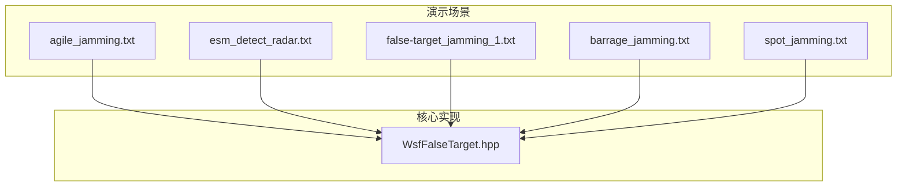
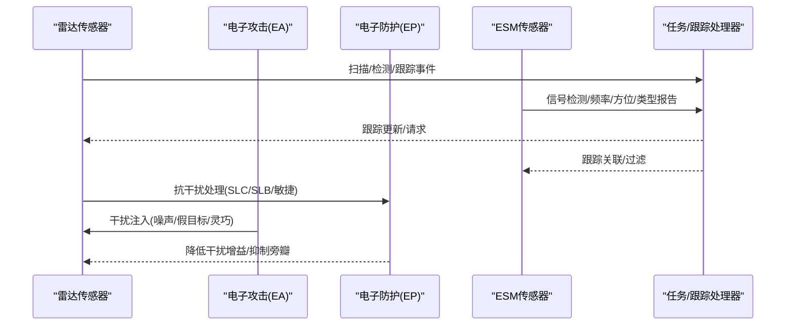
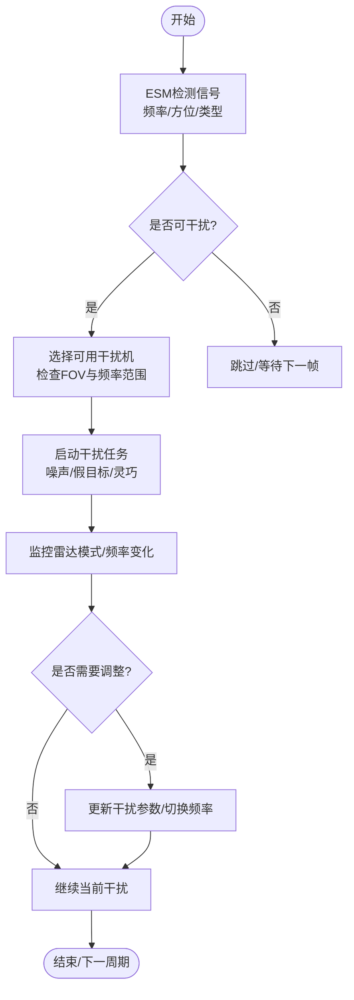
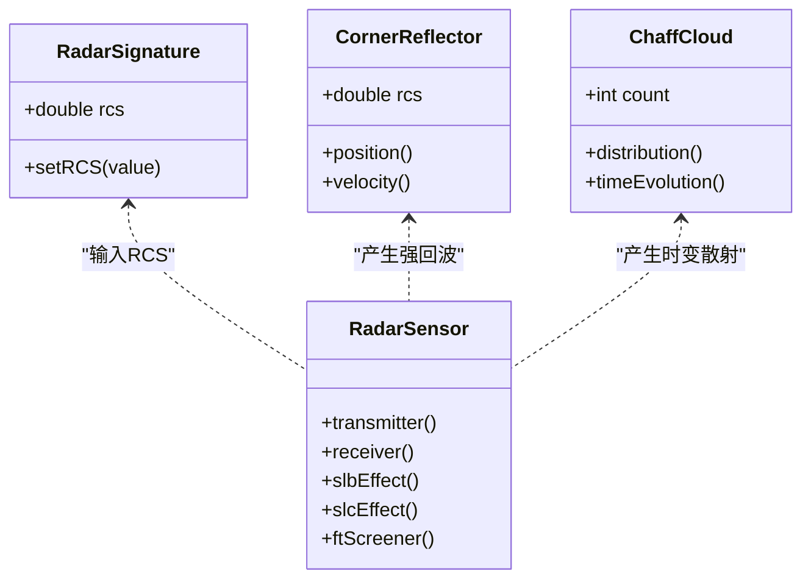
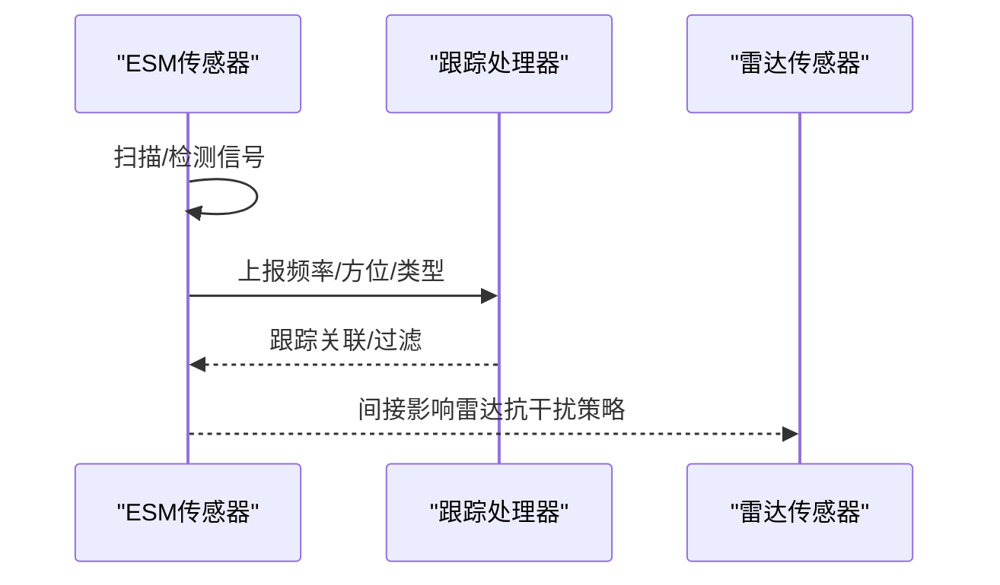
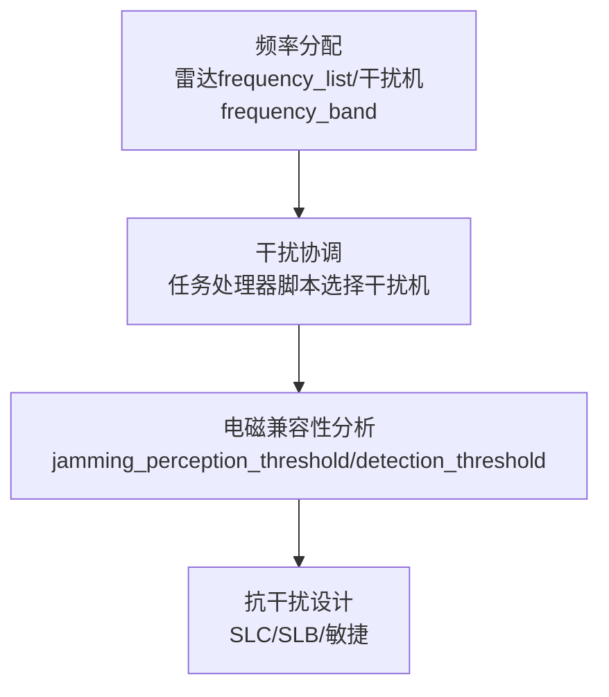
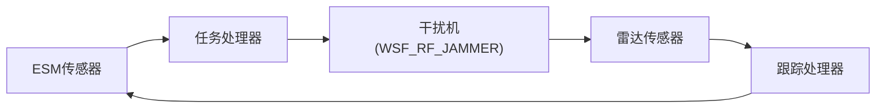

# 电子战仿真

<cite>
**本文引用的文件**   
- [agile_jamming.txt](file://demos/electronic_warfare/agile_jamming.txt)
- [esm_detect_radar.txt](file://demos/electronic_warfare/esm_detect_radar.txt)
- [false-target_jamming_1.txt](file://demos/electronic_warfare/false-target_jamming_1.txt)
- [barrage_jamming.txt](file://demos/electronic_warfare/barrage_jamming.txt)
- [spot_jamming.txt](file://demos/electronic_warfare/spot_jamming.txt)
- [README.md](file://demos/electronic_warfare/README.md)
- [WsfFalseTarget.hpp](file://swdev/src/core/wsf_mil/source/ew/WsfFalseTarget.hpp)
</cite>

## 目录
1. [简介](#简介)
2. [项目结构](#项目结构)
3. [核心组件](#核心组件)
4. [架构总览](#架构总览)
5. [详细组件分析](#详细组件分析)
6. [依赖关系分析](#依赖关系分析)
7. [性能与可扩展性](#性能与可扩展性)
8. [故障排查指南](#故障排查指南)
9. [结论](#结论)
10. [附录：场景配置与案例](#附录场景配置与案例)

## 简介
本技术文档面向AFSIM电子战仿真系统，聚焦干扰建模、雷达对抗、电子支援措施（ESM）、频谱管理与战术应用。文档基于仓库中的电子战演示场景与核心头文件，系统性解释噪声干扰、欺骗干扰与灵巧干扰的实现原理；说明RCS缩减、角反射器与箔条散布的建模思路；梳理ESM的信号检测、识别与定位流程；给出频率分配、干扰协调与电磁兼容性分析的实践方法；并提供防空压制、编队掩护与电子侦察等复杂任务案例与效能评估指标。

## 项目结构
电子战相关示例集中在 demos/electronic_warfare 目录，包含多种干扰类型与ESM探测场景，以及多波束雷达与假目标对抗测试。核心实现涉及EW攻击/防护技术与假目标生成逻辑，位于 swdev 源码中。

**图表来源**
- [agile_jamming.txt:1-472](file://demos/electronic_warfare/agile_jamming.txt#L1-L472)
- [esm_detect_radar.txt:1-253](file://demos/electronic_warfare/esm_detect_radar.txt#L1-L253)
- [false-target_jamming_1.txt:1-392](file://demos/electronic_warfare/false-target_jamming_1.txt#L1-L392)
- [barrage_jamming.txt:1-260](file://demos/electronic_warfare/barrage_jamming.txt#L1-L260)
- [spot_jamming.txt:1-320](file://demos/electronic_warfare/spot_jamming.txt#L1-L320)
- [WsfFalseTarget.hpp:41-434](file://swdev/src/core/wsf_mil/source/ew/WsfFalseTarget.hpp#L41-L434)

**章节来源**
- [README.md:1-45](file://demos/electronic_warfare/README.md#L1-L45)

## 核心组件
- 电子攻击（EA）与电子防护（EP）技术：通过 WSF_ELECTRONIC_ATTACK / WSF_ELECTRONIC_PROTECT 定义干扰与抗干扰策略，如噪声干扰、敏捷模式/频率切换、旁瓣对消（SLC）、旁瓣遮蔽（SLB）等。
- 雷达传感器：WSF_RADAR_SENSOR 提供发射机/接收机参数、扫描模式、检测概率、脉冲积分与跟踪门限等。
- ESM传感器：WSF_ESM_SENSOR 负责信号检测、频率测量、方位估计与目标类型报告。
- 假目标（FT）机制：WSF_FALSE_TARGET_EFFECT 与 WsfFalseTarget 类协同，在雷达端生成虚假回波并影响跟踪。

**章节来源**
- [agile_jamming.txt:67-88](file://demos/electronic_warfare/agile_jamming.txt#L67-L88)
- [spot_jamming.txt:100-119](file://demos/electronic_warfare/spot_jamming.txt#L100-L119)
- [false-target_jamming_1.txt:88-124](file://demos/electronic_warfare/false-target_jamming_1.txt#L88-L124)
- [esm_detect_radar.txt:39-66](file://demos/electronic_warfare/esm_detect_radar.txt#L39-L66)
- [WsfFalseTarget.hpp:49-124](file://swdev/src/core/wsf_mil/source/ew/WsfFalseTarget.hpp#L49-L124)

## 架构总览
电子战仿真由“平台—传感器—武器—处理器”构成闭环：
- 平台携带雷达（WSF_RADAR_SENSOR）或ESM（WSF_ESM_SENSOR），并可挂载干扰机（WSF_RF_JAMMER）。
- 处理器（WSF_TASK_PROCESSOR / WSF_TRACK_PROCESSOR）驱动任务编排与跟踪管理。
- EA/EP技术作为可插拔模块，作用于发射/接收链路，改变有效信噪比与检测概率。
- 假目标机制在雷达侧注入虚拟轨迹，影响跟踪与火控。

**图表来源**
- [agile_jamming.txt:211-228](file://demos/electronic_warfare/agile_jamming.txt#L211-L228)
- [spot_jamming.txt:100-119](file://demos/electronic_warfare/spot_jamming.txt#L100-L119)
- [false-target_jamming_1.txt:88-124](file://demos/electronic_warfare/false-target_jamming_1.txt#L88-L124)
- [esm_detect_radar.txt:39-66](file://demos/electronic_warfare/esm_detect_radar.txt#L39-L66)

## 详细组件分析

### 干扰技术建模
- 噪声干扰（Noise Jamming）
  - 通过 WSF_EA_TECHNIQUE 的 noise_jamming 技术，结合 WSF_POWER_EFFECT 调整干扰功率或增益差（jamming_delta_gain），以压制雷达接收机。
  - 窄带点频干扰（Spot Jamming）将能量集中于雷达工作频率，提升单目标压制效果。
  - 宽带阻塞干扰（Barrage Jamming）覆盖较宽频段，同时压制多个雷达但单目标干扰效率下降。
- 欺骗干扰（Deceptive Jamming）
  - 使用 false_target_jamming 技术，配合 WSF_FALSE_TARGET_EFFECT 控制脉冲密度、扫描倍率等，生成虚假回波。
  - 雷达侧通过 WSF_FT_SCREENER 进行假目标筛选，结合旁瓣遮蔽（SLB）与信号增益等技术降低假目标影响。
- 灵巧干扰（Agile Jamming）
  - 结合雷达的模式/频率敏捷（mode_changing/frequency_changing），动态跟踪雷达频率变化，维持点频压制。
  - 任务处理器脚本根据ESM检测到的信号频率与平台视场，自动选择可用干扰机并启动干扰任务。

**图表来源**
- [agile_jamming.txt:90-197](file://demos/electronic_warfare/agile_jamming.txt#L90-L197)
- [false-target_jamming_1.txt:40-66](file://demos/electronic_warfare/false-target_jamming_1.txt#L40-L66)
- [spot_jamming.txt:54-78](file://demos/electronic_warfare/spot_jamming.txt#L54-L78)
- [barrage_jamming.txt:43-49](file://demos/electronic_warfare/barrage_jamming.txt#L43-L49)

**章节来源**
- [agile_jamming.txt:67-88](file://demos/electronic_warfare/agile_jamming.txt#L67-L88)
- [agile_jamming.txt:211-228](file://demos/electronic_warfare/agile_jamming.txt#L211-L228)
- [false-target_jamming_1.txt:40-66](file://demos/electronic_warfare/false-target_jamming_1.txt#L40-L66)
- [false-target_jamming_1.txt:88-124](file://demos/electronic_warfare/false-target_jamming_1.txt#L88-L124)
- [spot_jamming.txt:54-78](file://demos/electronic_warfare/spot_jamming.txt#L54-L78)
- [spot_jamming.txt:100-119](file://demos/electronic_warfare/spot_jamming.txt#L100-L119)
- [barrage_jamming.txt:43-49](file://demos/electronic_warfare/barrage_jamming.txt#L43-L49)

### 雷达对抗仿真（RCS缩减、角反射器、箔条散布）
- RCS缩减
  - 通过雷达签名（radar_signature）定义平台的等效RCS，可在不同平台类型中设置常数RCS以降低被探测概率。
- 角反射器建模
  - 可使用独立平台或静态目标模拟角反射器的高RCS特性，结合移动器与轨迹生成其散布效果。
- 箔条散布
  - 通过大量低RCS/高RCS混合目标模拟箔条云，结合时间演化与扩散模型，形成时变散射体群，影响雷达检测与跟踪。
- 雷达侧对抗
  - 旁瓣遮蔽（SLB）与旁瓣对消（SLC）用于抑制来自旁瓣的干扰与假目标。
  - 假目标筛选器（WSF_FT_SCREENER）结合容量限制与强制真实目标跟踪，提高鲁棒性。

**图表来源**
- [agile_jamming.txt:23-29](file://demos/electronic_warfare/agile_jamming.txt#L23-L29)
- [false-target_jamming_1.txt:149-159](file://demos/electronic_warfare/false-target_jamming_1.txt#L149-L159)
- [spot_jamming.txt:100-119](file://demos/electronic_warfare/spot_jamming.txt#L100-L119)

**章节来源**
- [agile_jamming.txt:23-29](file://demos/electronic_warfare/agile_jamming.txt#L23-L29)
- [false-target_jamming_1.txt:149-159](file://demos/electronic_warfare/false-target_jamming_1.txt#L149-L159)
- [spot_jamming.txt:100-119](file://demos/electronic_warfare/spot_jamming.txt#L100-L119)

### 电子支援措施（ESM）
- 信号检测
  - WSF_ESM_SENSOR 配置最大作用距离、接收机阈值、噪声功率与内部损耗，支持宽频带扫描。
- 识别
  - reported_emitter_type 支持默认类型声明与真值报告，结合 time_to_declare 控制识别延迟。
- 定位
  - reports_location 输出方位信息，ranging_time 控制测距能力，结合多平台数据可实现TDOA/AOA融合。

**图表来源**
- [esm_detect_radar.txt:39-66](file://demos/electronic_warfare/esm_detect_radar.txt#L39-L66)
- [esm_detect_radar.txt:130-158](file://demos/electronic_warfare/esm_detect_radar.txt#L130-L158)

**章节来源**
- [esm_detect_radar.txt:39-66](file://demos/electronic_warfare/esm_detect_radar.txt#L39-L66)
- [esm_detect_radar.txt:130-158](file://demos/electronic_warfare/esm_detect_radar.txt#L130-L158)

### 频谱管理功能
- 频率分配
  - 雷达 transmitter.frequency_list 定义多频点，支持模式间切换；干扰机 frequency_band 定义可用频段。
- 干扰协调
  - 任务处理器脚本根据ESM检测到的频率与平台视场，动态选择干扰机并启动干扰任务，避免冲突。
- 电磁兼容性分析
  - 通过 jamming_perception_threshold 与 detection_threshold 等参数，评估干扰对雷达检测概率的影响；结合EP技术（SLC/SLB/敏捷）进行抗干扰设计。

**图表来源**
- [agile_jamming.txt:251-264](file://demos/electronic_warfare/agile_jamming.txt#L251-L264)
- [agile_jamming.txt:90-197](file://demos/electronic_warfare/agile_jamming.txt#L90-L197)
- [spot_jamming.txt:121-166](file://demos/electronic_warfare/spot_jamming.txt#L121-L166)

**章节来源**
- [agile_jamming.txt:251-264](file://demos/electronic_warfare/agile_jamming.txt#L251-L264)
- [agile_jamming.txt:90-197](file://demos/electronic_warfare/agile_jamming.txt#L90-L197)
- [spot_jamming.txt:121-166](file://demos/electronic_warfare/spot_jamming.txt#L121-L166)

## 依赖关系分析
- 组件耦合
  - 雷达传感器依赖EA/EP技术以改变检测概率；ESM为干扰协调提供输入；任务处理器串联检测、决策与执行。
- 外部依赖
  - 平台移动器（WSF_AIR_MOVER/WSF_GROUND_MOVER）与轨迹定义影响几何关系与视场约束。
- 循环依赖
  - 无直接代码级循环依赖；逻辑上存在反馈回路（ESM→干扰→雷达→ESM）。

**图表来源**
- [agile_jamming.txt:90-197](file://demos/electronic_warfare/agile_jamming.txt#L90-L197)
- [esm_detect_radar.txt:130-158](file://demos/electronic_warfare/esm_detect_radar.txt#L130-L158)

**章节来源**
- [agile_jamming.txt:90-197](file://demos/electronic_warfare/agile_jamming.txt#L90-L197)
- [esm_detect_radar.txt:130-158](file://demos/electronic_warfare/esm_detect_radar.txt#L130-L158)

## 性能与可扩展性
- 性能特征
  - 宽带阻塞干扰降低单目标干扰效率，但提升多目标压制面；点频干扰提升单目标压制强度。
  - 假目标数量与脉冲密度影响雷达跟踪容量与误报率；SLB/SLC与FT筛选项可显著改善鲁棒性。
- 优化建议
  - 合理设置雷达带宽与噪声功率，平衡检测概率与抗干扰能力。
  - 使用敏捷模式/频率切换减少固定干扰的有效性。
  - 通过任务处理器脚本优化干扰机选择与资源分配，避免FOV与频率不匹配导致的任务失败。
- 扩展新干扰技术
  - 新增WSF_EA_TECHNIQUE子类，定义新的effect（如波形扰动、极化调制），并在雷达侧对应EP技术进行对抗建模。
  - 扩展WSF_FALSE_TARGET_EFFECT，增加分布模式（圆形/扇形/随机）与运动学行为（速度/航向参考）。

**章节来源**
- [false-target_jamming_1.txt:40-66](file://demos/electronic_warfare/false-target_jamming_1.txt#L40-L66)
- [false-target_jamming_1.txt:88-124](file://demos/electronic_warfare/false-target_jamming_1.txt#L88-L124)
- [agile_jamming.txt:211-228](file://demos/electronic_warfare/agile_jamming.txt#L211-L228)

## 故障排查指南
- 干扰未生效
  - 检查干扰机频率是否在雷达接收带宽内；确认FOV与平台姿态。
  - 查看任务处理器脚本是否成功启动干扰任务（JAMMING_ATTEMPT事件）。
- 假目标过多
  - 调整WSF_FT_SCREENER的track_capacity与plot_capacity；启用force_target_tracks限制真实目标优先。
  - 增强SLB/SLC效果，提高旁瓣抑制与对消能力。
- ESM未检测到信号
  - 检查maximum_range、detection_threshold与noise_power参数；确认reports_location与reports_frequency已启用。

**章节来源**
- [agile_jamming.txt:412-460](file://demos/electronic_warfare/agile_jamming.txt#L412-L460)
- [false-target_jamming_1.txt:149-159](file://demos/electronic_warfare/false-target_jamming_1.txt#L149-L159)
- [esm_detect_radar.txt:39-66](file://demos/electronic_warfare/esm_detect_radar.txt#L39-L66)

## 结论
AFSIM电子战仿真通过模块化EA/EP技术、灵活的雷达与ESM传感器、以及强大的任务处理器脚本，提供了从噪声干扰到欺骗干扰再到灵巧干扰的全谱系建模能力。结合RCS缩减、角反射器与箔条散布的对抗手段，以及频谱管理与电磁兼容性分析，能够支撑防空压制、编队掩护与电子侦察等复杂任务的仿真与评估。未来可通过扩展新的干扰技术与战术，进一步提升仿真保真度与实用性。

## 附录：场景配置与案例
- 防空压制
  - 使用宽带阻塞干扰压制多型雷达，结合敏捷雷达的频率切换与SLC/SLB对抗，评估压制效果与雷达恢复能力。
- 编队掩护
  - 点频干扰保护打击编队，任务处理器根据ESM检测动态调整干扰频率与功率，确保关键目标的生存概率。
- 电子侦察
  - ESM平台持续扫描并上报敌方雷达信号，结合多平台数据实现定位与识别，为干扰与突防提供情报支持。

**章节来源**
- [barrage_jamming.txt:1-260](file://demos/electronic_warfare/barrage_jamming.txt#L1-L260)
- [spot_jamming.txt:1-320](file://demos/electronic_warfare/spot_jamming.txt#L1-L320)
- [esm_detect_radar.txt:1-253](file://demos/electronic_warfare/esm_detect_radar.txt#L1-L253)