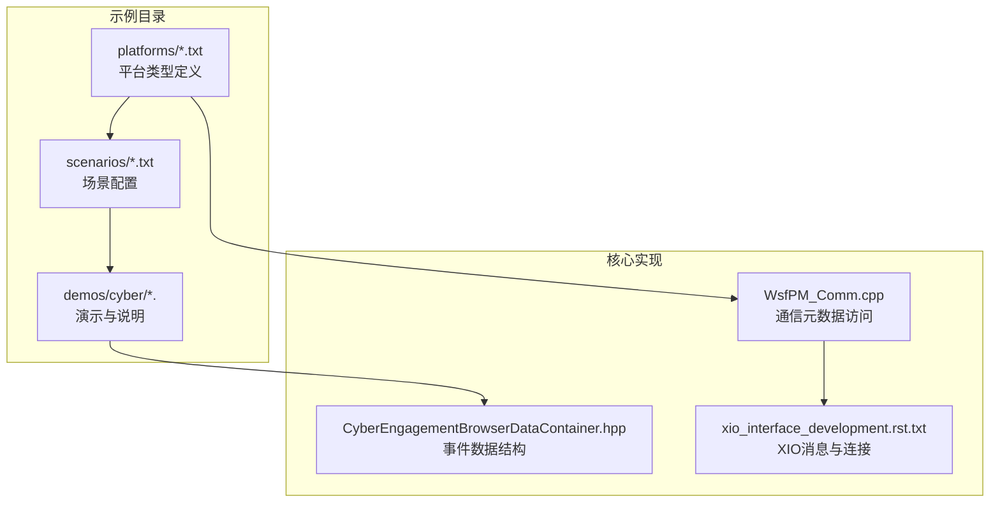
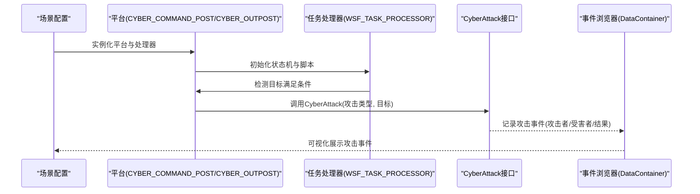
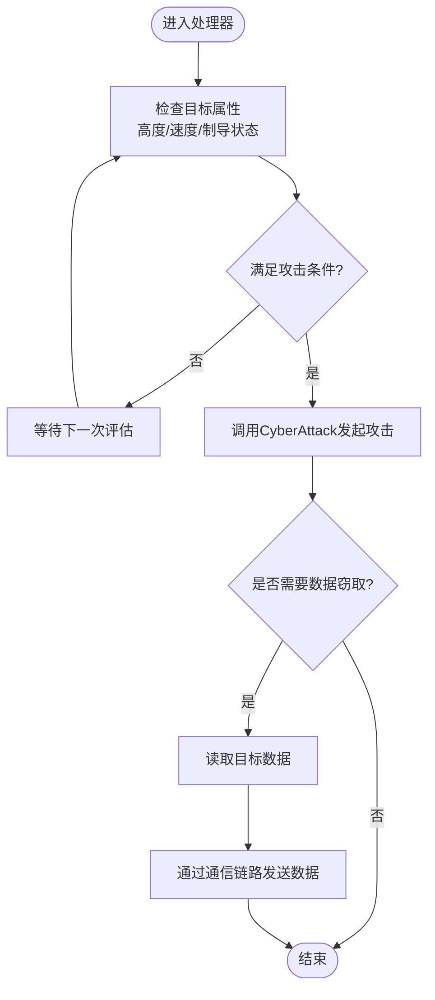
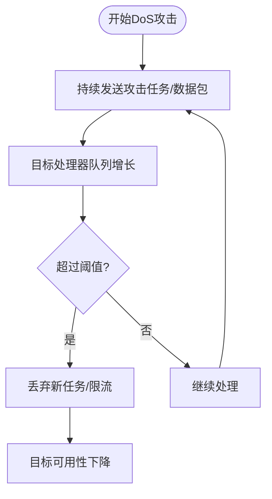
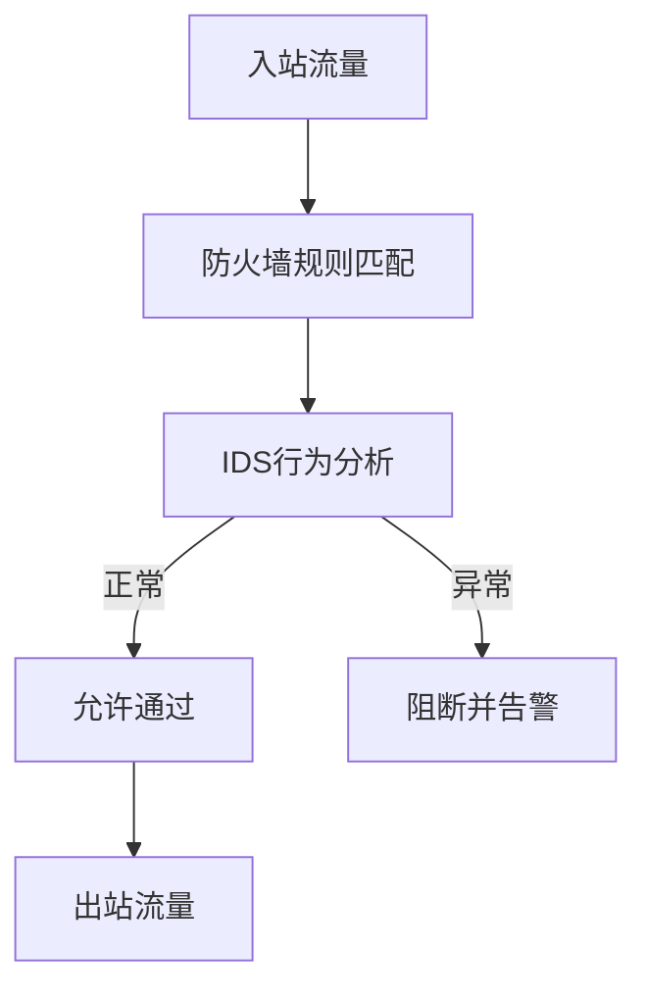
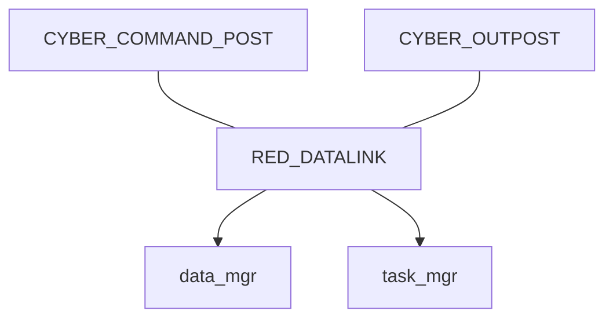
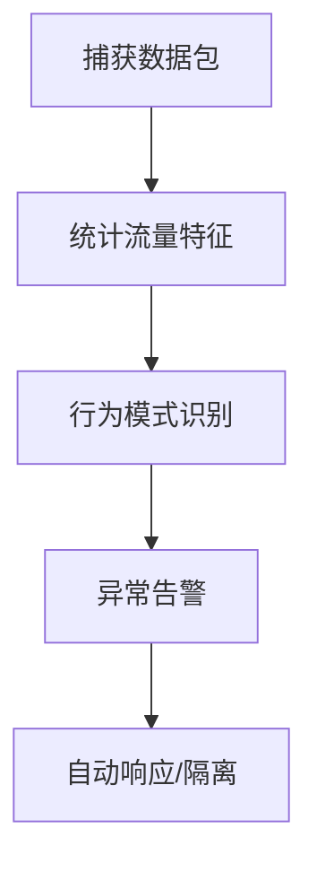
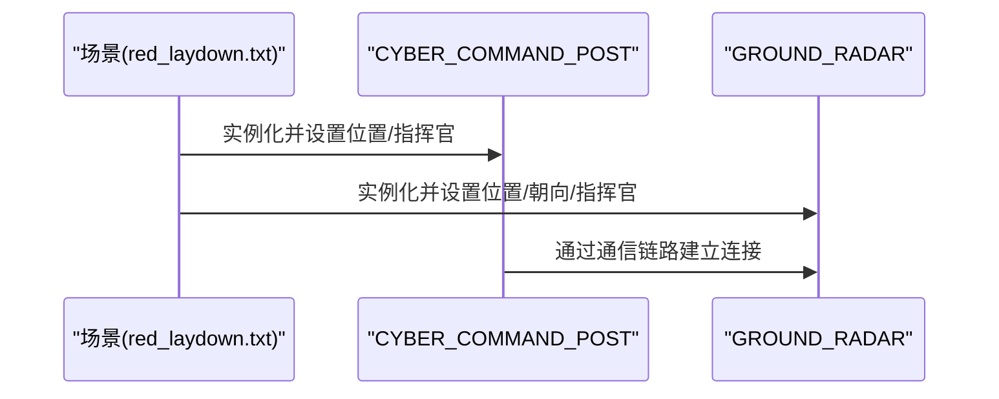
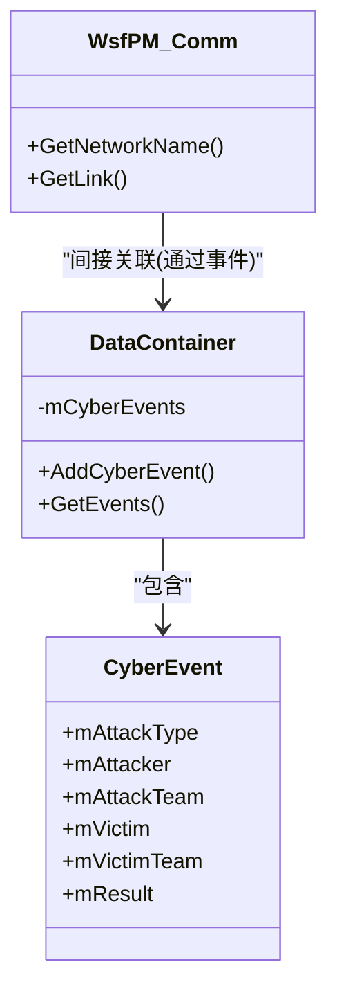

# 网络战仿真

<cite>
**本文引用的文件**   
- [README.md](file://demos/cyber/README.md)
- [blue_laydown.txt](file://demos/cyber/scenarios/blue_laydown.txt)
- [red_laydown.txt](file://demos/cyber/scenarios/red_laydown.txt)
- [cyber_command_post.txt](file://demos/cyber/platforms/cyber_command_post.txt)
- [cyber_outpost.txt](file://demos/cyber/platforms/cyber_outpost.txt)
- [CyberEngagementBrowserDataContainer.hpp](file://swdev/src/warlock/plugins/CyberEngagementBrowser/source/CyberEngagementBrowserDataContainer.hpp)
- [WsfPM_Comm.cpp](file://swdev/src/core/wsf_parser/source/WsfPM_Comm.cpp)
- [xio_interface_development.rst.txt](file://documentation/html/_sources/docs/xio_interface_development.rst.txt)
</cite>

## 目录
1. [简介](#简介)
2. [项目结构](#项目结构)
3. [核心组件](#核心组件)
4. [架构总览](#架构总览)
5. [详细组件分析](#详细组件分析)
6. [依赖关系分析](#依赖关系分析)
7. [性能考虑](#性能考虑)
8. [故障排查指南](#故障排查指南)
9. [结论](#结论)
10. [附录](#附录)

## 简介
本技术文档面向AFSIM的网络战仿真能力，聚焦网络安全攻击建模、网络防御机制、网络拓扑建模、网络流量与行为分析、场景配置方法以及复杂网络战案例（如APT模拟、关键基础设施防护和网络弹性评估）。文档同时给出可扩展的攻击与防御模型设计建议，并说明如何计算网络安全指标与进行威胁评估。

## 项目结构
AFSIM的“网络战”示例位于 demos/cyber 目录，包含平台定义、处理器脚本、场景配置与演示用例。核心要点：
- 平台类型定义：在 platforms 下定义具备通信、处理器和状态机的平台类型（如指挥节点、前沿哨所等）。
- 场景配置：scenarios 中通过 platform 实例化具体实体，并设置位置、航路、指挥关系等。
- 攻击与效果：通过处理器脚本调用平台的 CyberAttack 接口触发网络攻击；结果由系统记录并可被浏览器展示。
- 通信与数据流：平台通过 comm datalink 建立链路，内部通过 internal_link 连接处理器，形成任务处理链。

图示来源
- [README.md:1-48](file://demos/cyber/README.md#L1-L48)
- [blue_laydown.txt:1-27](file://demos/cyber/scenarios/blue_laydown.txt#L1-L27)
- [red_laydown.txt:1-25](file://demos/cyber/scenarios/red_laydown.txt#L1-L25)
- [CyberEngagementBrowserDataContainer.hpp:22-80](file://swdev/src/warlock/plugins/CyberEngagementBrowser/source/CyberEngagementBrowserDataContainer.hpp#L22-L80)
- [WsfPM_Comm.cpp:18-36](file://swdev/src/core/wsf_parser/source/WsfPM_Comm.cpp#L18-L36)
- [xio_interface_development.rst.txt:30-45](file://documentation/html/_sources/docs/xio_interface_development.rst.txt#L30-L45)

章节来源
- [README.md:1-48](file://demos/cyber/README.md#L1-L48)
- [blue_laydown.txt:1-27](file://demos/cyber/scenarios/blue_laydown.txt#L1-L27)
- [red_laydown.txt:1-25](file://demos/cyber/scenarios/red_laydown.txt#L1-L25)

## 核心组件
- 平台类型与处理器
  - 指挥节点（CYBER_COMMAND_POST）：内置数据管理与任务处理器，基于探测状态机触发网络攻击。
  - 前沿哨所（CYBER_OUTPOST）：具备多服务器能力的任务处理器，按条件对目标执行网络攻击，并在不同状态间切换。
- 网络攻击接口
  - 平台提供 CyberAttack 接口，用于向目标发起指定类型的网络攻击（例如“CRASH”、“LOWER_ALTITUDE”等）。
- 事件记录与展示
  - 使用 CyberEngagementBrowserDataContainer 中的 CyberEvent 结构记录攻击者、受害者、团队与结果等信息，供前端浏览器展示。
- 通信与数据流
  - 平台通过 comm datalink 建立通信链路，并通过 internal_link 将链路连接到内部处理器，形成任务处理链。
  - 通信元数据可通过 WsfPM_Comm 获取网络名称与链路信息。
  - XIO 提供可靠与不可靠两种网络连接方式，支持广播/组播与序列化传输。

章节来源
- [cyber_command_post.txt:14-49](file://demos/cyber/platforms/cyber_command_post.txt#L14-L49)
- [cyber_outpost.txt:14-76](file://demos/cyber/platforms/cyber_outpost.txt#L14-L76)
- [CyberEngagementBrowserDataContainer.hpp:22-80](file://swdev/src/warlock/plugins/CyberEngagementBrowser/source/CyberEngagementBrowserDataContainer.hpp#L22-L80)
- [WsfPM_Comm.cpp:18-36](file://swdev/src/core/wsf_parser/source/WsfPM_Comm.cpp#L18-L36)
- [xio_interface_development.rst.txt:30-45](file://documentation/html/_sources/docs/xio_interface_development.rst.txt#L30-L45)

## 架构总览
下图展示了从场景到平台、处理器、攻击接口、事件记录与展示的端到端流程。

图示来源
- [cyber_command_post.txt:24-49](file://demos/cyber/platforms/cyber_command_post.txt#L24-L49)
- [cyber_outpost.txt:24-76](file://demos/cyber/platforms/cyber_outpost.txt#L24-L76)
- [CyberEngagementBrowserDataContainer.hpp:22-80](file://swdev/src/warlock/plugins/CyberEngagementBrowser/source/CyberEngagementBrowserDataContainer.hpp#L22-L80)

## 详细组件分析

### 组件A：网络入侵与数据窃取建模
- 攻击建模
  - 通过处理器脚本判断目标属性（如高度、速度、是否开启制导等），满足条件后调用 CyberAttack 发起攻击。
  - 攻击类型可包括“CRASH”（导致目标失效）、“LOWER_ALTITUDE”（迫使目标降低高度）等。
- 数据窃取
  - 可在处理器中增加逻辑，在成功攻击后读取或转发受控目标的敏感数据（如轨迹、传感器数据），并通过通信链路发送到外部系统。
- 典型流程

图示来源
- [cyber_outpost.txt:28-76](file://demos/cyber/platforms/cyber_outpost.txt#L28-L76)
- [cyber_command_post.txt:24-49](file://demos/cyber/platforms/cyber_command_post.txt#L24-L49)

章节来源
- [cyber_outpost.txt:28-76](file://demos/cyber/platforms/cyber_outpost.txt#L28-L76)
- [cyber_command_post.txt:24-49](file://demos/cyber/platforms/cyber_command_post.txt#L24-L49)

### 组件B：拒绝服务攻击建模
- 攻击建模
  - 通过高频触发 CyberAttack 或注入大量无效任务至目标处理器，造成目标处理能力饱和。
  - 结合通信链路拥塞（如广播风暴）放大影响范围。
- 防御策略
  - 在处理器层引入速率限制、任务队列长度上限与优先级调度。
  - 在网络层启用流量整形与丢弃策略。

[此图为概念流程图，不直接映射具体源码]

### 组件C：恶意软件传播建模
- 传播路径
  - 利用已攻陷节点作为跳板，横向移动到其他节点，复制并执行恶意载荷。
- 控制与命令
  - 通过通信链路下发指令，协调多节点协同行动。
- 检测与阻断
  - 在处理器中加入异常行为检测（如频繁连接、异常数据量），发现后隔离受影响节点。

[此图为概念流程图，不直接映射具体源码]

### 组件D：网络防御机制
- 防火墙规则
  - 在通信链路层过滤非法源地址/端口，限制广播/组播滥用。
- 入侵检测系统（IDS）
  - 在处理器中实现签名匹配与行为分析，触发告警与自动响应。
- 安全协议
  - 对关键数据采用加密与认证，防止中间人攻击与重放攻击。

[此图为概念流程图，不直接映射具体源码]

### 组件E：网络拓扑建模
- 节点属性
  - 平台类型定义中包含图标、阵营、通信链路、处理器与状态机等属性。
- 连接关系
  - 通过 comm datalink 与 network_name 建立网络域，internal_link 将链路连接到处理器。
- 通信协议栈
  - 使用 XIO 提供的可靠/不可靠连接，支持广播/组播与序列化传输。

图示来源
- [cyber_command_post.txt:18-22](file://demos/cyber/platforms/cyber_command_post.txt#L18-L22)
- [cyber_outpost.txt:18-22](file://demos/cyber/platforms/cyber_outpost.txt#L18-L22)
- [WsfPM_Comm.cpp:18-36](file://swdev/src/core/wsf_parser/source/WsfPM_Comm.cpp#L18-L36)
- [xio_interface_development.rst.txt:30-45](file://documentation/html/_sources/docs/xio_interface_development.rst.txt#L30-L45)

章节来源
- [cyber_command_post.txt:18-22](file://demos/cyber/platforms/cyber_command_post.txt#L18-L22)
- [cyber_outpost.txt:18-22](file://demos/cyber/platforms/cyber_outpost.txt#L18-L22)
- [WsfPM_Comm.cpp:18-36](file://swdev/src/core/wsf_parser/source/WsfPM_Comm.cpp#L18-L36)
- [xio_interface_development.rst.txt:30-45](file://documentation/html/_sources/docs/xio_interface_development.rst.txt#L30-L45)

### 组件F：网络流量分析与行为模式识别
- 数据包捕获
  - 在处理器中记录入站/出站消息数量、大小与时间戳，生成统计报表。
- 流量统计
  - 聚合各节点的带宽占用、丢包率与延迟分布。
- 行为模式识别
  - 基于历史数据训练异常检测模型，识别突发流量、周期性扫描与异常会话。

[此图为概念流程图，不直接映射具体源码]

### 组件G：场景配置与扩展
- 攻击者画像
  - 在场景中定义红方平台（如 cyber_command_post_1、ground_radar_1），设定其位置、朝向与指挥官。
- 防御策略
  - 在蓝方平台中增加处理器与状态机，实现对攻击的检测与反制。
- 环境设置
  - 通过 scenarios 配置平台实例、导航路线与通信网络。

图示来源
- [red_laydown.txt:15-25](file://demos/cyber/scenarios/red_laydown.txt#L15-L25)

章节来源
- [red_laydown.txt:15-25](file://demos/cyber/scenarios/red_laydown.txt#L15-L25)

## 依赖关系分析
- 平台类型依赖处理器与通信链路
  - CYBER_COMMAND_POST 与 CYBER_OUTPOST 均依赖 WSF_TASK_PROCESSOR 与 WSF_TRACK_PROCESSOR。
- 事件浏览器依赖事件数据结构
  - CyberEngagementBrowserDataContainer 提供 CyberEvent 结构，用于记录攻击者与受害者信息。
- 通信模块依赖XIO
  - WsfPM_Comm 提供网络名称与链路访问；XIO文档描述可靠/不可靠连接与序列化机制。

图示来源
- [CyberEngagementBrowserDataContainer.hpp:22-80](file://swdev/src/warlock/plugins/CyberEngagementBrowser/source/CyberEngagementBrowserDataContainer.hpp#L22-L80)
- [WsfPM_Comm.cpp:18-36](file://swdev/src/core/wsf_parser/source/WsfPM_Comm.cpp#L18-L36)

章节来源
- [CyberEngagementBrowserDataContainer.hpp:22-80](file://swdev/src/warlock/plugins/CyberEngagementBrowser/source/CyberEngagementBrowserDataContainer.hpp#L22-L80)
- [WsfPM_Comm.cpp:18-36](file://swdev/src/core/wsf_parser/source/WsfPM_Comm.cpp#L18-L36)

## 性能考虑
- 处理器并发
  - 为高负载任务处理器设置 number_of_servers，避免单线程瓶颈。
- 状态机评估间隔
  - 合理设置 evaluation_interval 与 time_to_evaluate，平衡实时性与开销。
- 通信负载
  - 控制广播/组播频率，避免网络拥塞；对关键链路启用可靠传输。
- 资源清理
  - 定期清理跟踪数据（purge_interval），减少内存占用。

章节来源
- [cyber_outpost.txt:24-30](file://demos/cyber/platforms/cyber_outpost.txt#L24-L30)
- [cyber_command_post.txt:33-46](file://demos/cyber/platforms/cyber_command_post.txt#L33-L46)

## 故障排查指南
- 攻击未触发
  - 检查处理器状态机条件（如斜距、目标类型、高度阈值）是否正确。
  - 确认 CyberAttack 调用参数（攻击类型、目标）有效。
- 事件未显示
  - 确认 CyberEvent 字段（攻击者、受害者、结果）已正确填充。
  - 检查事件浏览器是否订阅了 EventAdded 信号。
- 通信异常
  - 验证 network_name 与 internal_link 配置一致。
  - 检查 XIO 连接状态（OnConnected/OnDisconnected回调）。

章节来源
- [cyber_command_post.txt:33-46](file://demos/cyber/platforms/cyber_command_post.txt#L33-L46)
- [cyber_outpost.txt:49-68](file://demos/cyber/platforms/cyber_outpost.txt#L49-L68)
- [CyberEngagementBrowserDataContainer.hpp:72-79](file://swdev/src/warlock/plugins/CyberEngagementBrowser/source/CyberEngagementBrowserDataContainer.hpp#L72-L79)
- [xio_interface_development.rst.txt:30-45](file://documentation/html/_sources/docs/xio_interface_development.rst.txt#L30-L45)

## 结论
AFSIM的网络战仿真通过平台类型、处理器脚本与通信链路实现了灵活的网络安全攻击与防御建模。借助 CyberAttack 接口与事件浏览器，用户可快速构建从网络入侵、数据窃取到拒绝服务与恶意软件传播的完整攻击链，并结合状态机与通信机制实现动态防御。未来可扩展新的攻击类型与防御技术，以支撑APT模拟、关键基础设施防护与网络弹性评估等复杂场景。

## 附录
- 复杂网络战仿真案例
  - APT攻击模拟：分阶段渗透、持久化与控制，结合横向移动与数据外泄。
  - 关键基础设施防护：多层防御（防火墙、IDS、安全协议）与快速恢复策略。
  - 网络弹性评估：量化指标（可用性、恢复时间、损失程度）与压力测试。
- 网络安全指标计算与威胁评估方法
  - 指标：攻击成功率、检测率、平均恢复时间、数据泄露体积。
  - 方法：蒙特卡洛仿真、敏感性分析、风险矩阵。
- 扩展新攻击与防御模型
  - 新增攻击类型：在处理器脚本中定义新攻击逻辑，并通过 CyberAttack 暴露接口。
  - 新增防御技术：在处理器中实现检测与响应逻辑，集成到状态机与工作流。

[本节为概念性内容，不直接分析具体文件]