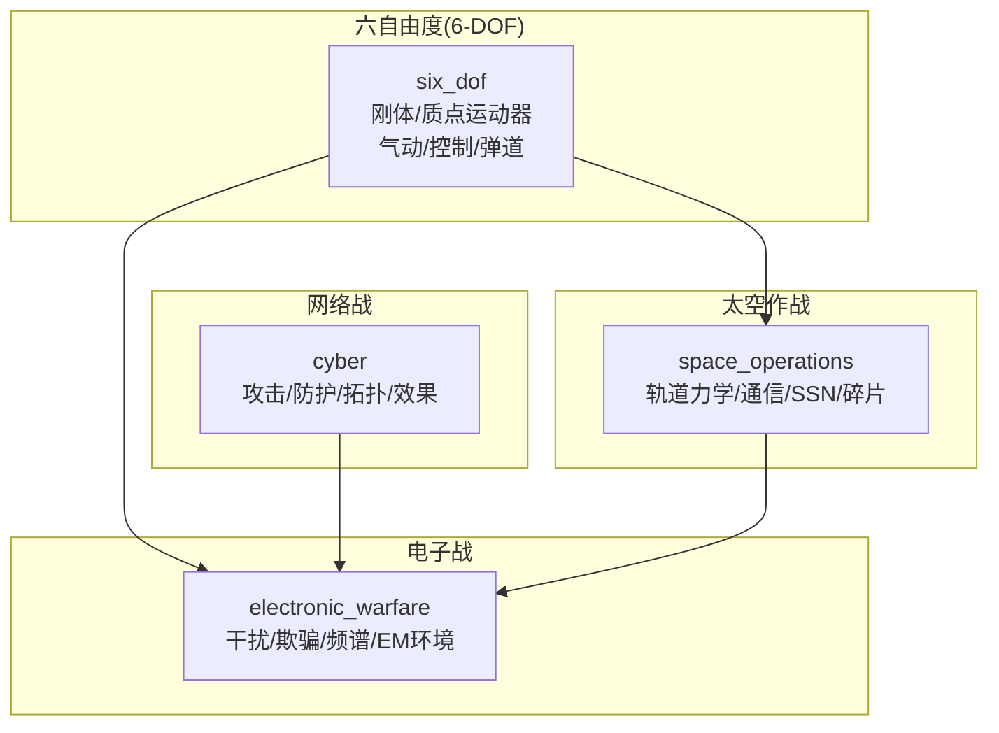
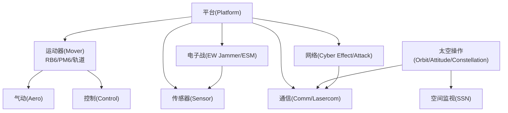
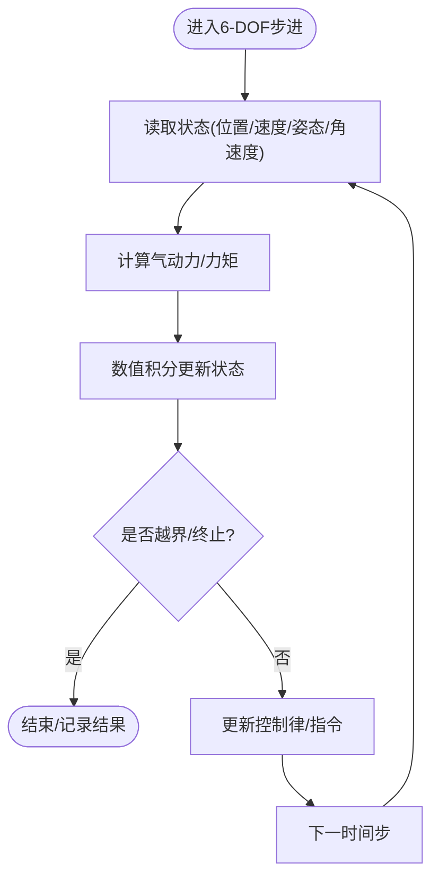
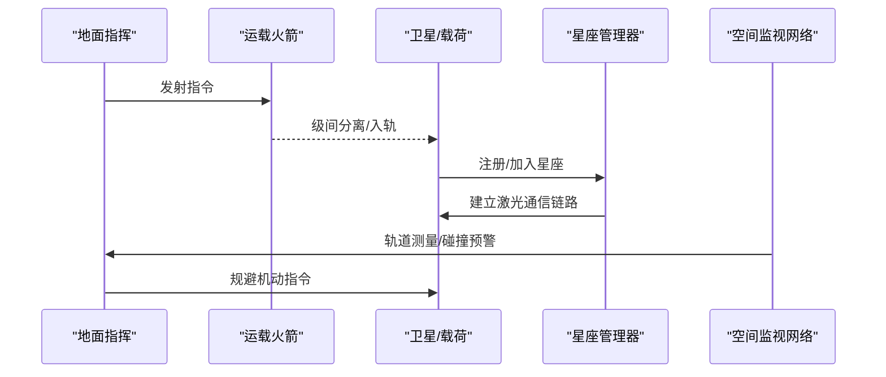
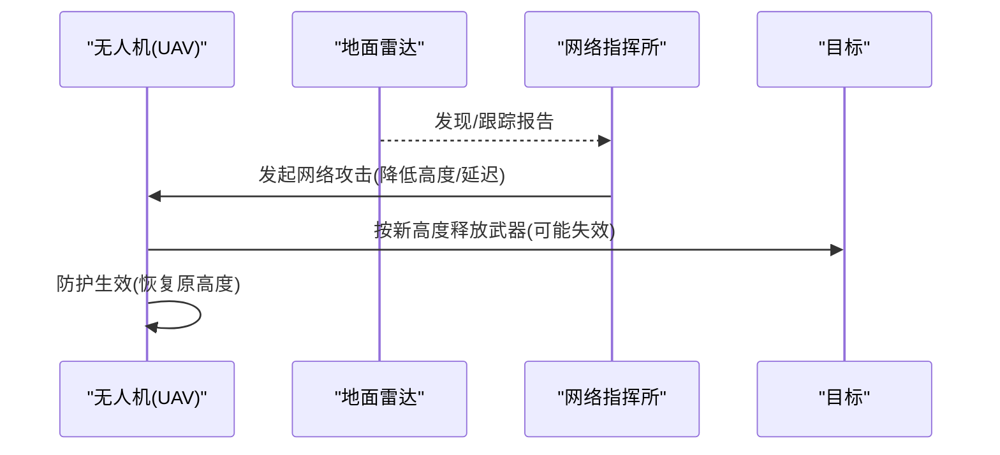
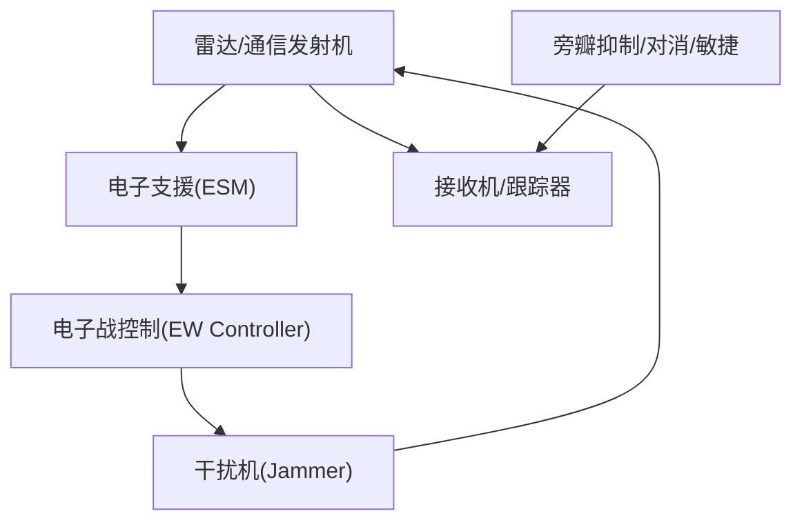
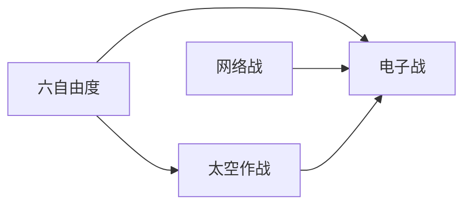

# 高级功能

<cite>
**本文引用的文件**   
- [demos/six_dof/doc/six_dof.rst](file://demos/six_dof/doc/six_dof.rst)
- [demos/cyber/doc/cyber.rst](file://demos/cyber/doc/cyber.rst)
- [demos/electronic_warfare/doc/electronic_warfare_demos.rst](file://demos/electronic_warfare/doc/electronic_warfare_demos.rst)
- [demos/space_operations/doc/space_operations.rst](file://demos/space_operations/doc/space_operations.rst)
</cite>

## 目录
1. [简介](#简介)
2. [项目结构](#项目结构)
3. [核心组件](#核心组件)
4. [架构总览](#架构总览)
5. [详细组件分析](#详细组件分析)
6. [依赖关系分析](#依赖关系分析)
7. [性能考虑](#性能考虑)
8. [故障排查指南](#故障排查指南)
9. [结论](#结论)
10. [附录](#附录)

## 简介
本技术文档聚焦AFSIM的高级仿真能力，围绕以下四大领域展开：六自由度（6-DOF）飞行仿真、太空作战仿真、网络战仿真与电子战仿真。文档从系统架构、数据流、处理逻辑、集成方式与配置方法入手，结合仓库中的演示场景与说明文档，给出可操作的实践路径与扩展建议，并辅以数学模型与物理公式的推导思路，帮助读者在有限技术背景的前提下理解并应用这些高级功能。

## 项目结构
AFSIM通过“演示（demos）”组织各领域的典型用例与参考实现，其中与本主题直接相关的目录包括：
- six_dof：六自由度刚体/质点运动器、气动与控制脚本、弹道与轨道发射等示例
- space_operations：发射、轨道机动、星座通信、空间态势感知与碎片建模等示例
- cyber：网络攻击、中间人效应、资源约束与防护等示例
- electronic_warfare：干扰、欺骗、频谱管理与电磁环境建模等示例

[本节为概念性结构说明，不直接分析具体源文件]

## 核心组件
- 六自由度（6-DOF）仿真
  - 刚体动力学与质点动力学双轨支持，覆盖起飞、编队、巡航、导弹制导、空对空/地对空拦截、零长发射、外部油箱、轨道发射等复杂任务
  - 气动建模、控制系统与数值积分通过平台类型与脚本组合实现
- 太空作战仿真
  - 轨道力学与任务序列、姿态控制、激光通信、星座生成与管理、空间监视网络（SSN）、碰撞规避与碎片建模
- 网络战仿真
  - 基于脚本的网络攻击与防护、中间人（MITM）效应、资源约束与事件联动
- 电子战仿真
  - 电子攻击（EA）与电子防护（EP），涵盖宽带/点频噪声干扰、随机脉冲、假目标、旁瓣抑制/对消、频率敏捷、增益与跟踪误差效应等

**章节来源**
- [demos/six_dof/doc/six_dof.rst:10-29](file://demos/six_dof/doc/six_dof.rst#L10-L29)
- [demos/space_operations/doc/space_operations.rst:10-27](file://demos/space_operations/doc/space_operations.rst#L10-L27)
- [demos/cyber/doc/cyber.rst:10-27](file://demos/cyber/doc/cyber.rst#L10-L27)
- [demos/electronic_warfare/doc/electronic_warfare_demos.rst:10-32](file://demos/electronic_warfare/doc/electronic_warfare_demos.rst#L10-L32)

## 架构总览
AFSIM的高级功能以“平台/传感器/处理器/武器/通信/脚本”等对象为核心，通过统一的事件驱动框架进行耦合。六自由度与太空模块共享底层运动学与导航能力；电子战与网络战通过事件与通信链路影响平台行为与传感器探测链。

[本节为概念性架构图，不直接映射到具体源文件]

## 详细组件分析

### 六自由度（6-DOF）飞行仿真
- 刚体动力学与质点动力学
  - 提供RigidBody与PointMass两类SixDOF运动器，用于高精度姿态/轨迹与简化动力学对比
  - 支持编队保持、相对机动、战术机动脚本化、外挂物分离、空对空/地对空拦截、零长发射、轨道发射等
- 气动建模与控制
  - 通过气动表与控制律配合，结合自动飞行控制（PID前馈/反馈）与辅助表格生成工具
- 数值积分与环境
  - 通过环境配置与地形/大气模型参与积分过程，支撑包线、航程、续航等评估

**图示来源**
- [demos/six_dof/doc/six_dof.rst:176-223](file://demos/six_dof/doc/six_dof.rst#L176-L223)

**章节来源**
- [demos/six_dof/doc/six_dof.rst:10-29](file://demos/six_dof/doc/six_dof.rst#L10-L29)
- [demos/six_dof/doc/six_dof.rst:31-44](file://demos/six_dof/doc/six_dof.rst#L31-L44)
- [demos/six_dof/doc/six_dof.rst:46-55](file://demos/six_dof/doc/six_dof.rst#L46-L55)
- [demos/six_dof/doc/six_dof.rst:57-87](file://demos/six_dof/doc/six_dof.rst#L57-L87)
- [demos/six_dof/doc/six_dof.rst:88-123](file://demos/six_dof/doc/six_dof.rst#L88-L123)
- [demos/six_dof/doc/six_dof.rst:124-144](file://demos/six_dof/doc/six_dof.rst#L124-L144)
- [demos/six_dof/doc/six_dof.rst:145-160](file://demos/six_dof/doc/six_dof.rst#L145-L160)
- [demos/six_dof/doc/six_dof.rst:162-223](file://demos/six_dof/doc/six_dof.rst#L162-L223)

#### 数学模型与公式推导（概述）
- 刚体动力学
  - 牛顿-欧拉方程：m·dv/dt = ΣF, I·dω/dt + ω×(I·ω) = ΣM
  - 姿态四元数或方向余弦矩阵演化：dq/dt = f(q, ω)
- 气动建模
  - 气动力/力矩：F_aero = q·S·C_L(α,β,M), M_aero = q·S·c·C_m(...)
  - 推力/阻力：T = f(m_dot, v_e), D = q·S·C_D(α,δ,...)
- 控制系统
  - PID控制器：u(t) = K_p e(t) + K_i ∫e dt + K_d de/dt
  - 前馈补偿：u_ff = g(α_ref, CL_ref, ...)
- 数值积分
  - Runge-Kutta 4阶（RK4）、自适应步长（如Dormand-Prince）
  - 稳定性判据：Δt ≤ C·h_min / |λ_max|

[本节为通用理论概述，不直接分析具体源文件]

### 太空作战仿真
- 轨道力学与任务序列
  - 支持轨道注入、切向点火、倾角改变、圆化机动等复杂任务序列
  - 使用轨道机动模型与delta-v预算进行任务规划与执行
- 卫星通信与星座管理
  - 激光通信跨链路与星间链路，结合星座生成器与脚本动态管理连接
- 空间态势感知（SSN）
  - 多站观测、轨道确定与融合、碰撞预警与规避
- 太空碎片建模
  - 基于NASA标准碎片模型模拟碰撞产生的碎片云

**图示来源**
- [demos/space_operations/doc/space_operations.rst:148-159](file://demos/space_operations/doc/space_operations.rst#L148-L159)
- [demos/space_operations/doc/space_operations.rst:120-146](file://demos/space_operations/doc/space_operations.rst#L120-L146)
- [demos/space_operations/doc/space_operations.rst:58-71](file://demos/space_operations/doc/space_operations.rst#L58-L71)
- [demos/space_operations/doc/space_operations.rst:169-174](file://demos/space_operations/doc/space_operations.rst#L169-L174)

**章节来源**
- [demos/space_operations/doc/space_operations.rst:30-40](file://demos/space_operations/doc/space_operations.rst#L30-L40)
- [demos/space_operations/doc/space_operations.rst:49-71](file://demos/space_operations/doc/space_operations.rst#L49-L71)
- [demos/space_operations/doc/space_operations.rst:120-146](file://demos/space_operations/doc/space_operations.rst#L120-L146)
- [demos/space_operations/doc/space_operations.rst:148-159](file://demos/space_operations/doc/space_operations.rst#L148-L159)
- [demos/space_operations/doc/space_operations.rst:169-174](file://demos/space_operations/doc/space_operations.rst#L169-L174)

#### 数学模型与公式推导（概述）
- 轨道力学
  - 二体问题：r'' = -μ r / |r|^3
  - 开普勒元素与状态向量转换、Hohmann转移、Delta-V预算
- 姿态控制
  - 反作用轮/推力器扭矩：τ = J·dω/dt + ω×(J·ω)
  - 指向控制：q_cmd → u_ctrl（PD/PID）
- 通信链路
  - 自由空间路径损耗：L_fs = (4π d / λ)^2
  - 激光通信功率预算与指向误差衰减

[本节为通用理论概述，不直接分析具体源文件]

### 网络战仿真
- 网络安全攻击与防护
  - 通过脚本命令发起网络攻击（如延迟通信、降低高度、崩溃等），平台具备对应防护机制（恢复、限制等）
- 中间人（MITM）效应
  - 可对消息进行延迟、篡改或转发（外泄），影响指挥链路与态势感知
- 网络拓扑建模
  - 通过平台与通信对象定义网络节点与边，结合处理器与脚本实现策略

**图示来源**
- [demos/cyber/doc/cyber.rst:30-39](file://demos/cyber/doc/cyber.rst#L30-L39)
- [demos/cyber/doc/cyber.rst:41-45](file://demos/cyber/doc/cyber.rst#L41-L45)

**章节来源**
- [demos/cyber/doc/cyber.rst:10-27](file://demos/cyber/doc/cyber.rst#L10-L27)
- [demos/cyber/doc/cyber.rst:30-39](file://demos/cyber/doc/cyber.rst#L30-L39)
- [demos/cyber/doc/cyber.rst:41-45](file://demos/cyber/doc/cyber.rst#L41-L45)
- [demos/cyber/doc/cyber.rst:46-64](file://demos/cyber/doc/cyber.rst#L46-L64)

#### 数学模型与公式推导（概述）
- 攻击成功率与资源约束
  - P_success = f(对抗强度, 防护等级, 资源可用性)
  - 资源预算：Σ cost(attack_i) ≤ R_total
- 延迟与丢包
  - 端到端时延：D = Σ D_tx + D_prop + D_proc + D_queue
  - 丢包率与重传策略对任务时序的影响

[本节为通用理论概述，不直接分析具体源文件]

### 电子战仿真
- 电子攻击（EA）
  - 宽带/点频噪声干扰、随机脉冲、假目标、增益提升、跟踪误差诱导
- 电子防护（EP）
  - 旁瓣抑制/对消、脉冲压制、频率敏捷、增益补偿、跟踪误差缓解
- 频谱管理与电磁环境
  - 通过干扰机与ESM感知形成闭环选择策略，支持DIS接口与指挥中心的关联/融合

**图示来源**
- [demos/electronic_warfare/doc/electronic_warfare_demos.rst:34-93](file://demos/electronic_warfare/doc/electronic_warfare_demos.rst#L34-L93)
- [demos/electronic_warfare/doc/electronic_warfare_demos.rst:95-132](file://demos/electronic_warfare/doc/electronic_warfare_demos.rst#L95-L132)

**章节来源**
- [demos/electronic_warfare/doc/electronic_warfare_demos.rst:10-32](file://demos/electronic_warfare/doc/electronic_warfare_demos.rst#L10-L32)
- [demos/electronic_warfare/doc/electronic_warfare_demos.rst:34-93](file://demos/electronic_warfare/doc/electronic_warfare_demos.rst#L34-L93)
- [demos/electronic_warfare/doc/electronic_warfare_demos.rst:95-132](file://demos/electronic_warfare/doc/electronic_warfare_demos.rst#L95-L132)
- [demos/electronic_warfare/doc/electronic_warfare_demos.rst:134-159](file://demos/electronic_warfare/doc/electronic_warfare_demos.rst#L134-L159)

#### 数学模型与公式推导（概述）
- 信干比（J/S）与有效辐射功率（ERP）
  - J/S = (P_j G_j / L_j) / (P_t G_t / L_t) · (R_t/R_j)^n
- 旁瓣抑制/对消
  - 主瓣增益G_main vs 旁瓣增益G_sidelobe，SLB/SLC通过辅助天线/电路抑制
- 频率敏捷
  - 跳频带宽B_f与驻留时间τ对检测概率与跟踪精度的影响

[本节为通用理论概述，不直接分析具体源文件]

## 依赖关系分析
- 六自由度与太空模块共享运动学/导航基础，便于将飞行器与航天器纳入统一仿真框架
- 电子战与网络战通过事件与通信链路影响平台行为，进而作用于传感器探测链与武器效能
- 星座通信与激光通信作为太空作战的关键纽带，与电子战频谱管理存在潜在交互

[本节为概念性依赖图，不直接映射到具体源文件]

## 性能考虑
- 六自由度实体数量与时间步长对实时性有显著影响，建议在包线与续航测试中逐步放宽步长或采用降阶模型
- 太空星座规模与激光通信链路数量增加会提高通信与路由开销，建议分平面/分层管理链路
- 电子战场景中干扰机数量与频段密度会影响信号处理复杂度，建议先做开环分配再引入闭环感知
- 网络战中的事件风暴需设置资源上限与退避策略，避免连锁反应导致仿真抖动

[本节为通用指导，不直接分析具体源文件]

## 故障排查指南
- 六自由度
  - 若出现发散或不稳定，检查气动表与控制参数一致性，核对积分步长与约束条件
  - 使用包线与燃油消耗测试定位异常工况
- 太空作战
  - 轨道偏差较大时，核查初始轨道元素与机动序列delta-v预算
  - 星座链路中断时，检查星座生成脚本与运行时链接管理
- 网络战
  - 攻击未生效时，确认资源约束与成功概率参数，检查防护机制是否提前触发
  - MITM延迟导致时序错乱时，调整延迟时间与重传策略
- 电子战
  - 干扰无效时，核对干扰机功率/带宽/频率与目标雷达参数匹配
  - 旁瓣抑制/对消未生效时，检查辅助天线/电路配置与扫描周期

[本节为通用指导，不直接分析具体源文件]

## 结论
AFSIM的高级功能以模块化、可扩展的方式整合了六自由度飞行、太空作战、网络战与电子战等关键领域。通过平台/传感器/处理器/通信/脚本的统一框架，用户可在同一仿真环境中构建复杂的多域对抗场景。借助演示案例与说明文档，用户可以快速上手并进行二次定制，同时结合数学模型与性能调优建议，确保仿真结果的可靠性与效率。

[本节为总结性内容，不直接分析具体源文件]

## 附录
- 配置与集成要点
  - 六自由度：通过平台类型与脚本组合启用RB6/PM6，必要时生成辅助控制表
  - 太空作战：使用星座生成器与脚本管理激光通信链路，结合SSN进行态势感知
  - 网络战：通过脚本命令定义攻击/防护与资源约束，结合通信链路实现MITM
  - 电子战：配置干扰机与ESM，结合旁瓣抑制/对消与频率敏捷提升鲁棒性
- 扩展与定制
  - 自定义气动表与控制律，接入新的推进模型
  - 扩展星座生成器与通信协议栈
  - 新增网络攻击/防护效果与资源调度策略
  - 扩展干扰模式与抗干扰算法

[本节为通用指导，不直接分析具体源文件]